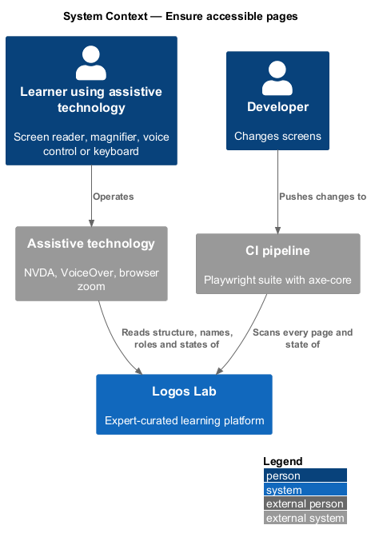
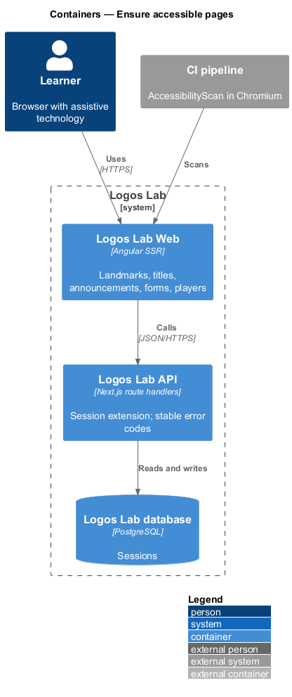
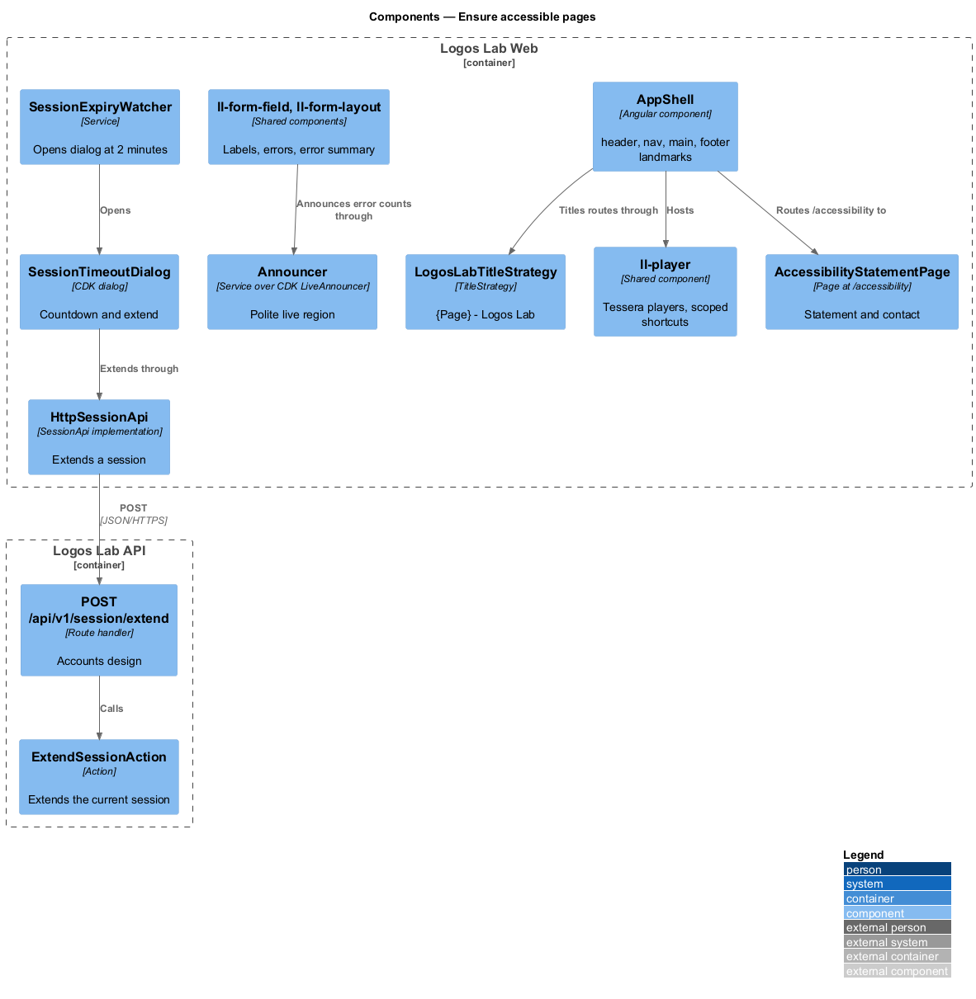
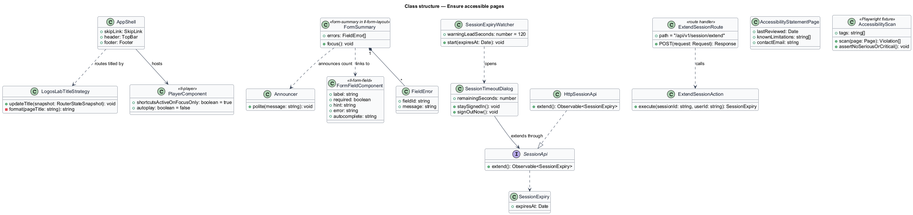
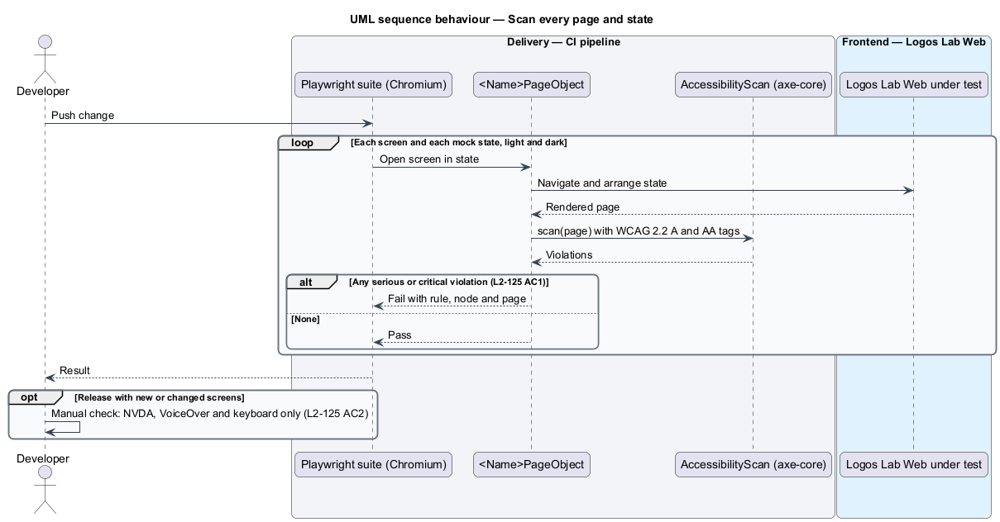
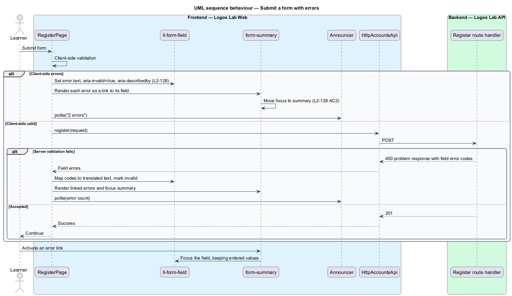
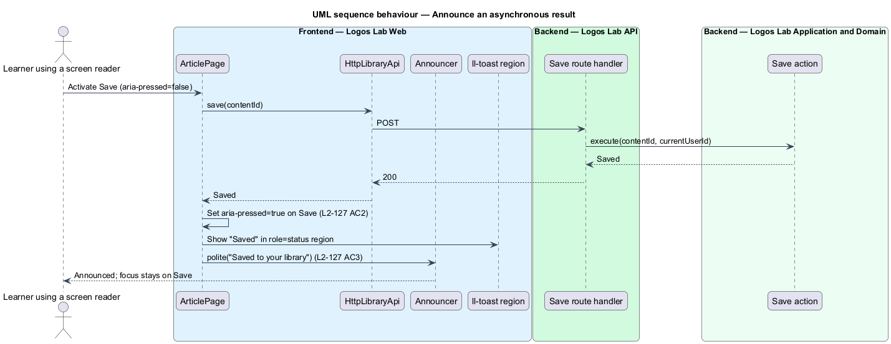
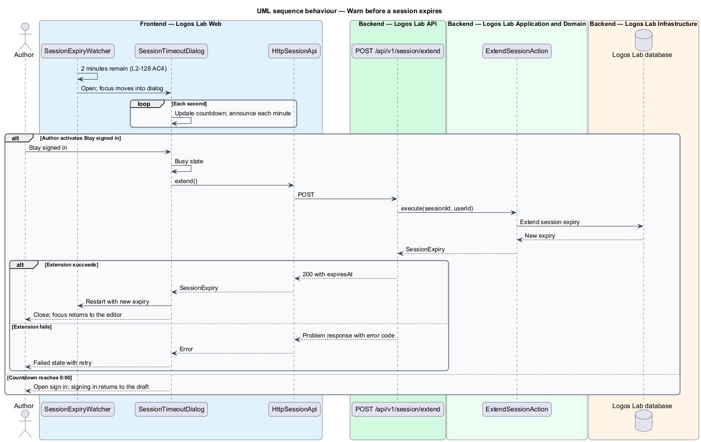

# Ensure accessible pages

## Overview

Logos Lab serves learners who use screen readers, magnification, voice control, captions or only a
keyboard. Level 1 requirement `L1-021` commits every page, dialog, player and notification to WCAG 2.2
Level AA. This feature is the slice that builds that conformance into every page and then proves it,
automatically on every change and manually before every release.

The feature belongs to the accessibility subsystem. Its sibling feature, support keyboard and focus,
covers keyboard operation and focus management. This feature covers the remaining 4 concerns:
conformance checking with a public statement, page semantics and announcements, accessible forms, and
accessible media, motion and zoom.

- **WCAG 2.2 AA** — Level AA of version 2.2 of the W3C Web Content Accessibility Guidelines
- **axe-core** — open-source rules engine that detects WCAG violations in a rendered page and rates
  each as minor, moderate, serious or critical
- **landmark** — page region exposed to assistive technology by role: `header`, `nav`, `main`, `footer`
- **accessible name** — text that assistive technology announces for a control
- **live region** — element whose changes a screen reader announces without moving focus; a polite one
  waits until the reader is idle
- **error summary** — box at the top of a submitted form that lists each error as a link to its field
- **reflow** — re-arrangement of content into 1 column when the viewport narrows or zoom rises, without
  horizontal scrolling
- **accessibility statement** — public page that states the conformance target, known limitations and
  a feedback contact

## Description

### Conformance checking and the statement (`L2-125`)

- **`AccessibilityScan`** — Playwright fixture built on `@axe-core/playwright`. Each page object in the
  end-to-end suite opens its screen in every state that the mocks define and runs the scan with the
  WCAG 2.0, 2.1 and 2.2 A and AA rule tags. The suite fails on any serious or critical violation
  (`L2-125` AC1). The scan runs in Chromium only, in both themes.
- **Manual release check** — release checklist step for new or changed screens: NVDA with Firefox or
  Chrome on Windows, VoiceOver with Safari on iOS, and keyboard only. Blocking findings are fixed before
  release (`L2-125` AC2). Where the findings are recorded is `<TO SUPPLY>`.
- **`AccessibilityStatementPage`** — anonymous, server-rendered page at `/accessibility`, linked from
  `ll-footer`. It shows the conformance target, how pages are checked, known limitations and the
  contact `help@logoslab.ca` (`L2-125` AC3). Mock: `docs/mocks/pages/accessibility-statement/`
  (state `default`). Whether the statement is static text in translation files or editor-managed
  content is `<TO SUPPLY>`.

### Semantics and announcements (`L2-127`)

- **`AppShell`** — root layout. It renders `ll-skip-link`, `ll-top-bar` inside `header`, the routed page
  inside `main`, and `ll-footer` inside `footer`. Each `nav` has a distinct `aria-label`: "Primary",
  "Site" (navigation drawer), "Footer" and page-local labels such as "Breadcrumb" (`L2-127` AC1).
- **Page heading rule** — each `<Name>Page` renders exactly 1 `h1`, usually through
  `ll-page-header`, and nests further headings without skipping levels.
- **`LogosLabTitleStrategy`** — Angular `TitleStrategy`. It sets `document.title` to
  "{Page} - Logos Lab" from each route's translated title and keeps titles unique per page
  (`L2-127` AC4). Detail pages use the item title, for example the course name.
- **Control naming** — `ll-button`, `ll-menu`, `ll-switch`, `ll-tabs` and `ll-accordion` take their
  accessible name from the visible label. Icon-only buttons take an `aria-label`. Toggles expose
  `aria-pressed`, `aria-expanded` or `aria-checked` (`L2-127` AC2).
- **`Announcer`** — Logos Lab Web service over the Angular CDK `LiveAnnouncer`. It writes to 1 polite
  live region for saved states, progress updates, search result counts, form error counts and new
  messages, and never moves focus (`L2-127` AC3).
- **`ll-toast`** — toast region (`.toast-region`, `role="status"`, `aria-live="polite"`) used for
  confirmations. Mocks: `docs/mocks/notifications/toast/` (states `success`, `info`, `warning`,
  `danger`, `with-action`, `stacked`).

### Forms and errors (`L2-128`)

- **`ll-form-field`** — wraps each control with a visible `<label for>`, hint and error text. Required
  fields say "Required" in text. The error text is linked by `aria-describedby`, and an invalid field
  sets `aria-invalid="true"` (`L2-128` AC1 and AC2).
- **Error summary** — the `form-summary` block of `ll-form-layout`. On a failed submit it lists each
  error as a link to its field, receives focus, and the `Announcer` reports the error count
  (`L2-128` AC2). Mocks: the `invalid` states, for example `docs/mocks/pages/register/invalid.html` and
  `docs/mocks/pages/studio-editor/invalid.html`.
- **`AutocompleteDefaults`** — rule set for personal-data fields: `name`, `email`,
  `current-password` and `new-password`. No field blocks paste (`L2-128` AC3).
- **`SessionTimeoutDialog`** — CDK dialog opened by `SessionExpiryWatcher` when 2 minutes of a timed
  session remain. It counts down each second, announces each minute, and offers "Stay signed in" and
  "Sign out now" (`L2-128` AC4). "Stay signed in" calls the session-extension endpoint of the accounts
  design, `POST /api/v1/session/extend`, through `SessionApi`, `SESSION_API` and `HttpSessionApi`.
  That endpoint calls `ExtendSessionAction`. Mocks: `docs/mocks/dialogs/session-timeout/` (states
  `default`, `busy`, `success`, `failed`).

### Media, motion and zoom (`L2-129`)

- **`ll-player`** — wrapper around the Tessera video-player and scorm-player. Every control is a named,
  focusable button or slider. Single-character shortcuts are active only while the player has focus
  (`L2-129` AC1). Mock: `docs/mocks/pages/module-player/` (states `default`, `loading`, `saving`,
  `offline`, `error`, `fullscreen`).
- **Reduced motion** — every transition is wrapped in `@media (prefers-reduced-motion: no-preference)`.
  Under `reduce`, the `--duration-*` tokens collapse to 0.01 ms and lifts become 0px. Nothing autoplays
  in any mode (`L2-129` AC2).
- **Reflow and text spacing** — layouts use relative units and the 1-column base layout. At 400% zoom
  on a 1280px window, content reflows with no horizontal scroll (`L2-129` AC3). Containers have no fixed
  heights on text, so the WCAG text-spacing overrides cause no clipping (`L2-129` AC4).
- **Contrast pairs** — `docs/design-system/tokens/contrast-pairs.json` declares each foreground and
  background role pair. The design-system contrast check verifies them in both themes: body text at
  least 4.5:1, large text at least 3:1, component boundaries and icons at least 3:1 (`L2-129` AC5).
- **`ZoomAndSpacingSuite`** — Playwright tests that set a 320 CSS px viewport (1280px at 400%) and
  inject the text-spacing style sheet, then assert no horizontal scroll and no clipped text.

## Requirements

| L2 ID | Refines (L1) | Requirement |
|-------|--------------|-------------|
| `L2-125` | `L1-021` | **WCAG 2.2 AA conformance.** The platform shall conform to WCAG 2.2 Level AA, and shall be checked automatically and manually. |
| `L2-127` | `L1-021` | **Semantics and announcements.** Pages shall expose correct structure, names, roles and states to assistive technology. |
| `L2-128` | `L1-021` | **Form accessibility and errors.** Forms shall be easy to complete and errors easy to recover from. |
| `L2-129` | `L1-021` | **Media, motion and zoom.** Media, animation and zoom shall be accessible. |

## Diagrams

### System context

Learners using assistive technology reach Logos Lab directly. The CI pipeline scans every page and
state before a change merges.

### Containers

Logos Lab Web carries almost all of the slice. Logos Lab API takes part only for the session extension
and for the stable error codes that forms show.

### Components

`AppShell`, `LogosLabTitleStrategy` and `Announcer` give every page its structure, title and
announcements. Forms, the session dialog and the player add their specific behaviour.

### Class structure

Shared components expose accessible names and states. `SessionExpiryWatcher` opens
`SessionTimeoutDialog`, which depends on the `SessionApi` contract.

### Behaviour — scan every page and state

The Playwright suite opens each screen in each mock state and runs axe-core in both themes. One serious
or critical violation fails the build.

### Behaviour — submit a form with errors

A failed submit renders the error summary, marks each field invalid, moves focus to the summary and
announces the count politely.

### Behaviour — announce an asynchronous result

A save completes in the background. The page announces it through the polite live region without
moving focus.

### Behaviour — warn before a session expires

With 2 minutes left, the dialog warns the person and lets them extend the session. A failed extension
keeps the dialog open with an error.

