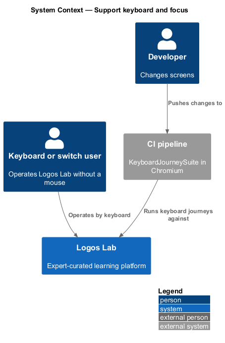
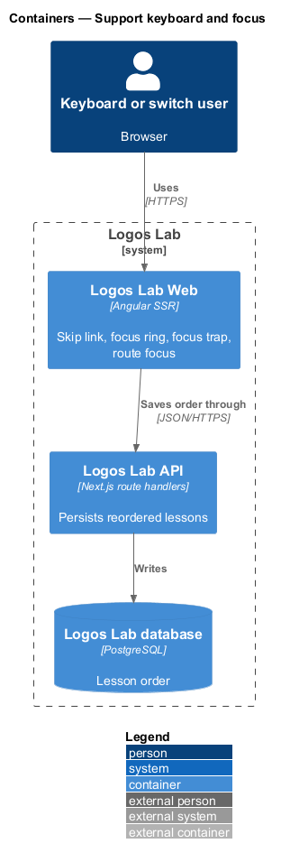
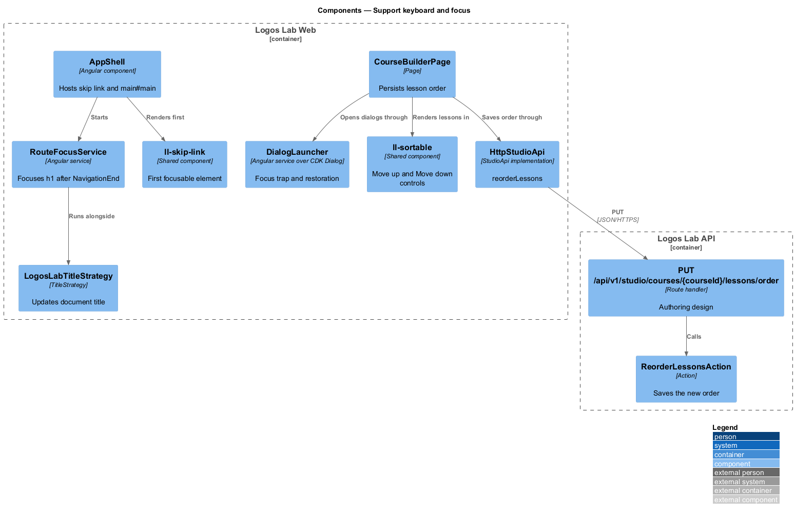
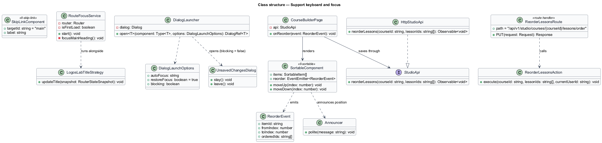
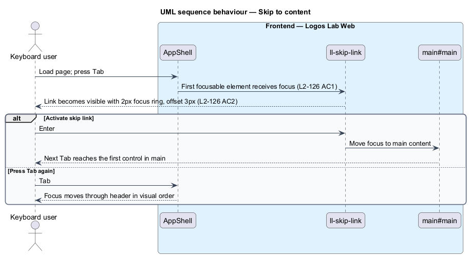
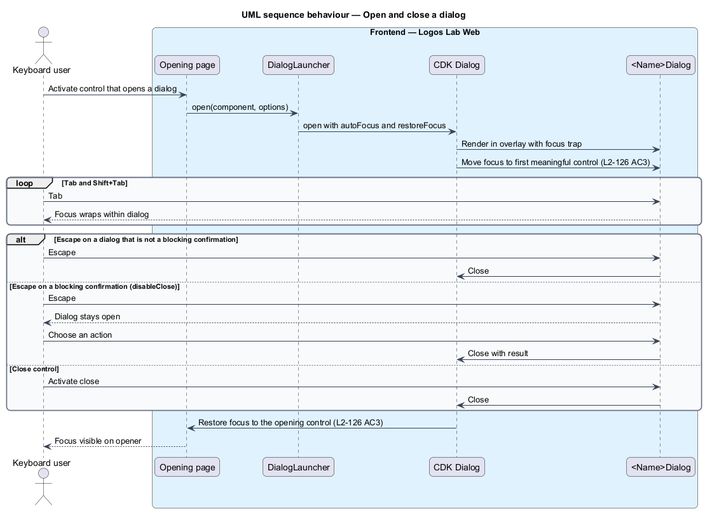
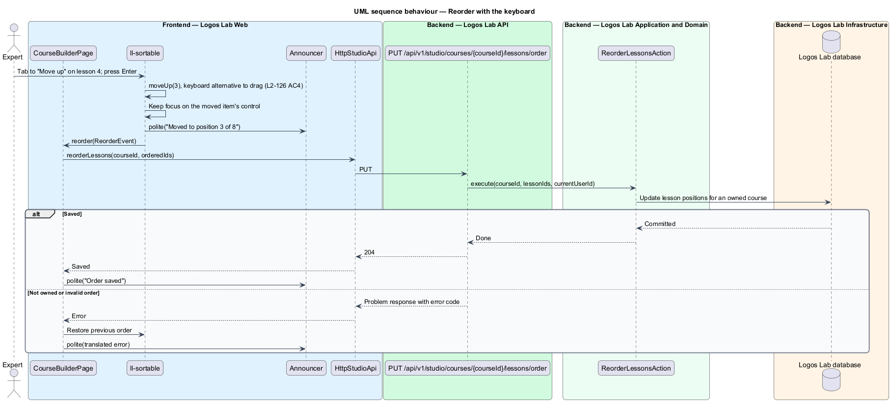
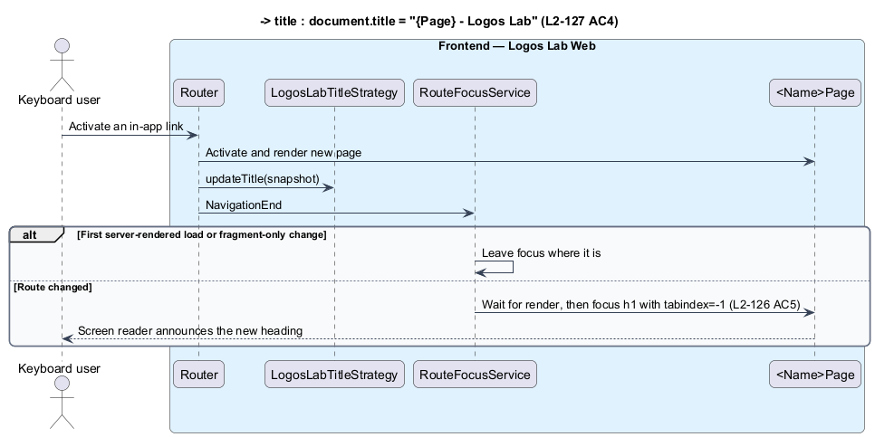

# Support keyboard and focus

## Overview

Many Logos Lab learners navigate with a keyboard, a switch device or voice control instead of a mouse.
For them, every action is reachable by keyboard, and the element with focus is visible at all times. This feature makes keyboard operation and focus management a property of every page, dialog and
interaction in Logos Lab Web.

The feature belongs to the accessibility subsystem, next to ensure accessible pages. It is almost
entirely a front-end slice. Logos Lab API takes part only where a keyboard alternative saves data, such
as reordering lessons.

- **focus indicator** — visible outline drawn around the element that has keyboard focus
- **skip link** — first focusable link on a page that moves focus past the header to the main content
- **focus trap** — rule that keeps Tab and Shift+Tab inside an open dialog
- **focus restoration** — return of focus to the control that opened a dialog when the dialog closes
- **blocking confirmation** — dialog that requires an explicit choice and does not close on Escape
- **route change** — single-page navigation from one page to another without a full page load

## Description

### Skip link and focus order

- **`ll-skip-link`** — first element in `AppShell`. It is hidden until focused and targets
  `main#main` (`L2-126` AC1). The mocks render it on every page with the text "Skip to content";
  `L2-126` AC1 gives the text as "Skip to main content". The final text is `<TO SUPPLY>`.
- **Focus order** — DOM order matches visual order. No positive `tabindex` is used. Layouts reorder
  with grid areas only where the reading order stays the same.

### Focus indicator

- **Focus ring tokens** — every interactive component draws `outline: var(--focus-ring-width) solid
  var(--color-focus-ring)` with `outline-offset: var(--focus-ring-offset)` on `:focus-visible`. The
  tokens are 2px and 3px, and `--color-focus-ring` meets 3:1 against adjacent colours in both themes
  (`L2-126` AC2). The contrast pair is verified by the design-system contrast check.
- **Not obscured** — the root sets `scroll-padding-top` to `--layout-topbar-height`. Sticky banners such
  as the consent banner and `ll-workflow-bar` reserve the same padding, so a focused element is never
  hidden under them (`L2-126` AC2).
- **Forced colours** — under `forced-colors: active`, the focus ring uses the system `Highlight`
  colour.

### Dialogs and overlays

- **Angular CDK `Dialog`** — the only modal primitive. Every `<Name>Dialog` opens through it with
  `autoFocus` on the first meaningful control and `restoreFocus: true`. The CDK focus trap keeps Tab
  inside the dialog. Escape closes the dialog unless it is opened with `disableClose: true` as a
  blocking confirmation (`L2-126` AC3).
- **`UnsavedChangesDialog`** — confirmation shown when leaving a page with unsaved edits. Focus starts on
  "Stay on this page", and Escape keeps the person on the page. Mock:
  `docs/mocks/dialogs/unsaved-changes/` (state `default`).
- **`ll-menu`, `ll-popover`, `ll-drawer`** — overlays built on the CDK overlay. Menus use arrow keys
  between items and return focus to their trigger on Escape.

### Drag-and-drop alternatives

- **`ll-sortable`** — reorderable list used by the course, module and collection builders. Each item has
  a drag handle (`.sortable__handle`) and "Move up" and "Move down" buttons (`.sortable__actions`) that
  work with a single pointer or a keyboard (`L2-126` AC4). After a move, focus stays on the moved item's
  control, and the `Announcer` reports the new position, for example "Moved to position 3 of 8".
- **Persisting an order** — the builder page calls the authoring contract, for example
  `StudioApi.reorderLessons(courseId, lessonIds)`. That method sends
  `PUT /api/v1/studio/courses/{courseId}/lessons/order` to `ReorderLessonsAction`, which belongs to the
  authoring design. The same request serves drag, button and keyboard moves.

### Route changes

- **`RouteFocusService`** — listens for `NavigationEnd` from the Angular router. After the new page
  renders, it moves focus to the page's `h1`, which carries `tabindex="-1"` (`L2-126` AC5). It skips the
  move on the first server-rendered load and when navigation only changes a fragment.
- **`LogosLabTitleStrategy`** — updates `document.title` to "{Page} - Logos Lab" on the same navigation
  (shared with ensure accessible pages).

### Verification

- **`KeyboardJourneySuite`** — Playwright tests, through page objects, that tab from the top of
  representative pages, open and close dialogs, reorder lessons with the keyboard and navigate between
  routes. They assert the skip link comes first, focus is visible and unobscured, focus is trapped and
  restored, and the `h1` receives focus after a route change.

## Requirements

| L2 ID | Refines (L1) | Requirement |
|-------|--------------|-------------|
| `L2-126` | `L1-021` | **Keyboard operation and focus.** Everything shall work with a keyboard, and focus shall always be visible and managed. |

## Diagrams

### System context

Keyboard and switch users operate Logos Lab directly. The CI pipeline runs the keyboard journeys on
every change.

### Containers

Logos Lab Web manages focus. Logos Lab API persists only the orders that keyboard reordering produces.

### Components

`AppShell` hosts the skip link and `RouteFocusService`. Dialogs rely on the CDK `Dialog`, and
`ll-sortable` sends its order through the authoring API.

### Class structure

`RouteFocusService` depends on the router and the page heading. `DialogLauncher` wraps the CDK `Dialog`
options, and `SortableComponent` emits `ReorderEvent` values that a builder page persists.

### Behaviour — skip to content

From the top of a page, the first Tab reaches the skip link. Activating it moves focus into `main`.

### Behaviour — open and close a dialog

Focus moves into the dialog and stays there. Escape or a close control returns focus to the opener,
except for a blocking confirmation.

### Behaviour — reorder with the keyboard

"Move up" and "Move down" reorder a lesson without dragging. The page announces the new position and
persists the order.

### Behaviour — change route

After single-page navigation, the title updates and focus moves to the new page's main heading.

