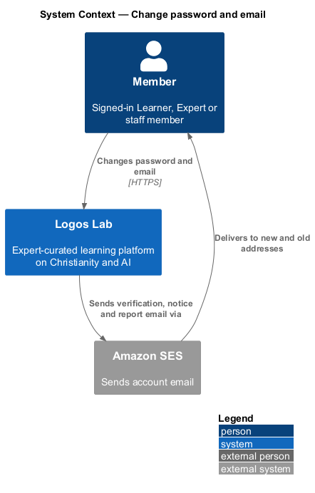
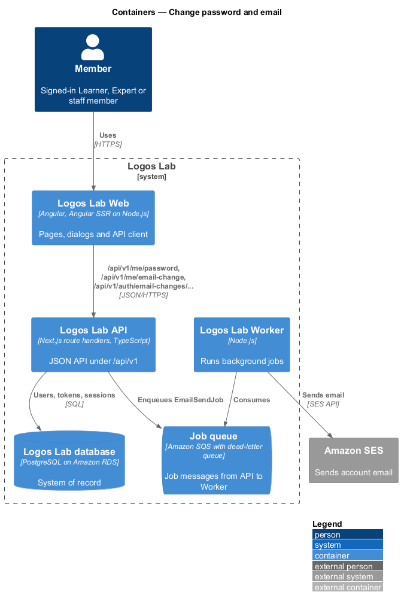
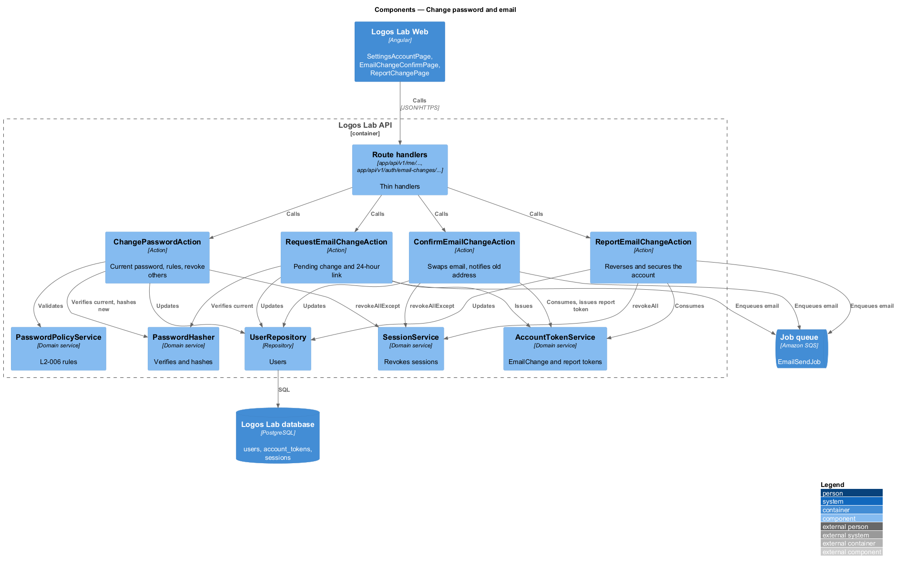
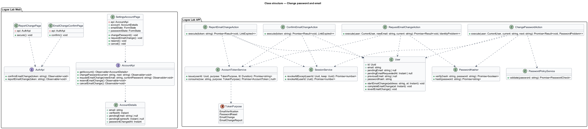
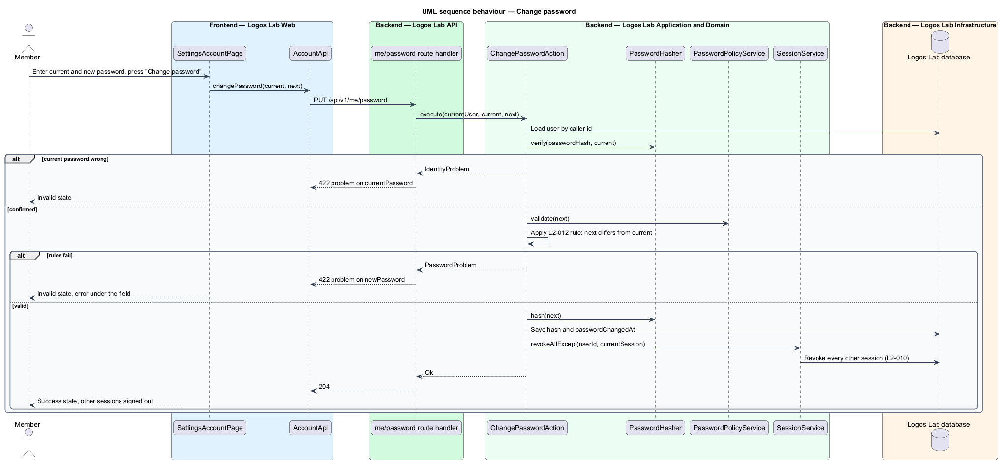
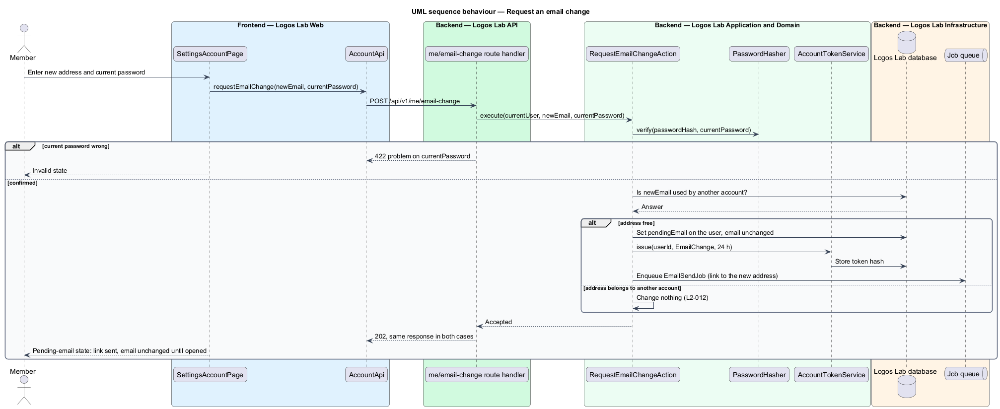
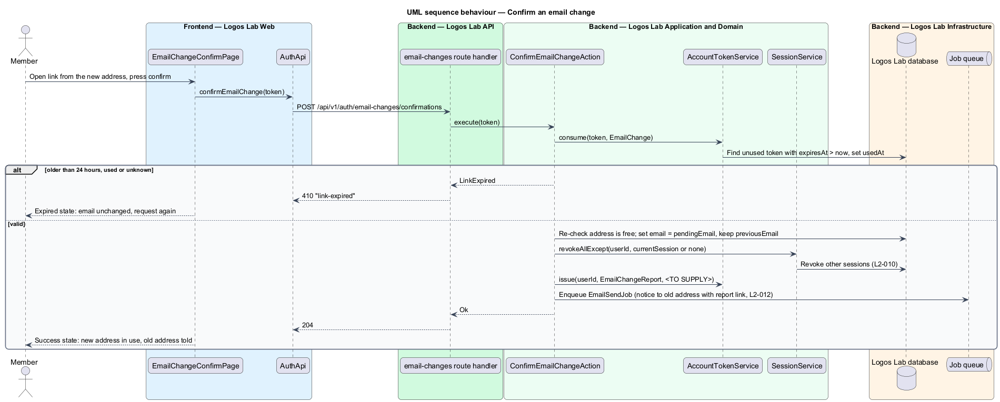
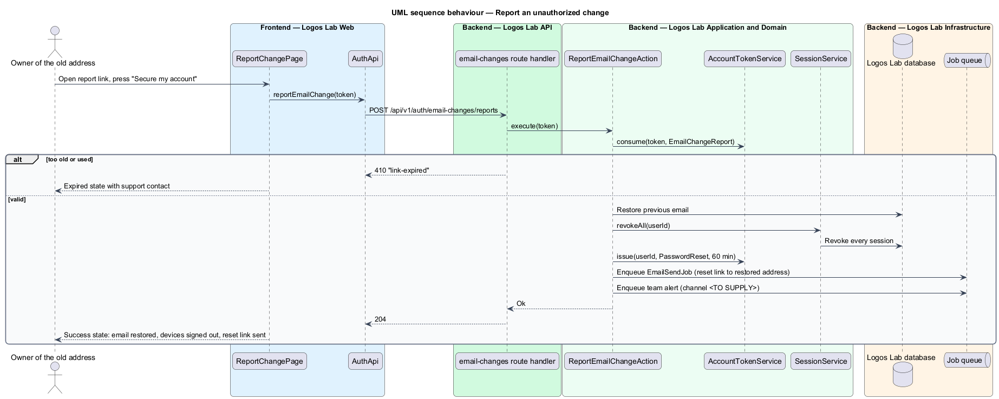

# Change password and email

## Overview

A signed-in member may change the password or the email address of their account. Both changes are guarded by the current password, which confirms that the person at the keyboard is the owner. An email change also proves control of the new address before it takes effect, and it warns the old address.

**pending email change** — requested new address that has not yet been confirmed through the link sent to it

**change report link** — link in the notice sent to the old address that lets the owner report an email change they did not make

The feature sits in the account settings area of the accounts subsystem. It reuses the password rules of `L2-006`, the token store of `accounts/verify-email`, and the session revocation of `accounts/manage-sessions` (`L2-010`): a successful change ends every other session.

## Description

**Screens (Logos Lab Web)**

- **`SettingsAccountPage`** — routed page at `/settings/account` ("Email and password"), in the settings layout. It holds two `ll-panel` form cards: the email card (current address with `ll-badge` "Verified", new address, current password) and the password card (current password, new password with the rules). The mocks in `docs/mocks/pages/settings-account/` cover `default`, `loading`, `error`, `invalid`, `submitting`, `success`, `pending-email` and `bounced`. The `pending-email` state offers "Send the link again" and "Cancel the change". The `bounced` state belongs to `L2-092`.
- **`EmailChangeConfirmPage`** — routed page at `/account/confirm-email?token=…`. One button confirms the change. Mocks in `docs/mocks/pages/email-change-confirm/`: `default`, `loading`, `success`, `expired`, `error`.
- **`ReportChangePage`** — routed page at `/account/report-change?token=…` ("Secure your account"). Mocks in `docs/mocks/pages/report-change/`: `default`, `submitting`, `success`, `expired`, `error`.

**API contract (shared API library)**

- **`AccountApi`** (token `ACCOUNT_API`, implementation `HttpAccountApi`) — `getAccount()`, `changePassword(current, next)`, `requestEmailChange(newEmail, currentPassword)`, `resendEmailChange()`, `cancelEmailChange()`.
- **`AuthApi`** (token `AUTH_API`) — `confirmEmailChange(token)`, `reportEmailChange(token)`. These work signed out, because the links may open on any device.

**Endpoints (Logos Lab API)**

- **`GET /api/v1/me/account`** — email, verification date, pending change and password change date.
- **`PUT /api/v1/me/password`** — body `{ currentPassword, newPassword }`.
- **`POST /api/v1/me/email-change`** — body `{ newEmail, currentPassword }`. Answers `202` whether or not the address is free.
- **`POST /api/v1/me/email-change/resend`** and **`DELETE /api/v1/me/email-change`** — resend or cancel the pending change.
- **`POST /api/v1/auth/email-changes/confirmations`** — anonymous, body `{ token }`.
- **`POST /api/v1/auth/email-changes/reports`** — anonymous, body `{ token }`.

**Application and domain (Logos Lab API)**

- **`ChangePasswordAction`** — verifies the current password, applies `PasswordPolicyService` (`L2-006` rules) and refuses a new password equal to the current one. It saves the hash and calls `SessionService.revokeAllExcept` for the current session.
- **`RequestEmailChangeAction`** — verifies the current password. For a free address it stores the pending address on the user and issues an `EmailChange` token valid for 24 hours, sent to the new address. For an address that belongs to another account, it returns the same response and changes nothing. Whether the other account's owner is told is `<TO SUPPLY>`.
- **`ConfirmEmailChangeAction`** — consumes the token within 24 hours, checks again that the address is free, swaps the email, revokes every other session, and sends the old address a notice with a change report link.
- **`ReportEmailChangeAction`** — from the mock: restores the previous email, signs out every device, sends a password reset link and alerts the Logos Lab team. The validity period of the report link and the team alert channel are `<TO SUPPLY>`.
- **`AccountTokenService`** — tokens of purposes `EmailChange` and `EmailChangeReport` in table `account_tokens`.
- **`User`** — gains `pendingEmail`, `pendingEmailRequestedAt` and `previousEmail` for the duration of the change.
- **`SecurityEventLogger`** — logs password and email changes (`L2-111`).

**Rules from the acceptance criteria**

- A password change requires the current password; the new password meets `L2-006` rules and differs from the current one.
- An email change sends a verification link to the new address. The email does not change until the link is opened within 24 hours.
- On confirmation, a notice goes to the old address with a link to report that the change was not authorized.
- An address that already belongs to another account gets the same UI response as a free address, and no change occurs.
- A successful password or email change invalidates every other session (`L2-010`).

## Requirements

The feature realizes the following level-2 (L2) requirement.

| L2 ID | Refines (L1) | Requirement |
|-------|--------------|-------------|
| `L2-012` | `L1-002` | **Change password and email.** Members shall be able to change their password and email address after confirming their identity. |

## Diagrams

### System context

The member changes credentials in Logos Lab. Logos Lab emails the new address, the old address and, on a report, the Logos Lab team.

### Containers

Logos Lab Web calls the Logos Lab API. The API writes the database and enqueues the emails for the Worker.

### Components

Four actions share the password hasher, the token service and the session service.

### Class structure

The settings page depends on `AccountApi`; the two link pages depend on `AuthApi`. The actions change `User` and consume `AccountToken` rows.

### Behaviour — change password

The current password confirms identity. Success ends every other session.

### Behaviour — request an email change

The response is the same whether or not the new address is free (`L2-012`).

### Behaviour — confirm an email change

The link from the new address completes the change, ends other sessions and notifies the old address.

### Behaviour — report an unauthorized change

The link in the notice to the old address reverses the change and secures the account.

