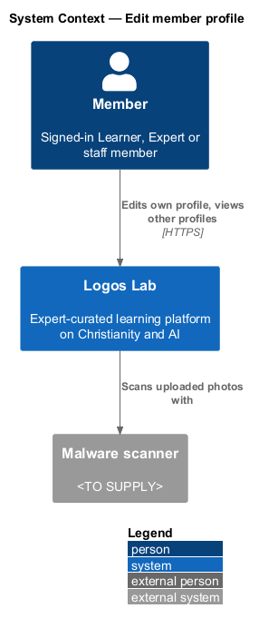
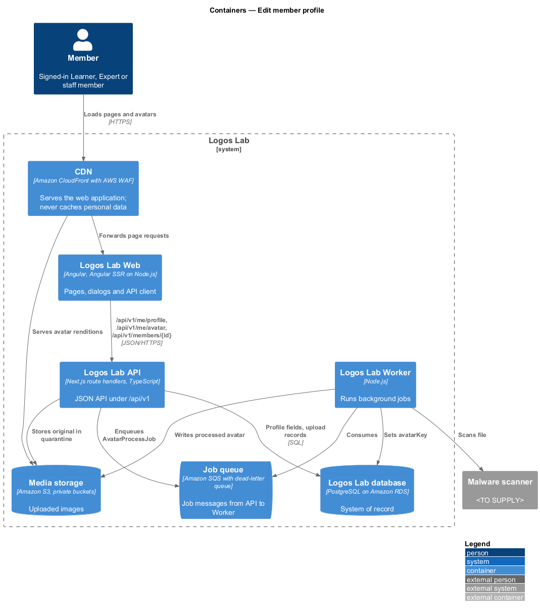
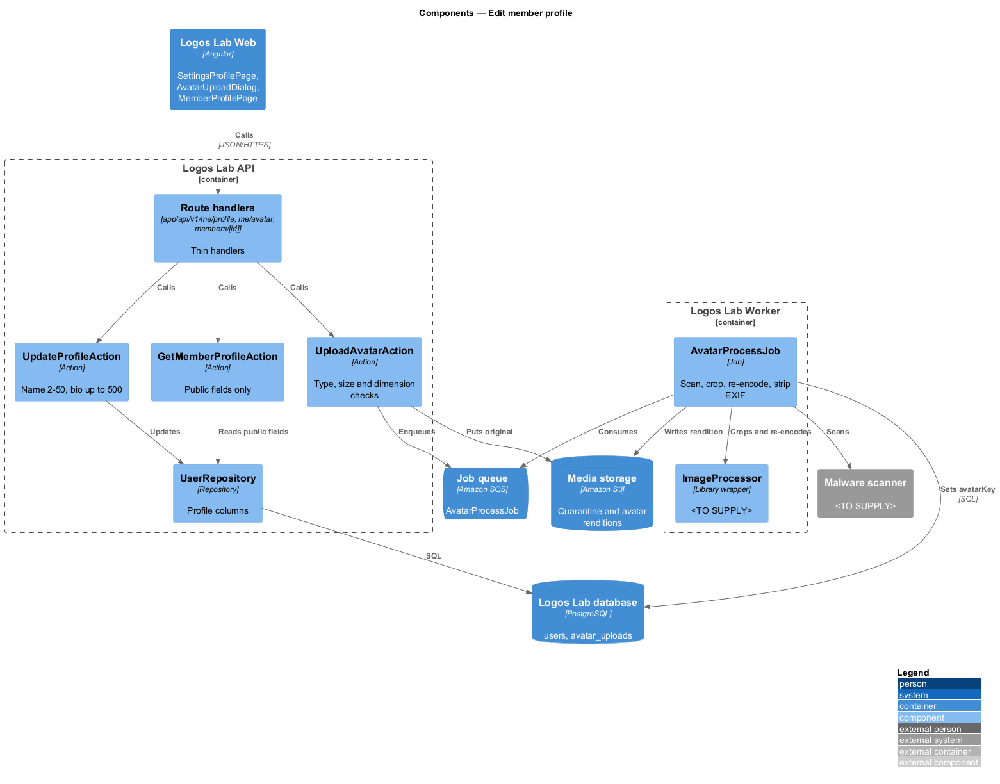
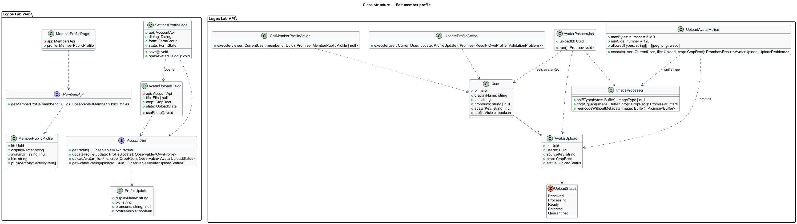
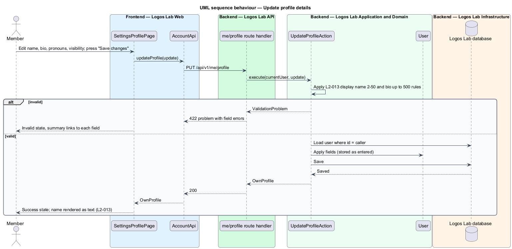
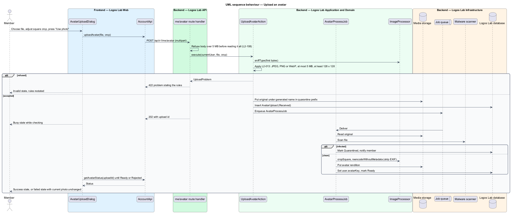
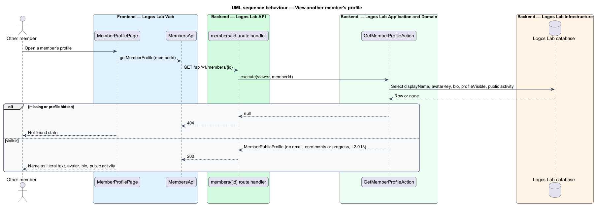

# Edit member profile

## Overview

Every member has a profile: the face they show to other members beside comments, cohort posts and certificates. This feature lets a member manage that profile and controls what other members see of it.

**member profile** — public face of a member account: display name, avatar, bio and public community activity

**avatar** — square photo shown beside the member's name

**profile visibility** — member setting that decides whether other members may open the member's profile page

**EXIF metadata** — data embedded in an image file, such as camera details and location

The profile is deliberately narrow. Email address, enrolments and progress are never part of it. Display names come from members, so the platform treats them as untrusted text everywhere they appear. The feature belongs to the accounts subsystem; expert profiles have their own feature in the experts subsystem (`L2-021`, `L2-023`).

## Description

**Screens (Logos Lab Web)**

- **`SettingsProfilePage`** — routed page at `/settings/profile`, in the settings layout (`ll-sidebar-navigation`, `ll-page-header`). An `ll-panel` form card holds the photo with "Change photo", display name (`ll-text-field`), bio (`ll-textarea` with a 500-character counter), optional pronouns, and the visibility `ll-checkbox` "Show my profile page to other members". The mocks in `docs/mocks/pages/settings-profile/` cover `default`, `loading`, `error`, `invalid`, `submitting`, `success` and `long`.
- **`AvatarUploadDialog`** — CDK dialog built on `ll-dialog` and `ll-file-upload` (drop zone), with a square crop preview and zoom `ll-slider`. "Change photo" opens it. The mocks in `docs/mocks/dialogs/avatar-upload/` cover `default`, `busy`, `invalid`, `crop`, `failed` and `success`.
- **`MemberProfilePage`** — the public member profile that other members open. Its route is `/members/{id}`; it renders the fields of `MemberPublicProfile` only.
- Display names are bound with Angular text interpolation everywhere, never with `innerHTML`. A name that contains HTML or script renders as literal text.

**Settings profile flow**

- `/settings` opens `/settings/profile`. Every settings page is a member page (`memberGuard`) inside `ll-settings-layout` with the "Settings" navigation: Profile, Email and password, Security, Sessions, Notifications, Privacy and messaging, Your data, Blocked members.
- While `GET /api/v1/me/profile` loads, the form card holds skeletons and the status "Loading your profile…". If it fails, the danger alert "We couldn't load your profile" offers "Try again".
- `MemberProfile` is `displayName`, `bio`, `pronouns`, `avatarUrl` and `profileVisible`. The bio shows its count as "136 / 500".
- "Save changes" checks first. A display name outside 2 to 50 characters reads "Enter a display name of 2 to 50 characters. This one has {n}." A bio over 500 reads "Shorten your bio to 500 characters. It has {n} now." The summary reads "One thing to fix before you can save", or "{Two} things to fix before you can save".
- Saving shows "Saving…". A `200` returns the saved profile, updates the member's name in the header, and shows the success status "Profile saved. Members see the change straight away." beside the actions. A `422` maps `displayName` and `bio` errors onto the fields. Any other failure shows the danger alert "We couldn't save your profile" ("Your changes are still here. Try again in a minute; if it keeps happening, write to help@logoslab.ca.") above the form, keeping what was typed.
- "View your profile" links to the member's own public profile at `/members/{id}`.

**API contract (shared API library)**

- **`AccountApi`** (token `ACCOUNT_API`, implementation `HttpAccountApi`) — `getProfile()`, `updateProfile(update: ProfileUpdate)`, `uploadAvatar(file, crop)`, `getAvatarStatus(uploadId)`.
- **`MembersApi`** (token `MEMBERS_API`, implementation `HttpMembersApi`) — `getMemberProfile(memberId)`.

**Endpoints (Logos Lab API)**

- **`GET /api/v1/me/profile`** and **`PUT /api/v1/me/profile`** — the caller's own profile.
- **`POST /api/v1/me/avatar`** — multipart upload with the crop rectangle. The handler refuses a body over 5 MB before reading all of it (`L2-108`). It answers `202` with an upload id.
- **`GET /api/v1/me/avatar/uploads/{id}`** — processing status, scoped to the caller.
- **`GET /api/v1/members/{id}`** — another member's public profile. It answers `404` when the profile is hidden.

**Application and domain (Logos Lab API)**

- **`UpdateProfileAction`** — validates display name (2 to 50 characters) and bio (up to 500 characters). It stores text as entered; escaping happens at render time. The pronouns length limit is `<TO SUPPLY>`.
- **`UploadAvatarAction`** — determines the type from the file's magic bytes, not the extension or declared type (`L2-108`). It accepts JPEG, PNG or WebP of 5 MB or smaller and at least 128 by 128 pixels. It stores the original under a generated name in a private quarantine prefix of media storage and enqueues `AvatarProcessJob`.
- **`AvatarProcessJob`** — Worker job. It scans the file with the malware scanner, crops it to a square, re-encodes it and strips EXIF metadata. It then writes the rendition to media storage and sets `avatarKey` on the user. An infected file is quarantined and the member is notified (`L2-108`).
- **`ImageProcessor`** — crop, re-encode and metadata stripping. Library is `<TO SUPPLY>`.
- **`GetMemberProfileAction`** — returns `MemberPublicProfile`: display name, avatar URL, bio and public community activity. Email, enrolments and progress are never included.
- **`User`** — profile columns on table `users`: `displayName`, `bio`, `pronouns`, `avatarKey`, `profileVisible`.
- **`AvatarUpload`** — row in table `avatar_uploads`: `id`, `userId`, `sourceKey`, `crop`, `status`, `createdAt`.

**Rules from the acceptance criteria**

- Profile settings let the member edit display name (2 to 50 characters), bio (up to 500 characters) and avatar.
- An avatar that is JPEG, PNG or WebP, 5 MB or smaller and at least 128 by 128 pixels is accepted, cropped to a square, re-encoded and stripped of EXIF metadata. Any other file is refused with a message stating the rules.
- Another member sees only display name, avatar, bio and public community activity. Email address, enrolments and progress are never shown.
- A display name containing HTML or script renders as literal text wherever it is displayed.

## Requirements

The feature realizes the following level-2 (L2) requirement.

| L2 ID | Refines (L1) | Requirement |
|-------|--------------|-------------|
| `L2-013` | `L1-002` | **Member profile.** Members shall be able to manage their display name, avatar, short bio and visibility. |

## Diagrams

### System context

A member edits the profile and another member views it. Logos Lab scans uploaded photos with the malware scanner.

### Containers

The API writes profile fields to the database and the original photo to media storage. The Worker processes the photo and the CDN serves the rendition.

### Components

Three actions serve the profile endpoints. `AvatarProcessJob` in the Worker turns an accepted upload into the stored avatar.

### Class structure

The settings page and dialog depend on `AccountApi`; the public page depends on `MembersApi`. `MemberPublicProfile` carries only the public fields of `User`.

### Behaviour — update profile details

Validation enforces the display name and bio lengths. Text is stored as entered and escaped at render time.

### Behaviour — upload an avatar

The action checks type, size and dimensions, then the Worker scans, crops, re-encodes and strips metadata.

### Behaviour — view another member's profile

The public endpoint returns only the public fields, and nothing for a hidden profile.

