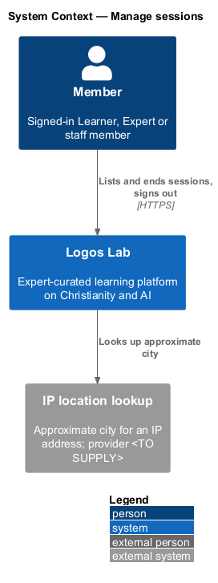
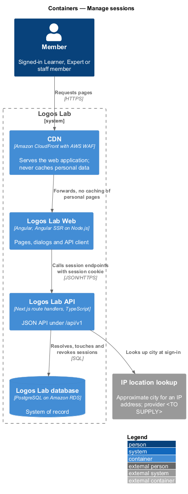
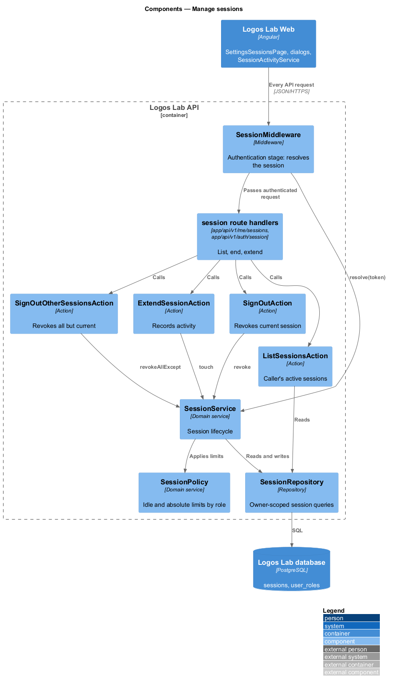
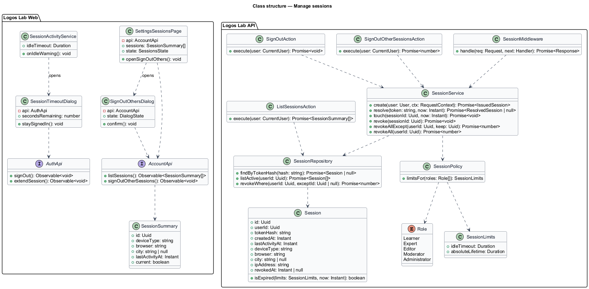
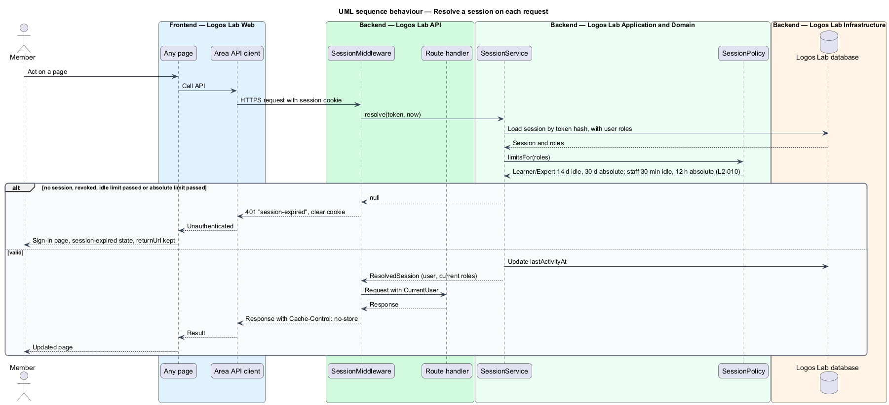
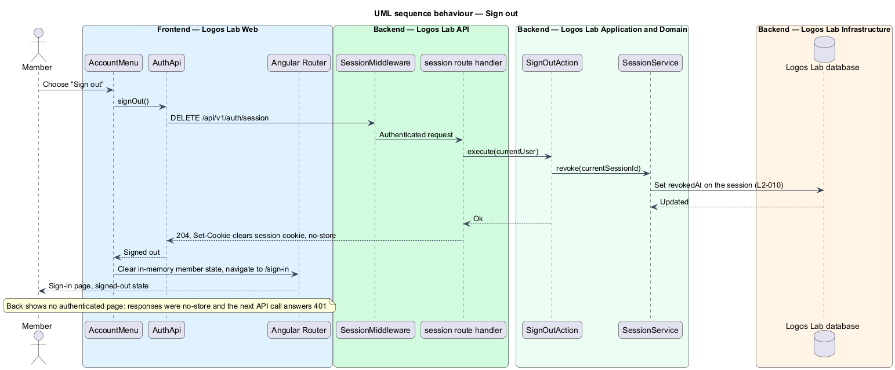
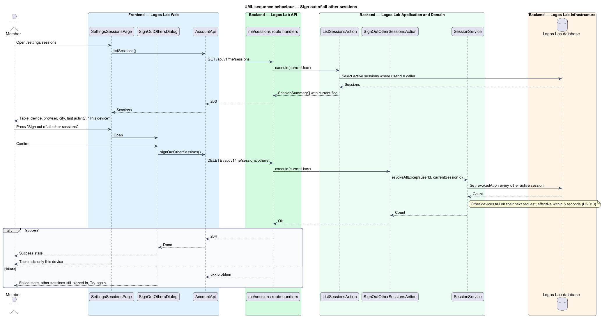

# Manage sessions

## Overview

A member who signs in (`accounts/sign-in`, `L2-008`) receives a session. This feature governs the session for the rest of its life: how each request resolves it, when it expires, how the member signs out, and how the member sees and ends sessions on other devices.

**session** — server-side record of one signed-in device, referenced by an opaque random token held in an HTTP-only cookie

**idle timeout** — longest interval without activity after which a session expires

**absolute lifetime** — longest interval after sign-in after which a session expires regardless of activity

**staff role** — the Editor, Moderator or Administrator role

Sessions are the base that every authenticated request in Logos Lab stands on. Other features end sessions through this one: a password or email change (`L2-012`), a password reset (`L2-011`) and a suspension or ban (`L2-019`).

## Description

**Screens (Logos Lab Web)**

- **`SettingsSessionsPage`** — routed page at `/settings/sessions`, in the settings layout (`ll-sidebar-navigation`, `ll-page-header`). An `ll-table` lists every active session with device type, browser, approximate location (city) and last activity, and marks "This device" with `ll-badge`. The mocks in `docs/mocks/pages/settings-sessions/` cover `default`, `single`, `loading`, `error`, `success` and `long`.
- **`SignOutOthersDialog`** — CDK dialog built on `ll-dialog` that confirms "Sign out of all other sessions". Mocks in `docs/mocks/dialogs/sign-out-others/`: `default`, `busy`, `failed`, `success`.
- **`SessionTimeoutDialog`** — CDK dialog that warns a staff member before the idle timeout and offers "Stay signed in". The mock in `docs/mocks/dialogs/session-timeout/` opens after 28 minutes idle and counts down from 2:00; states `default`, `busy`, `success`, `failed`.
- **`AccountMenu`** — `ll-menu` under the avatar with "Sign out" (`docs/mocks/dialogs/account-menu/`).
- **`SignInPage`** states `session-expired` and `signed-out` (`docs/mocks/pages/sign-in/`) explain why the member is at sign-in.
- **`SessionActivityService`** — web service that tracks idle time and opens `SessionTimeoutDialog` 2 minutes before a staff session's idle timeout.

**API contract (shared API library)**

- **`AccountApi`** (token `ACCOUNT_API`, implementation `HttpAccountApi`) — `listSessions(): Observable<SessionSummary[]>`, `signOutOtherSessions(): Observable<void>`.
- **`AuthApi`** (token `AUTH_API`) — `signOut(): Observable<void>`, `extendSession(): Observable<void>`.
- **`SessionSummary`** — `id`, `deviceType`, `browser`, `city`, `lastActivityAt`, `current`.

**Endpoints (Logos Lab API)**

- **`GET /api/v1/me/sessions`** — the caller's active sessions only (`L2-017`).
- **`DELETE /api/v1/me/sessions/others`** — ends every session except the current one.
- **`DELETE /api/v1/auth/session`** — signs out: ends the current session and clears the cookie.
- **`POST /api/v1/auth/session/extend`** — records activity on the current session.
- Every authenticated response carries `Cache-Control: no-store`, so the browser's Back button does not show authenticated pages from cache after sign-out. The CDN never caches them (`L2-113`).

**Application and domain (Logos Lab API)**

- **`SessionMiddleware`** — the authentication stage of the middleware pipeline. It hashes the cookie token, loads the `Session`, applies `SessionPolicy`, updates `lastActivityAt`, and attaches the current user and roles to the request context. An expired or revoked session answers `401` with problem type `session-expired` and clears the cookie.
- **`SessionPolicy`** — timeouts by role:

  | Roles held | Idle timeout | Absolute lifetime |
  |---|---|---|
  | Learner or Expert only | 14 days | 30 days |
  | Any staff role | 30 minutes | 12 hours |

- **`SessionService`** — `create`, `resolve`, `touch`, `revoke`, `revokeAllExcept` and `revokeAll`. Revocation sets `revokedAt` in the database; because each request resolves the session from the database, a revoked session fails on its next request. Ending other sessions completes within 5 seconds.
- **`SignOutAction`**, **`SignOutOtherSessionsAction`**, **`ListSessionsAction`**, **`ExtendSessionAction`** — one use case each.
- **`DeviceDescriber`** — derives device type and browser from the user agent at sign-in.
- **`IpLocationLookup`** — derives the approximate city from the IP address. Provider is `<TO SUPPLY>`.
- **`Session`** — entity in table `sessions`: `id` (UUID), `userId`, `tokenHash`, `createdAt`, `lastActivityAt`, `deviceType`, `browser`, `city`, `ipAddress`, `revokedAt`.
- **`SessionRepository`** — queries always filter by `userId`.
- Expired and revoked rows are removed by a retention job; its schedule and retention period are `<TO SUPPLY>`.

**Rules from the acceptance criteria**

- Learner or Expert: expiry after 14 days with no activity, or 30 days after sign-in. The next request requires signing in again.
- Editor, Moderator or Administrator: expiry after 30 minutes with no activity, or 12 hours after sign-in.
- "Sign out" invalidates the session on the server and clears the cookie; Back does not reveal authenticated pages.
- Account > Sessions lists every active session and marks the current one.
- "Sign out of all other sessions" invalidates every other session within 5 seconds.
- A successful password or email change invalidates every other session.

## Requirements

The feature realizes the following level-2 (L2) requirement.

| L2 ID | Refines (L1) | Requirement |
|-------|--------------|-------------|
| `L2-010` | `L1-002` | **Sessions and sign out.** Sessions shall be secure, shall expire, and shall be revocable by the member. |

## Diagrams

### System context

A member manages sessions in Logos Lab. Logos Lab uses an IP location lookup to name the approximate city of each session.

### Containers

Logos Lab Web calls the session endpoints. The Logos Lab API resolves and revokes sessions in the database.

### Components

`SessionMiddleware` resolves each request through `SessionService` and `SessionPolicy`. The sign-out, list and extend actions use the same service.

### Class structure

`Session` belongs to a `User`. `SessionPolicy` derives the timeouts from the user's roles, and the settings page and dialogs depend on the `AccountApi` and `AuthApi` contracts.

### Behaviour — resolve a session on each request

Every authenticated request resolves the session and applies the idle and absolute limits for the member's roles (`L2-010`).

### Behaviour — sign out

Signing out revokes the session on the server, clears the cookie, and shows the `signed-out` state of the sign-in page.

### Behaviour — sign out of all other sessions

The member reviews the list, confirms in the dialog, and every other session is revoked.

