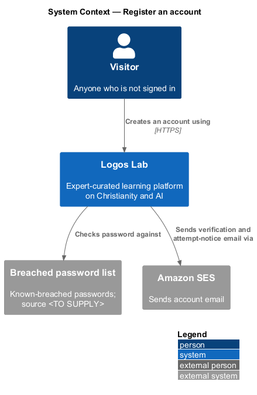
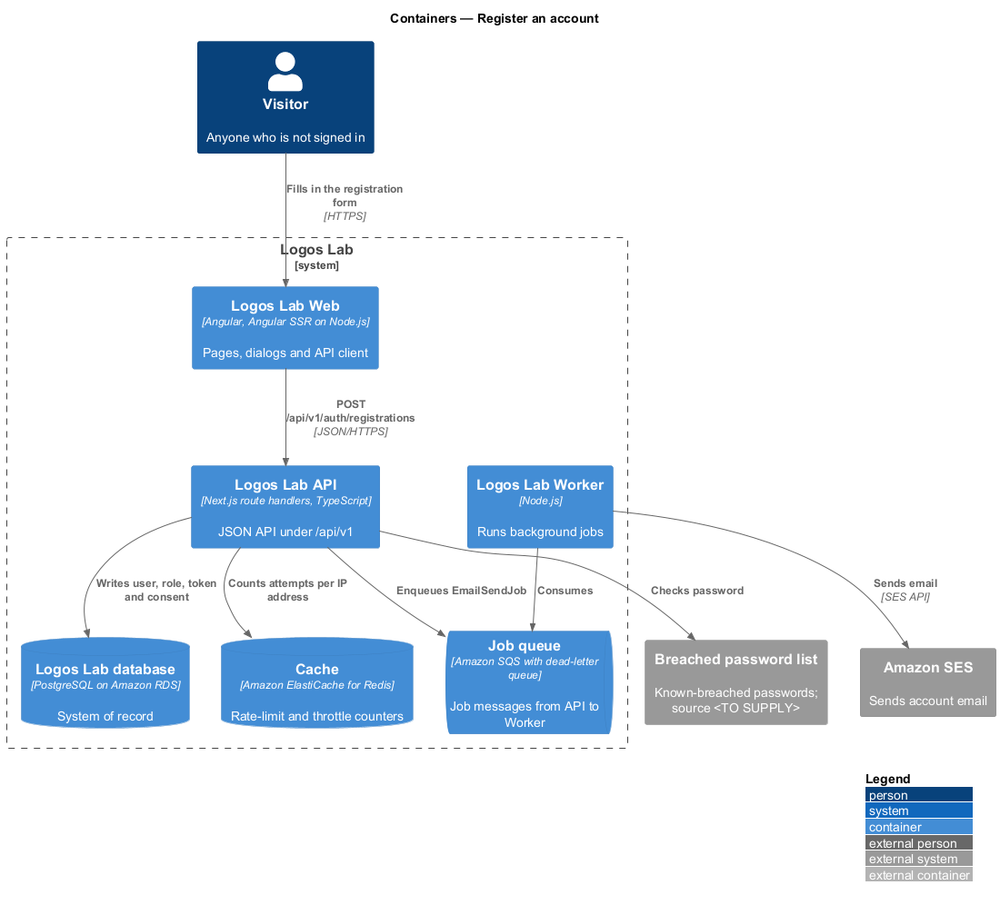
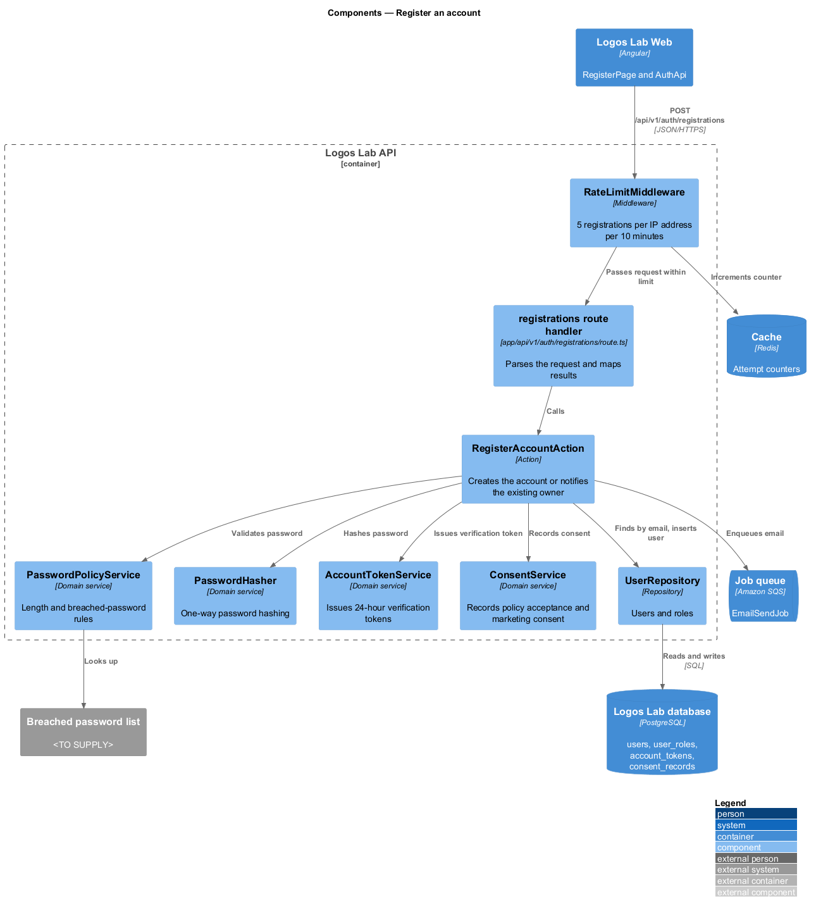
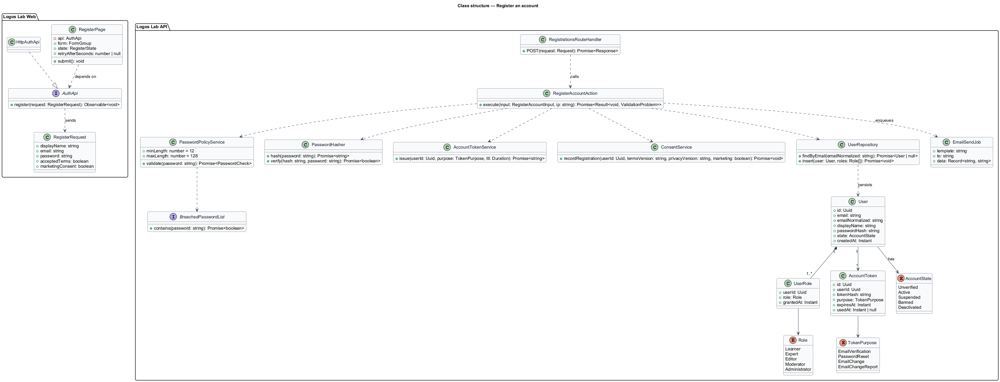
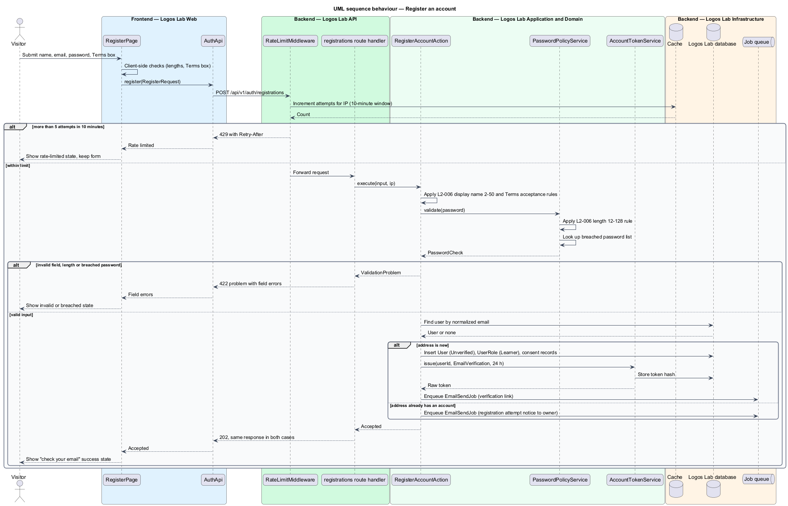

# Register an account

## Overview

Logos Lab is an expert-curated learning platform on Christianity and artificial intelligence. Anyone may browse it, but learning activity, comments and event registration belong to members. This feature is the front door of the accounts subsystem: it lets a visitor create an account.

**visitor** — person who uses Logos Lab without being signed in

**member** — person with a Logos Lab account; every member holds the Learner role

**account state** — lifecycle status of an account that decides what it may do (`L2-019`); a new account starts as Unverified

**breached password** — password that appears in a published list of credentials exposed in past data breaches

A visitor gives a display name, an email address and a password, and accepts the Terms of Use and the Privacy Policy. The platform creates an Unverified account with the Learner role and sends a verification email. The account becomes Active only when its owner opens that email (feature `accounts/verify-email`, `L2-007`). Registration never reveals whether an email address already has an account.

## Description

The slice runs from the registration page to the database and the email provider.

**Screens (Logos Lab Web)**

- **`RegisterPage`** — routed page at `/register`, server-rendered. It uses `ll-auth-card`, `ll-form-field`, `ll-text-field` with a show-password toggle, `ll-checkbox`, `ll-button` and `ll-alert`, and keeps the BEM blocks of the mock (`auth`, `form`, `field`, `input-group`, `check`). The mocks in `docs/mocks/pages/register/` cover the states `default`, `submitting`, `invalid`, `breached`, `rate-limited`, `success` and `error`.
- The form shows the rules up front: display name 2 to 50 characters, password 12 to 128 characters. The "Email me Platform news" box renders unchecked and is optional.
- The `success` state asks the visitor to check their email. It looks the same whether or not the address already had an account.
- The `rate-limited` state reads the wait time from the `Retry-After` header and keeps the form as typed.

**API contract (shared API library)**

- **`AuthApi`** — contract with `register(request: RegisterRequest): Observable<void>`. Token `AUTH_API`; implementation `HttpAuthApi`.
- **`RegisterRequest`** — `displayName`, `email`, `password`, `acceptedTerms`, `marketingConsent`.

**Endpoint (Logos Lab API)**

- **`POST /api/v1/auth/registrations`** — anonymous endpoint in `app/api/v1/auth/registrations/route.ts`. It validates the body shape and calls `RegisterAccountAction`. It answers `202 Accepted` with no body for both new and existing addresses, and `422` with an RFC 9457 problem listing field errors.
- **`RateLimitMiddleware`** — applies the registration limit before the handler runs: more than 5 attempts from one IP address in 10 minutes answers `429` with `Retry-After`. The global limits of `L2-107` also apply.

**Application and domain (Logos Lab API)**

- **`RegisterAccountAction`** — owns the transaction. It validates the request, checks the password, and either creates the account or emails the existing owner.
- **`PasswordPolicyService`** — applies the password rules shared with `L2-011` and `L2-012`. Length is 12 to 128 characters. A password found in the breached password list is refused with "This password has appeared in a data breach. Choose a different one."
- **`BreachedPasswordList`** — lookup over the known-breached password list. Source, refresh cadence and lookup method are `<TO SUPPLY>`.
- **`PasswordHasher`** — one-way password hashing with Argon2id (memory at least 19 MiB, at least 2 iterations) and a unique salt per password, as `L2-109` sets out in `security/store-passwords-and-secrets`.
- **`AccountTokenService`** — issues the single-use email verification token, valid for 24 hours. Only a hash of the token is stored.
- **`ConsentService`** — records acceptance of the Terms and Privacy Policy versions and the marketing-consent choice (`L2-114`).
- **`User`** — entity in table `users`: `id` (UUID), `email`, `emailNormalized` (unique), `displayName`, `passwordHash`, `state` (`AccountState`), `createdAt`. A new user is `Unverified`.
- **`UserRole`** — row in table `user_roles` granting a `Role`; registration grants `Learner`.
- **`AccountToken`** — row in table `account_tokens` with `tokenHash`, `purpose` (`EmailVerification`), `expiresAt` and `usedAt`.
- **`UserRepository`**, **`AccountTokenRepository`**, **`ConsentRecordRepository`** — PostgreSQL access.
- **`EmailSendJob`** — job enqueued to the job queue. The Worker sends the email through Amazon SES.

**Rules from the acceptance criteria**

- A unique, well-formed email, a display name of 2 to 50 characters, a valid password and accepted Terms create an `Unverified` account with the `Learner` role, and a verification email is sent.
- A password shorter than 12 or longer than 128 characters is refused with a message stating the length rule.
- An address that already has an account gets the same response and UI as a new address. The existing owner receives an email saying someone tried to register with the address.
- An unchecked Terms and Privacy Policy box refuses registration and marks the checkbox invalid.
- The marketing-consent box starts unchecked and does not block registration.
- The response for an existing address should take as long as for a new one, so timing does not reveal account existence. The equalization method is `<TO SUPPLY>`.

## Requirements

The feature realizes the following level-2 (L2) requirement.

| L2 ID | Refines (L1) | Requirement |
|-------|--------------|-------------|
| `L2-006` | `L1-002` | **Registration.** Visitors shall be able to create an account with an email address and a password. |

## Diagrams

### System context

A visitor registers through Logos Lab, which checks the password against the breached password list and sends email through Amazon SES.

### Containers

The registration page in Logos Lab Web calls the Logos Lab API. The API counts attempts in the cache, writes the account to the database and enqueues the email for the Worker.

### Components

Inside the Logos Lab API, the rate-limit middleware guards the route handler. `RegisterAccountAction` then uses the password, token and consent services and the repositories.

### Class structure

`RegisterPage` depends on the `AuthApi` contract. On the server, `RegisterAccountAction` creates a `User` with an `AccountState` and a `UserRole`, and an `AccountToken` for verification.

### Behaviour — register an account

The rate limit runs first. Field and password rules (`L2-006`) refuse invalid input with `422`. A new address creates the account and a verification email; an existing address gets the same `202` response and an attempt notice to its owner.

