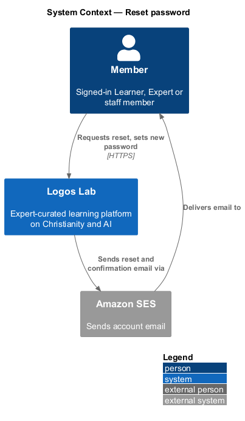
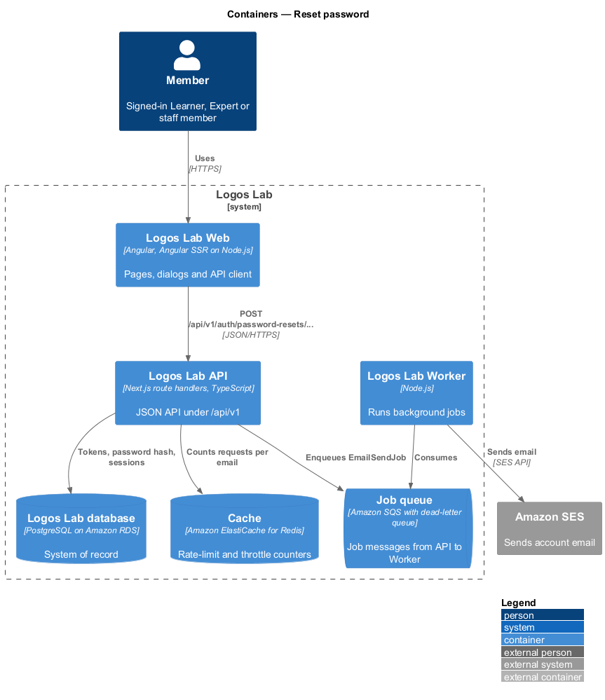
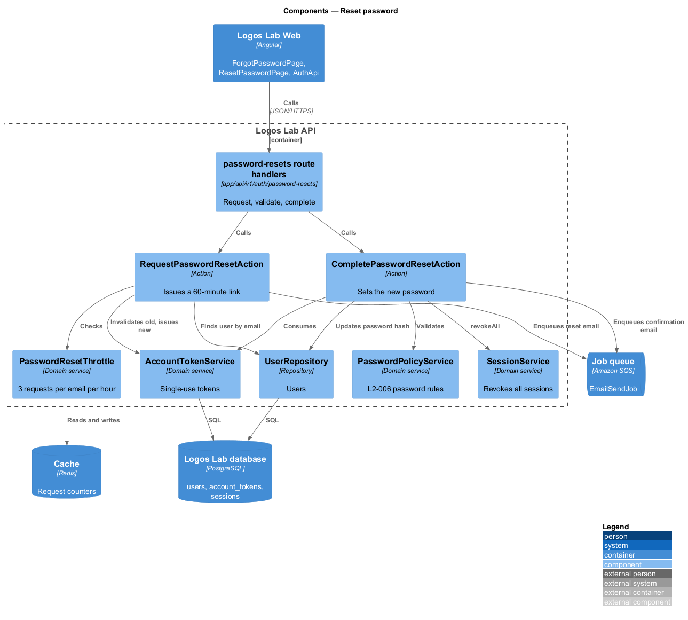
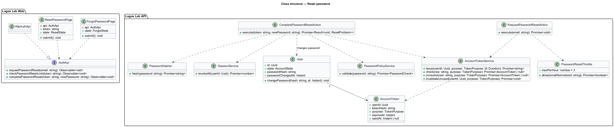
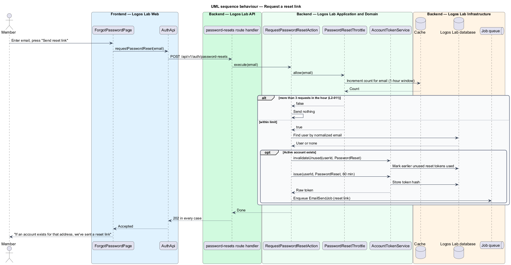
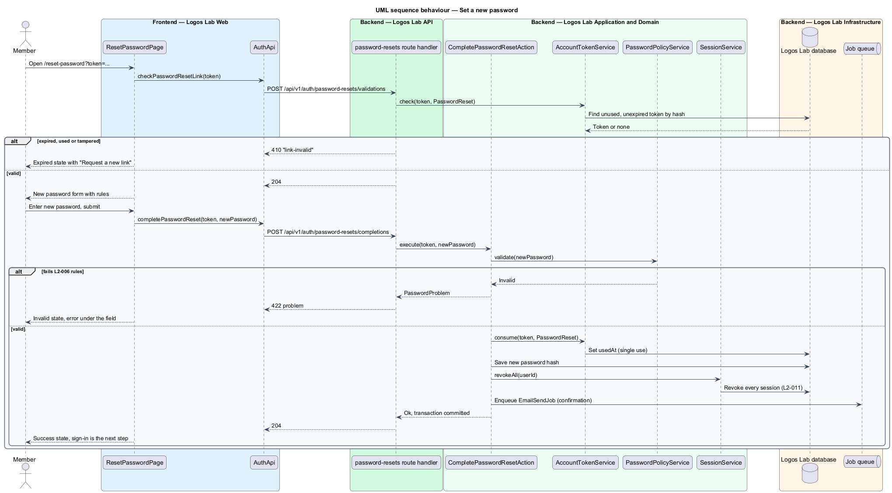

# Reset password

## Overview

A member who forgets their password regains access through their verified email address. This feature covers the "Forgot password" request, the reset email, and the page that sets a new password from the link.

**reset link** — single-use link, valid for 60 minutes, that carries a random token allowing one password change for one account

**account enumeration** — discovery of which email addresses have accounts by comparing the platform's responses

The request step answers the same way whether or not an account exists, so it cannot be used for account enumeration. Completing a reset ends every session of the account (`accounts/manage-sessions`, `L2-010`). The feature reuses the password rules of `accounts/register-account` (`L2-006`) and the token store shared with email verification and email change.

## Description

**Screens (Logos Lab Web)**

- **`ForgotPasswordPage`** — routed page at `/forgot-password`, built on `ll-auth-card`, `ll-form-field`, `ll-text-field`, `ll-button` and `ll-alert`. The mocks in `docs/mocks/pages/forgot-password/` cover `default`, `submitting`, `invalid`, `success` and `error`. The `success` state shows "If an account exists for that address, we've sent a reset link" in every case.
- **`ResetPasswordPage`** — routed page at `/reset-password?token=…`. It checks the link on load, then offers the new-password field with the rules. The mocks in `docs/mocks/pages/reset-password/` cover `default`, `loading`, `submitting`, `invalid`, `success`, `expired` and `error`.

**Page flow**

- `ResetPasswordPage` shows the `loading` state ("Checking your reset link…") while it checks the token, then `default`, which names the address ("For miriam.clarke@example.ca…"), or `expired` for a `410`.
- The field is checked before sending: empty reads "Enter a new password"; the length rules read as on registration ("Use at least 12 characters. This one has 9."). A `422` maps `breached` to "This password has appeared in a data breach. Choose a different one." and `same-as-current` to "Choose a password different from your current one."
- "Save new password" shows "Saving…". A `204` shows `success` naming the address, with "Sign in"; a `410` shows `expired`; any other failure shows the `error` alert and keeps what was typed. A failed check of the link shows the same alert with "Try again", which checks it again.

**API contract (shared API library)**

- **`AuthApi`** (token `AUTH_API`, implementation `HttpAuthApi`) — `requestPasswordReset(email)`, `checkPasswordResetLink(token)` returning `PasswordResetLink` (`email`), `completePasswordReset(token, newPassword)`.

**Endpoints (Logos Lab API)**

All three are anonymous. Tokens travel in request bodies, not in API paths, so they stay out of access logs.

- **`POST /api/v1/auth/password-resets`** — body `{ email }`. Always answers `202` when the email is well formed.
- **`POST /api/v1/auth/password-resets/validations`** — body `{ token }`. Answers `200` with `{ email }` for a valid link, so the page can name the account, or `410` with problem type `link-invalid`.
- **`POST /api/v1/auth/password-resets/completions`** — body `{ token, newPassword }`. Answers `204`, `410` with `link-invalid`, or `422` with `errors: [{ field: "newPassword", code }]`, where `code` is `breached` or `same-as-current`.

**Application and domain (Logos Lab API)**

- **`RequestPasswordResetAction`** — counts requests per email address through `PasswordResetThrottle`. For an Active account within the limit, it invalidates earlier unused reset tokens, issues a new token valid for 60 minutes and enqueues the reset email. The behaviour for accounts in other states is `<TO SUPPLY>`; the response is the same in every case.
- **`PasswordResetThrottle`** — more than 3 requests for one email address within an hour send no further email, and the UI response is unchanged. The per-IP limit for this endpoint under `L2-009` is `<TO SUPPLY>`.
- **`CompletePasswordResetAction`** — consumes the token, applies `PasswordPolicyService` (12 to 128 characters, not breached), stores the new hash with `PasswordHasher`, revokes all sessions through `SessionService.revokeAll`, and enqueues the confirmation email. It runs in one transaction.
- **`AccountTokenService`** — issue, check and consume tokens of purpose `PasswordReset` in table `account_tokens`. A tampered token has no matching hash and is treated as invalid.
- **`SecurityEventLogger`** — logs the password change without the token or the password (`L2-111`).

**Rules from the acceptance criteria**

- Any email submitted to "Forgot password" shows the same message, whether or not an account exists.
- An Active account receives a single-use link that expires after 60 minutes. Earlier unused reset links for that account are invalidated.
- A valid link with a new password that meets the `L2-006` rules changes the password, invalidates all sessions and sends a confirmation email.
- An expired, used or tampered link explains that it is invalid and offers to request a new one.
- More than 3 requests for one email address within an hour send no further email and leave the UI response unchanged.

## Requirements

The feature realizes the following level-2 (L2) requirement.

| L2 ID | Refines (L1) | Requirement |
|-------|--------------|-------------|
| `L2-011` | `L1-002` | **Password reset.** Members who forget their password shall be able to reset it through their verified email address. |

## Diagrams

### System context

The member asks Logos Lab for a reset link, which arrives by email through Amazon SES.

### Containers

The Logos Lab API counts requests in the cache, stores tokens and passwords in the database, and enqueues email for the Worker.

### Components

`RequestPasswordResetAction` and `CompletePasswordResetAction` share `AccountTokenService`. The completion also uses the password policy and the session service.

### Class structure

Both pages depend on `AuthApi`. Both actions work on `AccountToken` rows of purpose `PasswordReset` and on the `User`.

### Behaviour — request a reset link

The response never changes with account existence or the hourly limit (`L2-011`).

### Behaviour — set a new password

The page checks the link on load, then submits the new password. Success ends all sessions and sends a confirmation email.

