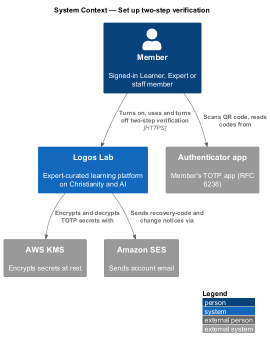
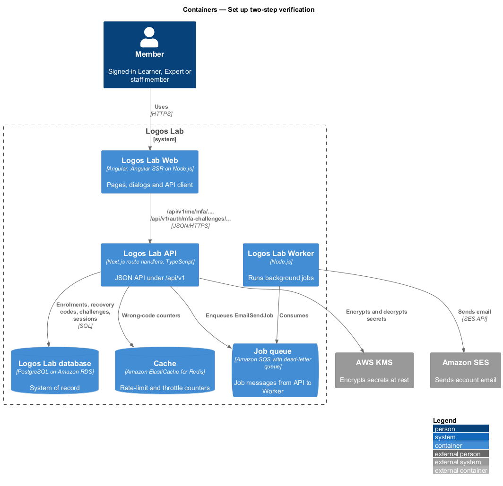
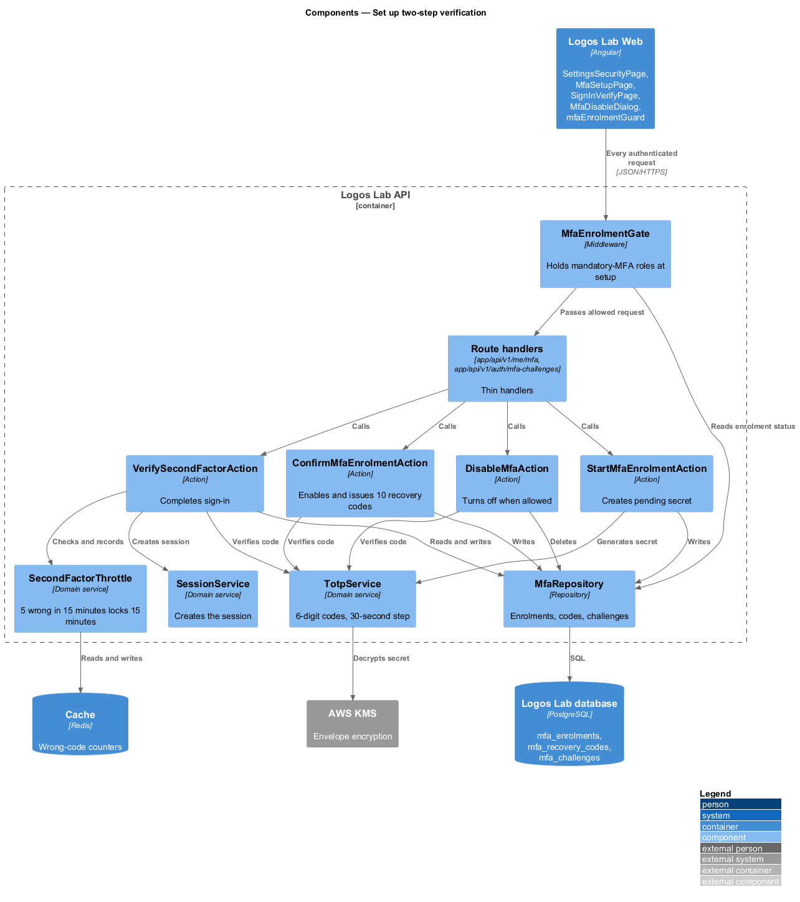
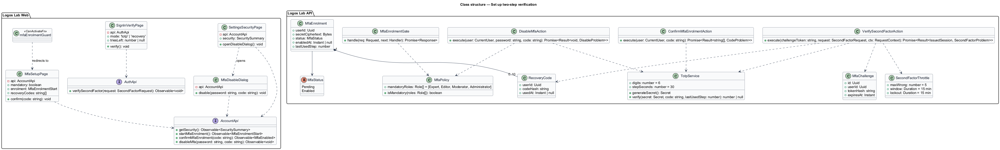
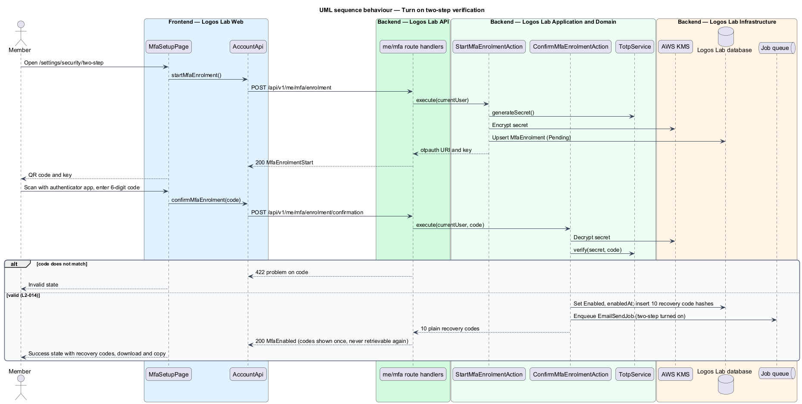
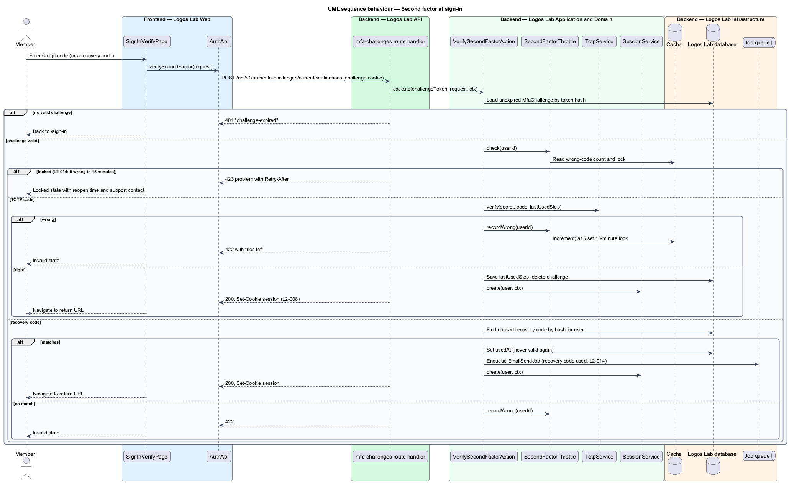
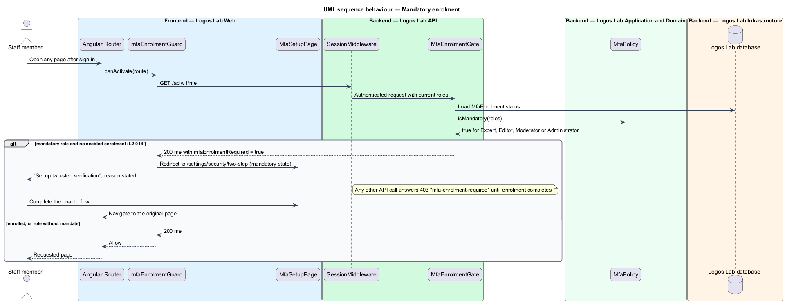
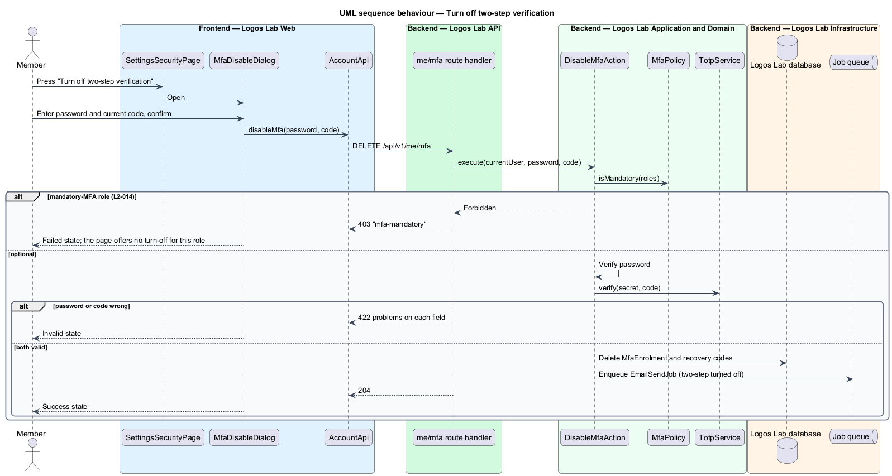

# Set up two-step verification

## Overview

Two-step verification adds a second proof of identity to sign-in. After the password step (`accounts/sign-in`, `L2-008`), the member enters a code from an authenticator app. Any member may turn it on. It is mandatory for the Expert, Editor, Moderator and Administrator roles, which can change published content or other people's accounts.

**TOTP** — time-based one-time password (RFC 6238): a 6-digit code derived from a shared secret and the current 30-second time step

**authenticator app** — app on the member's phone that holds the shared secret and shows the current TOTP code

**recovery code** — single-use code, issued in a set of 10, that replaces a TOTP code when the phone is lost

**second-factor challenge** — short-lived server-side record that a password step succeeded and a second factor is still owed

**mandatory-MFA role** — the Expert, Editor, Moderator or Administrator role

The feature belongs to the accounts subsystem. It covers turning the feature on, the second-factor step at sign-in, the enrolment required of mandatory-MFA roles, and turning the feature off.

## Description

**Screens (Logos Lab Web)**

- **`SettingsSecurityPage`** — routed page at `/settings/security`, in the settings layout. It shows two-step status with `ll-badge`, the authenticator date and unused recovery-code count, and "Set up two-step verification" or "Turn off two-step verification". The mocks in `docs/mocks/pages/settings-security/` cover `default` (off), `enabled`, `mandatory` (on, no way to turn it off), `loading` and `error`.
- **`MfaSetupPage`** — routed page at `/settings/security/two-step`. Step 1 shows the QR code and the key to type; step 2 takes the 6-digit code. Success shows the 10 recovery codes once with `ll-two-step-codes`, offering "Download as a text file" and "Copy all". The mocks in `docs/mocks/pages/mfa-setup/` cover `default`, `mandatory`, `loading`, `submitting`, `invalid`, `success` and `error`.
- **`SignInVerifyPage`** — routed page at `/sign-in/verify`, built on `ll-auth-card` and the one-time-code field (`otp` block). It accepts a TOTP code or, after "Use a recovery code", a recovery code. The mocks in `docs/mocks/pages/sign-in-verify/` cover `default`, `recovery-code`, `submitting`, `invalid` (tries left), `locked` and `error`.
- **`MfaDisableDialog`** — CDK dialog built on `ll-dialog` that asks for the password and a current code. Mocks in `docs/mocks/dialogs/mfa-disable/`: `default`, `busy`, `invalid`, `failed`, `success`.
- **`mfaEnrolmentGuard`** — route guard that sends a member flagged for mandatory enrolment to `/settings/security/two-step` in the `mandatory` state before any other page loads.

**API contract (shared API library)**

- **`AccountApi`** (token `ACCOUNT_API`) — `getSecurity()`, `startMfaEnrolment()`, `confirmMfaEnrolment(code)`, `disableMfa(password, code)`.
- **`AuthApi`** (token `AUTH_API`) — `verifySecondFactor(request: SecondFactorRequest)`.
- **`MfaEnrolmentStart`** — `otpauthUri`, `manualKey`. **`MfaEnabled`** — `recoveryCodes: string[]`.

**Endpoints (Logos Lab API)**

- **`GET /api/v1/me/security`** — status, enabled date, unused recovery codes, whether MFA is mandatory.
- **`POST /api/v1/me/mfa/enrolment`** — starts enrolment and returns the secret for the QR code.
- **`POST /api/v1/me/mfa/enrolment/confirmation`** — body `{ code }`. Enables MFA and returns the recovery codes once.
- **`DELETE /api/v1/me/mfa`** — body `{ password, code }`. Answers `403` for a mandatory-MFA role.
- **`POST /api/v1/auth/mfa-challenges/current/verifications`** — anonymous with the challenge cookie. Body `{ code }` or `{ recoveryCode }`. Creates the session on success.

**Application and domain (Logos Lab API)**

- **`TotpService`** — generates the secret and verifies 6-digit codes on a 30-second step. The accepted clock-drift window is `<TO SUPPLY>`. A code already accepted for the same time step is refused.
- **`StartMfaEnrolmentAction`** and **`ConfirmMfaEnrolmentAction`** — create a pending `MfaEnrolment`, then enable it on a valid code. Confirmation generates 10 recovery codes, stores only their hashes and returns the plain codes once.
- **`VerifySecondFactorAction`** — loads the challenge, applies `SecondFactorThrottle`, verifies the TOTP or recovery code and calls `SessionService.create`. A used recovery code is marked used and the member is emailed that a recovery code was used.
- **`SecondFactorThrottle`** — 5 wrong codes within 15 minutes lock the second-factor step for 15 minutes.
- **`MfaEnrolmentGate`** — middleware stage after authentication. When the user holds a mandatory-MFA role and has no enabled `MfaEnrolment`, every endpoint except the MFA setup endpoints, `GET /api/v1/me` and sign-out answers `403` with problem type `mfa-enrolment-required`. The check runs on every request, so it also applies when a role is granted mid-session (`L2-018`).
- **`DisableMfaAction`** — verifies the password and a current TOTP code, refuses for a mandatory-MFA role, deletes the enrolment and recovery codes, and emails a confirmation (from the mock).
- **`MfaEnrolment`** — table `mfa_enrolments`: `userId`, `secretCiphertext` (encrypted with AWS KMS, `L2-112`), `status`, `enabledAt`, `lastUsedStep`.
- **`RecoveryCode`** — table `mfa_recovery_codes`: `userId`, `codeHash`, `usedAt`.
- **`MfaChallenge`** — table `mfa_challenges`: `id`, `userId`, `tokenHash`, `expiresAt`. The lifetime is `<TO SUPPLY>`.
- **`SecurityEventLogger`** — logs MFA changes and lockouts without codes or secrets (`L2-111`).

**Rules from the acceptance criteria**

- Scanning the QR code and entering a valid 6-digit TOTP code enables MFA and shows 10 single-use recovery codes once.
- A user granted the Expert, Editor, Moderator or Administrator role without MFA enrols before reaching any page.
- 5 wrong TOTP codes in 15 minutes lock the second-factor step for 15 minutes.
- A used recovery code can never be used again, and the member is emailed that it was used.
- Disabling MFA requires a current TOTP code and the password. Members of mandatory-MFA roles cannot disable it.

## Requirements

The feature realizes the following level-2 (L2) requirement.

| L2 ID | Refines (L1) | Requirement |
|-------|--------------|-------------|
| `L2-014` | `L1-002` | **Multi-factor authentication.** Members shall be able to enable time-based one-time-password (TOTP) multi-factor authentication. It is mandatory for the Expert, Editor, Moderator and Administrator roles. |

## Diagrams

### System context

The member pairs an authenticator app with Logos Lab. Logos Lab protects the shared secret with AWS KMS and emails security notices through Amazon SES.

### Containers

The Logos Lab API stores encrypted secrets and hashed recovery codes in the database, and keeps the wrong-code counters in the cache.

### Components

The enrolment, verification and disable actions share `TotpService`. `MfaEnrolmentGate` sits in the middleware pipeline after authentication.

### Class structure

A `User` has at most one `MfaEnrolment` and up to 10 `RecoveryCode` rows. A pending `MfaChallenge` links the password step to the second factor.

### Behaviour — turn on two-step verification

Enrolment pairs the app, confirms one code, and shows the recovery codes once.

### Behaviour — second factor at sign-in

The second factor creates the session only after a valid code (`L2-008`, `L2-014`). The lockout and the recovery-code email are shown as alternates.

### Behaviour — mandatory enrolment

A member of a mandatory-MFA role without MFA is held at the setup page until enrolment completes.

### Behaviour — turn off two-step verification

Disabling needs the password and a current code, and is refused for mandatory-MFA roles.

