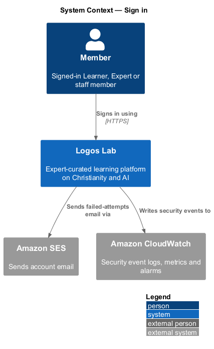
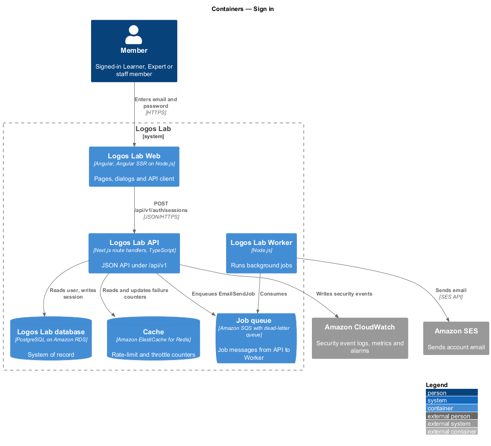
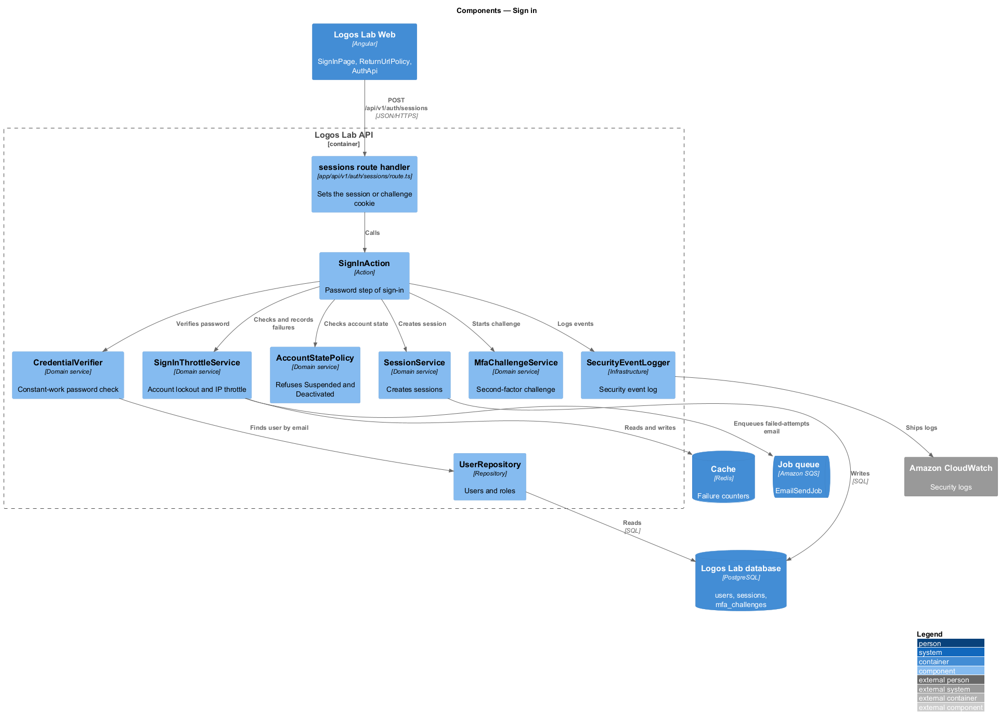
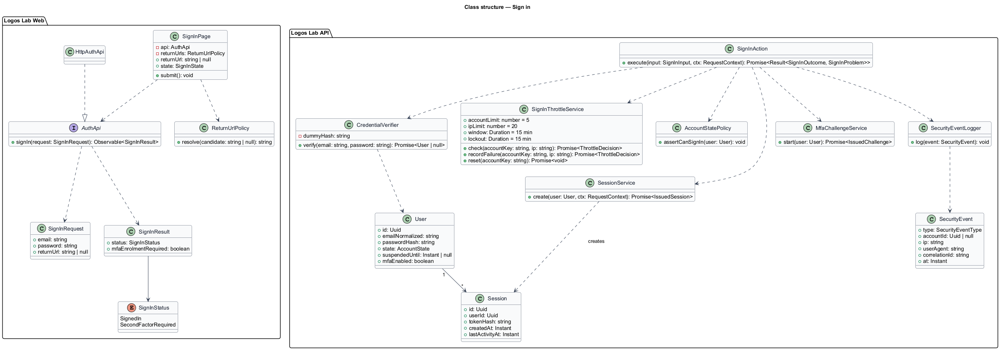
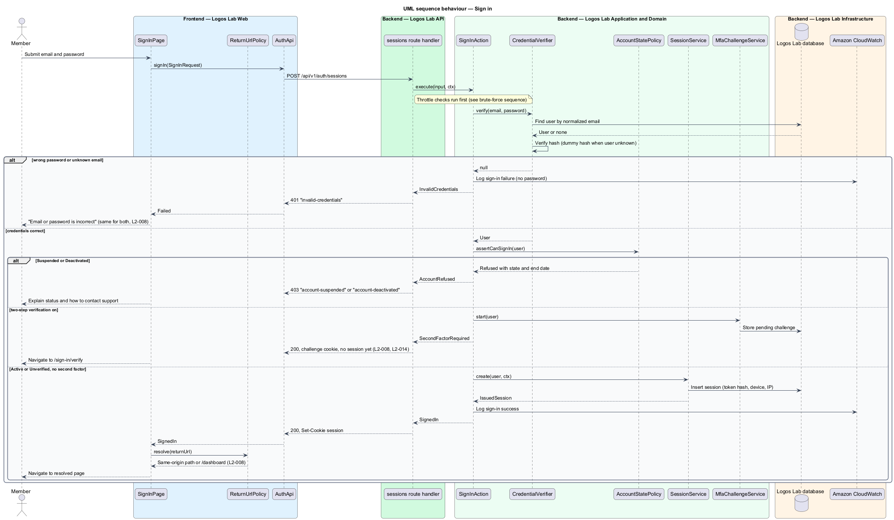
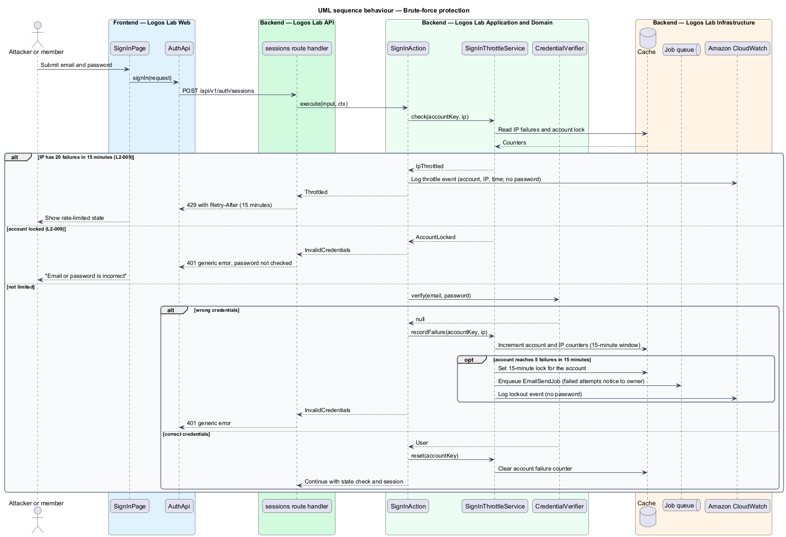

# Sign in

## Overview

Signing in turns a visitor into a member for the length of a session. This feature covers the password step of sign-in, the checks on the account's state, the safe return to the page the member came from, and the protection against password guessing.

**session** — server-side record of a signed-in member, referenced by an opaque token in an HTTP-only cookie (`accounts/manage-sessions`, `L2-010`)

**return URL** — same-origin path that sign-in sends the member back to after success

**credential stuffing** — automated sign-in attempts that replay email and password pairs leaked from other sites

**lockout** — 15-minute refusal of sign-in for one account after repeated failures

**throttle** — 15-minute refusal, with `429`, of sign-in requests from one IP address after repeated failures

**second factor** — 6-digit TOTP code or recovery code asked for after the password step (`accounts/set-up-two-step-verification`, `L2-014`)

The feature sits at the centre of the accounts subsystem. It creates the session that every authenticated request resolves, and it hands over to the second-factor step when the account has two-step verification on.

## Description

**Screens (Logos Lab Web)**

- **`SignInPage`** — routed page at `/sign-in?returnUrl=…`, server-rendered. It uses `ll-auth-card`, `ll-form-field`, `ll-text-field` with a show-password toggle, `ll-button` and `ll-alert`. The mocks in `docs/mocks/pages/sign-in/` cover `default`, `submitting`, `invalid`, `error`, `rate-limited`, `suspended`, `deactivated`, `context` (names the pending action), `session-expired` and `signed-out`.
- **`SignInVerifyPage`** — routed page at `/sign-in/verify` for the second factor. Its behaviour belongs to `accounts/set-up-two-step-verification`; mocks in `docs/mocks/pages/sign-in-verify/`.
- **`ReturnUrlPolicy`** — web service that accepts only a same-origin relative path. Any other value, such as `https://evil.example`, resolves to `/dashboard`. Coming straight to `/sign-in` also resolves to `/dashboard`.

**API contract (shared API library)**

- **`AuthApi`** (token `AUTH_API`, implementation `HttpAuthApi`) — `signIn(request: SignInRequest): Observable<SignInResult>`.
- **`SignInResult`** — `status` (`SignedIn` or `SecondFactorRequired`) and `mfaEnrolmentRequired`.

**Endpoint (Logos Lab API)**

- **`POST /api/v1/auth/sessions`** — anonymous endpoint. Body `{ email, password, returnUrl }`. On success it sets the session cookie (`Secure`, `HttpOnly`, `SameSite`) and answers `200`. When a second factor is needed it sets a short-lived challenge cookie instead and answers `200` with `SecondFactorRequired`. Failures answer `401` with problem type `invalid-credentials`, `403` with `account-suspended` or `account-deactivated`, or `429` with `Retry-After`.

**Application and domain (Logos Lab API)**

- **`SignInAction`** — orchestrates the password step: throttle check, credential check, state check, then a session or a second-factor challenge.
- **`CredentialVerifier`** — verifies the password with `PasswordHasher`. For an unknown email it verifies against a fixed dummy hash, so both failure cases do the same work. The response time of the two cases differs by no more than 50 ms at p95.
- **`SignInThrottleService`** — keeps failure counters in the cache:
  - 5 failed attempts for one account within 15 minutes lock that account's sign-in for 15 minutes, whatever the password. The generic error is shown and the owner is emailed about the failed attempts.
  - 20 failed attempts from one IP address across any accounts within 15 minutes answer `429` for that IP address for 15 minutes.
  - A success after a lockout expires resets the account's failure counter.
- **`AccountStatePolicy`** — refuses correct credentials for a `Suspended` or `Deactivated` account with a message that explains the status and how to contact support. A suspended account sees its end date and a link to its notice (`L2-019`). The refusal copy for a `Banned` account is `<TO SUPPLY>`. An `Unverified` account may sign in (`L2-007`).
- **`SessionService`** — creates the `Session` row (`accounts/manage-sessions`).
- **`MfaChallengeService`** — creates the pending second-factor challenge when the account has two-step verification on, or flags mandatory enrolment for a staff role without it (`L2-014`).
- **`SecurityEventLogger`** — writes each sign-in success, failure, lockout and throttle event to Amazon CloudWatch with the account identifier, IP address and timestamp, never the submitted password (`L2-111`).
- **`EmailSendJob`** — sends the failed-attempts email to the account owner.

**Rules from the acceptance criteria**

- Correct credentials for an Active account create a session and return the member to the page they were on, or to `/dashboard`.
- An incorrect password and an unknown email both show "Email or password is incorrect".
- An off-origin `returnUrl` sends the member to `/dashboard`.

## Requirements

The feature realizes the following level-2 (L2) requirements.

| L2 ID | Refines (L1) | Requirement |
|-------|--------------|-------------|
| `L2-008` | `L1-002` | **Sign in.** Members shall be able to sign in with their email address and password. |
| `L2-009` | `L1-002` | **Brute-force protection.** Sign-in, password reset and verification endpoints shall resist credential stuffing and brute force attacks. |

## Diagrams

### System context

A member signs in to Logos Lab. Logos Lab emails the owner after repeated failures and records security events in Amazon CloudWatch.

### Containers

The API reads failure counters from the cache, reads the user and writes the session in the database, and enqueues the failed-attempts email.

### Components

`SignInAction` calls the throttle, the credential verifier, the account state policy and either the session service or the challenge service.

### Class structure

`SignInPage` depends on `AuthApi` and `ReturnUrlPolicy`. `SignInAction` depends on the domain services, which work on `User` and `Session`.

### Behaviour — sign in

The happy path creates a session and returns the member to a safe return URL (`L2-008`). The alternates show the generic credentials error, the state refusals and the hand-over to the second factor.

### Behaviour — brute-force protection

The account lockout and the IP throttle run before the password is checked (`L2-009`). Each lockout or throttle event is logged without the password.

