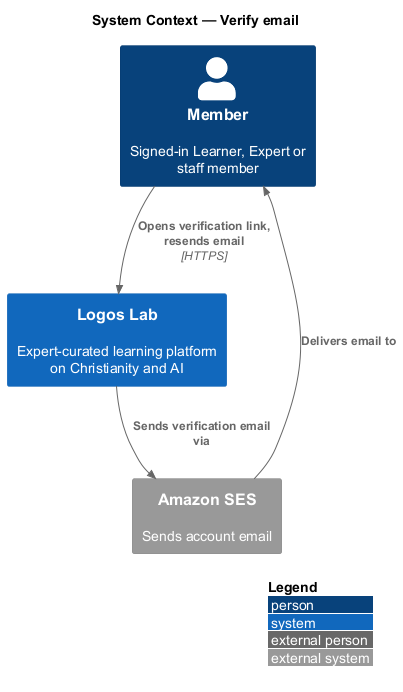
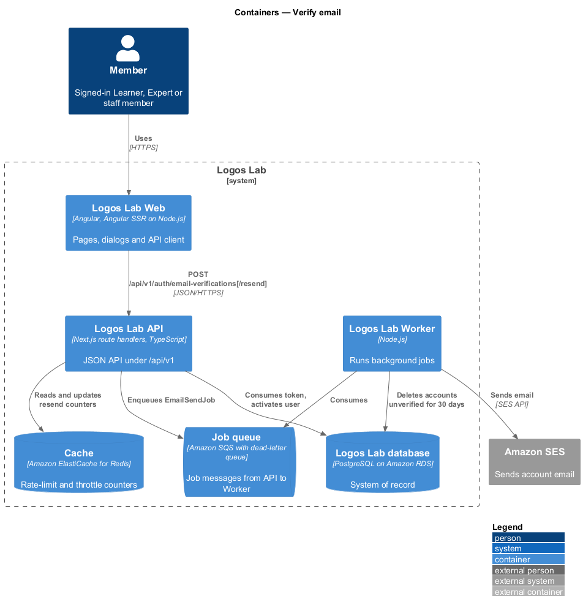
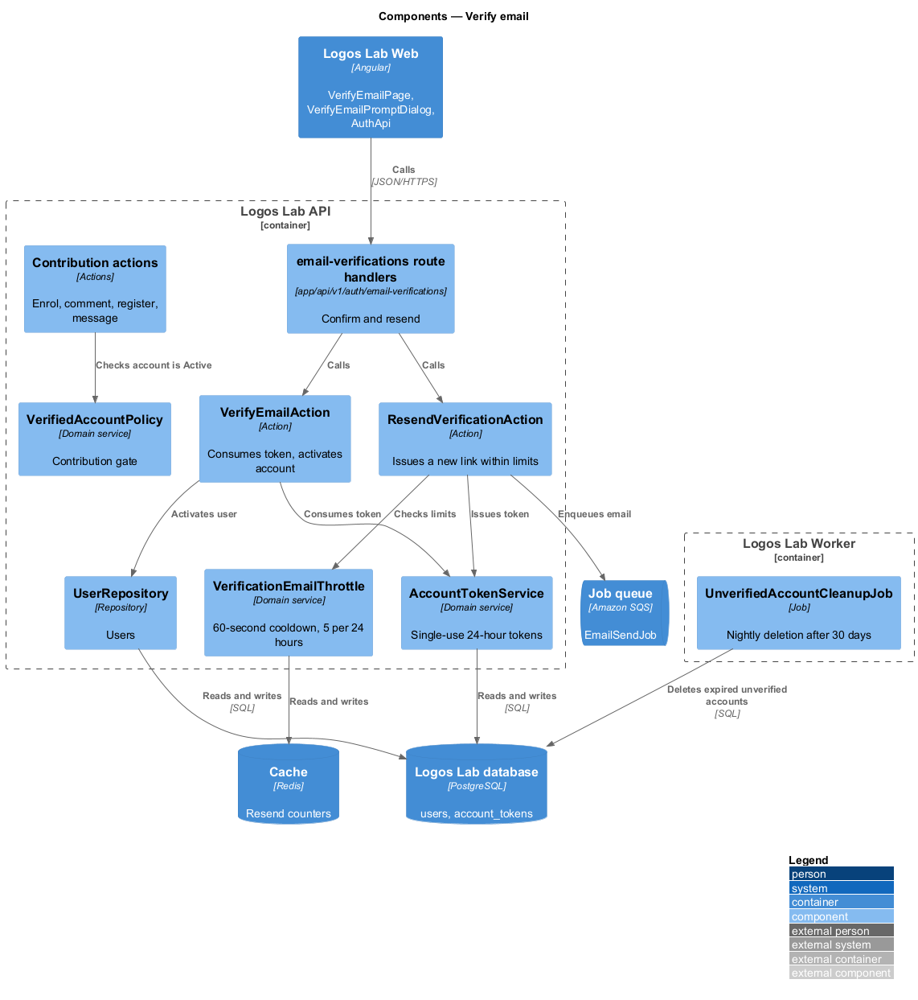
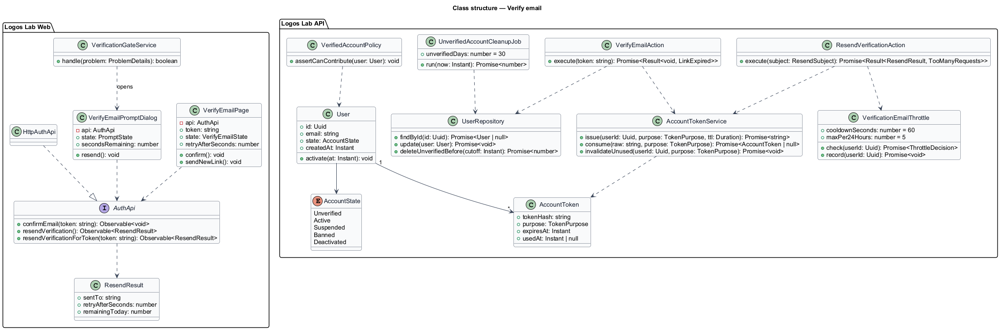
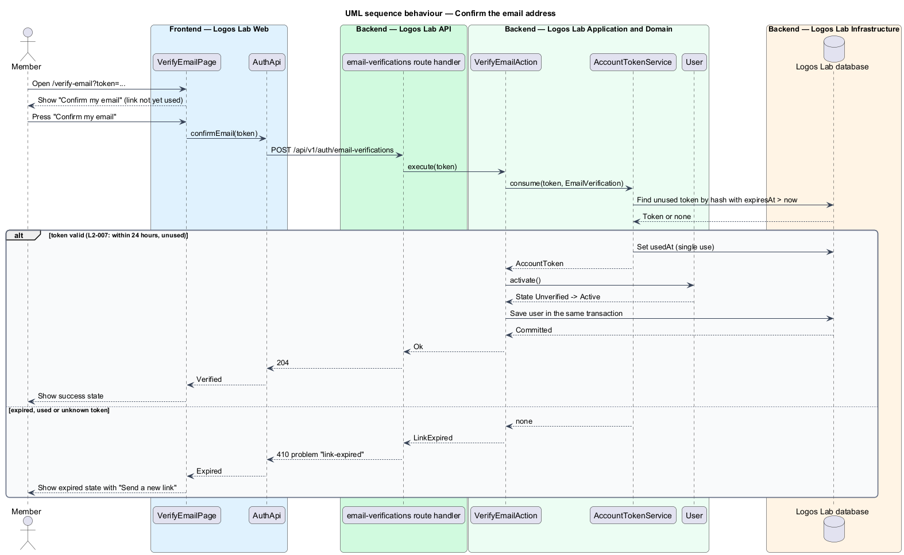
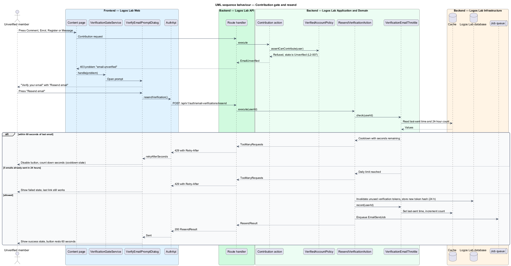
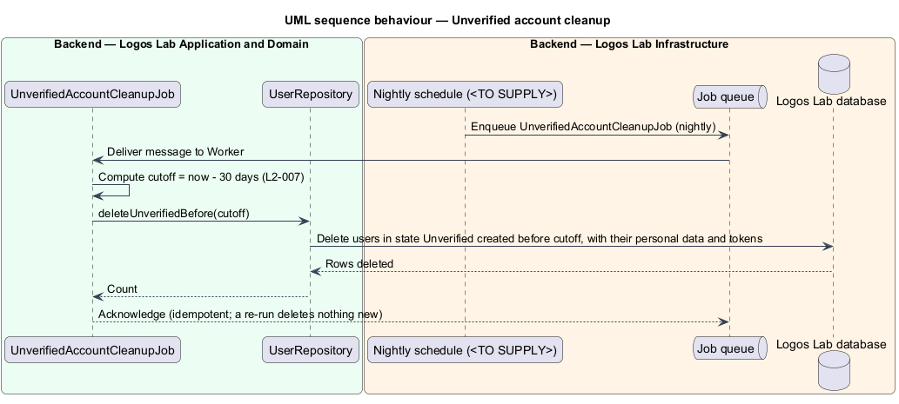

# Verify email

## Overview

Registration (`accounts/register-account`, `L2-006`) creates an account in the Unverified state and emails a verification link. This feature completes that step. It proves that the owner controls the address, and it keeps unverified accounts from contributing until they do.

**verification link** — single-use link, valid for 24 hours, that carries a random token proving control of an email address

**contribution action** — action that adds to the platform or to another member's experience: enrolling, commenting, registering for events and messaging

**contribution gate** — server-side check that refuses a contribution action from an Unverified account

An Unverified member may sign in and browse. Each contribution action shows a prompt to verify, with a "Resend email" button. Opening a valid link makes the account Active. An account left unverified for 30 days is deleted by a nightly job. The feature belongs to the accounts subsystem and shares its token store with password reset and email change.

## Description

**Screens (Logos Lab Web)**

- **`VerifyEmailPage`** — routed page at `/verify-email?token=…`, built on `ll-auth-card`, `ll-button`, `ll-empty-state` and `ll-alert`. Opening the link does not verify by itself; one "Confirm my email" button posts the token, so link scanners cannot use it up. The mocks in `docs/mocks/pages/verify-email/` cover `default`, `loading`, `success`, `expired`, `resend-sent`, `cooldown` and `error`.
- **`VerifyEmailPromptDialog`** — CDK dialog built on `ll-dialog`, opened when an Unverified member tries a contribution action. It offers "Resend email". The mocks in `docs/mocks/dialogs/verify-email-prompt/` cover `default`, `busy`, `success`, `cooldown` and `failed` (daily limit reached).
- **`ll-account-banner`** — banner below the header for an Unverified member, with "Resend email". The mocks in `docs/mocks/notifications/account-banner/` cover `warning`, `info`, `success` and `persistent` (the deletion date).
- **`VerificationGateService`** — web service that intercepts a `403` problem of type `email-unverified` and opens `VerifyEmailPromptDialog`.

**Page flow**

- Opening `/verify-email?token=…` shows the `loading` state ("Checking your link…") while `GET /api/v1/auth/email-verifications/{token}` looks the token up without using it. A `200` gives `{ email, displayName }` for the `default` state, which names the address. A `410` problem `link-expired` shows the `expired` state. When the problem carries `email`, the state names the address and offers "Send a new link". An unknown token carries no address, so the state says only "Verification links work once, within 24 hours." and points to "Sign in", from which an Unverified member can resend through the account banner.
- "Confirm my email" shows the `loading` state again while it posts the token. A `204` shows `success`, which greets the member by the first word of `displayName` ("Welcome to Logos Lab, Miriam.") and moves focus to its heading. A `410` shows `expired`. Any other failure returns to the card with the danger alert of the `error` state, and the button reads "Try again". If the lookup itself fails with anything but `410`, the same alert shows without the address, and "Try again" looks the link up again.
- "Send a new link" posts the token to `resend`. A `200` shows `resend-sent` with the success alert "Email sent at {time}". From then until `retryAfterSeconds` runs out, the quiet "Resend email" button is disabled and reads "Resend in {n} s". Its help reads "You can send up to 5 emails a day. You have {remainingToday} left today." This is the `cooldown` state. The help sits under the button in a label-less form field (form-field CRD D-4), which ties it to the button as its description. At 0 the button turns back on. A `429` restarts the countdown from `Retry-After`.

**API contract (shared API library)**

- **`AuthApi`** (token `AUTH_API`, implementation `HttpAuthApi`) — `lookUpEmailVerification(token)` returning `EmailVerification` (`email`, `displayName`), `confirmEmail(token)`, `resendVerification()` for a signed-in Unverified member, and `resendVerificationForToken(token)` for the expired-link page.
- **`ResendResult`** — `sentTo`, `retryAfterSeconds`, `remainingToday`.

**Endpoints (Logos Lab API)**

- **`GET /api/v1/auth/email-verifications/{token}`** — anonymous, read-only. Answers `200` with `{ email, displayName }`, or `410` with problem type `link-expired` (carrying `email` when the token is known but expired or used).

- **`POST /api/v1/auth/email-verifications`** — anonymous. Body `{ token }`. Answers `204` on success and `410` with problem type `link-expired` for an expired, used or unknown token.
- **`POST /api/v1/auth/email-verifications/resend`** — authenticated Unverified member, or anonymous with the expired token in the body. Answers `200` with `ResendResult`, or `429` with `Retry-After` inside the cooldown or past the daily limit.

**Application and domain (Logos Lab API)**

- **`VerifyEmailAction`** — consumes the token through `AccountTokenService` and moves the `User` from `Unverified` to `Active` in one transaction. A token is marked used, so it can never be used again.
- **`ResendVerificationAction`** — applies the resend limits through `VerificationEmailThrottle`, invalidates earlier unused verification tokens, issues a new 24-hour token and enqueues `EmailSendJob`.
- **`VerificationEmailThrottle`** — keeps the time of the last email and a 24-hour count per account in the cache.
- **`VerifiedAccountPolicy`** — contribution gate used by the actions for enrolling, commenting, event registration and messaging. It refuses an Unverified account with `403` and problem type `email-unverified`.
- **`UnverifiedAccountCleanupJob`** — nightly Worker job. It deletes each account that has stayed Unverified for 30 days, with its personal data. Each run is idempotent.
- **`AccountToken`** (table `account_tokens`, purpose `EmailVerification`) and **`User`** (table `users`) — from `accounts/register-account`.

**Rules from the acceptance criteria**

- A link opened within 24 hours makes the account Active, and the link can never be used again.
- A link older than 24 hours or already used shows the expired state and offers a new link.
- An Unverified member can browse; every contribution action shows the verify prompt with "Resend email".
- Within 60 seconds of the last email, "Resend email" is disabled and shows the seconds remaining. No more than 5 emails go to one account in 24 hours.
- An account unverified for 30 days is deleted with its personal data when the nightly cleanup job runs.
- The verification endpoints also fall under the brute-force protection of `L2-009`; their per-IP limit is `<TO SUPPLY>`.

## Requirements

The feature realizes the following level-2 (L2) requirement.

| L2 ID | Refines (L1) | Requirement |
|-------|--------------|-------------|
| `L2-007` | `L1-002` | **Email verification.** A new account shall verify its email address before it can contribute anything (enrol, comment, register for events, message). |

## Diagrams

### System context

The member opens the link from an email that Logos Lab sends through Amazon SES.

### Containers

Logos Lab Web posts the token to the Logos Lab API. The API keeps the resend counters in the cache, and the Worker sends email and runs the nightly cleanup.

### Components

`VerifyEmailAction` and `ResendVerificationAction` share `AccountTokenService`. `VerifiedAccountPolicy` is called by every contribution action, and `UnverifiedAccountCleanupJob` runs in the Worker.

### Class structure

The page and the prompt dialog depend on the `AuthApi` contract. The actions use the token service, the throttle and the user repository.

### Behaviour — confirm the email address

The page posts the token only when the member presses the button. A valid token activates the account and is marked used; an expired or used token shows the expired state.

### Behaviour — contribution gate and resend

A contribution action from an Unverified account is refused with `email-unverified`, and the prompt opens. "Resend email" honours the 60-second cooldown and the limit of 5 emails in 24 hours.

### Behaviour — nightly cleanup

The nightly job deletes accounts that have stayed Unverified for 30 days.

