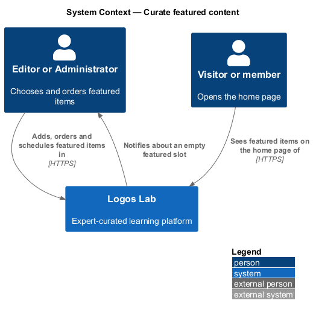
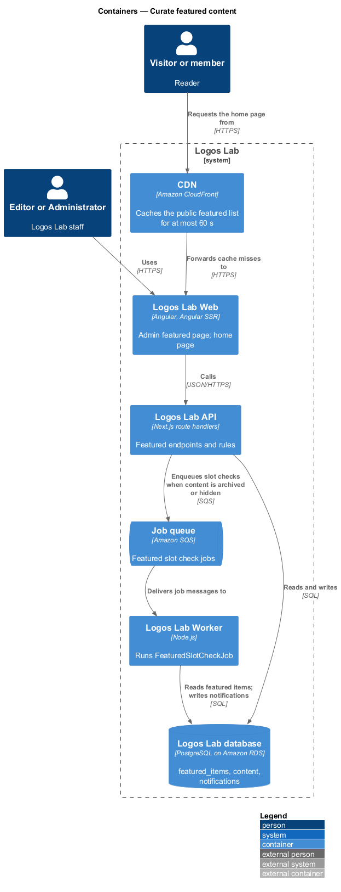
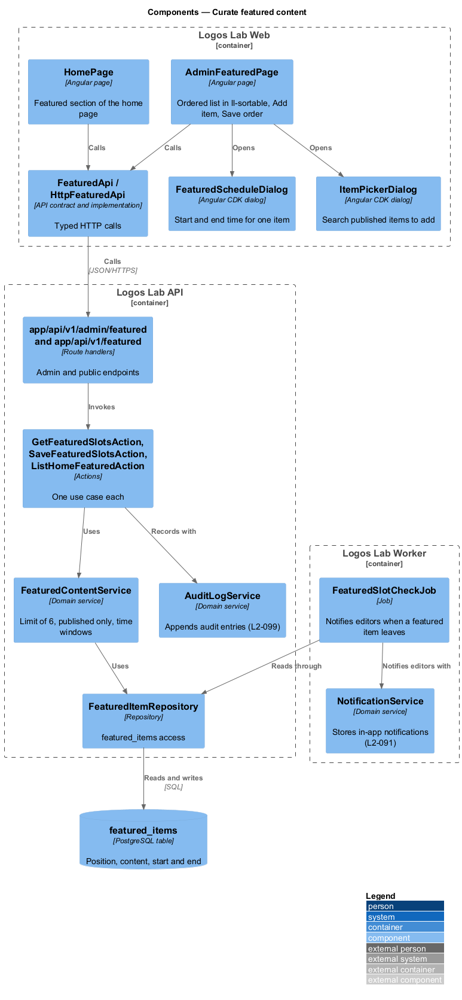
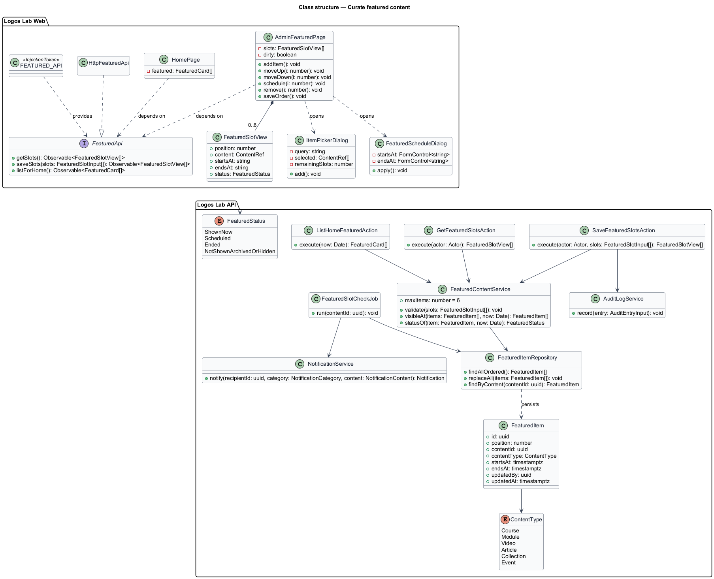
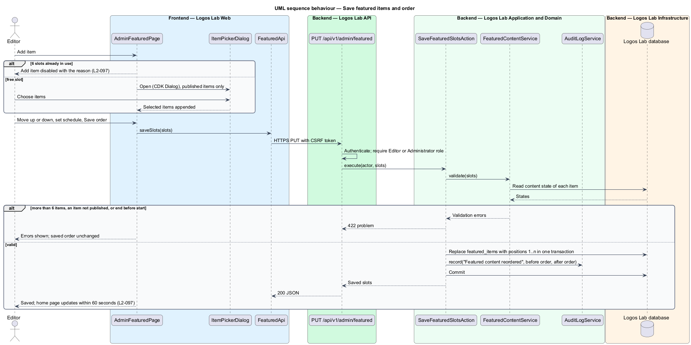
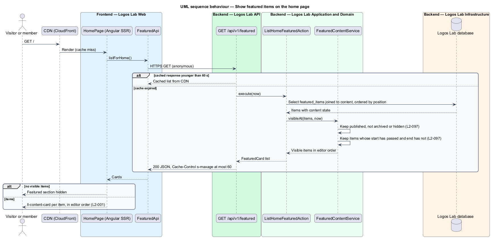
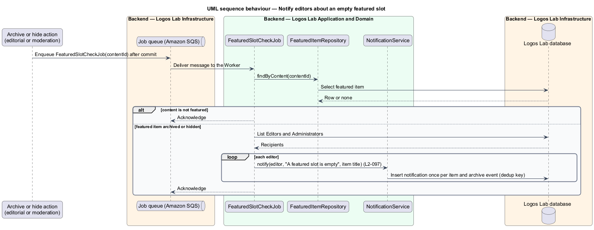

# Curate featured content

## Overview

The Logos Lab home page opens with a short, ordered set of featured items chosen by staff
(`L2-001`). This feature is the part of the administration subsystem that lets Editors and
Administrators choose those items, order them and schedule when each one shows. It is reached at
`/admin/featured`.

- **featured item** — published piece of content placed in the home page's featured section
- **featured slot** — one of the 6 ordered positions a featured item can occupy
- **featuring window** — optional start and end time between which a featured item shows
- **empty slot** — slot whose item no longer shows because the content was archived or hidden

An editor adds up to 6 published items, orders them and saves. The home page shows them in that order
within 60 seconds. An item with a start and end time appears and disappears on its own. When featured
content is archived or hidden, the home page omits it and editors are notified that a slot is empty.

## Description

### Logos Lab Web

- **`AdminFeaturedPage`** — routed page at `/admin/featured` in the admin layout. It uses
  `ll-page-header` (Add item and Save order), `ll-sortable` for the ordered list with Move up and Move
  down, Schedule and Remove on each row, `ll-badge` for the status ("Shown now", "Scheduled, not shown
  yet", "Not shown"), `ll-alert` for the slot warning, `ll-empty-state` and `ll-skeleton`. Mock states
  in `docs/mocks/pages/admin-featured/`: `default` (5 of 6 slots), `loading`, `empty`, `error` (the
  home page keeps the last saved order), `full` (Add item disabled with the reason), `scheduled` and
  `slot-warning` (an archived item leaves a slot empty).
- **`ItemPickerDialog`** — shared CDK dialog for choosing published items, with search, a type filter
  and checkboxes. Its `invalid` state in `docs/mocks/dialogs/item-picker/` refuses an addition when
  Featured already holds 6 items.
- **`FeaturedScheduleDialog`** — CDK dialog opened by Schedule to set the start and end time of one
  item. No mock exists for this dialog yet; its mock is `<TO SUPPLY>` before implementation.
- **`HomePage`** — the home page (`L2-001`) renders the featured section with `ll-content-card` and
  hides it when no item is visible (`docs/mocks/pages/home/`).
- **`FeaturedApi`** — contract in the shared API library, provided through `FEATURED_API` and
  implemented by `HttpFeaturedApi`: `getSlots`, `saveSlots` and `listForHome`.

### Logos Lab API

| Method and path | Action | Notes |
|---|---|---|
| `GET /api/v1/admin/featured` | `GetFeaturedSlotsAction` | Editor or Administrator; items with status |
| `PUT /api/v1/admin/featured` | `SaveFeaturedSlotsAction` | Replaces the ordered list with windows in one transaction |
| `GET /api/v1/featured` | `ListHomeFeaturedAction` | Anonymous; visible items in order; cacheable for at most 60 seconds |

- **`FeaturedContentService`** — enforces at most 6 items, published content only, and an end time
  after the start time. `visibleAt(items, now)` keeps published items that are neither archived nor
  hidden and whose window contains `now`. Because the window is evaluated on every uncached read,
  scheduled items appear and leave without a job.
- **60-second freshness** — the public response carries `Cache-Control` with `s-maxage` of at most 60
  seconds, so CloudFront serves a saved change within 60 seconds. The exact value is `<TO SUPPLY>`.
- **`SaveFeaturedSlotsAction`** — writes an audit entry with the order before and after
  (`L2-099`).
- **`FeaturedItem`** — entity in `featured_items`: id, `position` (1 to 6), `contentId`,
  `contentType`, `startsAt`, `endsAt`, `updatedBy` and `updatedAt`.

### Logos Lab Worker

- **`FeaturedSlotCheckJob`** — enqueued by the archive action (`L2-081`) and the moderation hide
  action (`L2-087`) after commit. When the content is featured it notifies every Editor and
  Administrator in-app through `NotificationService`. A dedup key per item and event keeps it
  idempotent (`L2-140`). Whether an email also goes out is `<TO SUPPLY>`.

## Requirements

| L2 ID | Refines (L1) | Requirement |
|-------|--------------|-------------|
| `L2-097` | `L1-016` | **Featured content curation.** Editors and Administrators curate what is featured on the home page. |

## Diagrams

### System context

Editors curate featured items in Logos Lab, readers see them on the home page, and Logos Lab notifies
editors when a slot empties.

### Containers

The CDN caches the public featured list for at most 60 seconds. The Worker runs the slot check when
content is archived or hidden.

### Components

`AdminFeaturedPage` and `HomePage` call `FeaturedApi`. `FeaturedContentService` holds the limit and
window rules, and `FeaturedSlotCheckJob` notifies editors through `NotificationService`.

### Class structure

The page holds up to 6 `FeaturedSlotView` rows. `FeaturedItem` records position, content and window,
and `FeaturedStatus` names what the admin page shows for each.

### Behaviour — save featured items and order

The save validates the limit, the published state and the windows. It then replaces the list and
writes the audit entry in one transaction.

### Behaviour — show featured items on the home page

The public read filters out archived, hidden and out-of-window items and returns the rest in editor
order, cached for at most 60 seconds.

### Behaviour — notify editors about an empty slot

When featured content is archived or hidden, the slot check notifies each Editor and Administrator
once.

