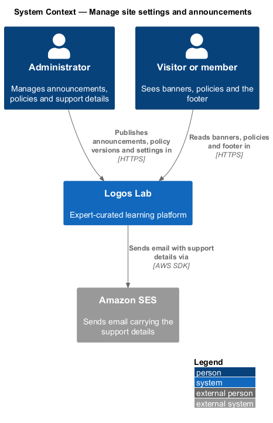
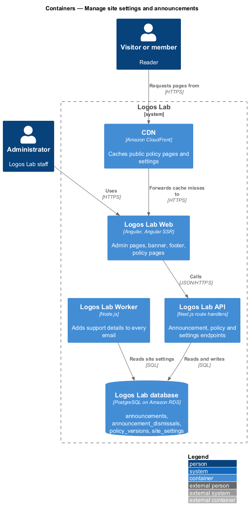
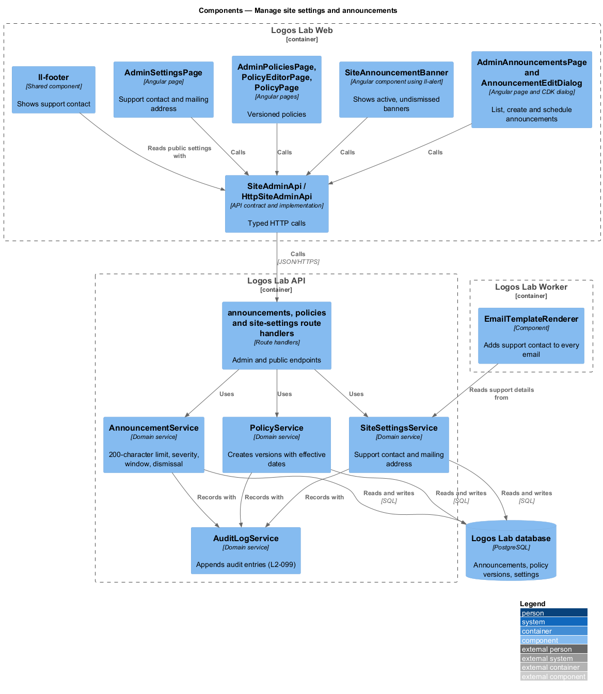
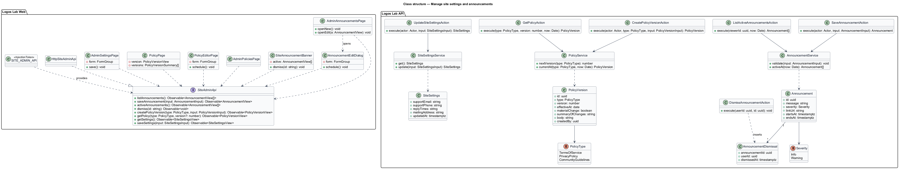
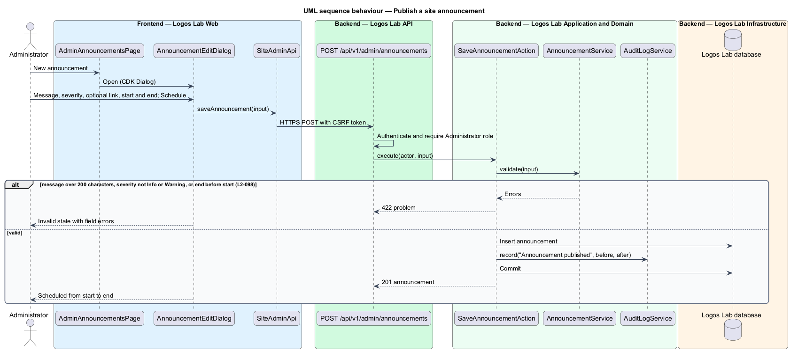
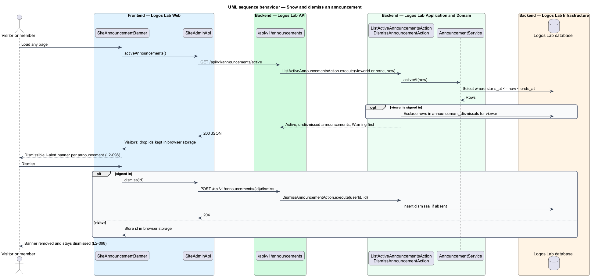
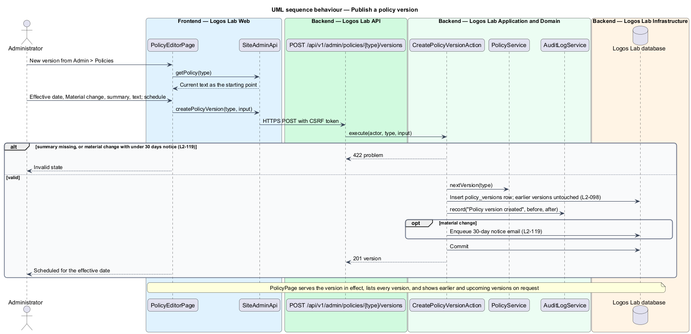
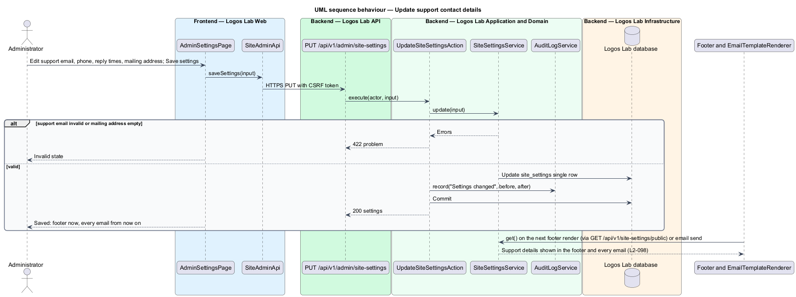

# Manage site settings and announcements

## Overview

Some content on Logos Lab belongs to the site as a whole rather than to any course or expert: a
notice about planned maintenance, the legal policies members agree to, and the support contact shown
in the footer and in email. This feature is the part of the administration subsystem that lets
Administrators manage that site-wide content.

- **site announcement** — short message shown as a dismissible banner on every page during a set
  window
- **severity** — level of an announcement: Info or Warning
- **policy** — one of the three governing texts: Terms of Service, Privacy Policy and Community
  Guidelines
- **policy version** — numbered, immutable text of a policy with the date it takes effect
- **support contact details** — support email, optional phone and reply times, and the mailing address
  that email carries

An Administrator publishes an announcement with a message of up to 200 characters, a severity, an
optional link and a start and end time. A member who dismisses a banner does not see it again. Editing
a policy creates a new version with an effective date, and earlier versions stay readable. Support
contact details appear in the footer and in every email.

## Description

### Logos Lab Web

- **`AdminAnnouncementsPage`** — routed page at `/admin/announcements` (baseline choice). It shows an
  `ll-table` with severity (`ll-badge`), window and status, a preview of the live banner, and New
  announcement. Mock states in `docs/mocks/pages/admin-announcements/`: `default`, `loading`, `empty`
  and `error` (live banners keep showing).
- **`AnnouncementEditDialog`** — CDK dialog on `ll-dialog` with `ll-textarea` for the message,
  `ll-radio-group` for severity, `ll-text-field` for the link and start and end fields. Mock states in
  `docs/mocks/dialogs/announcement-edit/`: `default`, `invalid` (message over 200 characters, end
  before start), `busy`, `failed` and `success`.
- **`SiteAnnouncementBanner`** — app-shell component above the header, built from `ll-alert` in its
  banner form, one per active announcement with Warning first, each dismissed on its own. Mock states
  in `docs/mocks/notifications/site-announcement/`: `info`, `warning`, `with-action` and `stacked`.
  Signed-in dismissals are stored on the server. Visitors' dismissals are kept in browser storage
  (baseline choice), because the spec does not say how a visitor's dismissal persists.
- **`AdminPoliciesPage`** — routed page at `/admin/policies` listing the three policies with current
  version, effective date and any upcoming version, with New version and Earlier versions. Mock states
  in `docs/mocks/pages/admin-policies/`: `default`, `loading` and `error`.
- **`PolicyEditorPage`** — routed page for a new version with effective date, a Material change
  `ll-checkbox`, a summary of changes and the text in `ll-rich-editor`, starting from the current
  version. Mock states in `docs/mocks/pages/policy-editor/`: `default`, `loading`, `error`, `invalid`,
  `material-change`, `submitting` and `success`. The 30-day notice and re-consent for material changes
  belong to `L2-119`.
- **`PolicyPage`** — public page for a policy in `ll-prose`, with every version listed. Mock states in
  `docs/mocks/pages/policy/`: `default`, `long`, `previous-version` (marked as no longer in effect),
  `upcoming` and `error`. The public route is `<TO SUPPLY>`.
- **`AdminSettingsPage`** — routed page at `/admin/settings` with support email, optional phone,
  optional reply times and the mailing address. Mock states in `docs/mocks/pages/admin-settings/`:
  `default`, `loading`, `error`, `invalid`, `submitting` and `success`.
- **`ll-footer`** — shows the support contact details from the public settings endpoint.
- **`SiteAdminApi`** — contract in the shared API library, provided through `SITE_ADMIN_API` and
  implemented by `HttpSiteAdminApi`.

### Logos Lab API

| Method and path | Action |
|---|---|
| `GET /api/v1/admin/announcements` | `ListAnnouncementsAction` |
| `POST /api/v1/admin/announcements`, `PATCH /api/v1/admin/announcements/{id}` | `SaveAnnouncementAction` |
| `GET /api/v1/announcements/active` (anonymous) | `ListActiveAnnouncementsAction` |
| `POST /api/v1/announcements/{id}/dismiss` | `DismissAnnouncementAction` |
| `GET /api/v1/admin/policies` | `ListPoliciesAction` |
| `POST /api/v1/admin/policies/{type}/versions` | `CreatePolicyVersionAction` |
| `GET /api/v1/policies/{type}?version=` (anonymous) | `GetPolicyAction` |
| `GET /api/v1/admin/site-settings`, `PUT /api/v1/admin/site-settings` | `GetSiteSettingsAction`, `UpdateSiteSettingsAction` |
| `GET /api/v1/site-settings/public` (anonymous) | `GetPublicSiteSettingsAction` |

- Admin endpoints require the Administrator role, and each change writes an audit entry (`L2-099`).
- **`AnnouncementService`** — validates a message of 1 to 200 characters, severity `Info` or
  `Warning`, an optional link, and an end after the start. `activeAt(now)` returns announcements
  whose window contains `now`.
- **`PolicyService`** — gives each new version the next number. `currentAt(type, now)` returns the
  latest version whose effective date has passed. Versions are never updated or deleted.
- **`SiteSettingsService`** — keeps one `site_settings` row. `EmailTemplateRenderer` (`L2-092`) and
  `CaslFooterBuilder` (`L2-094`) read it at send time, so every email after a save carries the new
  details.
- **Entities and tables** — `Announcement` (`announcements`), `AnnouncementDismissal`
  (`announcement_dismissals`, key `(announcement_id, user_id)`), `PolicyVersion` (`policy_versions`,
  unique `(type, version)`) and `SiteSettings` (`site_settings`).

## Requirements

| L2 ID | Refines (L1) | Requirement |
|-------|--------------|-------------|
| `L2-098` | `L1-016` | **Site settings and announcements.** Administrators manage site-wide settings and announcements. |

## Diagrams

### System context

Administrators publish announcements, policy versions and settings. Readers see them in Logos Lab,
and the support details also travel in email sent through Amazon SES.

### Containers

Logos Lab Web hosts the admin pages, the banner, the footer and policy pages. The API stores the
content, and the Worker reads the support details when it sends email.

### Components

Three domain services hold the rules for announcements, policy versions and settings, and each
records changes through `AuditLogService`.

### Class structure

`Announcement` carries a `Severity` and its per-user `AnnouncementDismissal` rows. `PolicyVersion` is
typed by `PolicyType`, and `SiteSettings` is a single row.

### Behaviour — publish an announcement

The action validates the length, severity and window, stores the announcement and records the audit
entry.

### Behaviour — show and dismiss an announcement

The banner lists announcements active now, minus the viewer's dismissals. A dismissal persists on the
server for members and in the browser for visitors.

### Behaviour — publish a policy version

A new version is a new row with an effective date; earlier versions stay untouched and readable.

### Behaviour — update support contact details

The saved settings appear in the footer on the next render and in every email sent afterwards.

