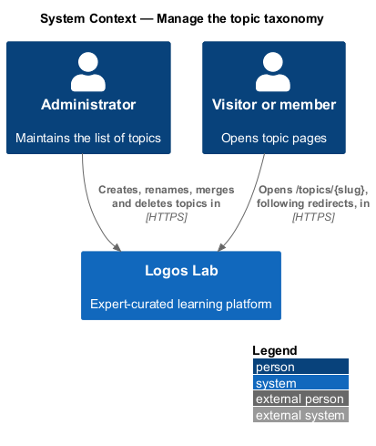
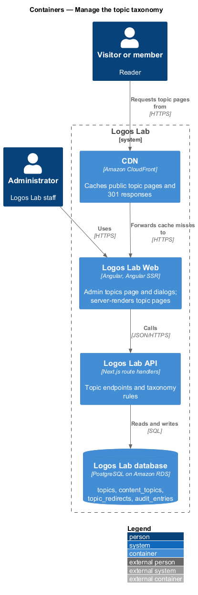
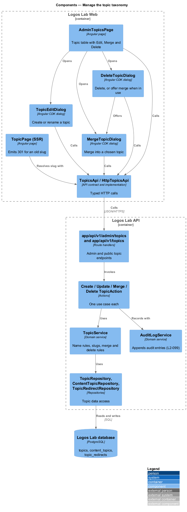
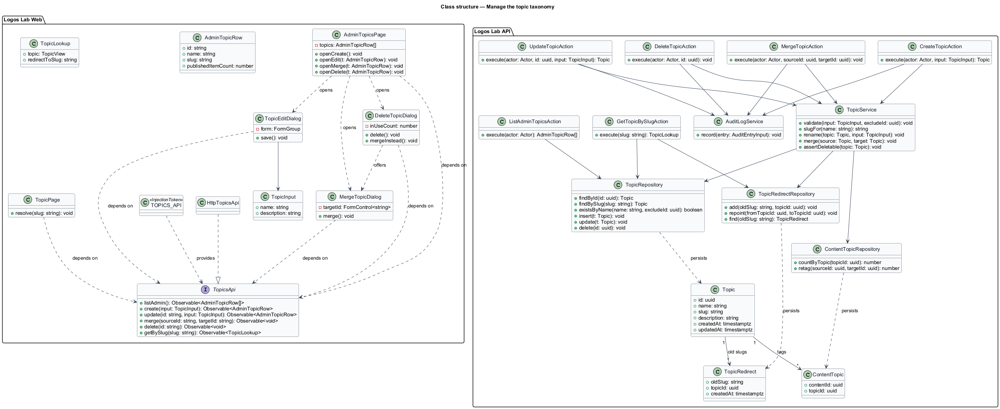
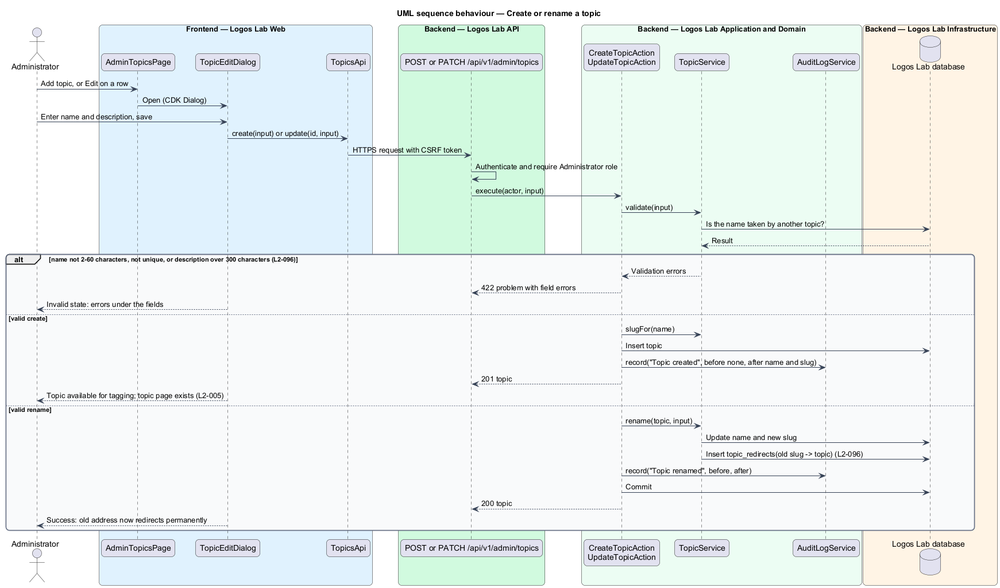
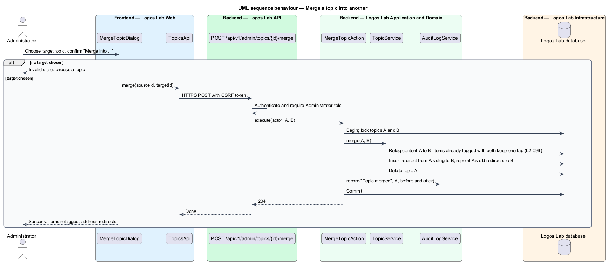
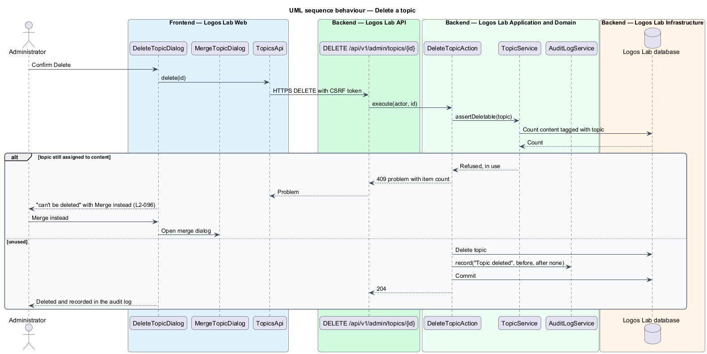
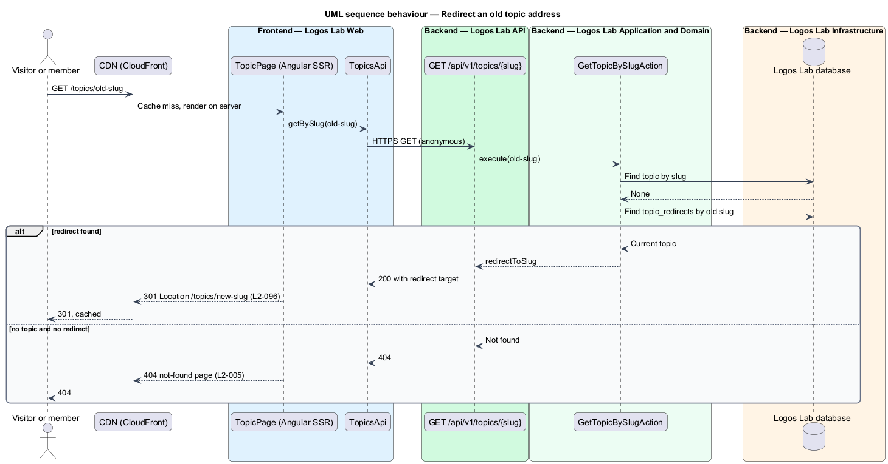

# Manage the topic taxonomy

## Overview

Logos Lab organizes its content by topic, such as "Theology of technology" or "AI ethics". This
feature is the part of the administration subsystem that lets Administrators maintain that list. It
feeds discovery: authors tag content with topics, the catalogue filters by topic, and every topic has
a public page at `/topics/{slug}` (`L2-005`).

- **topic taxonomy** — controlled list of topics that content may be tagged with
- **slug** — URL-safe form of a topic name used in its address, such as `ai-ethics`
- **topic redirect** — stored mapping from a slug a topic no longer uses to the topic that replaced it
- **merge** — operation that moves every tag of one topic to another, redirects the first topic's
  address, and removes the first topic

An Administrator creates a topic with a name and a description. Renaming a topic changes its slug,
and the old address redirects permanently to the new one. Merging moves the content and the address
of one topic to another. A topic still assigned to content cannot be deleted; the merge is offered
instead.

## Description

### Logos Lab Web

- **`AdminTopicsPage`** — routed page at `/admin/topics` (baseline choice) in the admin layout. It
  shows an `ll-table` of topics with each topic's address and published item count, and Edit, Merge
  and Delete `ll-button`s on each row, plus Add topic. Mock states in `docs/mocks/pages/admin-topics/`:
  `default`, `loading`, `empty` (add the first topic), `error` (Try again and a support address) and
  `long` (names at the 60-character limit).
- **`TopicEditDialog`** — CDK dialog on `ll-dialog` with `ll-text-field` for the name and
  `ll-textarea` for the description. Mock states in `docs/mocks/dialogs/topic-edit/`: `default`,
  `invalid` (name already taken, description over 300 characters), `busy`, `failed` and `success`
  (the old address now redirects permanently).
- **`MergeTopicDialog`** — CDK dialog with an `ll-select` "Merge into" listing the other topics, and
  the note that items already tagged with both keep one tag. Mock states in
  `docs/mocks/dialogs/merge-topic/`: `default`, `invalid` (no target chosen), `busy` and `success`.
- **`DeleteTopicDialog`** — CDK dialog that confirms a delete. When the topic is in use it shows the
  item count and offers "Merge instead", which opens `MergeTopicDialog`. Mock states in
  `docs/mocks/dialogs/delete-topic/`: `default`, `in-use`, `busy` and `success`.
- **`TopicPage`** — the public topic page (`L2-005`). During server rendering it asks the API for the
  slug and returns `301` with the new address when the slug belongs to a redirect.
- **`TopicsApi`** — contract in the shared API library, provided through `TOPICS_API` and
  implemented by `HttpTopicsApi`.

### Logos Lab API

| Method and path | Action | Notes |
|---|---|---|
| `GET /api/v1/admin/topics` | `ListAdminTopicsAction` | Topics with slug and published item count |
| `POST /api/v1/admin/topics` | `CreateTopicAction` | `201`; `422` with field errors |
| `PATCH /api/v1/admin/topics/{id}` | `UpdateTopicAction` | Rename and describe; adds a redirect when the slug changes |
| `POST /api/v1/admin/topics/{id}/merge` | `MergeTopicAction` | Body names the target topic |
| `DELETE /api/v1/admin/topics/{id}` | `DeleteTopicAction` | `409` with the item count when the topic is in use |
| `GET /api/v1/topics/{slug}` | `GetTopicBySlugAction` | Anonymous; returns the topic or its redirect target |

- Admin endpoints require the Administrator role. Each change writes an audit entry through
  `AuditLogService` in its transaction (`L2-099`).
- **`TopicService`** — enforces the rules: name 2 to 60 characters and unique (case-insensitive
  uniqueness is a baseline choice), description up to 300 characters, slug derived from the name.
  `rename` stores the old slug in `topic_redirects`. `merge` retags content, adds a redirect from the
  source slug, repoints the source's earlier redirects to the target, and deletes the source.
  `assertDeletable` refuses a topic with any row in `content_topics`. The mock copy counts published
  items; whether drafts also block deletion is `<TO SUPPLY>`, and this design counts every tag.
- **Entities and tables** — `Topic` (`topics`: id, name, slug, description, timestamps),
  `ContentTopic` (`content_topics`: content id, topic id) and `TopicRedirect` (`topic_redirects`: old
  slug, topic id, created at).
- **CDN** — CloudFront caches the `301` responses for old topic addresses with the public page cache
  policy (`L2-124`).

## Requirements

| L2 ID | Refines (L1) | Requirement |
|-------|--------------|-------------|
| `L2-096` | `L1-016` | **Topic taxonomy management.** Administrators manage the controlled list of topics. |

## Diagrams

### System context

Administrators maintain topics in Logos Lab, and readers open topic pages that follow the resulting
redirects.

### Containers

Logos Lab Web hosts the admin page and server-renders topic pages behind the CDN. The API holds the
taxonomy rules and the database holds topics, tags and redirects.

### Components

The admin page opens three dialogs that call `TopicsApi`. Four actions share `TopicService`, which
uses the topic, tag and redirect repositories.

### Class structure

A `Topic` owns its `ContentTopic` tags and its `TopicRedirect` old slugs. Every change action also
depends on `AuditLogService`.

### Behaviour — create or rename a topic

Validation enforces the name and description limits. A rename stores the old slug as a redirect in
the same transaction.

### Behaviour — merge a topic

The merge retags the content, redirects the source address to the target, and removes the source in
one transaction.

### Behaviour — delete a topic

A topic still assigned to content is refused with `409`, and the dialog offers the merge instead.

### Behaviour — redirect an old topic address

The server-rendered topic page answers an old slug with `301` to the current address and an unknown
slug with `404`.

