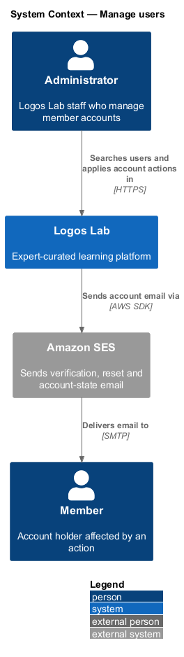
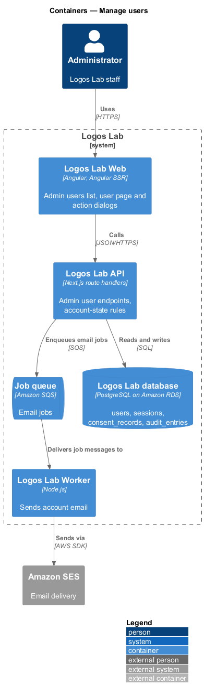
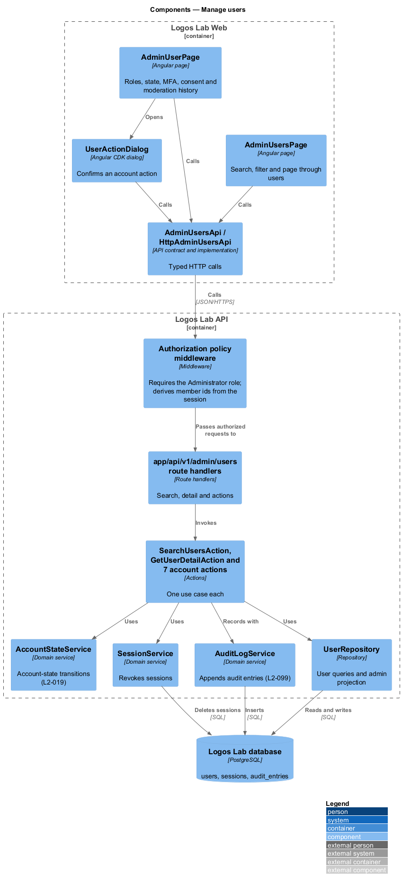
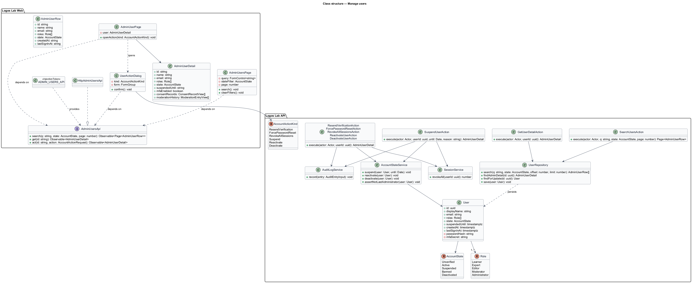
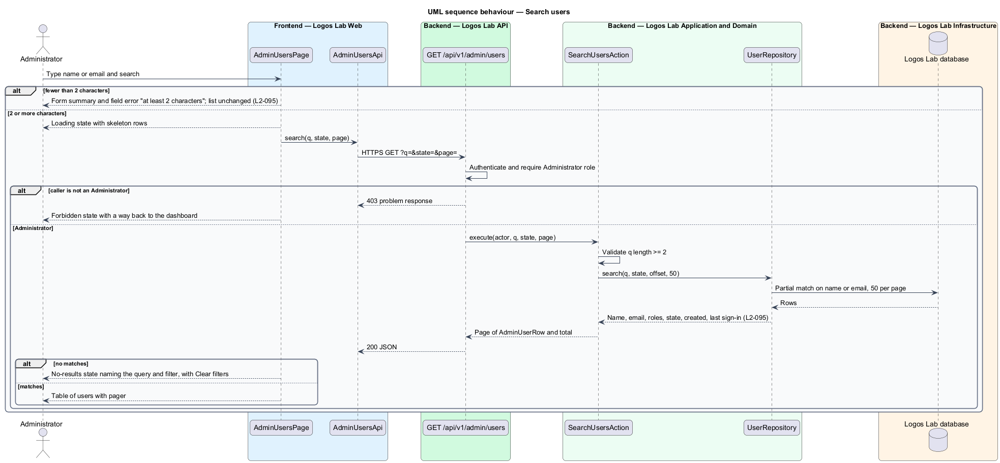
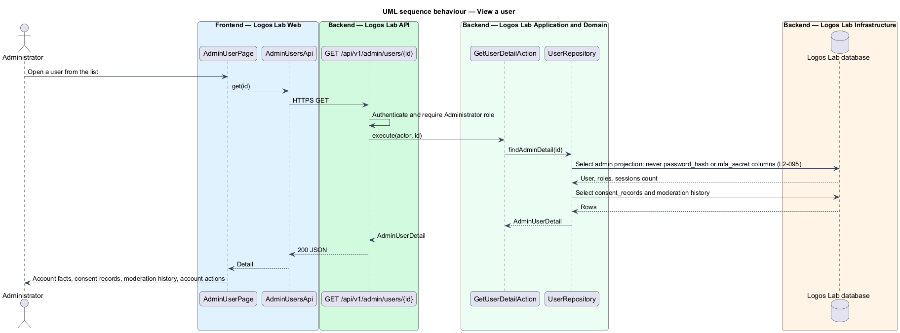
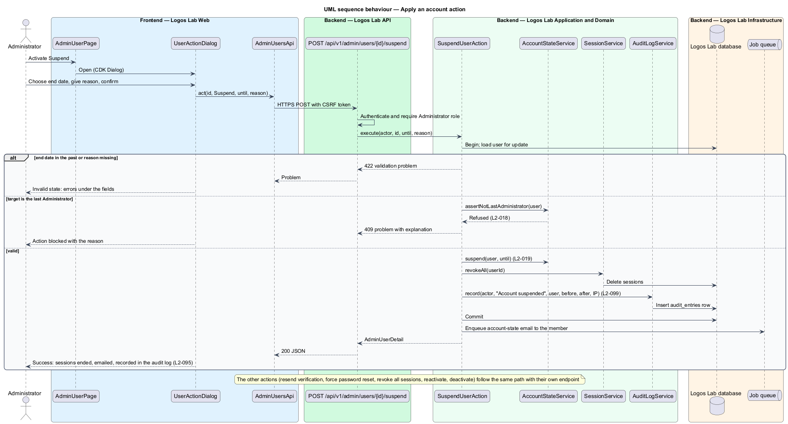
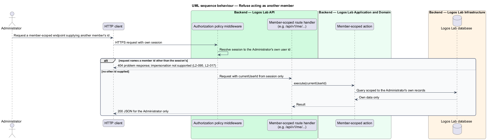

# Manage users

## Overview

Logos Lab staff with the Administrator role look after member accounts. This feature is the user
management part of the administration subsystem, reached at `/admin/users`. It lets an Administrator
find a member, review the account, and apply a small set of account actions. Role changes, expert
invitations, the topic taxonomy, featured content and site settings are separate administration
features.

- **member** — person with a Logos Lab account; every account has the Learner role
- **account state** — one of Unverified, Active, Suspended (until a date), Banned or Deactivated,
  which decides what the account can do (`L2-019`)
- **account action** — administrative change to an account: resend verification, force a password
  reset, revoke all sessions, suspend, reactivate or deactivate
- **impersonation** — acting in the platform as another member; Logos Lab does not support it

Each account action takes effect at once and is recorded in the administrative audit log
(`L2-099`). The detail page shows roles, state, two-step verification status, consent records and
moderation history. It never shows the password hash or the MFA secret.

## Description

### Logos Lab Web

- **`AdminUsersPage`** — routed page at `/admin/users` in the admin layout (`ll-sidebar-navigation`).
  It uses `ll-page-header`, `ll-search-filter-toolbar` (search field and a state `ll-select`),
  `ll-table` with name, email, roles (`ll-badge`), state, created date and last sign-in, and
  `ll-pagination`. Search needs at least 2 characters and matches part of a name or email; results show
  50 per page. Mock states in `docs/mocks/pages/admin-users/`: `default`, `loading`, `error`,
  `invalid` (one-character search refused), `no-results` (with Clear filters), `long` and `forbidden`
  (a non-administrator is told the page is for administrators only).
- **`AdminUserPage`** — routed page at `/admin/users/{id}`. It uses `ll-breadcrumb`,
  `ll-profile-header` with the account actions, an `ll-description-list` of account facts (roles,
  state, email verification, two-step verification, created, last sign-in, active sessions), `ll-table`
  for consent records and certificates, `ll-empty-state` for an empty moderation history, and
  `ll-danger-zone` for Suspend and Deactivate. Mock states in `docs/mocks/pages/admin-user/`:
  `default`, `loading`, `error`, `unverified`, `suspended`, `deactivated` and `last-admin`.
- **`UserActionDialog`** — CDK dialog built on `ll-dialog` that confirms an action and collects its
  inputs; for Suspend these are an end date and a reason the member sees. Mock states in
  `docs/mocks/dialogs/user-action/`: `default`, `invalid` (end date in the past, reason missing),
  `busy`, `failed` (account unchanged, form kept) and `success`.
- **`AdminUsersApi`** — contract in the shared API library, provided through `ADMIN_USERS_API` and
  implemented by `HttpAdminUsersApi`: `search`, `get` and `act`.

### Logos Lab API

| Method and path | Action |
|---|---|
| `GET /api/v1/admin/users?q=&state=&page=` | `SearchUsersAction` |
| `GET /api/v1/admin/users/{id}` | `GetUserDetailAction` |
| `POST /api/v1/admin/users/{id}/resend-verification` | `ResendVerificationAction` |
| `POST /api/v1/admin/users/{id}/force-password-reset` | `ForcePasswordResetAction` |
| `POST /api/v1/admin/users/{id}/revoke-sessions` | `RevokeAllSessionsAction` |
| `POST /api/v1/admin/users/{id}/suspend` | `SuspendUserAction` |
| `POST /api/v1/admin/users/{id}/reactivate` | `ReactivateUserAction` |
| `POST /api/v1/admin/users/{id}/deactivate` | `DeactivateUserAction` |

- The authorization policy requires the Administrator role on every `/api/v1/admin/users` endpoint and
  answers `403` otherwise.
- Each account action runs in one transaction: it loads the user for update, applies the change
  through `AccountStateService` or `SessionService`, writes the audit entry through `AuditLogService`
  with actor, action, target, before and after values, IP address and timestamp, and commits. Email to
  the member is enqueued after commit.
- **`AccountStateService`** — owns the state transitions of `L2-019`. Suspend and deactivate revoke all
  sessions. It refuses to suspend, deactivate or remove the Administrator role from the last remaining
  Administrator (`L2-018`), as the `last-admin` mock shows.
- **`UserRepository`** — `search` runs a partial, case-insensitive match on display name or email.
  The index type for partial matching is `<TO SUPPLY>`. `findAdminDetail` selects an explicit column
  list that excludes `password_hash` and `mfa_secret`.
- **No impersonation** — member-scoped endpoints take the user id only from the session. A request that
  names another member's id on such an endpoint is refused with `404`, as `L2-017` specifies for
  out-of-scope ids. No endpoint lets an Administrator act as another member.

## Requirements

| L2 ID | Refines (L1) | Requirement |
|-------|--------------|-------------|
| `L2-095` | `L1-016` | **User management.** Administrators manage member accounts at `/admin/users`. |

## Diagrams

### System context

The Administrator manages accounts in Logos Lab. Account actions that inform the member send email
through Amazon SES.

### Containers

Logos Lab Web calls the admin user endpoints of the Logos Lab API, which writes accounts, sessions
and audit entries and enqueues email for the Worker.

### Components

The authorization policy admits only Administrators. Each action uses `AccountStateService`,
`SessionService` and `AuditLogService` over `UserRepository`.

### Class structure

The pages and the dialog depend on `AdminUsersApi`. `User` keeps its password hash and MFA secret
private, and the admin projection `AdminUserDetail` has no field for them.

### Behaviour — search users

Searches shorter than 2 characters are refused in the page; valid searches return 50 rows per page,
and non-administrators receive `403`.

### Behaviour — view a user

The detail action reads an explicit projection that leaves out secrets, then adds consent records and
moderation history.

### Behaviour — apply an account action

Suspension shows the shared shape of every account action: validation, the last-Administrator guard,
the state change, session revocation and the audit entry in one transaction.

### Behaviour — refuse acting as another member

A member-scoped request that names another member's id is refused before it reaches an action, so an
Administrator cannot act as another member.

