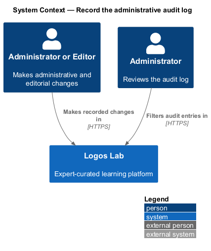
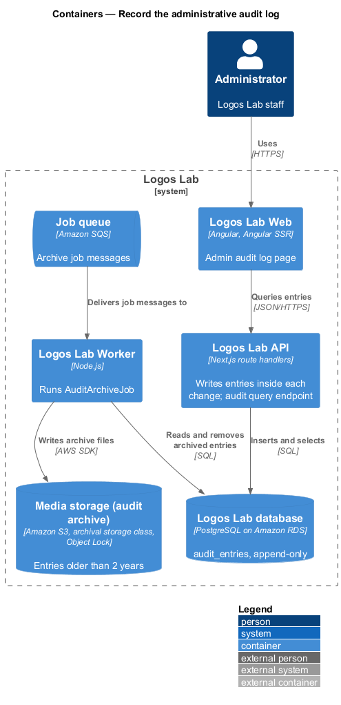
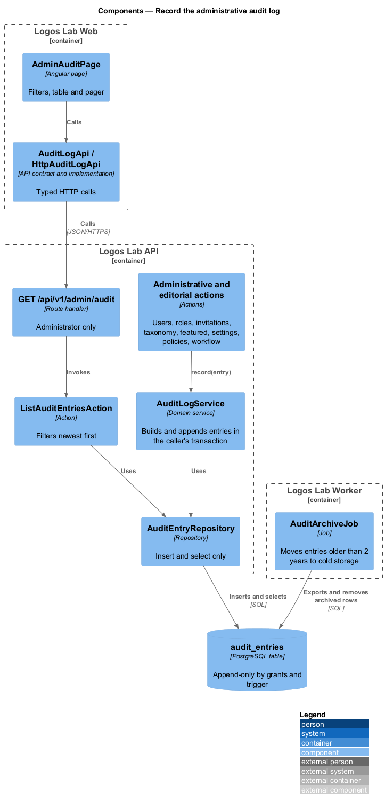
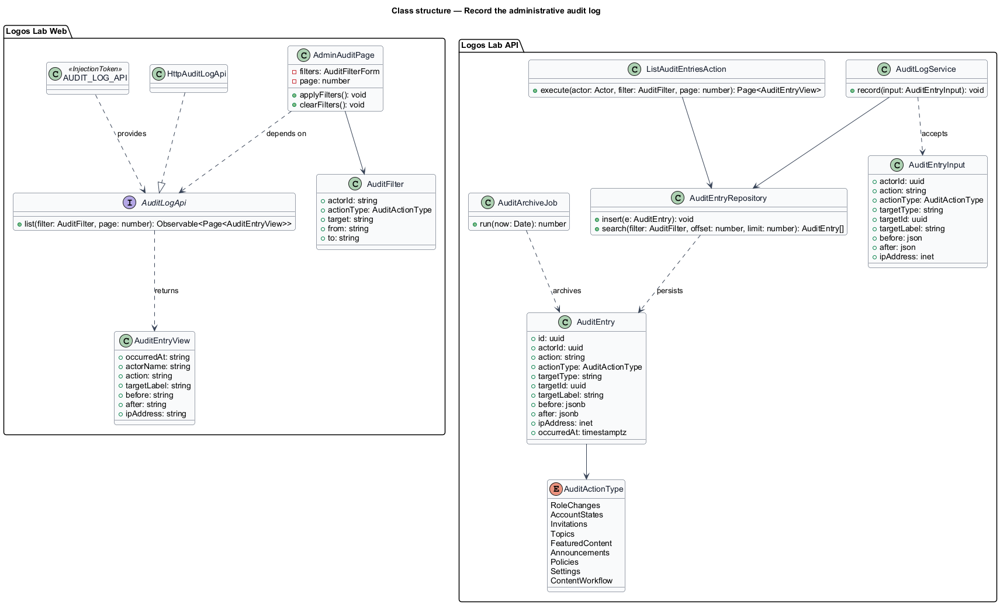
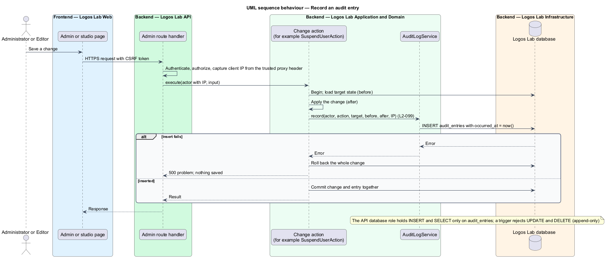
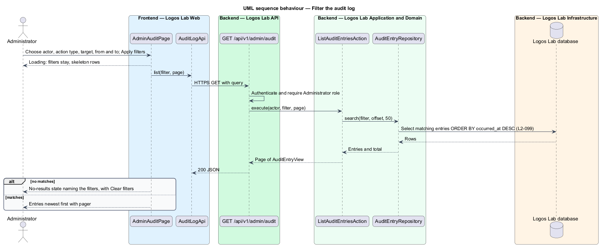
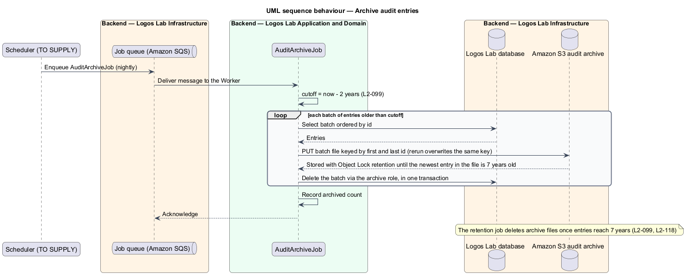

# Record the administrative audit log

## Overview

Logos Lab staff change accounts, roles, the taxonomy, featured content, settings, policies and the
state of content. This feature records every such change and lets Administrators review the record at
`/admin/audit`. It sits in the administration subsystem, and every other administration feature, as
well as the editorial workflow, writes to it.

- **audit entry** — append-only record of one administrative or editorial change, holding actor,
  action, target, before and after values, IP address and timestamp
- **append-only** — property of a store whose rows can be added and read but never changed or removed
  by the application
- **cold storage** — low-cost archival object storage for entries that are no longer queried online

Each change writes its audit entry in the same transaction as the change, so a change is never saved
without its entry. Administrators filter entries by actor, action type, target and date range, newest
first. Entries move to cold storage at 2 years old and are kept for 7 years in total.

Moderation actions have their own audit trail (`L2-089`); this log covers administrative and
editorial changes.

## Description

### Logos Lab Web

- **`AdminAuditPage`** — routed page at `/admin/audit` in the admin layout. It uses `ll-page-header`,
  `ll-search-filter-toolbar` with an Actor `ll-select`, an Action `ll-select` (Role changes, Account
  states, Invitations, Topics, Featured content, Announcements, Policies, Settings, Content workflow),
  a Target field and From and To dates, an `ll-table` (When, Actor, Action, Target, Before → after,
  IP address) and `ll-pagination` at 50 entries per page. Mock states in
  `docs/mocks/pages/admin-audit/`: `default`, `loading`, `empty`, `error`, `no-results` and `long`
  (long values and an IPv6 address).
- **Export CSV** — the `default` mock shows an Export CSV button. `L2-099` does not require an export;
  if it stays, it follows the CSV rules of `L2-103`. Its inclusion is `<TO SUPPLY>`.
- **`AuditLogApi`** — contract in the shared API library, provided through `AUDIT_LOG_API` and
  implemented by `HttpAuditLogApi`: `list(filter, page)`.

### Logos Lab API

| Method and path | Action | Notes |
|---|---|---|
| `GET /api/v1/admin/audit?actor=&action=&target=&from=&to=&page=` | `ListAuditEntriesAction` | Administrator only; newest first, 50 per page |

- **`AuditLogService`** — domain service that every change action calls with an `AuditEntryInput`.
  It writes through the caller's transaction, so the entry commits or rolls back with the change. The
  actions that call it cover users, roles, invitations, taxonomy, featured content, settings, policies
  and content workflow state.
- **IP address** — the route handler takes the client IP from the header set by CloudFront and the
  load balancer; the trusted header and proxy list are `<TO SUPPLY>`.
- **`AuditEntry`** — entity in `audit_entries`: `id` (UUID), `actorId`, `action`, `actionType`
  (`AuditActionType`), `targetType`, `targetId`, `targetLabel`, `before` and `after` (`jsonb`),
  `ipAddress` (`inet`) and `occurredAt`. Indexes on `occurred_at`, `(actor_id, occurred_at)` and
  `(action_type, occurred_at)` support the filters.
- **Append-only enforcement** — the API database role holds `INSERT` and `SELECT` only on
  `audit_entries`, and a trigger rejects `UPDATE` and `DELETE`. Only the archive job's role may delete
  rows, and only after they are stored in the archive.

### Logos Lab Worker

- **`AuditArchiveJob`** — runs nightly. It writes entries older than 2 years in batches to an S3
  audit archive in an archival storage class (class `<TO SUPPLY>`) with S3 Object Lock, then deletes
  them from the database. Object keys derive from the batch's id range, so a rerun rewrites the same
  object (`L2-140`). Object Lock keeps each file until its newest entry is 7 years old, after which the
  retention job deletes it (`L2-118`).

## Requirements

| L2 ID | Refines (L1) | Requirement |
|-------|--------------|-------------|
| `L2-099` | `L1-016` | **Administrative audit log.** All administrative and editorial actions shall be recorded. |

## Diagrams

### System context

Staff make recorded changes in Logos Lab, and Administrators review the record there.

### Containers

The API writes entries into the database as part of each change and serves the audit query. The
Worker archives old entries to S3.

### Components

Change actions call `AuditLogService`, which appends through `AuditEntryRepository`.
`ListAuditEntriesAction` serves the page, and `AuditArchiveJob` moves old rows to cold storage.

### Class structure

`AuditEntry` holds the actor, action, target, before and after values, IP address and timestamp, and
`AuditActionType` matches the page's Action filter.

### Behaviour — record an audit entry

The change and its entry commit in one transaction; if the entry fails, the change rolls back.

### Behaviour — filter the audit log

The query applies the filters and returns entries newest first, 50 per page.

### Behaviour — archive audit entries

Entries older than 2 years move in batches to locked S3 objects and leave the database; they are
deleted at 7 years.

