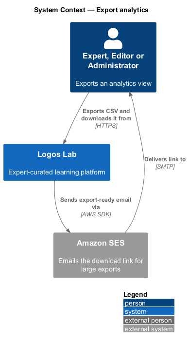
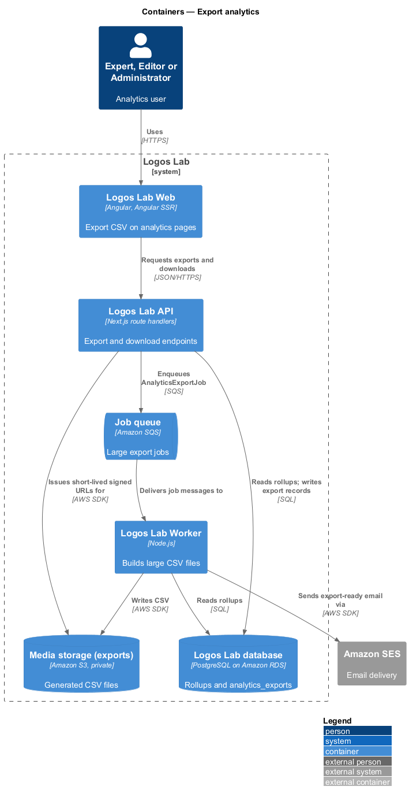
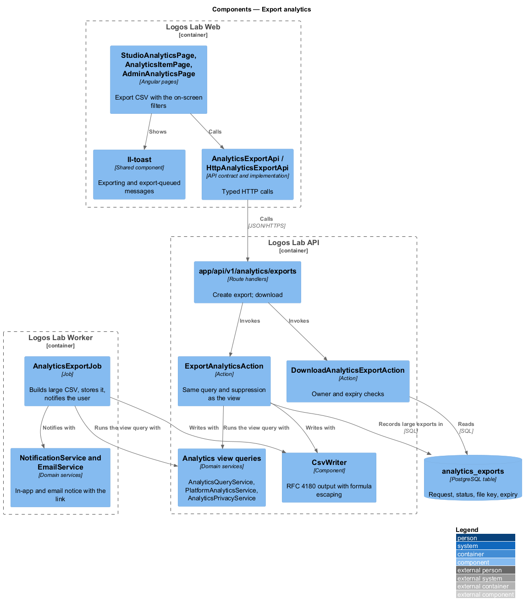
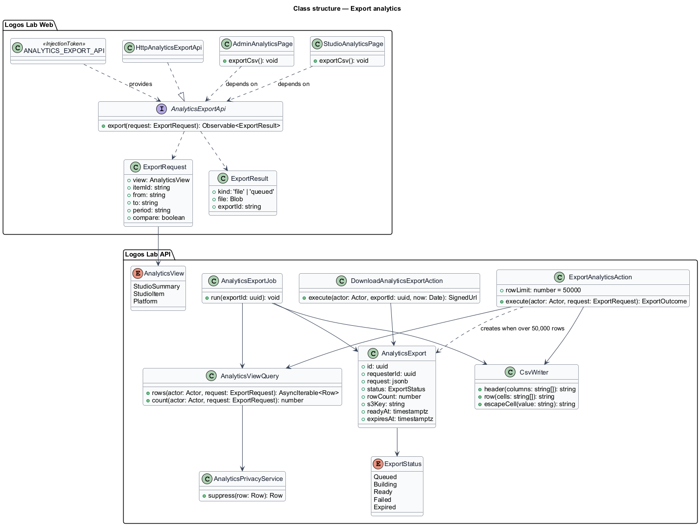
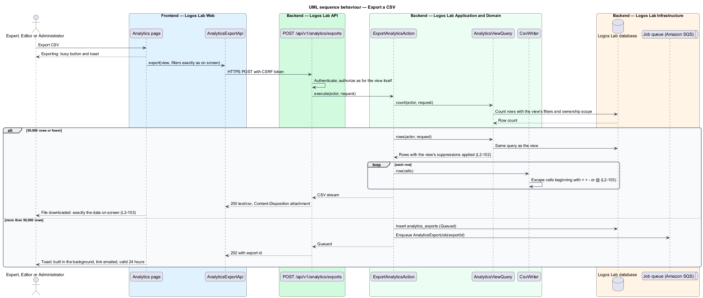
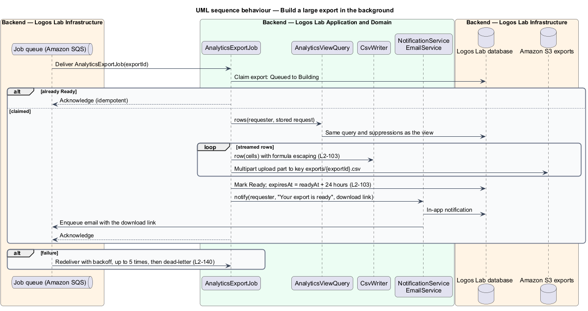
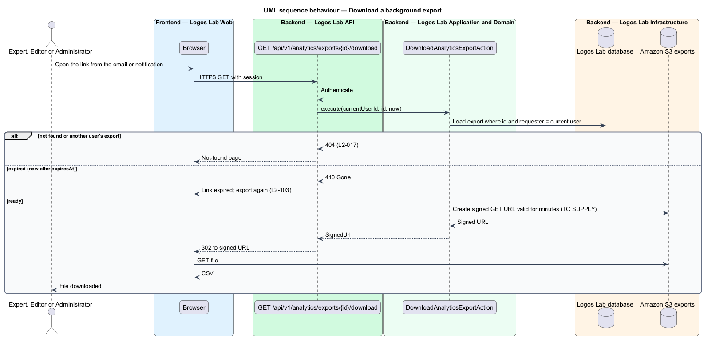

# Export analytics

## Overview

Experts, Editors and Administrators sometimes need analytics outside Logos Lab, for a report or a
spreadsheet. This feature adds "Export CSV" to every analytics view: the studio summary and item pages
(`L2-100`) and platform analytics (`L2-101`). It sits in the analytics subsystem and reuses the same
queries and privacy rules as the views it exports (`L2-102`).

- **CSV export** — comma-separated file of exactly the data an analytics view shows, with the same
  filters and suppressions
- **formula injection** — attack in which a cell beginning with `=`, `+`, `-` or `@` is run as a
  formula when a spreadsheet application opens the file
- **background export** — export of more than 50,000 rows, built by the Worker and delivered by a
  download link
- **download link** — link to a background export that stops working 24 hours after the file is
  ready

Small exports download at once. An export larger than 50,000 rows is built in the background, and the
user is notified with a download link that expires after 24 hours. Every cell that begins with `=`,
`+`, `-` or `@` is escaped.

## Description

### Logos Lab Web

- **Export CSV** — an `ll-button` in the `ll-page-header` of `StudioAnalyticsPage`,
  `AnalyticsItemPage` and `AdminAnalyticsPage`. It sends the view and its current filters (period or
  date range, item, comparison) so the file matches the screen.
- **Feedback** — `ll-toast` and `ll-inline-message` report progress. Mock states:
  `docs/mocks/pages/studio-analytics/exporting.html` (a download of exactly what is on screen being
  prepared), `docs/mocks/pages/studio-analytics/export-queued.html` and
  `docs/mocks/pages/admin-analytics/export-queued.html` (over 50,000 rows, built in the background, a
  link emailed and valid for 24 hours). `docs/mocks/notifications/toast/` and
  `docs/mocks/notifications/notification/success.html` show the toast and the "ready to download"
  notification forms.
- **`AnalyticsExportApi`** — contract in the shared API library, provided through
  `ANALYTICS_EXPORT_API` and implemented by `HttpAnalyticsExportApi`. `export(request)` returns either
  the file or a queued export id.

### Logos Lab API

| Method and path | Action | Notes |
|---|---|---|
| `POST /api/v1/analytics/exports` | `ExportAnalyticsAction` | `200 text/csv` up to 50,000 rows; `202` with an export id above that |
| `GET /api/v1/analytics/exports/{id}/download` | `DownloadAnalyticsExportAction` | Requester only; `404` for others, `410` after expiry, otherwise `302` to a signed S3 URL |

- **Authorization** — an export is authorized exactly as its view: the Expert role and item ownership
  for studio views (`404` otherwise), Editor or Administrator for platform analytics.
- **`ExportAnalyticsAction`** — counts the rows the view query returns. Up to 50,000 rows it streams
  the CSV in the response. Above 50,000 rows it records an `AnalyticsExport` and enqueues
  `AnalyticsExportJob`.
- **`AnalyticsViewQuery`** — the view's own query (`AnalyticsQueryService` or
  `PlatformAnalyticsService`) with `AnalyticsPrivacyService` applied. Reusing it keeps the filters and
  the "Fewer than 5 learners" suppressions identical to the screen.
- **`CsvWriter`** — writes RFC 4180 CSV in UTF-8. `escapeCell` prefixes a single quote to any cell
  that begins with `=`, `+`, `-` or `@` (baseline choice of escape). Whether negative numbers such as
  a `-33` change are also prefixed, or written as numbers, is `<TO SUPPLY>`.
- **`AnalyticsExport`** — entity in `analytics_exports`: id, requester, stored request, `ExportStatus`,
  row count, S3 key, `readyAt` and `expiresAt` (24 hours after `readyAt`).
- **`DownloadAnalyticsExportAction`** — checks the requester and the expiry, then redirects to a signed
  S3 URL valid for a few minutes; the exact lifetime is `<TO SUPPLY>`.

### Logos Lab Worker

- **`AnalyticsExportJob`** — claims the export, streams rows from the view query through `CsvWriter`
  into a multipart upload to the private exports bucket, marks it `Ready`, and notifies the requester
  in-app (`L2-091`) and by email (`L2-092`) with the download link. It is idempotent and retried with
  backoff up to 5 times (`L2-140`). The S3 lifecycle rule that deletes expired files is `<TO SUPPLY>`.

## Requirements

| L2 ID | Refines (L1) | Requirement |
|-------|--------------|-------------|
| `L2-103` | `L1-017` | **Analytics export.** Analytics shall be exportable for offline analysis. |

## Diagrams

### System context

Analytics users export from Logos Lab. For large exports, Logos Lab emails the download link through
Amazon SES.

### Containers

The API streams small exports and queues large ones. The Worker writes large files to private S3
storage, and the API issues short-lived signed URLs to download them.

### Components

`ExportAnalyticsAction` and `AnalyticsExportJob` both run the view's own query and write through
`CsvWriter`. `DownloadAnalyticsExportAction` guards the link.

### Class structure

`ExportAnalyticsAction` holds the 50,000-row limit. `AnalyticsExport` tracks a background export from
`Queued` to `Ready` and its 24-hour expiry.

### Behaviour — export a CSV

The action counts the rows first. It streams an escaped CSV for up to 50,000 rows and queues a
background export above that.

### Behaviour — build a large export in the background

The job streams the same query into S3, sets the 24-hour expiry, and notifies the requester in-app and
by email.

### Behaviour — download a background export

Only the requester can download, and only within 24 hours. A valid request is redirected to a
short-lived signed URL.

