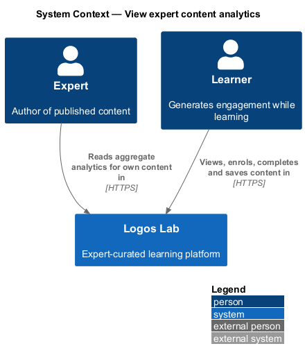
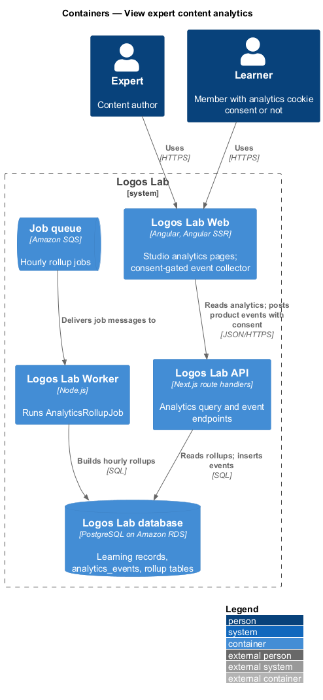
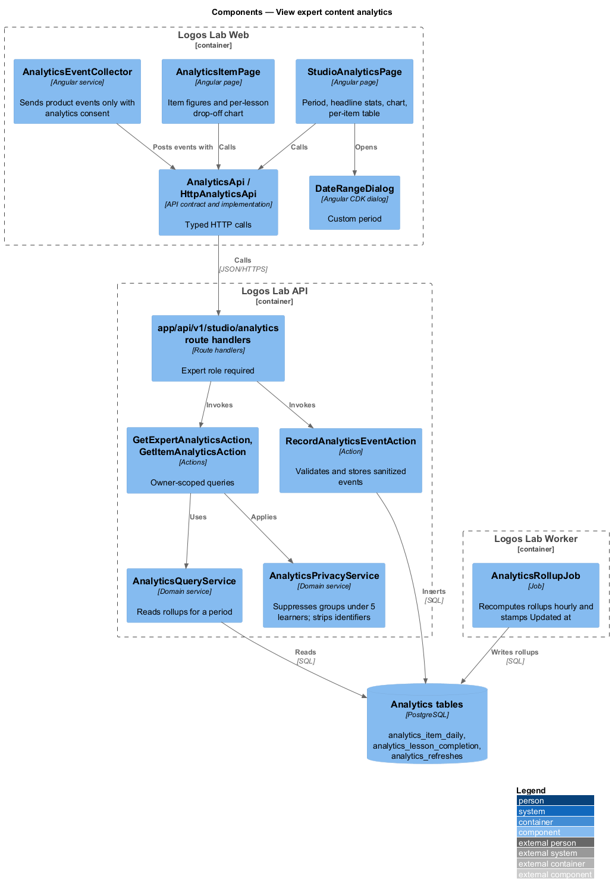
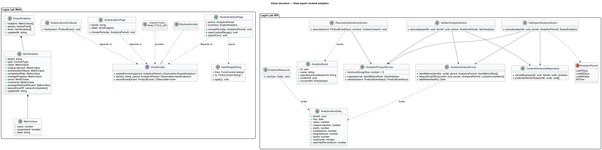
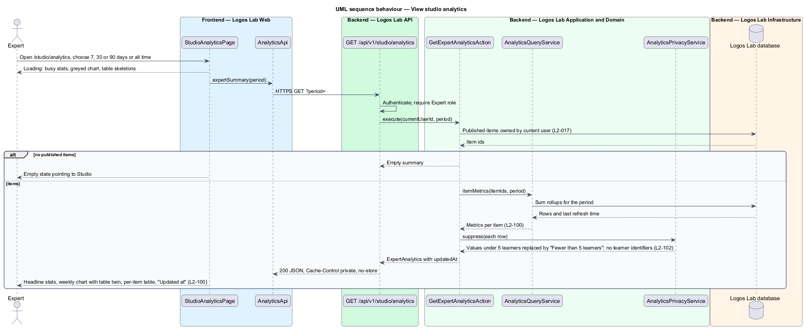
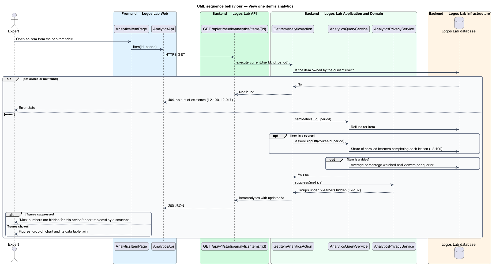
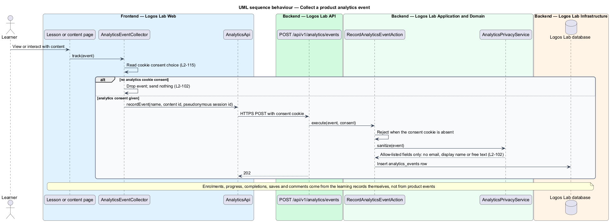
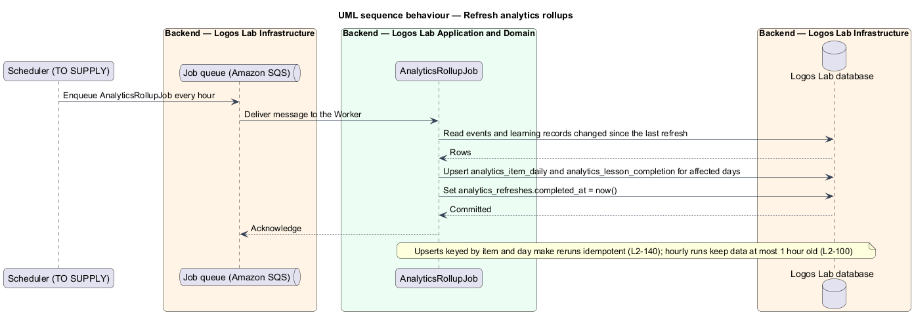

# View expert content analytics

## Overview

Experts author courses, videos, articles and collections on Logos Lab. This feature shows each expert
how that content performs, at `/studio/analytics`, without exposing the learners behind the numbers.
It sits in the analytics subsystem beside platform analytics for staff (`L2-101`) and CSV export
(`L2-103`), and it applies the analytics privacy rules (`L2-102`).

- **aggregate** — figure computed over a group of learners, such as a count, a rate or an average
- **period** — time window a figure covers: the last 7, 30 or 90 days, or all time
- **suppression** — replacement of an aggregate based on fewer than 5 learners with the text "Fewer
  than 5 learners"
- **per-lesson drop-off** — share of a course's enrolled learners who completed each lesson
- **rollup** — precomputed table of aggregates per item and day, refreshed hourly
- **product analytics event** — record of a page view or interaction, collected only with analytics
  cookie consent

For each published item and the chosen period, an expert sees views, unique learners, enrolments or
starts, completion rate, average progress, saves, comments and, for videos, average percentage
watched. Figures are at most 1 hour old, and the page shows when they were updated. An expert who
asks for content they do not own receives `404`.

## Description

### Logos Lab Web

- **`StudioAnalyticsPage`** — routed page at `/studio/analytics`. It uses `ll-page-header` with
  Export CSV, a period `ll-select`, an "Updated at" line, `ll-stat` for the headline figures,
  `ll-chart` for lesson completions per week with its "Show the numbers as a table" twin, and an
  `ll-table` of figures per item. Mock states in `docs/mocks/pages/studio-analytics/`: `default`,
  `loading`, `empty` (nothing published, pointing to Studio), `error`, `suppressed`, `exporting` and
  `export-queued` (the last two belong to `L2-103`).
- **`AnalyticsItemPage`** — routed page for one item (route `/studio/analytics/{itemId}`, baseline
  choice) with `ll-breadcrumb`, the item's figures in `ll-stat`, and for a course an `ll-chart` of
  per-lesson drop-off with a data table. Mock states in `docs/mocks/pages/analytics-item/`:
  `default` (a 24-lesson course), `video` (average percentage watched and viewers reaching each
  quarter), `suppressed`, `loading` and `error`.
- **`DateRangeDialog`** — CDK dialog with period presets and a custom range. Mock states in
  `docs/mocks/dialogs/date-range/`: `default`, `selected` and `invalid` (start after end).
- **Period contradiction** — `L2-100` names 7, 30 or 90 days or all time. The mocks also offer "This
  year" and "Custom range". Whether those extra periods are in scope is `<TO SUPPLY>`; this design
  carries the four periods of the spec.
- **`AnalyticsEventCollector`** — application service that sends product analytics events only when
  the visitor's cookie choice allows analytics (`L2-115`). Events carry an allow-listed set of fields.
- **`AnalyticsApi`** — contract in the shared API library, provided through `ANALYTICS_API` and
  implemented by `HttpAnalyticsApi`: `expertSummary`, `item` and `recordEvent`.

### Logos Lab API

| Method and path | Action | Notes |
|---|---|---|
| `GET /api/v1/studio/analytics?period=` | `GetExpertAnalyticsAction` | Expert role; the current user's published items only |
| `GET /api/v1/studio/analytics/items/{id}?period=` | `GetItemAnalyticsAction` | `404` when the item is not the caller's |
| `POST /api/v1/analytics/events` | `RecordAnalyticsEventAction` | Anonymous or signed in; refused without the analytics consent cookie |

- **`AnalyticsQueryService`** — sums `analytics_item_daily` over the period and reads
  `analytics_lesson_completion` for drop-off. It returns `analytics_refreshes.completed_at` as
  `updatedAt`.
- **`AnalyticsPrivacyService`** — replaces any aggregate based on fewer than 5 learners with "Fewer
  than 5 learners". Responses contain no learner names, email addresses or identifiers. `sanitize`
  removes everything outside the event allow-list, so no email address, display name or free-text
  input is stored. Cohort leaders' view of their own members' progress belongs to `L2-064`.
- **Ownership** — both actions resolve the expert from the session and check ownership of every item
  (`L2-017`).
- **Responses** — sent with `Cache-Control: private, no-store`, so the CDN never caches them
  (`L2-113`).
- **Tables** — `analytics_events` (product events with a pseudonymous session id), and the rollups
  `analytics_item_daily`, `analytics_lesson_completion` and `analytics_refreshes`. Enrolments,
  progress, completions, saves and comments come from the learning records, not from events.

### Logos Lab Worker

- **`AnalyticsRollupJob`** — runs every hour. It upserts rollups for the days touched since the last
  run and stamps `analytics_refreshes`. Upserts keyed by item and day make reruns idempotent
  (`L2-140`). The run shall finish within the hour for figures to stay at most 1 hour old; its time
  budget and the scheduler are `<TO SUPPLY>`.

## Requirements

| L2 ID | Refines (L1) | Requirement |
|-------|--------------|-------------|
| `L2-100` | `L1-017` | **Expert content analytics.** Experts see how their content performs at `/studio/analytics`. |
| `L2-102` | `L1-017` | **Analytics privacy.** Analytics shall not expose individual learners unnecessarily. |

## Diagrams

### System context

Learners generate engagement while they learn, and experts read aggregate figures about their own
content in Logos Lab.

### Containers

Logos Lab Web reads analytics from the API and, with consent, posts product events. The Worker
rebuilds the rollups each hour.

### Components

The two studio pages call owner-scoped actions that read rollups through `AnalyticsQueryService` and
apply `AnalyticsPrivacyService`. `AnalyticsRollupJob` writes the rollups.

### Class structure

Each figure is a `MetricValue` that can be marked suppressed. `AnalyticsItemDaily` holds the per-day
sums the query service adds up for a period.

### Behaviour — view studio analytics

The summary covers only the expert's published items, suppresses small groups, and carries the
"Updated at" time.

### Behaviour — view one item's analytics

An item the expert does not own answers `404`. A course adds the per-lesson drop-off, and a video
adds average percentage watched.

### Behaviour — collect a product analytics event

Without analytics cookie consent the collector sends nothing. With consent, the API stores only
allow-listed fields.

### Behaviour — refresh analytics rollups

An hourly job upserts the rollups and records the refresh time that the pages show as "Updated at".

