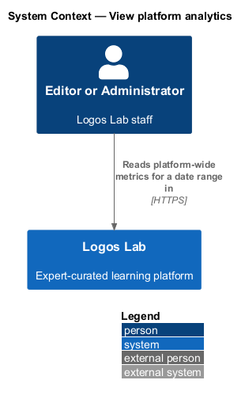
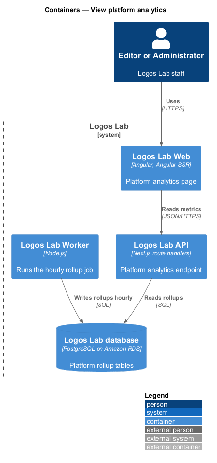
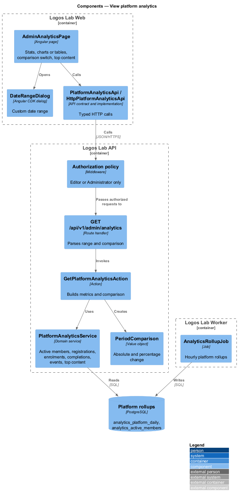
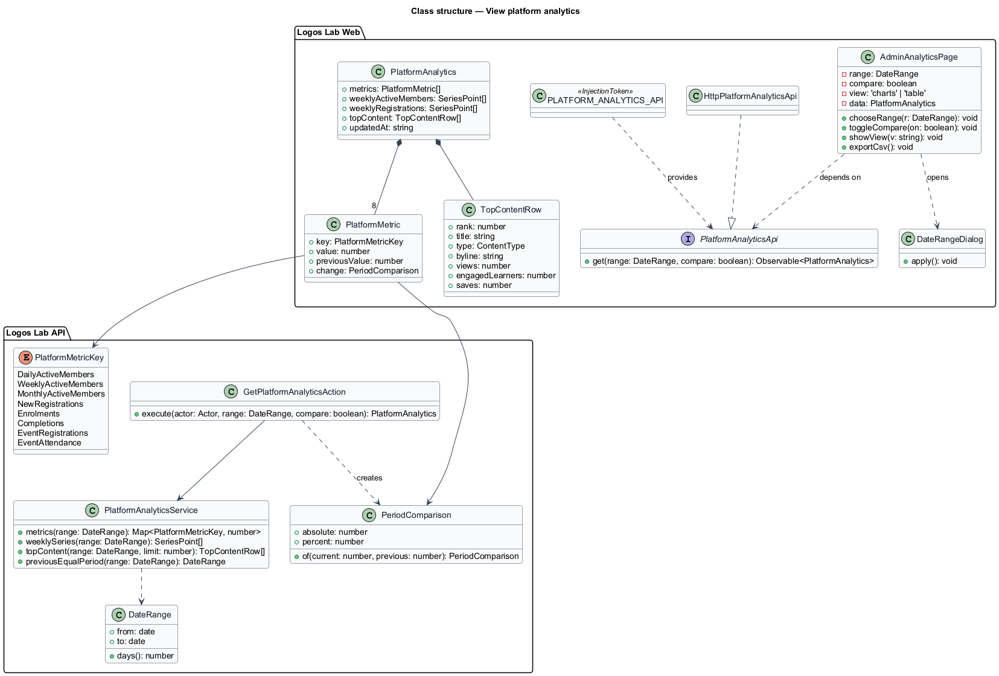
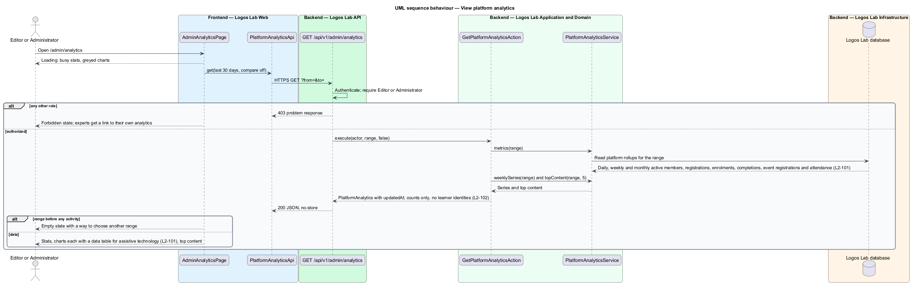
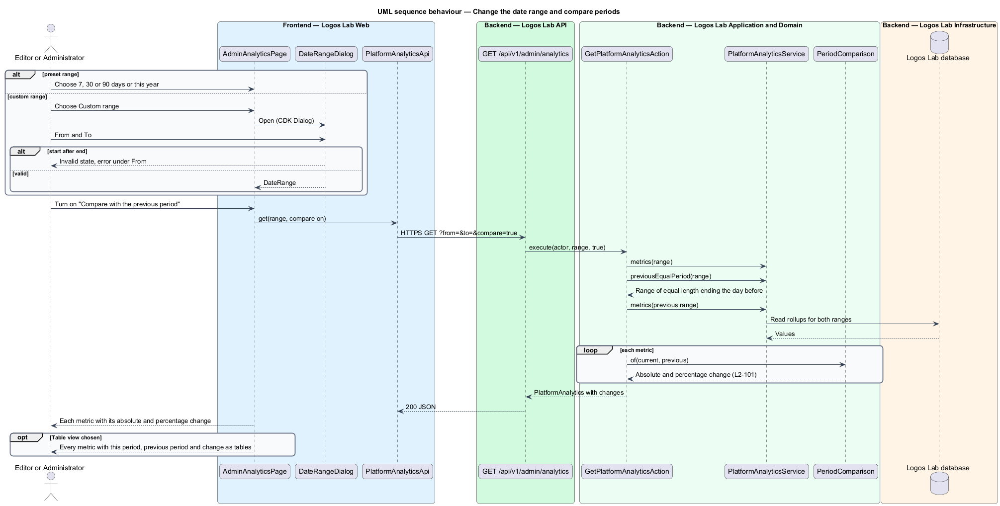

# View platform analytics

## Overview

Logos Lab staff track how the platform as a whole is used: how many members are active, how
many join, enrol, complete and attend events, and which content draws the most engagement. This
feature gives Editors and Administrators that view at `/admin/analytics`. It sits in the analytics
subsystem beside expert content analytics (`L2-100`) and CSV export (`L2-103`), and it follows the
analytics privacy rules (`L2-102`).

- **active member** — member who signed in or used the platform on a given day; counted daily (DAU),
  weekly (WAU) and monthly (MAU). The activity definition is `<TO SUPPLY>`.
- **date range** — period the metrics cover, chosen from presets or as a custom range
- **previous equal period** — range of the same length that ends the day before the chosen range
  starts
- **comparison** — difference between a metric's value in the chosen range and in the previous equal
  period, as an absolute number and a percentage
- **data table twin** — table that holds the same numbers as a chart, available to assistive
  technology

Platform analytics counts members and never lists them. Each chart has an equivalent data table, and
turning on the comparison shows every metric's absolute and percentage change.

## Description

### Logos Lab Web

- **`AdminAnalyticsPage`** — routed page at `/admin/analytics` in the admin layout. It uses
  `ll-page-header` with Export CSV, a date range `ll-select` with Custom range, an "Updated at" line,
  an `ll-switch` "Compare with the previous …", an `ll-button-group` for Charts and Table, `ll-stat` for
  the 8 metrics, two `ll-chart`s (weekly active members and new registrations per week) each with its
  "Show the numbers as a table" twin, and an `ll-table` of the top 5 items by engagement. Mock states
  in `docs/mocks/pages/admin-analytics/`: `default`, `loading`, `empty` (a range before Logos Lab
  opened), `error`, `comparison`, `table`, `forbidden` (an expert is sent to her own analytics) and
  `export-queued` (`L2-103`).
- **`DateRangeDialog`** — shared CDK dialog with presets and a custom range
  (`docs/mocks/dialogs/date-range/`).
- **`PlatformAnalyticsApi`** — contract in the shared API library, provided through
  `PLATFORM_ANALYTICS_API` and implemented by `HttpPlatformAnalyticsApi`: `get(range, compare)`.

### Logos Lab API

| Method and path | Action | Notes |
|---|---|---|
| `GET /api/v1/admin/analytics?from=&to=&compare=` | `GetPlatformAnalyticsAction` | Editor or Administrator; `403` for other roles |

- **`PlatformAnalyticsService`** — reads the platform rollups for a range: daily, weekly and monthly
  active members, new registrations, enrolments, completions, event registrations, event attendance,
  the weekly series, and top content by engagement. The engagement score that ranks top content is
  `<TO SUPPLY>`.
- **`PeriodComparison`** — value object holding the absolute and the percentage change. The display
  when the previous value is 0 is `<TO SUPPLY>`.
- **`DateRange`** — value object with `from`, `to` and `days()`; `previousEqualPeriod` derives the
  comparison range from it.
- **Privacy** — the response holds counts and content titles with their bylines only; it contains no
  learner names, email addresses or identifiers (`L2-102`). Suppression below 5 learners applies to
  aggregates shown to experts; whether it also applies here is `<TO SUPPLY>`.
- **Responses** — sent with `Cache-Control: private, no-store`.
- **Tables** — `analytics_platform_daily` and `analytics_active_members`, written by
  `AnalyticsRollupJob` (see view-expert-content-analytics). Figures are at most 1 hour old, as on the
  studio page.

## Requirements

| L2 ID | Refines (L1) | Requirement |
|-------|--------------|-------------|
| `L2-101` | `L1-017` | **Platform analytics.** Editors and Administrators see platform-wide metrics at `/admin/analytics`. |
| `L2-102` | `L1-017` | **Analytics privacy.** Analytics shall not expose individual learners unnecessarily. |

## Diagrams

### System context

Editors and Administrators read platform-wide metrics in Logos Lab; no external system takes part.

### Containers

Logos Lab Web reads metrics from the API, which reads rollups that the Worker refreshes hourly.

### Components

The authorization policy admits Editors and Administrators. `GetPlatformAnalyticsAction` reads
`PlatformAnalyticsService` and builds a `PeriodComparison` for each metric.

### Class structure

`PlatformAnalytics` holds 8 `PlatformMetric` values, each with an optional `PeriodComparison`, plus
the weekly series and the top content rows.

### Behaviour — view platform analytics

Other roles receive `403`. Authorized staff see the metrics, the charts with their table twins, and
top content.

### Behaviour — change the date range and compare periods

A new range reloads the metrics. With the comparison on, the action also reads the previous equal
period and returns each change as an absolute number and a percentage.

