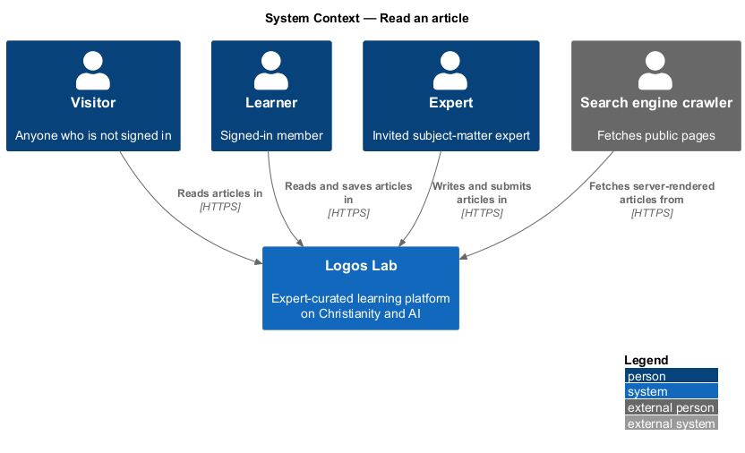
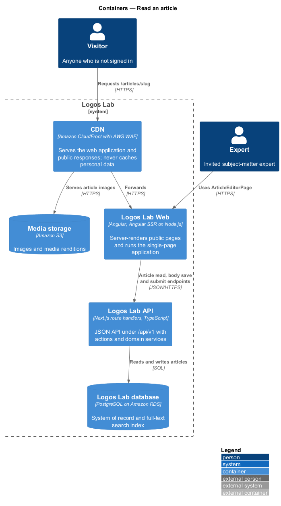
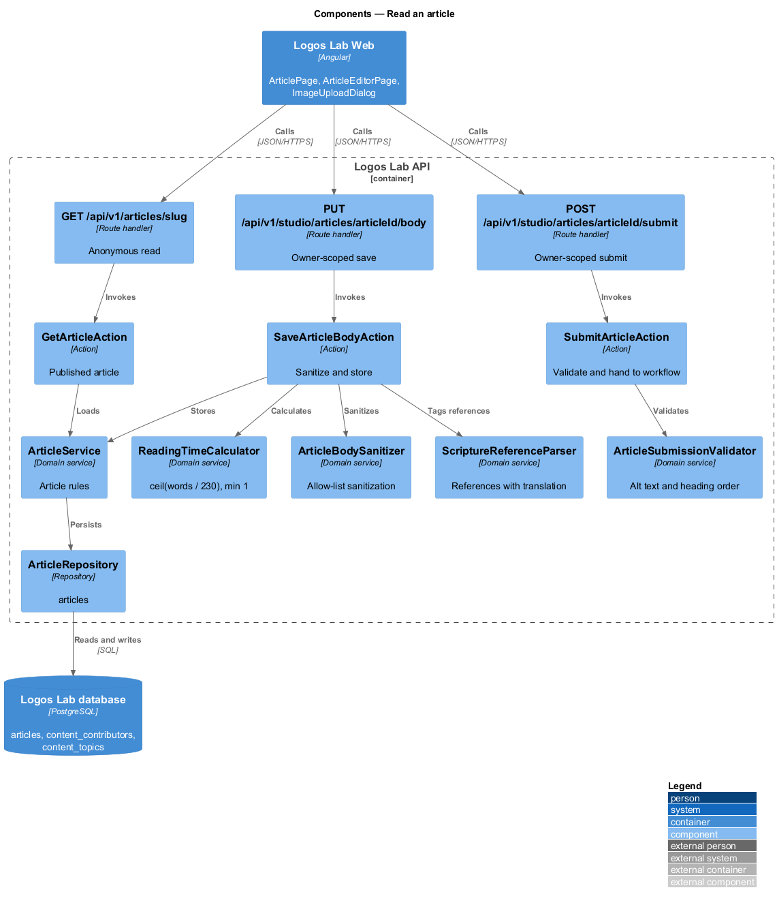
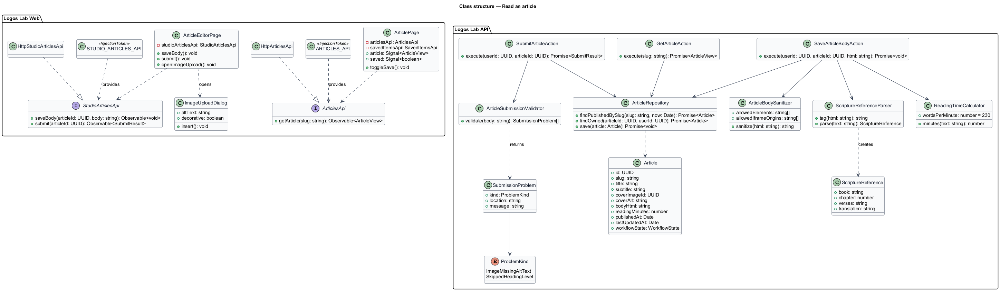
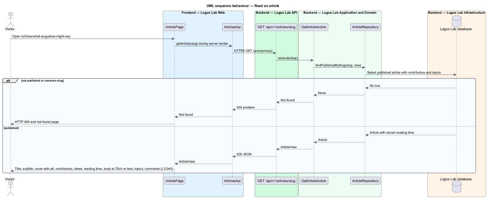
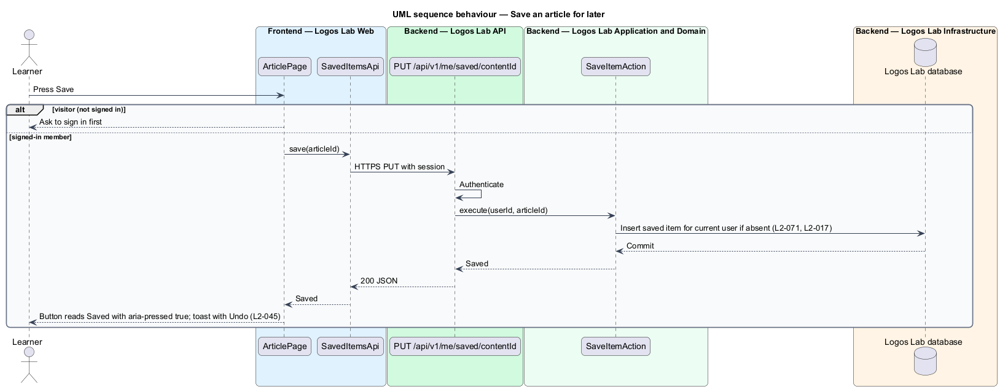
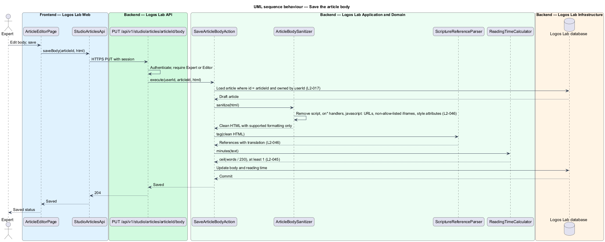
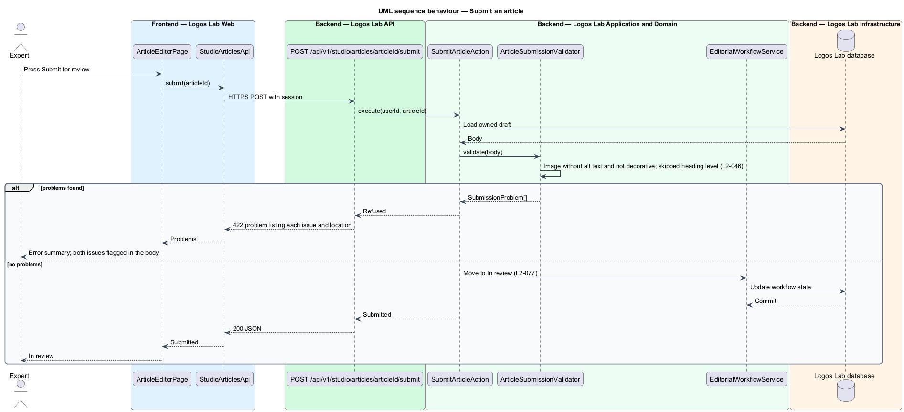

# Read an article

## Overview

An *article* is a piece of published long-form writing on Logos Lab, written by an expert or by Logos
Lab. The *articles* subsystem covers how articles are read, how their bodies are formatted and kept
safe, and how they point to related content. This feature covers reading an article and the rules
that govern its body.

Anyone can read a published article at `/articles/{slug}` without signing in. A signed-in member can
save it for later. Authors write the body in the article editor in Studio; the server removes
everything outside a defined set of formatting when the body is saved. Terms used below:

- **article body** — rich-text content of an article, stored after server-side sanitization
- **reading time** — word count divided by 230, rounded up to whole minutes, with a minimum of 1
- **measure** — length of a line of body text, in characters
- **Scripture reference** — citation of a Bible passage, such as "John 1:1-5", shown with its
  translation
- **pull quote** — short passage from the body repeated in larger type for emphasis
- **decorative image** — image that carries no information and is marked so that assistive technology
  skips it

## Description

The slice runs from `ArticlePage` and `ArticleEditorPage` in Logos Lab Web to the Logos Lab API, the
Logos Lab database and Media storage.

**Logos Lab Web — reading**

- **`ArticlePage`** — routed standalone component for `/articles/{slug}`, server-rendered. It shows
  title, subtitle, cover image with alt text, contributors with profile links, publish date,
  last-updated date when updated after publication, reading time, body, topics and comments.
- **Body measure** — `ll-prose` limits the body column to a maximum of 75 characters per line
  (`max-inline-size: 75ch`) at every viewport.
- **Save** — `ll-button` toggle with `aria-pressed`, calling `SavedItemsApi` from the saved-items
  feature (`L2-071`). A visitor is asked to sign in first. A toast announces "Saved" with Undo.
- **Design-system components** — `ll-breadcrumb`, `ll-prose`, `ll-avatar`, `ll-button`, `ll-chip`
  (topics), `ll-toast`, `ll-comment` (comments, `L2-060`), `ll-content-card` (related content,
  `L2-047`), `ll-alert` and `ll-skeleton`.
- **`ArticlesApi`** — contract with `getArticle(slug)`. `ARTICLES_API` is its token and
  `HttpArticlesApi` its HTTP implementation.
- **Screen states** — `docs/mocks/pages/article-page/` covers `default`, `visitor`, `saved`, `updated`,
  `loading`, `error` and `long`.

**Logos Lab Web — authoring**

- **`ArticleEditorPage`** — Studio page for the article body, using `ll-rich-editor` and
  `ll-workflow-bar`. Its route is `/studio/articles/{articleId}/edit` (baseline choice). Mocks:
  `docs/mocks/pages/article-editor/` (`default`, `empty`, `scripture`, `invalid`, `loading`, `error`,
  `long`).
- **`ImageUploadDialog`** — CDK dialog that uploads an image, asks for alt text or the decorative
  mark, and sets a focal point. Mocks: `docs/mocks/dialogs/image-upload/` (`default`, `busy`,
  `alt-text`, `focal-point`, `invalid`, `failed`, `success`). Upload and malware scanning are owned
  by `L2-083` and `L2-108`.
- **`StudioArticlesApi`** — contract with `saveBody(articleId, body)` and `submit(articleId)`.
  `STUDIO_ARTICLES_API` is its token and `HttpStudioArticlesApi` its HTTP implementation.

**Logos Lab API**

- **`GET /api/v1/articles/{slug}`** — anonymous. Calls `GetArticleAction`, which returns a published
  article or `404`.
- **`PUT /api/v1/studio/articles/{articleId}/body`** — Expert or Editor, owner-scoped (`L2-017`).
  Calls `SaveArticleBodyAction`, which runs `ArticleBodySanitizer` before storing.
- **`POST /api/v1/studio/articles/{articleId}/submit`** — Expert or Editor, owner-scoped. Calls
  `SubmitArticleAction`, which runs `ArticleSubmissionValidator` and then hands over to the editorial
  workflow (`L2-077`).
- **`ArticleBodySanitizer`** — allow-list sanitizer. It keeps headings h2-h4, paragraphs, bold, italic,
  links, ordered and unordered lists, block quotes, pull quotes, images with captions, embedded
  platform videos, footnotes and Scripture references. It removes `<script>`, inline event handlers,
  `javascript:` URLs, `<iframe>` elements from origins that are not allow-listed, and `style`
  attributes. The iframe origin allow-list is `<TO SUPPLY>`.
- **`ArticleSubmissionValidator`** — refuses submission when an image has no alt text and is not marked
  decorative, or when a heading level is skipped (for example h2 then h4). It returns each problem
  with its location so the editor can flag it.
- **`ScriptureReferenceParser`** — recognises references such as "John 1:1-5" and stores the book,
  chapter, verses and translation (for example ESV or NIV) on the reference element. The default
  translation and the source of the translation list are `<TO SUPPLY>`.
- **`ReadingTimeCalculator`** — computes `ceil(words / 230)`, minimum 1, when the body is saved.
- **`ArticleService`** and **`ArticleRepository`** — read and write `articles` (body, reading time,
  subtitle, cover image reference, `publishedAt`, `lastUpdatedAt`), `content_contributors` and
  `content_topics`.

**Key rules**

- A published article shows title, subtitle, cover image with alt text, contributors with profile
  links, publish date, last-updated date (if updated after publication), reading time, body, topics
  and comments.
- Reading time is the word count divided by 230, rounded up to whole minutes, minimum 1.
- The body text measure does not exceed 75 characters per line at any viewport.
- A signed-in member pressing "Save" adds the article to their saved items (`L2-071`).
- Scripture references render as references with their translation shown.
- Forbidden elements and attributes are removed on the server when the body is saved.
- Submission is refused for an image without alt text that is not marked decorative, and for a
  skipped heading level.

## Requirements

| L2 ID | Refines (L1) | Requirement |
|-------|--------------|-------------|
| `L2-045` | `L1-008` | **Article page.** Each published article has a public page at `/articles/{slug}`. |
| `L2-046` | `L1-008` | **Article content formatting and sanitization.** Article bodies support a defined set of rich formatting, and everything else is removed on save. |

## Diagrams

### System context

Visitors and learners read articles in Logos Lab; experts and editors write them in Studio.

### Containers

Logos Lab Web server-renders the article from the Logos Lab API. The API reads and writes the Logos
Lab database, and the CDN serves cover and body images from Media storage.

### Components

The read path runs through `GetArticleAction`. The write path runs every saved body through
`ArticleBodySanitizer`, and every submission through `ArticleSubmissionValidator`.

### Class structure

`Article` stores a sanitized body and a reading time. `ArticleSubmissionValidator` returns
`SubmissionProblem` values with the kind and location of each issue.

### Behaviour — read an article

The server render loads the published article. A draft or unknown slug returns HTTP 404.

### Behaviour — save an article for later

A signed-in member presses Save, and the saved-items endpoint records the item for the current user
only.

### Behaviour — save the article body

The author saves; the server removes forbidden markup, tags Scripture references and recalculates
reading time before storing.

### Behaviour — submit an article

Submission is refused with a list of problems when an image lacks alt text or a heading level is
skipped; otherwise the editorial workflow takes over.

