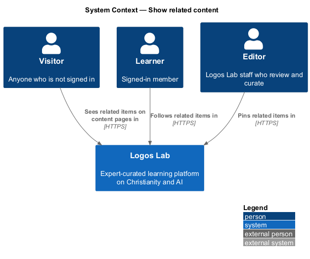
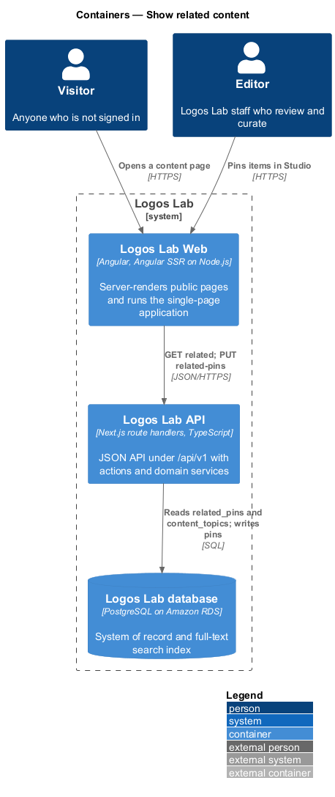
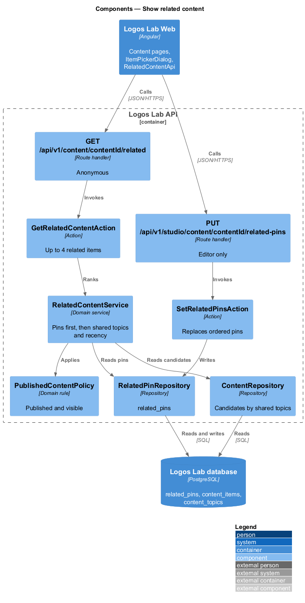
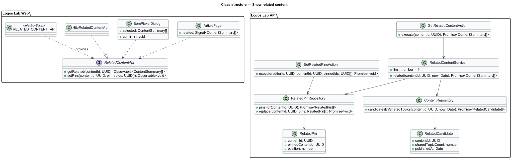
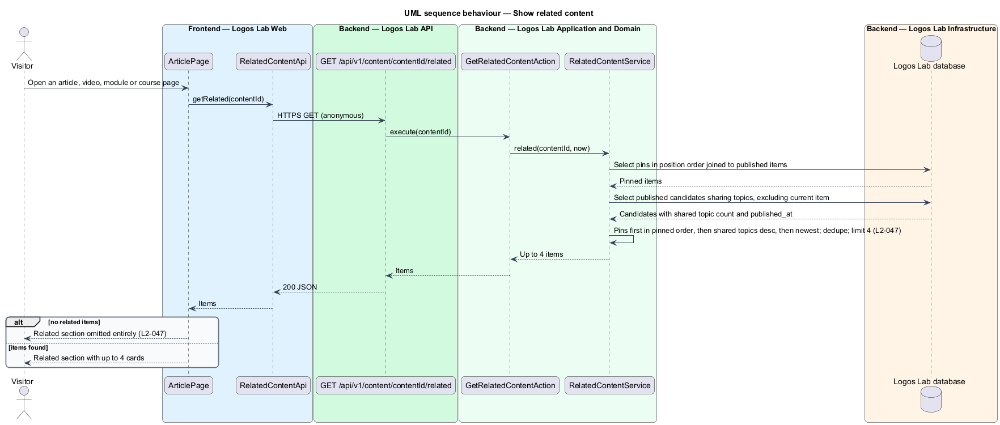
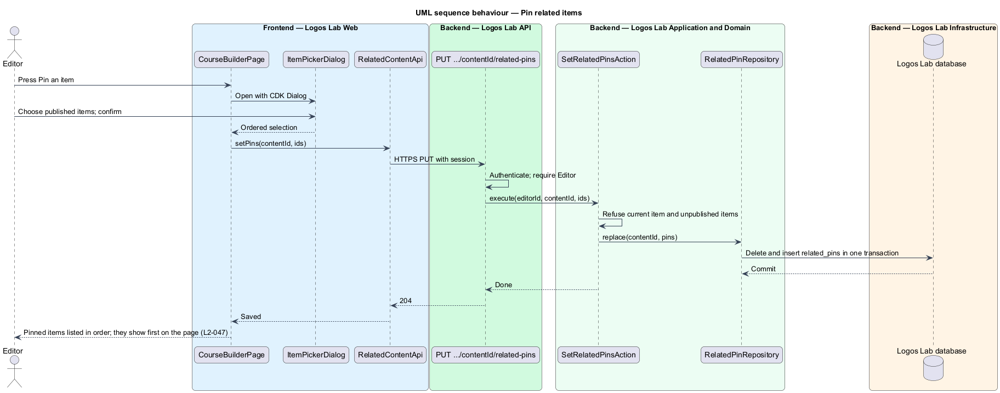

# Show related content

## Overview

*Related content* is a short list of other published items shown at the foot of a content page to
keep a learner moving to the next useful thing. This feature belongs to the articles subsystem, but
the same section appears on article, video, learning module and course pages.

The list is built automatically from shared topics. An editor can also *pin* items so that they
appear first. Terms used below:

- **related item** — published item, other than the current one, that shares at least one topic with
  it or is pinned to it
- **shared topic count** — number of topics a candidate item has in common with the current item
- **pinned related item** — item an editor has fixed to a piece of content, shown first in a set order

When no related item exists, the section is omitted entirely rather than shown empty.

## Description

The slice runs from the content pages in Logos Lab Web to the Logos Lab API and the Logos Lab
database.

**Logos Lab Web**

- **Content pages** — `ArticlePage`, `VideoPage`, `ModulePage` and `CourseOverviewPage` each render a
  "Related" section of up to 4 `ll-content-card` items. They omit the section when the list is empty.
  Mocks: `docs/mocks/pages/article-page/`, `video-page/`, `module-page/` and `course-overview/`.
- **Pinning** — the builder pages in Studio (for example `CourseBuilderPage`,
  `docs/mocks/pages/course-builder/default.html`) show a "Related content" aside with "Pin an item".
  It opens `ItemPickerDialog` (`docs/mocks/dialogs/item-picker/`) to choose published items.
- **`RelatedContentApi`** — contract with `getRelated(contentId)` and `setPins(contentId, ids)`.
  `RELATED_CONTENT_API` is its token and `HttpRelatedContentApi` its HTTP implementation.

**Logos Lab API**

- **`GET /api/v1/content/{contentId}/related`** — anonymous route handler. Returns up to 4 related
  items.
- **`PUT /api/v1/studio/content/{contentId}/related-pins`** — Editor only. Replaces the ordered pin
  list. The maximum number of pins is `<TO SUPPLY>`.
- **`GetRelatedContentAction`** and **`SetRelatedPinsAction`** — one use case each.
- **`RelatedContentService`** — places pinned items first in pinned order, keeping only published
  ones; then fills the remaining places with candidates ranked by shared topic count, descending, then
  by publish time, newest first. It excludes the current item and duplicates, and stops at 4.
- **`RelatedPinRepository`** — reads and writes `related_pins` (`content_id`, `pinned_content_id`,
  `position`).
- **`ContentRepository`** — finds published candidates by shared topics through `content_topics`.

**Key rules**

- An article, video, module or course page shows up to 4 related published items, ranked by the
  number of shared topics and then by recency, excluding the current item.
- Pinned related items appear first in their pinned order.
- When no related item exists, the related section is omitted entirely.

The specification names editors as the people who pin. The course-builder mock shows "Pin an item"
in an expert's builder. Whether experts may also pin is `<TO SUPPLY>`.

## Requirements

| L2 ID | Refines (L1) | Requirement |
|-------|--------------|-------------|
| `L2-047` | `L1-008` | **Related content.** Content pages shall suggest related content to keep learners engaged. |

## Diagrams

### System context

Visitors and learners see related items on content pages. Editors pin related items in Studio.

### Containers

Content pages call the related endpoint in the Logos Lab API, which reads pins and topics from the
Logos Lab database.

### Components

`RelatedContentService` merges pins with topic-ranked candidates. `SetRelatedPinsAction` writes the
pins for editors.

### Class structure

`RelatedPin` orders pinned items for one piece of content. `RelatedCandidate` carries the shared topic
count and publish time that drive the ranking.

### Behaviour — show related content

The page requests related items. Pins come first, ranked candidates fill the rest up to 4, and an
empty list omits the section.

### Behaviour — pin related items

The editor chooses items in `ItemPickerDialog`, and the action replaces the ordered pin list.

