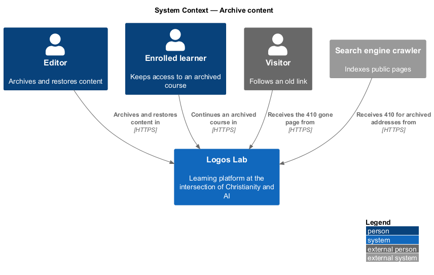
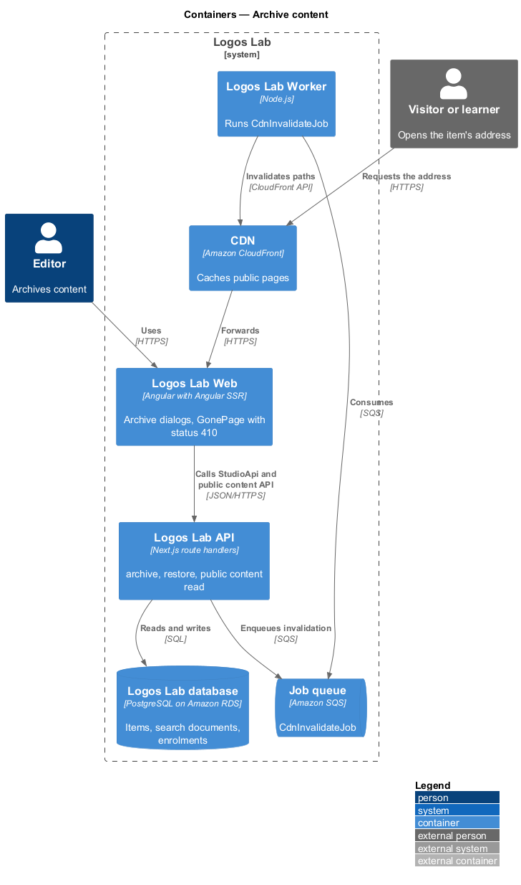
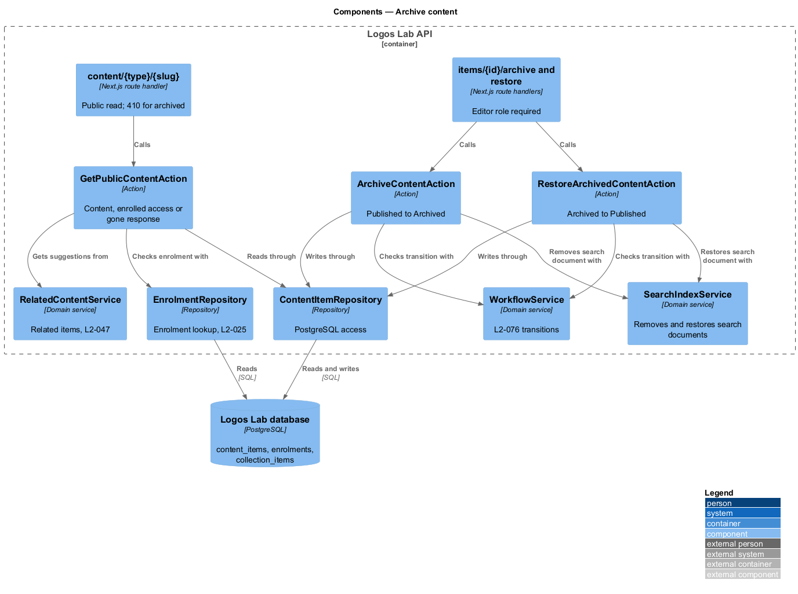
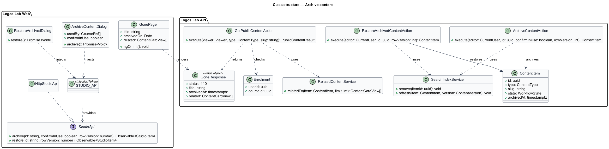
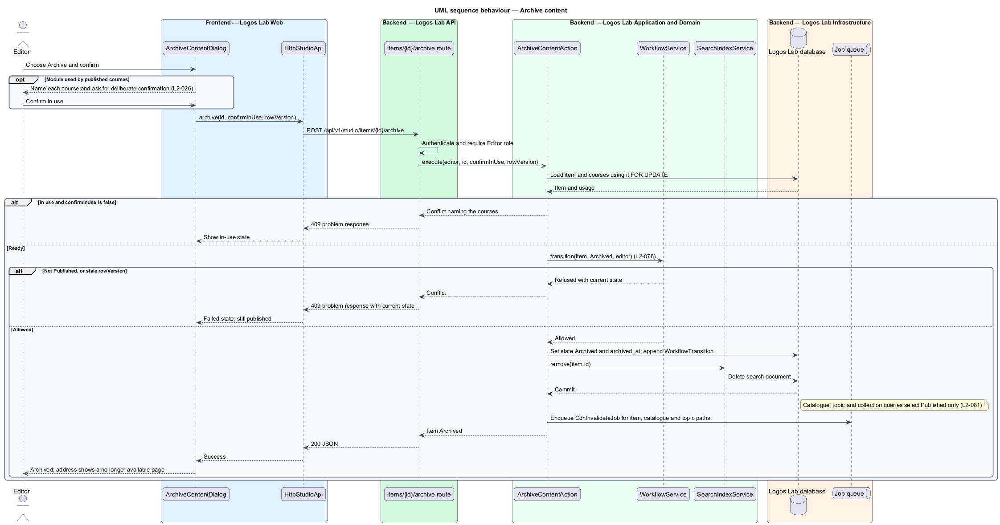
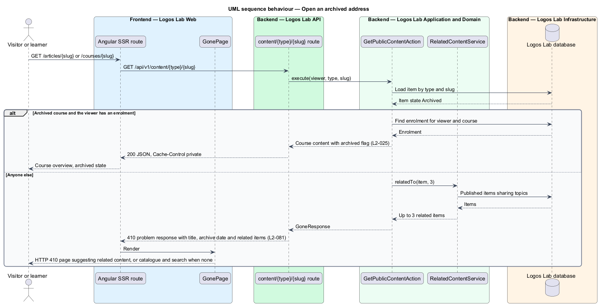
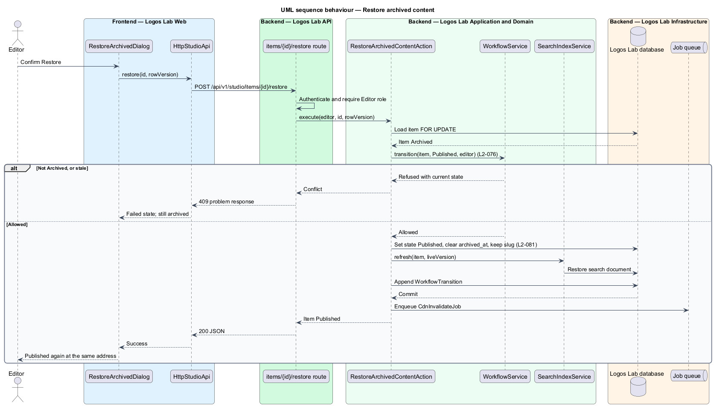

# Archive content

## Overview

Some content on Logos Lab stops being current when newer work takes its place. Deleting it would break links and
remove access for learners already enrolled. Archiving retires it from discovery instead.

**archive** — workflow transition from Published to Archived that removes a content item from discovery while keeping
it and its address

**discovery surface** — public listing where members find content: the catalogue, search, topic pages and collections

**gone page** — public page served with HTTP 410 at an archived item's address, saying the item is no longer
available and suggesting related content

An editor archives a Published item after confirming in a dialog. Visitors who follow an old link reach the gone page.
A learner enrolled in an archived course keeps access to it. An editor can restore an archived item, which becomes
Published again at the same address. Archive and restore are the last two rows of the transition table in
`move-through-editorial-workflow`.

## Description

**Logos Lab Web**

- **`ArchiveContentDialog`** — opened from the `ll-workflow-bar` of a Published item. It states that the item leaves
  the catalogue, search, topic pages and collections, and that its address shows a "no longer available" page. When a
  learning module is used by published courses, it names each course and asks for a deliberate confirmation
  (`L2-026`). Mock states in `docs/mocks/dialogs/archive-content/`: `default`, `in-use`, `busy`, `failed` and
  `success`.
- **`RestoreArchivedDialog`** — confirms that the item is published again at the same address. Mock states in
  `docs/mocks/dialogs/restore-archived/`: `default`, `busy`, `failed` and `success`.
- **`StudioEditorPage`** — mock state `archived` in `docs/mocks/pages/studio-editor/` shows the archived item with
  Restore.
- **`GonePage`** — page rendered for HTTP 410. It uses `ll-error-page` with the item's title and archive date, and
  up to three related items as `ll-content-card`. Mock states in `docs/mocks/pages/gone/`: `default` and
  `no-related`. Angular SSR sets the response status to 410.
- **`CourseOverviewPage`** — mock state `archived` in `docs/mocks/pages/course-overview/` shows an archived course
  to an enrolled learner.
- **`StudioApi`** — `archive()` and `restore()`, bound through `STUDIO_API` to `HttpStudioApi`.

**Logos Lab API**

- **Endpoints** — `POST /api/v1/studio/items/{id}/archive` and `POST /api/v1/studio/items/{id}/restore`, both for
  editors. The public read `GET /api/v1/content/{type}/{slug}` answers `410` for an archived item.
- **`ArchiveContentAction`** — checks the Published to Archived transition with `WorkflowService`, sets the state
  and `archivedAt`, removes the search document through `SearchIndexService`, and appends a `WorkflowTransition`.
  For a module used by published courses it requires the `confirmInUse` flag.
- **`RestoreArchivedContentAction`** — checks the Archived to Published transition, clears `archivedAt`, restores
  the search document and keeps the slug, so the address is unchanged.
- **Discovery queries** — the catalogue, search, topic and collection queries select only Published items. Collection
  membership rows are kept, so a restored item reappears in its collections (baseline choice).
- **`GetPublicContentAction`** — serves the public read. For an Archived item it returns `410` with the title,
  archive date and related items from `RelatedContentService` (`L2-047`). For an archived course and a learner with
  an enrolment (`L2-025`), it returns the course as usual.
- **`CdnInvalidateJob`** — invalidates the item's address, the catalogue and its topic pages after archive and
  restore.

**Rules**

- Archiving a Published item requires confirmation in a dialog.
- An archived item is removed from the catalogue, search, topic pages and collections.
- Its public URL returns HTTP 410 with a page suggesting related content.
- An enrolled learner can still access an archived course (`L2-025`).
- Restoring an archived item makes it Published at the same URL.

## Requirements

| L2 ID | Refines (L1) | Requirement |
|-------|--------------|-------------|
| `L2-081` | `L1-013` | **Archiving.** Editors archive content that is no longer current. |

## Diagrams

### System context

Editors archive and restore content in Logos Lab. Visitors and search engines receive HTTP 410 at an archived
address, while enrolled learners keep their courses.

### Containers

The API changes the item's state and search document, and the Worker invalidates cached public pages on the CDN.
Logos Lab Web renders the gone page on the server with status 410.

### Components

`ArchiveContentAction` and `RestoreArchivedContentAction` use `WorkflowService` and `SearchIndexService`.
`GetPublicContentAction` decides between the gone response and enrolled access.

### Class structure

`ContentItem` carries `archivedAt` alongside its state. The public read returns either the content or a
`GoneResponse` with related items.

### Behaviour — archive

The editor confirms, with an extra confirmation for a module in use, and the item leaves every discovery surface.

### Behaviour — open an archived address

A visitor receives the gone page with related content. An enrolled learner opening an archived course receives the
course.

### Behaviour — restore

The editor restores the item, which returns to Published at the same address and to the discovery surfaces.

