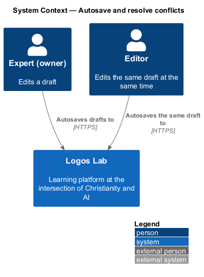
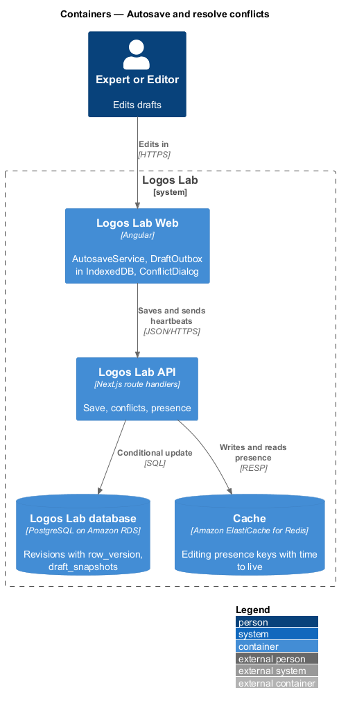
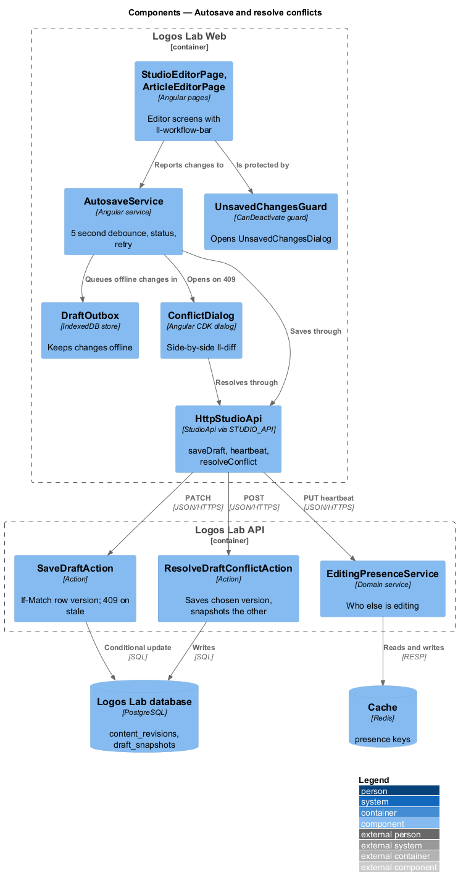
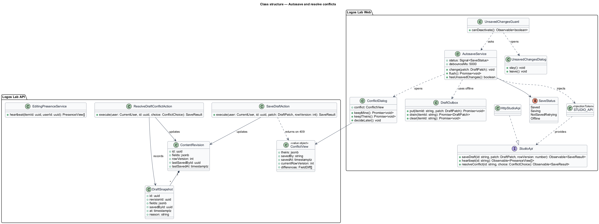
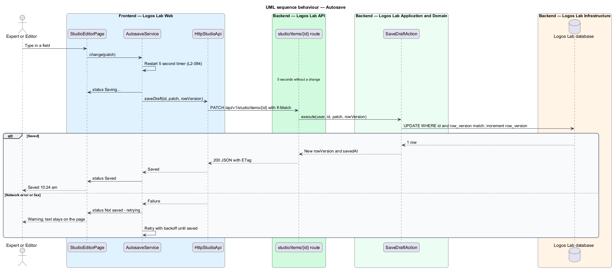
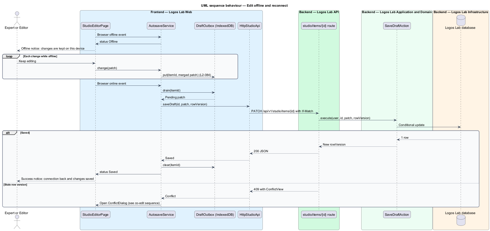
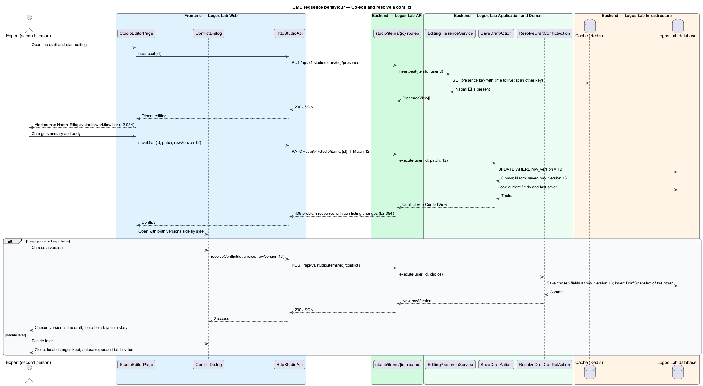
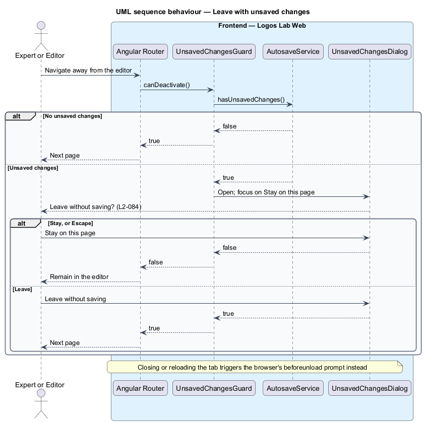

# Autosave and resolve conflicts

## Overview

Authors on Logos Lab write long articles and courses in Studio, sometimes on unreliable connections and sometimes
while an editor has the same item open. Work shall not be lost, and one person's save shall not silently replace
another's.

**autosave** — save of a draft that starts on its own 5 seconds after the author's last change

**save status** — short message in the editor that reads "Saved", "Saving..." or "Not saved - retrying"

**local outbox** — store in the author's browser that keeps unsaved changes while the network is unavailable and
sends them when it returns

**optimistic concurrency** — save check that compares the revision's version number at load time with the stored
one, and refuses the save when another save came first

**edit conflict** — refused save whose changes overlap a newer save by someone else, shown side by side to resolve

**editing presence** — short-lived record of who has an item open for editing

This feature underlies every editor screen in the authoring subsystem: `StudioEditorPage`, `ArticleEditorPage` and
the type-specific editors.

## Description

**Logos Lab Web**

- **`AutosaveService`** — Angular service used by the editor pages. It debounces changes and saves 5 seconds after
  the last one. It publishes the save status to the `ll-workflow-bar` and to an `ll-inline-message` under the body.
  A failed save shows "Not saved - retrying" and retries with backoff (intervals `<TO SUPPLY>`).
- **`DraftOutbox`** — IndexedDB store keyed by item id. While the browser is offline, changes go to the outbox, the
  status reads "Offline", and an offline notice says changes are kept on this device. When the `online` event fires,
  the outbox sends the pending changes and clears itself on success. Submitting waits for the connection.
- **Presence heartbeat** — the editor page calls `PUT /api/v1/studio/items/{id}/presence` while open (interval
  `<TO SUPPLY>`). When someone else is editing, an `ll-alert` names them and their avatar appears in the workflow bar.
- **`ConflictDialog`** — opened when a save returns `409`. It shows "Your version, not saved" and the other person's
  saved version side by side with `ll-diff` (split view), with "Keep yours", "Keep {name}'s" and "Decide later". The
  version not kept stays in history. Mock states in `docs/mocks/dialogs/conflict/`: `default`, `scroll`, `busy` and
  `success`.
- **`UnsavedChangesGuard`** — Angular `CanDeactivate` guard that opens `UnsavedChangesDialog` when changes are
  unsaved. A `beforeunload` handler covers closing the tab. Focus starts on "Stay on this page", and Escape keeps the
  author on the page. Mock state in `docs/mocks/dialogs/unsaved-changes/`: `default`.
- **Mocks** — `docs/mocks/pages/studio-editor/` states `saving`, `not-saved`, `offline` and `co-editing`, and
  `docs/mocks/notifications/offline-notice/` states `warning`, `persistent`, `with-action` and `success`.
- **`StudioApi`** — `saveDraft()`, `heartbeat()` and `resolveConflict()`, bound through `STUDIO_API` to
  `HttpStudioApi`.

**Logos Lab API**

- **`PATCH /api/v1/studio/items/{id}`** — `SaveDraftAction`. The request carries `If-Match` with the revision's
  `rowVersion`. The update runs as `UPDATE ... WHERE id = $1 AND row_version = $2`, which increments `row_version`.
  When no row matches, the action returns `409` with the current fields, the name of the person who saved, the time
  of that save and the field-level differences.
- **`POST /api/v1/studio/items/{id}/conflicts`** — `ResolveDraftConflictAction`. It saves the chosen version against
  the current `rowVersion`, and records the version not kept as a `DraftSnapshot` in history.
- **`PUT /api/v1/studio/items/{id}/presence`** — `EditingPresenceService` writes a Redis key per item and person with
  a short time to live (`<TO SUPPLY>`) and returns the other people present.
- **Editing lock** — `SaveDraftAction` refuses saves while the revision is In review, Approved or Scheduled, in line
  with `L2-077`.
- **Tables and stores** — `content_revisions.row_version`, `draft_snapshots`, and Redis keys
  `presence:{itemId}:{userId}`.

**Rules**

- 5 seconds after the author's last change, the draft is saved. The status reads "Saved" or "Saving..." or, on
  failure, "Not saved - retrying".
- When the network is unavailable and the author keeps editing, changes are kept locally and saved when the
  connection returns.
- When a second person starts editing an item that someone else has open, they are told who else is editing it.
- Saves use optimistic concurrency. A stale save is refused with `409`, and the person is shown the conflicting
  changes to resolve.
- An author who tries to leave a page with unsaved changes is asked to confirm.

## Requirements

| L2 ID | Refines (L1) | Requirement |
|-------|--------------|-------------|
| `L2-084` | `L1-013` | **Autosave and concurrent editing.** Authoring shall not lose work and shall not silently overwrite other people's changes. |

## Diagrams

### System context

Authors and editors edit the same drafts in Logos Lab. Each person's browser keeps unsaved changes when the
connection drops.

### Containers

Logos Lab Web saves drafts to the Logos Lab API, which checks row versions in the database and keeps editing presence
in the Redis cache.

### Components

`AutosaveService`, `DraftOutbox` and `UnsavedChangesGuard` work in the browser. The API's `SaveDraftAction`,
`ResolveDraftConflictAction` and `EditingPresenceService` enforce concurrency and report presence.

### Class structure

`AutosaveService` exposes a `SaveStatus` and uses `DraftOutbox` when offline. A `409` carries a `ConflictView`, and
the version not kept becomes a `DraftSnapshot`.

### Behaviour — autosave

A save starts 5 seconds after the last change. A failure keeps the text on the page and retries.

### Behaviour — edit offline and reconnect

Changes made offline go to the local outbox and are sent when the connection returns.

### Behaviour — co-edit and resolve a conflict

The second person learns who else is editing. A stale save is refused with `409`, and the person chooses the version
to keep.

### Behaviour — leave with unsaved changes

Navigation away with unsaved changes asks for confirmation first.

