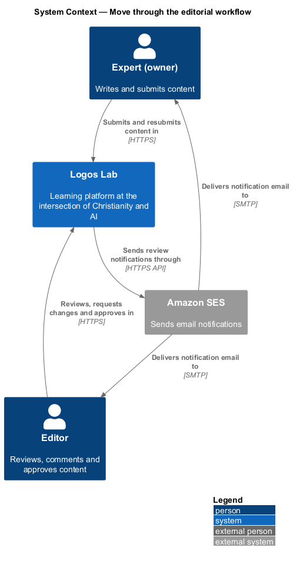
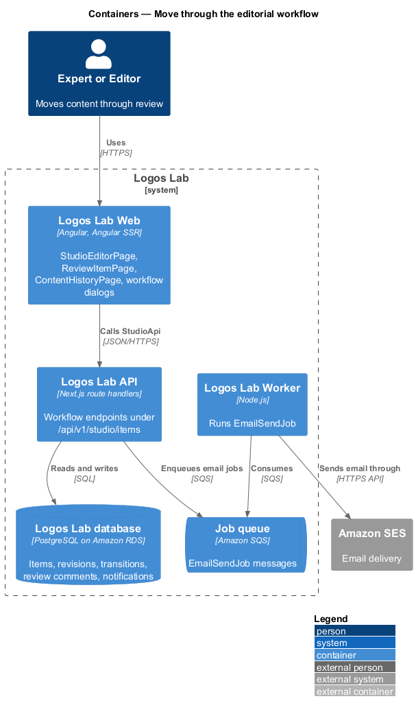
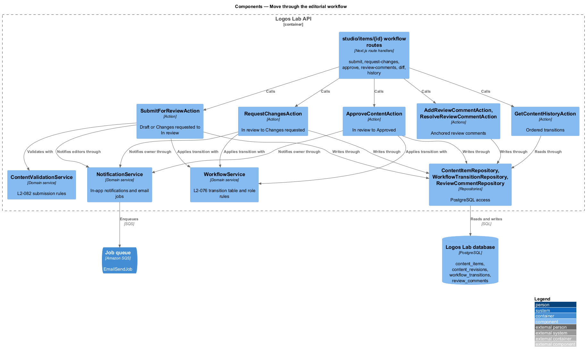
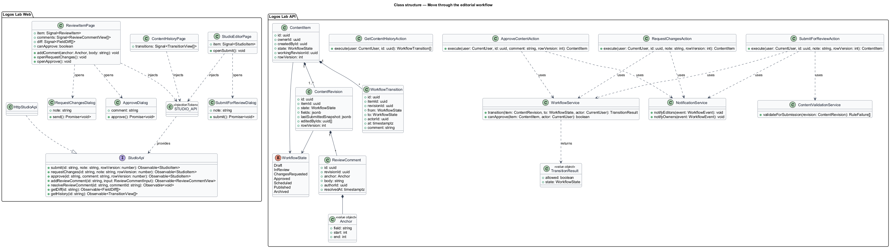
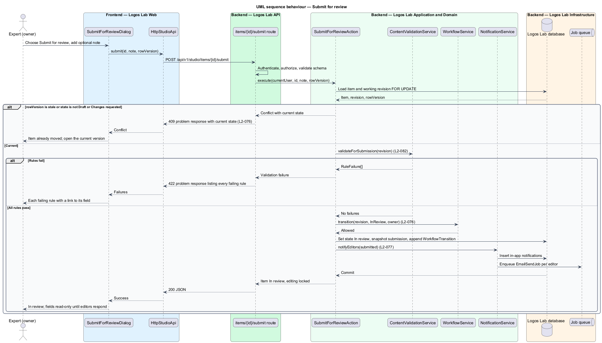
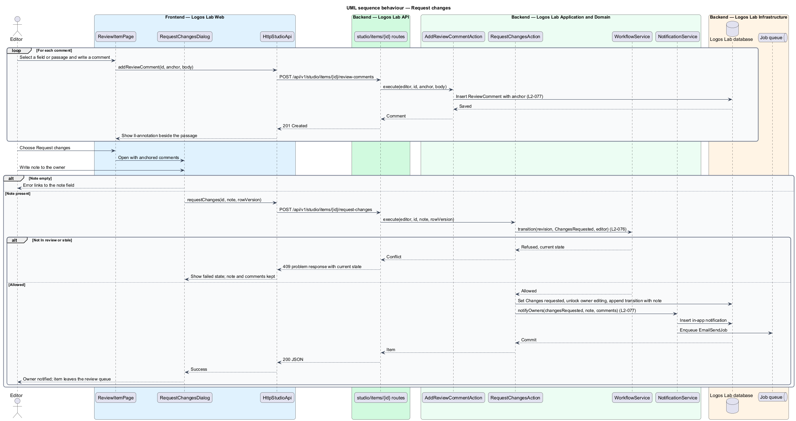
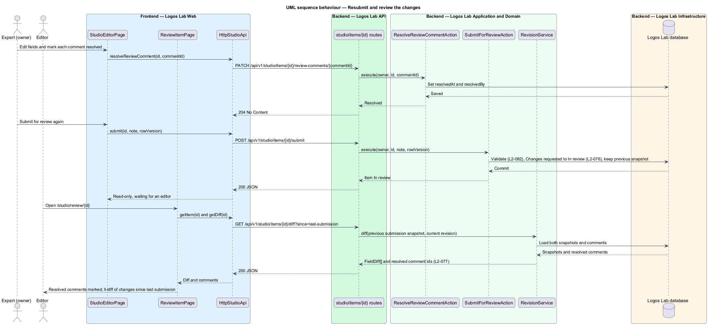
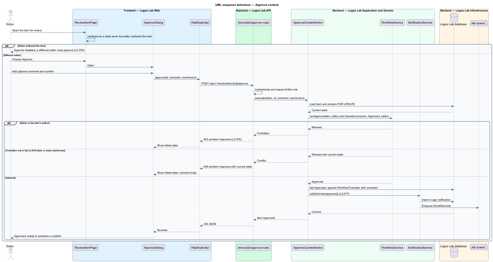
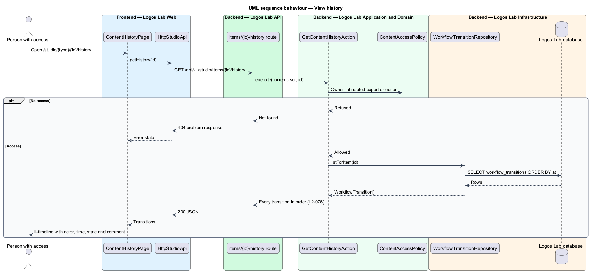

# Move through the editorial workflow

## Overview

No expert content reaches the public on Logos Lab without an editor's approval. Every content item therefore moves
through a fixed set of states, and only named roles may move it from one state to the next.

**editorial workflow** — ordered set of workflow states and permitted transitions that every content item follows
from Draft to Published or Archived

**workflow transition** — recorded move of a content item from one workflow state to another, with actor, timestamp
and optional comment

**review comment** — editor's note anchored to a field or to a passage of a content item, sent to the owner when
changes are requested

**owner** — expert who created a content item, or the experts it is attributed to

An owner writes a Draft and submits it for review. An editor reads it, anchors comments to fields or passages, and
either requests changes or approves it. A different editor from the item's author performs the approval. Each move is
recorded, so anyone with access can read the item's full history.

This feature holds the workflow engine of the authoring subsystem. Publishing and scheduling an Approved item, and
archiving a Published one, use the same engine and are described in `schedule-and-publish` and `archive-content`.

## Description

**Logos Lab Web**

- **`StudioEditorPage`** — routed page at `/studio/{type}/{id}`. Its `ll-workflow-bar` shows the item's state, the
  save status and the next permitted action. Fields become read-only while the item is In review. Workflow mock
  states in `docs/mocks/pages/studio-editor/`: `in-review`, `changes-requested`, `approved` and `scheduled`.
- **`SubmitForReviewDialog`** — confirms submission, lists the submission checks from `L2-082`, and takes an optional
  note for the editor of up to 500 characters. Mock states in `docs/mocks/dialogs/submit-for-review/`: `default`,
  `busy`, `invalid`, `failed` (a `409` because the item already moved) and `success`.
- **`ReviewItemPage`** — routed page at `/studio/review/{id}` where an editor reads the submission and anchors
  comments with `ll-annotation`. After a resubmission it marks resolved comments and shows an `ll-diff` of changes
  since the last submission. Mock states in `docs/mocks/pages/review-item/`: `default`, `loading`, `error`,
  `commenting`, `resubmitted` and `self-authored`.
- **`RequestChangesDialog`** — sends a required note to the owner with every anchored comment. Mock states in
  `docs/mocks/dialogs/request-changes/`: `default`, `busy`, `invalid`, `failed` and `success`.
- **`ApproveDialog`** — confirms approval with an optional comment for the history. Mock states in
  `docs/mocks/dialogs/approve/`: `default`, `busy`, `failed` and `success`.
- **`ContentHistoryPage`** — routed page at `/studio/{type}/{id}/history`. It lists every transition with actor,
  time and comment in an `ll-timeline`. Mock states in `docs/mocks/pages/content-history/`: `default`, `loading`,
  `empty`, `error` and `long`.
- **`StudioApi`** — bound through `STUDIO_API` to `HttpStudioApi`. Workflow methods: `submit()`,
  `requestChanges()`, `approve()`, `addReviewComment()`, `resolveReviewComment()`, `getDiff()` and `getHistory()`.

**Logos Lab API**

- **Endpoints** — `POST /api/v1/studio/items/{id}/submit`, `POST /api/v1/studio/items/{id}/request-changes`,
  `POST /api/v1/studio/items/{id}/approve`, `POST /api/v1/studio/items/{id}/review-comments`,
  `PATCH /api/v1/studio/items/{id}/review-comments/{commentId}`,
  `GET /api/v1/studio/items/{id}/diff?since=last-submission` and `GET /api/v1/studio/items/{id}/history`.
- **`SubmitForReviewAction`**, **`RequestChangesAction`**, **`ApproveContentAction`**, **`AddReviewCommentAction`**,
  **`ResolveReviewCommentAction`** and **`GetContentHistoryAction`** — one action per use case, each in one
  transaction.
- **`WorkflowService`** — domain service that holds the transition table of `L2-076` and decides whether a role may
  perform a transition. It returns the new state, or a refusal carrying the current state.
- **`ContentValidationService`** — runs the submission rules of `L2-082` before a Draft enters review.
- **`ContentItem`** and **`ContentRevision`** — the item and its working copy. Before first publication the item's
  state and its working revision's state move together. After publication, the item stays Published and the
  revision carries the workflow state (see `revise-published-content`).
- **`WorkflowTransition`** — append-only row in `workflow_transitions` with `itemId`, `revisionId`, `from`, `to`,
  `actorId`, `at` and `comment`.
- **`ReviewComment`** — row in `review_comments` with an anchor (field name, or field plus passage offsets), body,
  author and `resolvedAt`.
- **`NotificationService`** — creates in-app notifications (`L2-091`) and enqueues `EmailSendJob` for email
  (`L2-092`).
- **Optimistic state check** — each workflow request carries the item's `rowVersion`. A stale request is refused
  with `409`.

**Transition table (`L2-076`)**

| From | To | Who |
|---|---|---|
| Draft | In review | Owner (expert) or editor |
| In review | Changes requested | Editor |
| In review | Approved | Editor (not the item's author) |
| Changes requested | In review | Owner or editor |
| Approved | Scheduled or Published | Editor |
| Scheduled | Published | System, at the scheduled time |
| Scheduled | Approved | Editor (unschedule) |
| Published | Archived | Editor |
| Archived | Published | Editor |

**Rules**

- Each permitted transition succeeds for its stated role and is recorded with actor, timestamp and optional comment.
- Any other transition, for example Draft to Published, is refused with `409` and the response returns the current
  state.
- An editor who authored an item cannot approve it. `ReviewItemPage` disables Approve with the reason, and the API
  refuses the request with `403`.
- Submitting a Draft that passes validation moves it to In review, locks editing by the owner, and notifies editors.
- Requesting changes moves the item to Changes requested and notifies the owner with the comments.
- On resubmission the editor sees which comments were resolved and a diff of changes since the last submission.
- Approval notifies the owner and leaves the item ready to schedule or publish.
- Anyone with access to an item can list its full transition history in order.

## Requirements

| L2 ID | Refines (L1) | Requirement |
|-------|--------------|-------------|
| `L2-076` | `L1-013` | **Editorial workflow states.** Every content item moves through defined workflow states with enforced transitions. |
| `L2-077` | `L1-013` | **Submit for review and review.** Authors submit content for review, and editors review it with comments. |

## Diagrams

### System context

Experts submit content and editors review it in Logos Lab. Logos Lab sends review notifications by email through
Amazon SES.

### Containers

The Studio pages call the Logos Lab API, which records transitions in the database and queues notification email
for the Worker.

### Components

Each workflow action asks `WorkflowService` whether the transition is allowed, then writes the new state, the
transition and any review comments, and calls `NotificationService`.

### Class structure

`WorkflowService` owns the transition rules. `ContentItem` and `ContentRevision` carry a `WorkflowState`, and each
move appends a `WorkflowTransition`.

### Behaviour — submit for review

The action validates the Draft against `L2-082`, applies the `L2-076` transition, locks editing and notifies the
editors.

### Behaviour — request changes

An editor anchors comments, then sends them with a note. The item moves to Changes requested and the owner is
notified.

### Behaviour — resubmit and review the changes

The owner resolves comments and resubmits. The editor's review page then loads the resolved comments and the diff
since the last submission.

### Behaviour — approve

Approval is refused for the item's own author and for any transition outside the table. Otherwise the item becomes
Approved and the owner is notified.

### Behaviour — view history

The history page lists every recorded transition in order.

