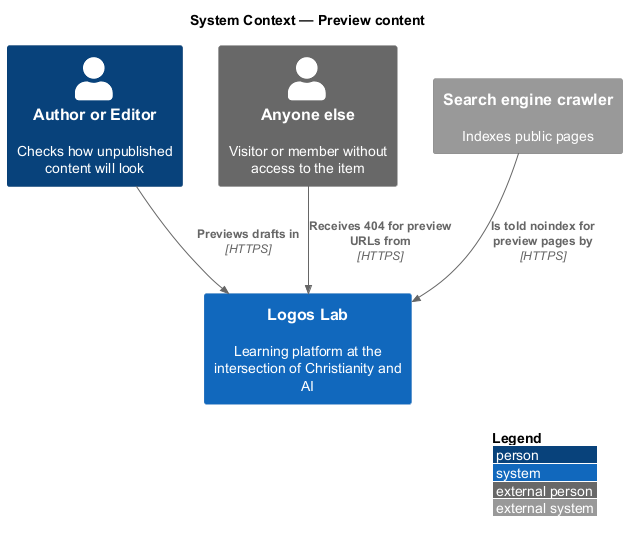
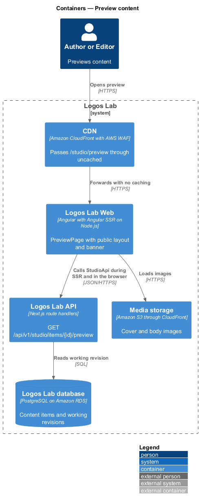
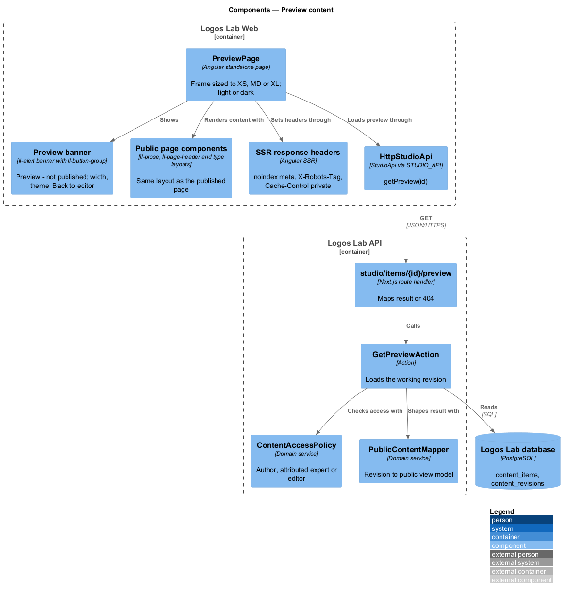
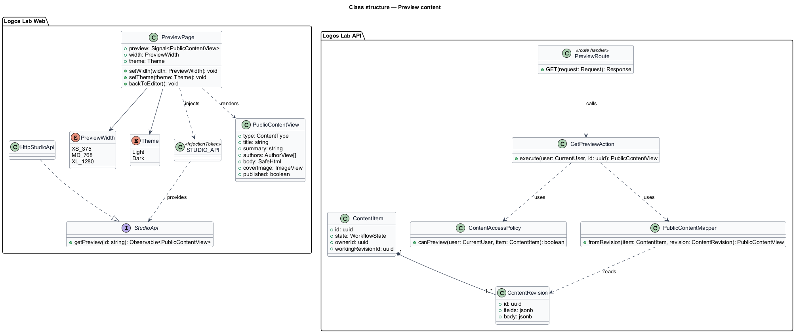
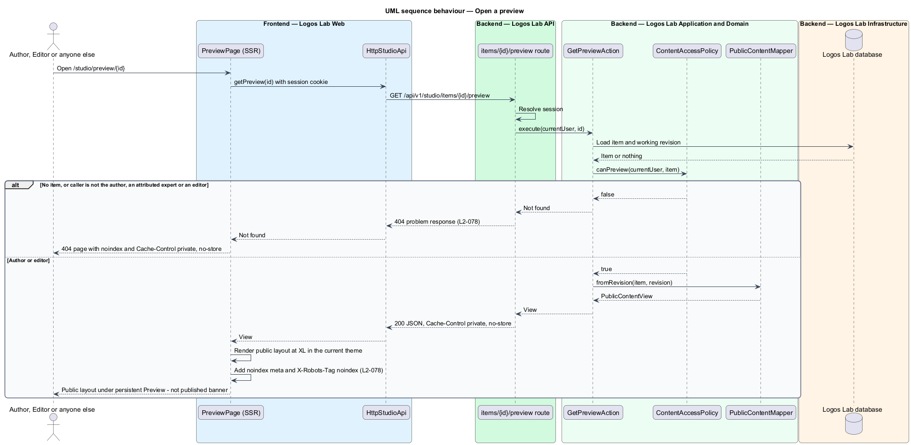
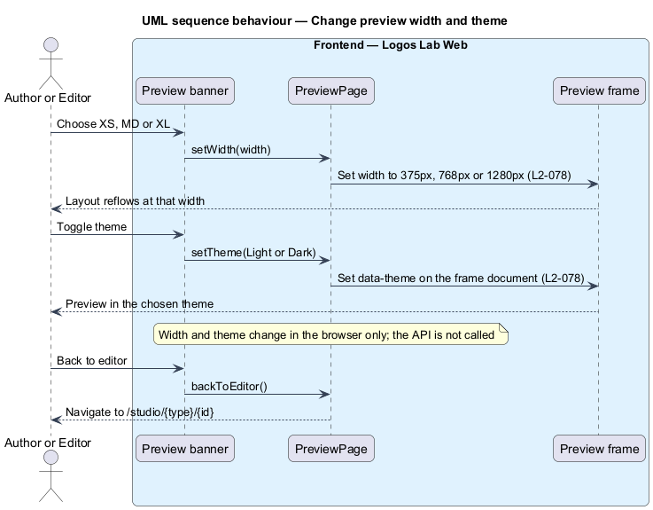

# Preview content

## Overview

Authors on Logos Lab write in Studio, where fields and an editor surface look different from the finished public
page. Before submitting or publishing, an author or editor needs to see the item exactly as readers will.

**preview** — rendering of an unpublished content item in the public page layout, visible only to its author and to
editors

**preview banner** — persistent notice across the top of a preview that reads "Preview - not published" and holds the
width, theme and Back to editor controls

**viewport toggle** — control in the preview banner that renders the preview at the XS (375px), MD (768px) or XL
(1280px) width

A preview reads the current working revision, not the live version. It never appears to anyone else and is never
indexed by search engines. Preview sits beside the editor in the authoring subsystem and changes no workflow state.

## Description

**Logos Lab Web**

- **`PreviewPage`** — routed page at `/studio/preview/{id}`. It loads the preview model and renders it with the same
  public page components the published page uses, for example the article layout with `ll-prose`. The public layout
  sits inside a same-origin frame sized to the chosen width, so that responsive rules match that width (baseline
  choice). Mock states in `docs/mocks/pages/preview/`: `default`, `phone`, `dark`, `loading` and `error`.
- **Preview banner** — `ll-alert` in its banner variant with no dismiss control. It holds an `ll-button-group` for
  XS, MD and XL, a theme toggle for light and dark, and Back to editor. Mock states in
  `docs/mocks/notifications/preview-banner/`: `info`, `persistent` and `with-action`.
- **Preview entry point** — the "Preview" action in the `ll-workflow-bar` of `StudioEditorPage`.
- **`StudioApi.getPreview(id)`** — bound through `STUDIO_API` to `HttpStudioApi`.
- **Server-side rendering** — Angular SSR renders `PreviewPage` with `<meta name="robots" content="noindex">` and the
  response header `X-Robots-Tag: noindex`. The response carries `Cache-Control: private, no-store`, so the CDN never
  caches it (`L2-113`).

**Logos Lab API**

- **`GET /api/v1/studio/items/{id}/preview`** — returns the working revision in the public content shape, with the
  author attribution and reading time the public page shows.
- **`GetPreviewAction`** — loads the item and checks access through `ContentAccessPolicy`. The author, attributed
  experts and editors may preview. Anyone else receives `404`, so the response does not reveal that the item exists.
- **`PublicContentMapper`** — maps a `ContentRevision` to the same view model that public content endpoints return,
  so the preview and the published page share one shape.

**Rules**

- An item in any unpublished state renders with the public page layout and a persistent "Preview - not published"
  banner when its author or an editor chooses "Preview".
- The viewport toggle renders the preview at XS (375px), MD (768px) and XL (1280px), in the light and dark themes.
- Anyone else who opens a preview URL receives `404`.
- Preview pages are never indexed (`noindex`).

## Requirements

| L2 ID | Refines (L1) | Requirement |
|-------|--------------|-------------|
| `L2-078` | `L1-013` | **Preview.** Authors and editors shall be able to preview content exactly as it will appear when published. |

## Diagrams

### System context

Authors and editors preview content in Logos Lab. Any other visitor, and any search engine crawler, is refused.

### Containers

The CDN passes preview requests to Logos Lab Web without caching them. Logos Lab Web renders the page on the server
with data from the Logos Lab API.

### Components

`PreviewPage` reuses the public page components and the preview banner. In the API, `GetPreviewAction` checks access
and `PublicContentMapper` shapes the working revision like a published item.

### Class structure

`PreviewPage` depends on `StudioApi` and holds the chosen width and theme. `GetPreviewAction` uses
`ContentAccessPolicy` and `PublicContentMapper`.

### Behaviour — open a preview

The action returns the working revision to the author or an editor. Anyone else receives `404`, and every response is
marked `noindex`.

### Behaviour — change width and theme

The width and theme controls act in the browser only. They resize the frame and switch its theme without a new
request.

