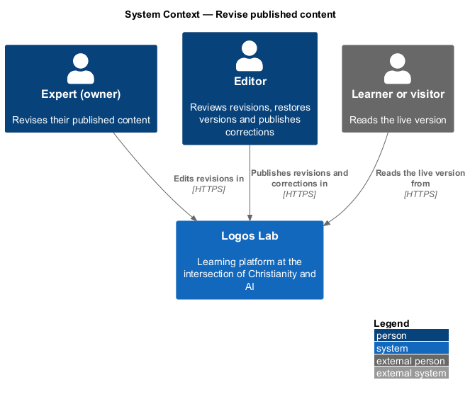
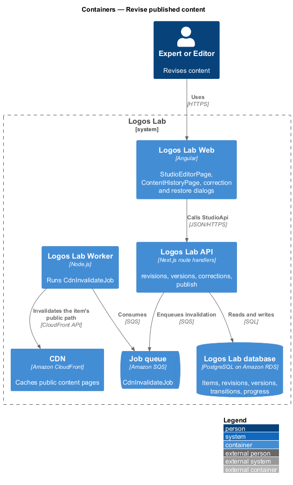
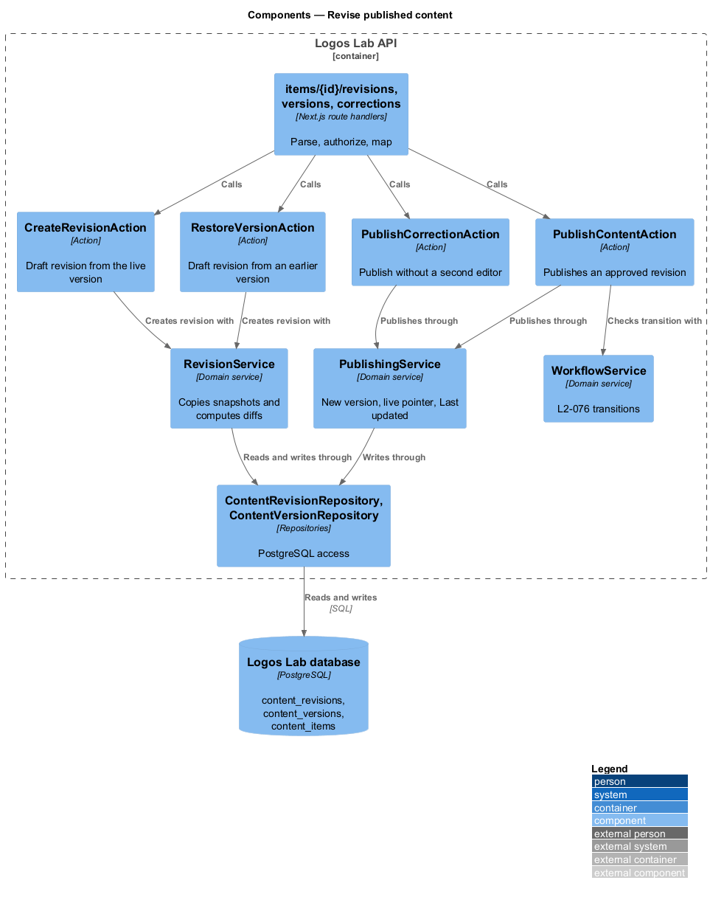
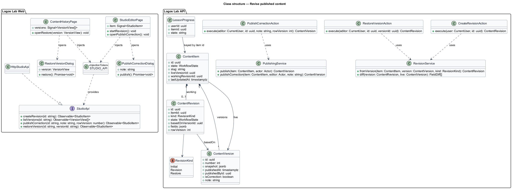
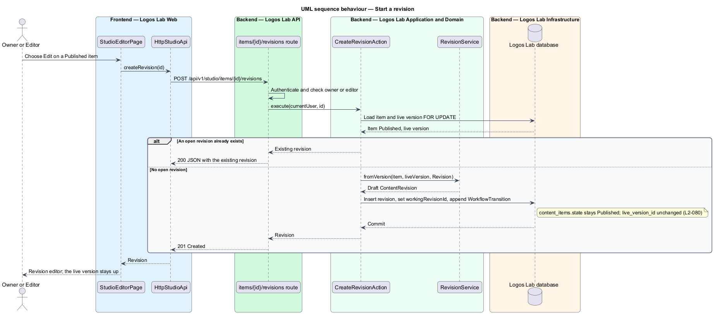
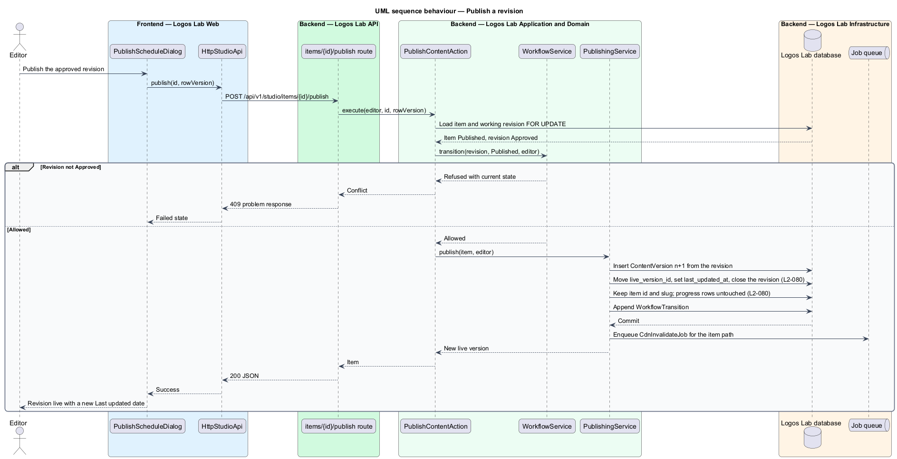
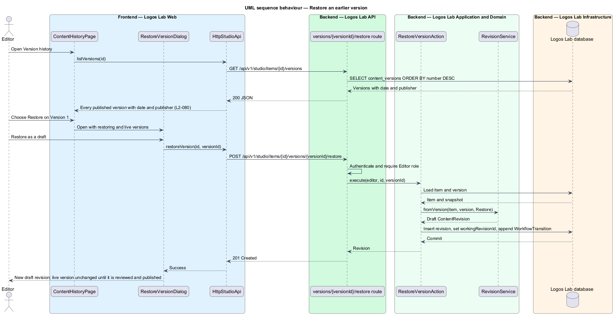
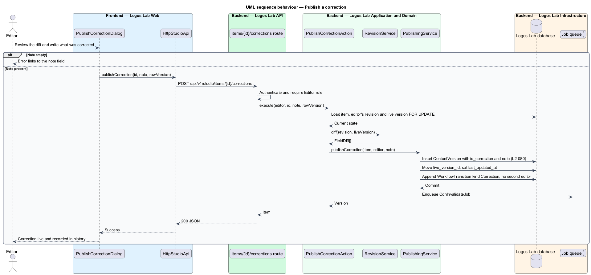

# Revise published content

## Overview

Published content on Logos Lab changes over time: an expert adds an example, an editor fixes a typo. Readers and
learners keep seeing the live version while those changes are prepared and reviewed.

**live version** — published version of a content item that the public page shows

**revision** — editable working copy of a Published item that goes through the editorial workflow and, once
published, replaces the live version

**published version** — immutable snapshot of a content item recorded each time it is published, with its date and
publisher

**correction** — urgent fix of a typo or broken link that an editor publishes without a second editor, recorded as a
correction in history

Choosing "Edit" on a Published item creates a draft revision; the item itself stays Published. The revision moves
through Draft, In review, Changes requested and Approved as in `move-through-editorial-workflow`, and publishing it
replaces the live version. Learner progress belongs to the item, so it survives the change. Every published version is
kept, and an editor can restore any earlier one as a new revision.

## Description

**Logos Lab Web**

- **`StudioEditorPage`** — mock state `published` shows the live version read-only with Edit, Publish correction and
  Archive. Mock state `revision` shows a revision being edited while the live version stays up, with an aside that
  summarises what changed and links to the full comparison (`ll-diff`). Both are in
  `docs/mocks/pages/studio-editor/`.
- **`ContentHistoryPage`** — lists every transition (`ll-timeline`) and a "Published versions" list with each
  version's date, publisher, a "Live" badge and Restore. Mock states in `docs/mocks/pages/content-history/`:
  `default`, `loading`, `empty`, `error` and `long`.
- **`PublishCorrectionDialog`** — shows the change as an `ll-diff` and asks "What did you correct?", a required note
  shown in history. Mock states in `docs/mocks/dialogs/publish-correction/`: `default`, `busy`, `invalid`, `failed`
  and `success`.
- **`RestoreVersionDialog`** — names the version being restored and the live version, then restores as a draft. Mock
  states in `docs/mocks/dialogs/restore-version/`: `default`, `busy`, `failed` and `success`.
- **`StudioApi`** — `createRevision()`, `listVersions()`, `publishCorrection()` and `restoreVersion()`, bound through
  `STUDIO_API` to `HttpStudioApi`.

**Logos Lab API**

- **Endpoints** — `POST /api/v1/studio/items/{id}/revisions`, `GET /api/v1/studio/items/{id}/versions`,
  `POST /api/v1/studio/items/{id}/corrections` and
  `POST /api/v1/studio/items/{id}/versions/{versionId}/restore`. Publishing an approved revision uses
  `POST /api/v1/studio/items/{id}/publish` from `schedule-and-publish`.
- **`CreateRevisionAction`** — copies the live version's snapshot into a new `ContentRevision` in Draft, linked by
  `basedOnVersionId`, and sets it as the item's working revision. The item keeps the Published state.
- **`PublishCorrectionAction`** — editor only. It publishes the editor's revision directly, without the approval
  step, and records the version and transition as a correction with the note.
- **`RestoreVersionAction`** — editor only. It copies a chosen `ContentVersion` snapshot into a new Draft revision.
  The live version is unchanged until that revision is reviewed and published.
- **`RevisionService`** — creates revisions, computes field-level diffs between a revision and the live version, and
  refuses a second open revision while one exists (baseline choice).
- **`PublishingService`** — when the published revision belongs to a Published item, it writes a new
  `ContentVersion`, moves `liveVersionId` to it and sets `lastUpdatedAt`, which public pages show as "Last updated".
  The slug and item id do not change.
- **Learner progress** — progress, enrolment and completion rows reference the item id, not a version id, so a new
  version keeps them (`L2-030`, `L2-042`).
- **Tables** — `content_revisions` (`based_on_version_id`, `kind`: Initial, Revision, Restore), `content_versions`
  (`number`, `published_at`, `published_by_id`, `is_correction`, `note`), `content_items.last_updated_at`.

**Rules**

- "Edit" on a Published item creates a draft revision, and the live version is unchanged.
- When an approved revision is published, it replaces the live version, sets the "Last updated" date, and keeps
  learner progress on the item.
- "Version history" lists every published version with its date and publisher for anyone with access.
- An editor can restore any earlier version as a new revision.
- An editor can publish an urgent correction (a typo or broken link) without a second editor. It is recorded as a
  correction in history. The note is required.
- How the platform limits a correction to typos and broken links is `<TO SUPPLY>`. The design relies on the
  dialog's wording and the recorded note.

## Requirements

| L2 ID | Refines (L1) | Requirement |
|-------|--------------|-------------|
| `L2-080` | `L1-013` | **Revisions of published content.** Changes to published content are made as revisions that go through review. The published version stays live until the revision is published. |

## Diagrams

### System context

Experts and editors revise published content in Logos Lab, while learners and visitors keep reading the live
version.

### Containers

The Studio pages call the Logos Lab API, which keeps revisions and versions in the database and invalidates the
public page on the CDN when a new version goes live.

### Components

`CreateRevisionAction`, `RestoreVersionAction` and `PublishCorrectionAction` use `RevisionService`. Publication of a
revision goes through `PublishingService`.

### Class structure

A `ContentItem` has one live `ContentVersion`, many earlier versions, and at most one open `ContentRevision` based on
a version.

### Behaviour — start a revision

"Edit" on a Published item creates a Draft revision from the live version and leaves the live version unchanged.

### Behaviour — publish a revision

An approved revision becomes a new live version. The item keeps its id and slug, so learner progress is kept.

### Behaviour — restore an earlier version

An editor restores a published version as a new Draft revision, which then goes through review.

### Behaviour — publish a correction

An editor publishes a correction without a second editor, and the history records it as a correction with the note.

