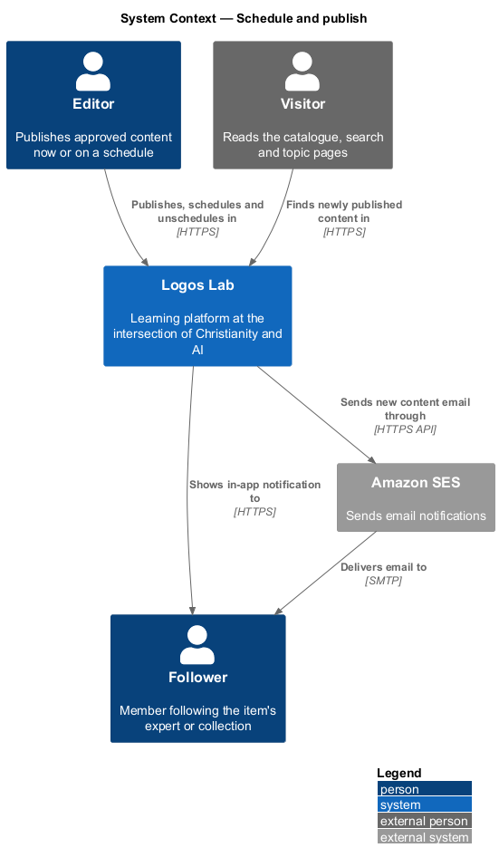
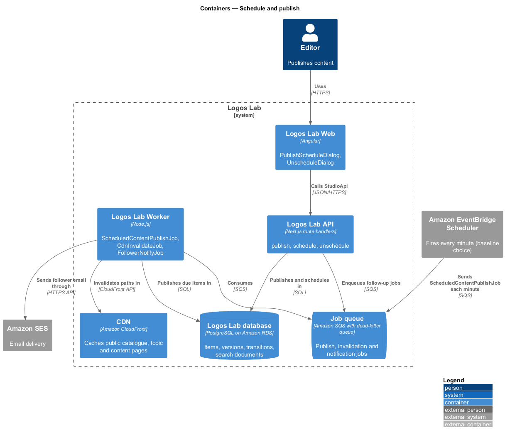
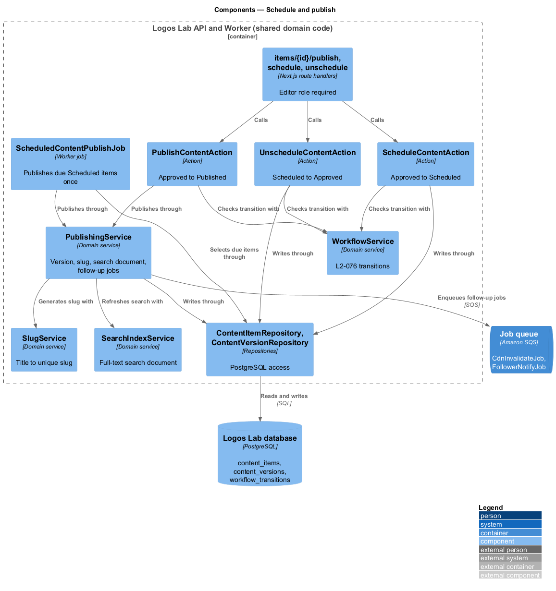
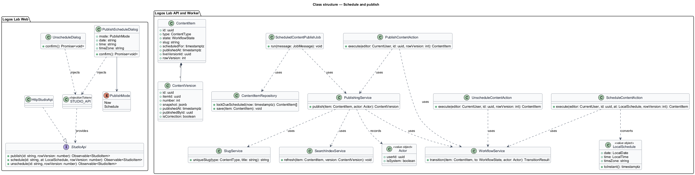
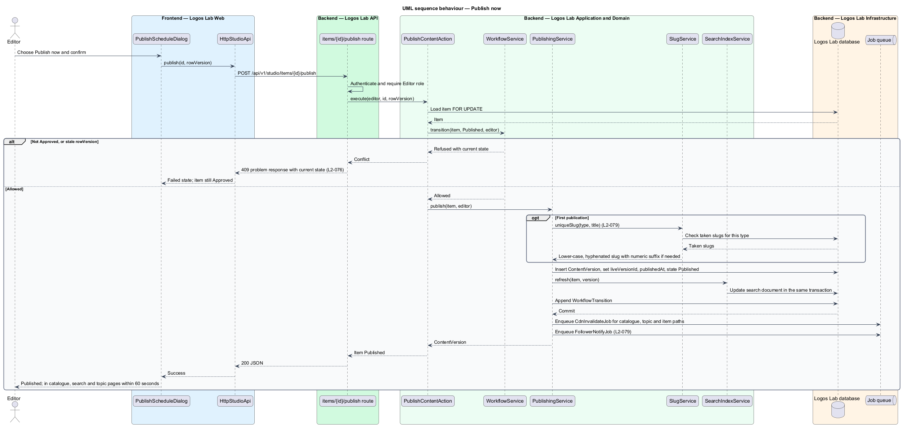
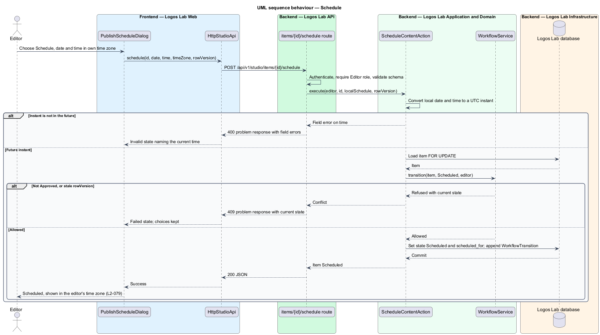
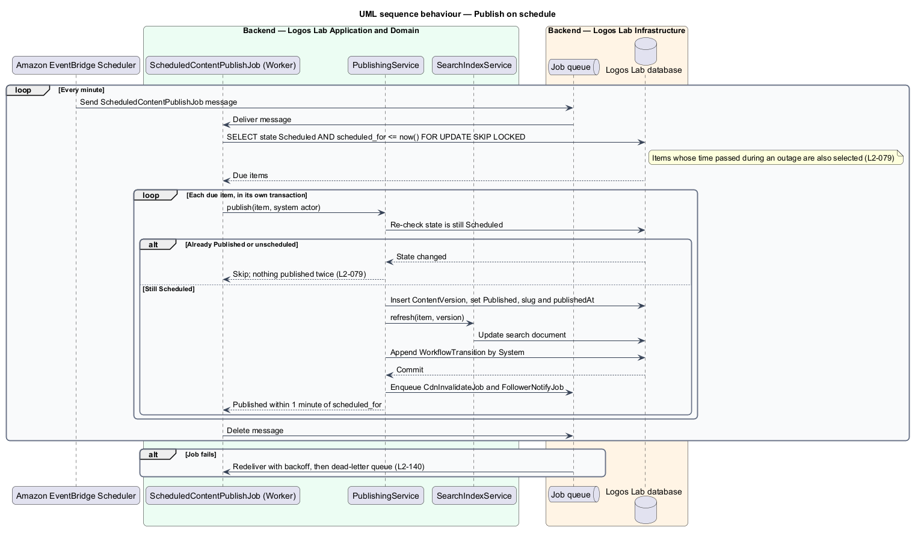
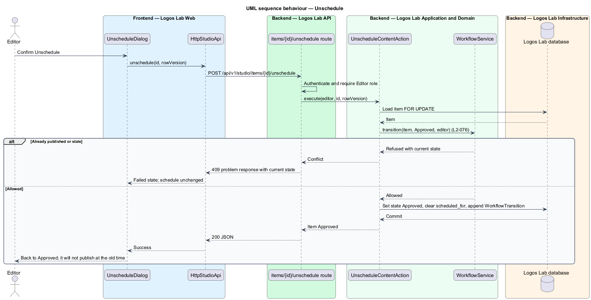

# Schedule and publish

## Overview

An Approved content item on Logos Lab is ready to go live, but it is not yet public. An editor decides when it goes
live: at once, or at a chosen date and time.

**publish** — workflow transition from Approved, or from Scheduled, to Published that makes a content item public at
its own address

**scheduled publish** — instruction to publish an Approved item automatically at a stored future instant

**slug** — lower-case, hyphenated address segment derived from an item's title, for example
`sabbath-for-the-always-on-mind`

**follower** — member who follows an expert or a collection and is told when new content appears (`L2-024`,
`L2-050`)

Publishing makes the item appear in the catalogue, search and topic pages and tells followers. A scheduled item
publishes on its own, even after an outage of the publishing job, and never twice. An editor can unschedule a
Scheduled item, which returns it to Approved. This feature is the last step of the editorial workflow described in
`move-through-editorial-workflow`.

## Description

**Logos Lab Web**

- **`PublishScheduleDialog`** — opened from the `ll-workflow-bar` of an Approved item in `StudioEditorPage`. An
  `ll-radio-group` offers "Publish now" or "Schedule". Schedule shows date and time fields with the editor's named
  time zone and current time, for example "Eastern Time (ET), your time zone". Mock states in
  `docs/mocks/dialogs/publish-schedule/`: `default`, `busy`, `invalid` (time already passed), `failed` and `success`.
- **`UnscheduleDialog`** — confirms that a Scheduled item goes back to Approved. Mock states in
  `docs/mocks/dialogs/unschedule/`: `default`, `busy`, `failed` and `success`.
- **`StudioEditorPage`** — mock states `approved` and `scheduled` in `docs/mocks/pages/studio-editor/` show the
  read-only fields, the publish time and the Unschedule action.
- **`StudioApi`** — `publish()`, `schedule()` and `unschedule()`, bound through `STUDIO_API` to `HttpStudioApi`.

**Logos Lab API and Worker**

- **Endpoints** — `POST /api/v1/studio/items/{id}/publish`, `POST /api/v1/studio/items/{id}/schedule` with a local
  date, time and IANA time zone, and `POST /api/v1/studio/items/{id}/unschedule`. Each requires the Editor role.
- **`PublishContentAction`**, **`ScheduleContentAction`** and **`UnscheduleContentAction`** — one action per use
  case, each in one transaction. Each uses `WorkflowService` for the `L2-076` transition check.
- **`PublishingService`** — domain service shared by the publish action and the scheduled job. It generates the slug
  on first publication, writes an immutable `ContentVersion`, sets `liveVersionId` and `publishedAt`, refreshes the
  search document through `SearchIndexService`, appends the `WorkflowTransition`, and enqueues follow-up jobs.
- **`SlugService`** — derives the slug from the title, lower-case and hyphenated, and appends a numeric suffix
  (`-2`, `-3`, …) when the slug is taken. A unique index on `content_items (type, slug)` backs the check.
- **`SearchIndexService`** — updates the item's full-text search document in PostgreSQL in the same transaction, so
  search and catalogue queries see the item on commit.
- **`ScheduledContentPublishJob`** — Worker job started once a minute by an Amazon EventBridge Scheduler rule that
  sends an SQS message (baseline choice). It selects items with state Scheduled and `scheduled_for <= now()` using
  `FOR UPDATE SKIP LOCKED`, and publishes each through `PublishingService`.
- **`CdnInvalidateJob`** — invalidates the CloudFront paths of the catalogue, the item's topic pages and the item's
  own address after a publish. The CDN cache lifetime for these pages is `<TO SUPPLY>`.
- **`FollowerNotifyJob`** — notifies followers of the item's experts and collections in-app and by email.
- **Tables** — `content_items` (`state`, `slug`, `scheduled_for`, `published_at`, `live_version_id`),
  `content_versions`, `workflow_transitions` and the search document column `<TO SUPPLY>`.

**Rules**

- "Publish now" on an Approved item makes it Published. It appears in the catalogue, search and topic pages within
  60 seconds, and followers are notified.
- A schedule is entered and shown in the editor's time zone and stored as a UTC instant. A time that has passed is
  refused with `400` and a field error.
- A Scheduled item is published automatically within 1 minute of its time.
- A scheduled time that passed while the job was unavailable is published when the job recovers, and only once. The
  job selects every overdue item, and the publish runs only while the row's state is still Scheduled.
- Unscheduling moves a Scheduled item back to Approved and clears `scheduled_for`.
- The slug is derived from the title, lower-case and hyphenated, and made unique by a numeric suffix where needed.

## Requirements

| L2 ID | Refines (L1) | Requirement |
|-------|--------------|-------------|
| `L2-079` | `L1-013` | **Scheduling and publishing.** Editors publish approved content immediately or at a scheduled time. |

## Diagrams

### System context

Editors publish and schedule in Logos Lab. Logos Lab notifies followers by email through Amazon SES and refreshes the
public pages that the CDN serves.

### Containers

The API publishes immediately on request. Amazon EventBridge Scheduler wakes the Worker every minute to publish due
items, and both paths enqueue invalidation and follower jobs on SQS.

### Components

`PublishContentAction` and `ScheduledContentPublishJob` share `PublishingService`, which uses `SlugService` and
`SearchIndexService` and enqueues the follow-up jobs.

### Class structure

`PublishingService` turns an Approved or Scheduled `ContentItem` into a Published one with a new `ContentVersion`.
`ScheduleContentAction` stores the scheduled instant on the item.

### Behaviour — publish now

The editor publishes an Approved item. The item, its version, its slug and its search document commit together,
then the CDN paths are invalidated and followers are notified.

### Behaviour — schedule

The editor's local date and time are converted to a UTC instant. A time in the past is refused.

### Behaviour — publish on schedule

The job runs every minute and publishes each overdue Scheduled item exactly once, including items whose time passed
during an outage.

### Behaviour — unschedule

The editor returns a Scheduled item to Approved, which removes it from the job's selection.

