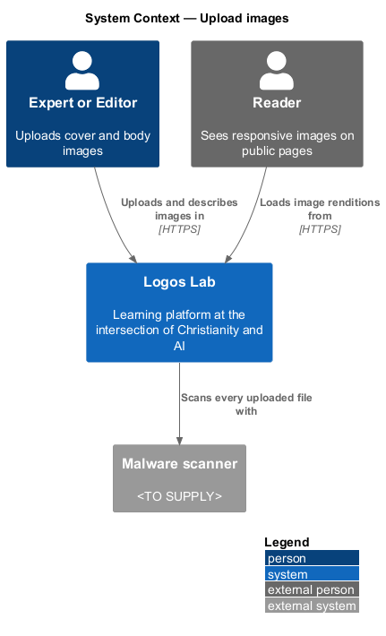
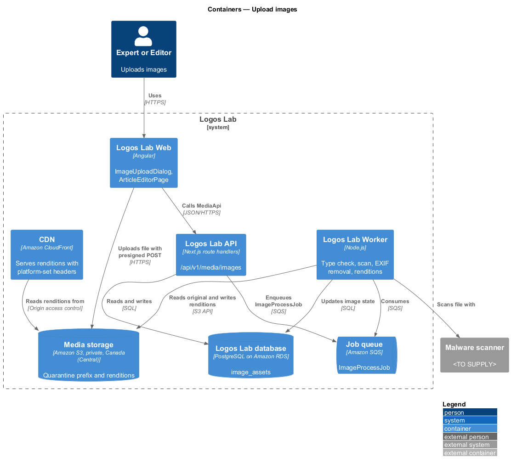
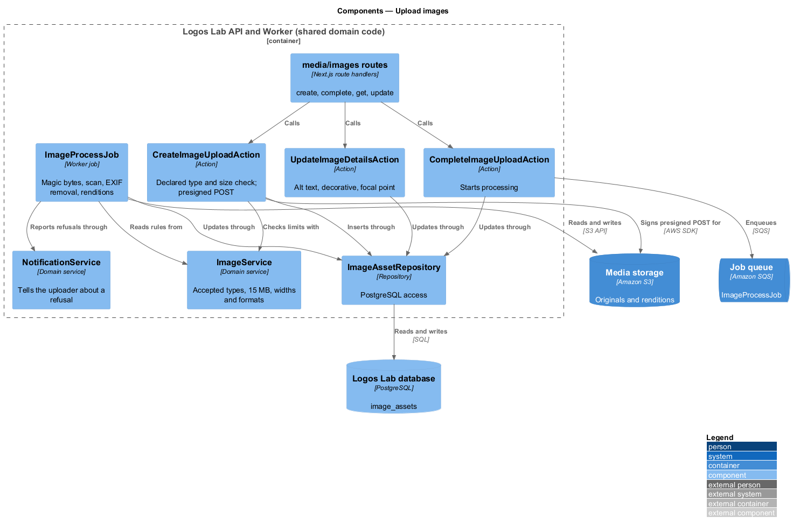
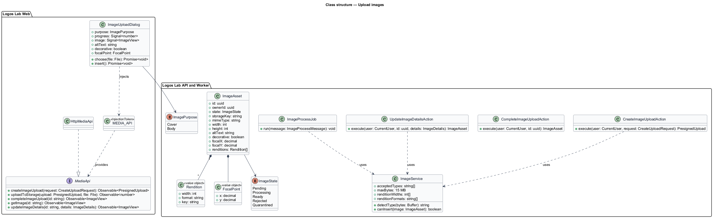
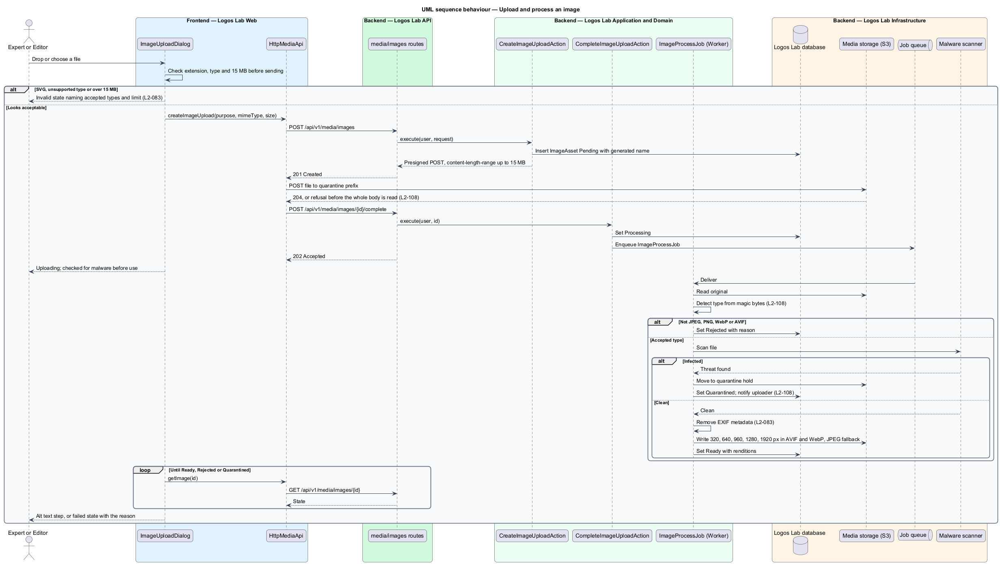
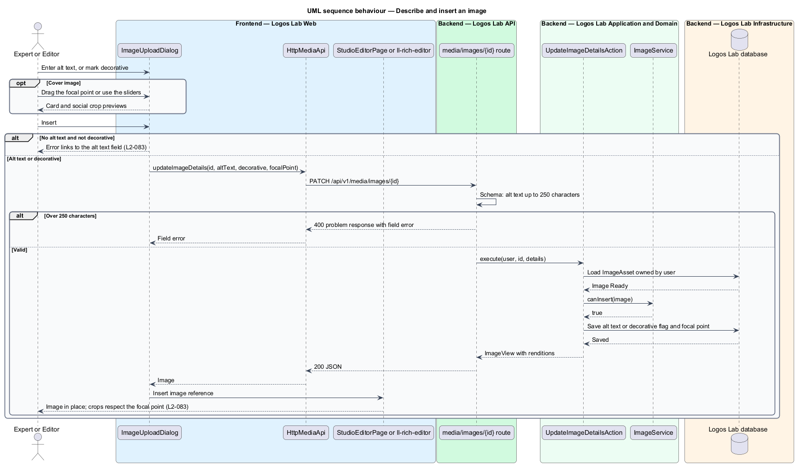

# Upload images

## Overview

Every content item on Logos Lab needs a cover image, and articles carry images in their body. Authors upload these
images in Studio, and the platform prepares them for every screen size and for screen readers.

**cover image** — image shown on an item's cards, page header and social previews

**rendition** — resized and re-encoded copy of an uploaded image at one width and one format

**alt text** — text alternative of up to 250 characters that describes an image for people who cannot see it

**decorative image** — image marked as adding no information, rendered with empty alt text

**focal point** — point in a cover image that crops for cards and social previews keep in view

An upload is untrusted until the platform has checked its real type, scanned it for malware and removed its EXIF
metadata (`L2-108`). Only then are renditions produced and the image offered for insertion. The author describes the
image or marks it decorative before it can be inserted. This feature serves the editor screens of the authoring
subsystem and the required cover image of `validate-required-metadata`.

## Description

**Logos Lab Web**

- **`ImageUploadDialog`** — Angular CDK dialog opened from the cover image field of `StudioEditorPage` and the Image
  tool of the `ll-rich-editor` in `ArticleEditorPage`. It uses `ll-file-upload` (dropzone plus native chooser), an
  upload progress bar, an `ll-textarea` for alt text with a decorative option, and, for covers, a focal point picker
  with `ll-slider` controls as a keyboard alternative and previews of the card and social crops. Mock states in
  `docs/mocks/dialogs/image-upload/`: `default`, `busy`, `alt-text`, `focal-point`, `invalid`, `failed` (quarantined
  by the malware scan) and `success`.
- **`ArticleEditorPage`** — routed page at `/studio/articles/{id}`; mock states in `docs/mocks/pages/article-editor/`
  include images with captions in the body.
- **`MediaApi`** — contract bound through `MEDIA_API` to `HttpMediaApi`. Methods: `createImageUpload()`,
  `uploadToStorage()`, `completeImageUpload()`, `getImage()` and `updateImageDetails()`.

**Logos Lab API and Worker**

- **`POST /api/v1/media/images`** — `CreateImageUploadAction` checks the declared type and size, creates an
  `ImageAsset` in state Pending with a generated name, and returns an S3 presigned POST. The POST policy carries a
  `content-length-range` of up to 15 MB, so S3 refuses a larger body before reading it all (`L2-108`, baseline
  choice).
- **Direct upload** — the browser posts the file to the private quarantine prefix of Media storage.
- **`POST /api/v1/media/images/{id}/complete`** — `CompleteImageUploadAction` sets state Processing and enqueues
  `ImageProcessJob`.
- **`ImageProcessJob`** — Worker job. It reads the magic bytes and refuses anything that is not JPEG, PNG, WebP or
  AVIF, including SVG. It sends the file to the malware scanner (`<TO SUPPLY>`) and quarantines an infected file. It
  strips EXIF metadata and writes renditions 320, 640, 960, 1280 and 1920 pixels wide in AVIF and WebP, with JPEG
  as a fallback. The image library is `<TO SUPPLY>`. On success it sets state Ready; on refusal it sets Rejected or
  Quarantined and notifies the uploader.
- **`GET /api/v1/media/images/{id}`** — returns the state, the reason for a refusal, and rendition URLs once Ready.
- **`PATCH /api/v1/media/images/{id}`** — `UpdateImageDetailsAction` stores alt text (up to 250 characters) or the
  decorative flag, and the focal point as x and y fractions.
- **`ImageService`** — domain service that holds the accepted types, the size limit, the rendition widths and formats,
  and the insertion rule.
- **`ImageAsset`** — row in `image_assets` with `ownerId`, `state` (`ImageState`), `storageKey`, `mimeType`,
  `width`, `height`, `altText`, `decorative`, `focalX`, `focalY` and `renditions`.
- **Delivery** — renditions are served only through the CDN with platform-set `Content-Type` and
  `Content-Disposition` headers (`L2-108`). Public pages use `<picture>` with AVIF, WebP and JPEG sources and the
  focal point as the crop centre (`object-position`).

**Rules**

- A JPEG, PNG, WebP or AVIF image of 15 MB or less is accepted, its EXIF metadata is removed, and renditions of 320,
  640, 960, 1280 and 1920 pixels wide are produced in AVIF and WebP, with JPEG as a fallback.
- An SVG file or any other unsupported type is refused.
- Before an uploaded image can be inserted, the author enters alt text of up to 250 characters or marks it
  decorative. The dialog
  inserts no image with neither, and the submission rules catch any that slip through (`L2-046`, `L2-082`).
- For a cover image the author can choose a focal point, which crops for cards and social previews respect.
- The cover field hint in the `studio-editor` mock lists "JPEG, PNG or WebP", while `L2-083` and the
  `image-upload` mock also accept AVIF. The specification governs.

## Requirements

| L2 ID | Refines (L1) | Requirement |
|-------|--------------|-------------|
| `L2-083` | `L1-013` | **Image uploads.** Authors shall be able to upload images for covers and article bodies. |

## Diagrams

### System context

Authors upload images to Logos Lab, which scans each file with the malware scanner. Readers receive the renditions
through the CDN.

### Containers

The browser uploads straight to private Media storage with a presigned POST. The Worker processes the file and writes
renditions back to Media storage, which the CDN serves.

### Components

The media route handlers call the create, complete and update actions. `ImageProcessJob` runs the type check, malware
scan, metadata removal and rendition steps.

### Class structure

`ImageAsset` moves through `ImageState` values from Pending to Ready, Rejected or Quarantined. `ImageService` holds the
limits the actions and the job share.

### Behaviour — upload and process an image

The file goes straight to the quarantine prefix, and the Worker checks, scans, cleans and resizes it before the
image becomes Ready.

### Behaviour — describe and insert an image

The author enters alt text or marks the image decorative, and chooses a focal point for a cover, before the image is
inserted.

