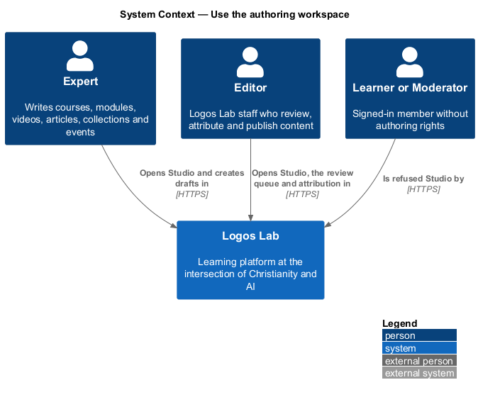
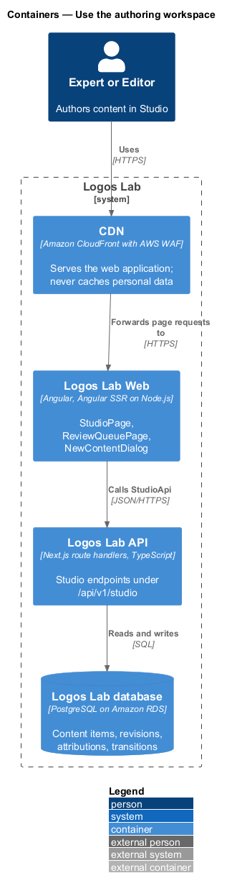
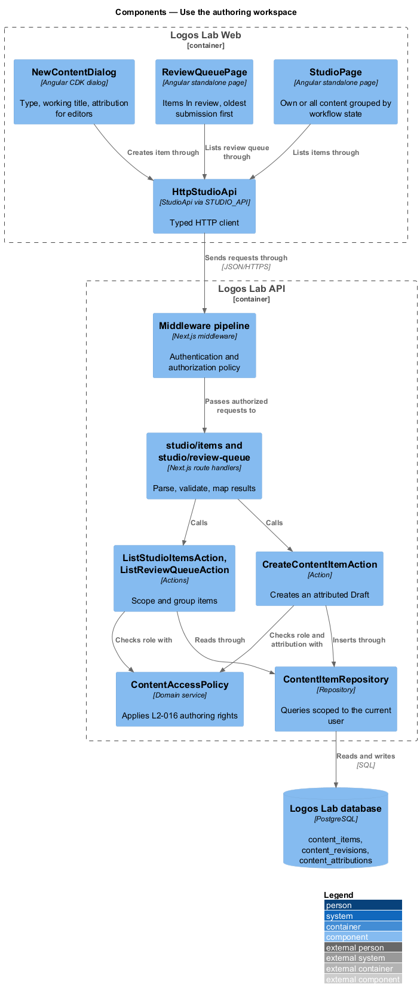
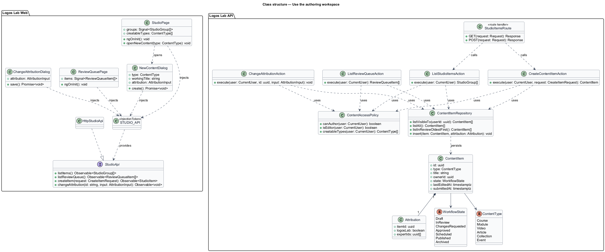
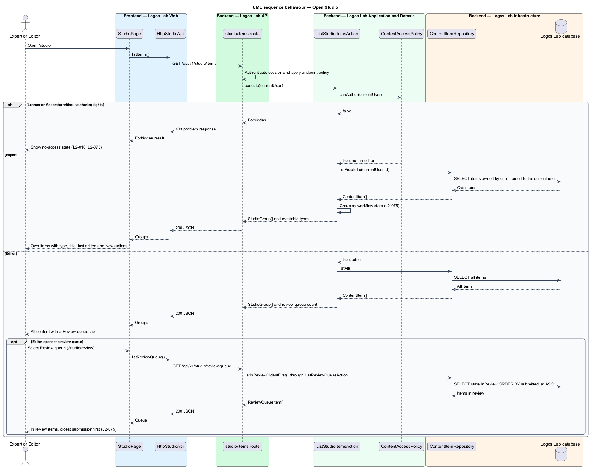
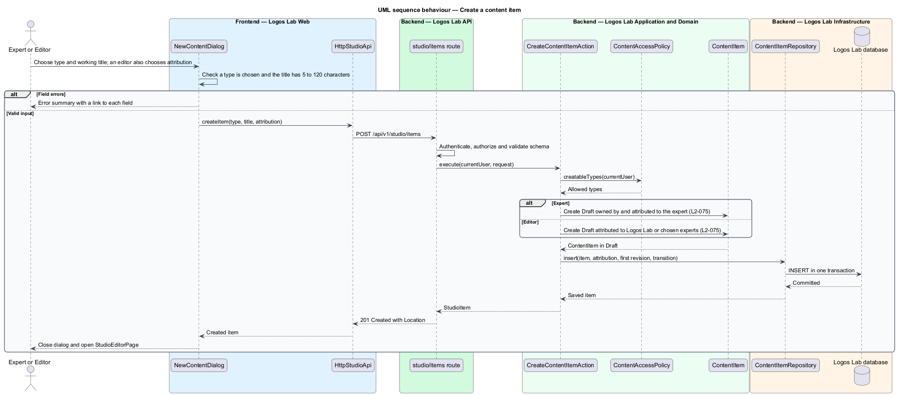

# Use the authoring workspace

## Overview

Logos Lab publishes courses, learning modules, videos, articles, collections and events. Experts and Logos Lab
editors write that content in one place, Studio.

**Studio** — authoring workspace at `/studio` where experts and editors create and track content items

**content item** — one course, learning module, video, article, collection or event, from first draft to archive

**workflow state** — stage a content item has reached in the editorial workflow: Draft, In review, Changes
requested, Approved, Scheduled, Published or Archived

**attribution** — record of who a content item is credited to on public pages: Logos Lab, or one or more experts

An expert sees only the items they own or are credited with, grouped by workflow state. An editor sees every item
and a review queue of items waiting for review. Learners and moderators without authoring rights cannot open Studio.

This feature is the entry point of the authoring subsystem. The editor screen, the editorial workflow, preview,
publishing, revisions, archiving, validation, image upload and autosave each have their own design in
`docs/detailed-designs/authoring/`.

## Description

The slice runs from the Studio pages in Logos Lab Web to the content tables in the Logos Lab database.

**Logos Lab Web**

- **`StudioPage`** — routed page at `/studio`. For an expert it lists the expert's own items in one table per
  workflow state, each row showing type, title and last-edited date. It offers a "New" action for each content type
  the person may create: course, module, video, article, collection and event. For an editor it lists all content
  and adds an "All content" and "Review queue" tab pair (`ll-tabs`). Mock states in `docs/mocks/pages/studio/`:
  `default`, `editor`, `onboarding`, `loading`, `empty`, `error` and `forbidden`.
- **`ReviewQueuePage`** — routed page at `/studio/review` for editors. It lists items In review, oldest submission
  first, with title, type, author, submission date and waiting time. Mock states in
  `docs/mocks/pages/review-queue/`: `default`, `loading`, `empty`, `error` and `forbidden`.
- **`NewContentDialog`** — Angular CDK dialog opened from a "New" action. It asks for a content type
  (`ll-radio-group`) and a working title of 5 to 120 characters (`ll-text-field` with a character count). For an
  editor it also asks whether the item is attributed to Logos Lab or to one or more experts. Mock states in
  `docs/mocks/dialogs/new-content/`: `default`, `editor`, `busy`, `invalid` and `failed`.
- **`ChangeAttributionDialog`** — Angular CDK dialog in which an editor changes an existing item's attribution to
  Logos Lab or to one or more experts (`ll-chip` per expert). Mock states in
  `docs/mocks/dialogs/change-attribution/`: `default`, `busy`, `invalid` and `success`.
- **Shared components** — `ll-page-header`, `ll-table`, `ll-badge`, `ll-tabs`, `ll-button`, `ll-dialog`,
  `ll-radio-group`, `ll-text-field`, `ll-chip`, `ll-skeleton`, `ll-empty-state` and `ll-alert`.
- **`StudioApi`** — contract in the shared API library, bound through the `STUDIO_API` injection token to
  `HttpStudioApi`. Its methods are `listItems()`, `listReviewQueue()`, `createItem()` and `changeAttribution()`.

**Logos Lab API**

- **`GET /api/v1/studio/items`** — returns the caller's visible items grouped by workflow state, plus the content
  types the caller may create.
- **`GET /api/v1/studio/review-queue`** — returns items In review ordered by submission time, oldest first. Editors
  only.
- **`POST /api/v1/studio/items`** — creates a content item in Draft and returns `201 Created`.
- **`PUT /api/v1/studio/items/{id}/attribution`** — replaces an item's attribution. Editors only.
- **`ListStudioItemsAction`**, **`ListReviewQueueAction`**, **`CreateContentItemAction`** and
  **`ChangeAttributionAction`** — one action per use case. Each action owns its transaction.
- **`ContentAccessPolicy`** — domain service that applies the role permissions of `L2-016`. It decides whether a
  person may author, whether the person is an editor, and which content types the person may create.
- **`ContentItem`** — entity with `id`, `type` (`ContentType`), `title`, `ownerId`, `state` (`WorkflowState`),
  `lastEditedAt` and `submittedAt`. Creating an item also creates its first `ContentRevision` and records the
  creation as a `WorkflowTransition`.
- **`Attribution`** — value held in the `content_attributions` table: either Logos Lab, or a list of expert ids.
- **`ContentItemRepository`** — PostgreSQL access to `content_items`, `content_revisions` and
  `content_attributions`. Every expert query filters by the current user's id (`L2-017`).

**Rules**

- An expert who opens `/studio` sees only their own content, grouped by workflow state, with type, title,
  last-edited date and a "New" action for each content type they can create.
- An editor sees all content, with a "Review queue" view that lists items In review, oldest submission first.
- A Learner or Moderator without authoring rights sees the no-access state (`L2-016`). The API answers `403` with
  an RFC 9457 problem response.
- An item created by an expert is in Draft, owned by that expert and attributed to them.
- An editor creating an item chooses whether to attribute it to Logos Lab or to one or more experts.
- The working title follows the title rule of `L2-082`: 5 to 120 characters.
- The `onboarding` mock state shows a newly invited expert finishing their profile first; that rule belongs to
  expert onboarding (`L2-020`).

## Requirements

| L2 ID | Refines (L1) | Requirement |
|-------|--------------|-------------|
| `L2-075` | `L1-013` | **Authoring workspace.** Experts and editors author content in a workspace at `/studio`. |

## Diagrams

### System context

Experts and editors use Logos Lab to author content. Learners and moderators without authoring rights reach Studio
only to be refused.

### Containers

Requests pass through the CDN to Logos Lab Web, which calls the Studio endpoints of the Logos Lab API. The API reads
and writes content tables in the Logos Lab database.

### Components

The Studio pages and `NewContentDialog` call `HttpStudioApi`. In the API, the middleware authorizes each request
before the route handlers call the list and create actions, which consult `ContentAccessPolicy`.

### Class structure

The pages depend on the `StudioApi` contract through `STUDIO_API`. On the server, the actions use
`ContentAccessPolicy` and `ContentItemRepository`, and each `ContentItem` owns one `Attribution`.

### Behaviour — open Studio

The action branches on the caller's role: an expert gets their own items, an editor gets all items and the review
queue, and anyone else gets the no-access state.

### Behaviour — create a content item

The dialog validates the type and working title, and the action creates a Draft with the attribution that
`L2-075` requires for the caller's role.

