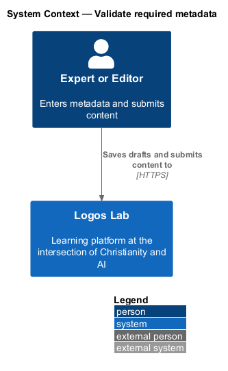
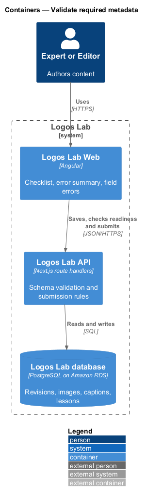
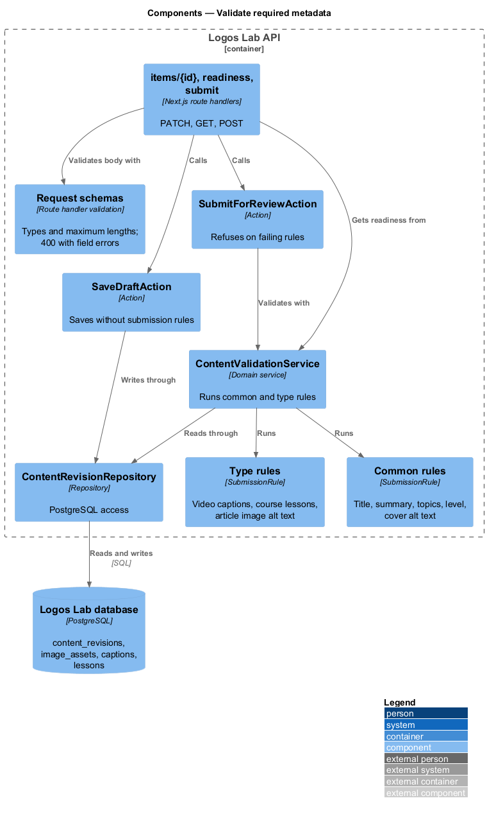
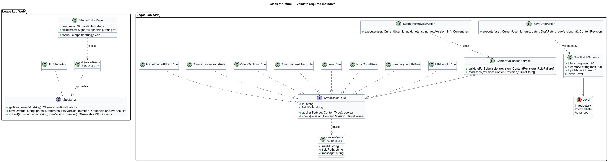
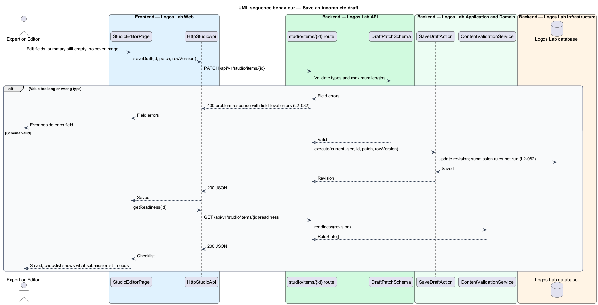
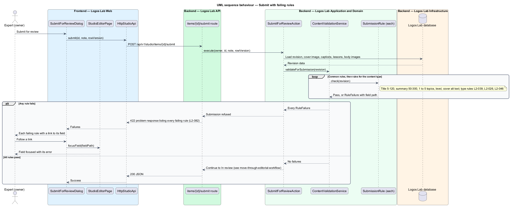

# Validate required metadata

## Overview

Every content item on Logos Lab appears on cards, in search, on topic pages and in social previews. Those surfaces
depend on a minimum set of metadata, and some content types need more, such as captions on a video.

**required metadata** — fields every content type needs before submission: title, summary, topics, level, and a cover
image with alt text

**submission rule** — named check that a content item shall pass before it can be submitted for review, either common
to all types or specific to one type

**field error** — message tied to one field, returned by the API and shown beside that field and in an error summary
that links to it

Drafts save freely while incomplete, so work is never blocked. The rules apply at the moment of submission, and the
API also guards every authoring field against values that are too long or of the wrong type. This feature supplies
the check that `move-through-editorial-workflow` runs when an owner submits for review.

## Description

**Logos Lab Web**

- **`StudioEditorPage`** — shows a "Before you submit" checklist in its aside, listing each common rule with its done
  state. The checklist notes that drafts save even when something is missing. Mock state `invalid` in
  `docs/mocks/pages/studio-editor/` shows the error summary (an `ll-alert` with links) and an error on each field
  (`ll-form-field`).
- **`ArticleEditorPage`** — mock state `invalid` in `docs/mocks/pages/article-editor/` flags an image without alt
  text and a skipped heading level in the body (`L2-046`).
- **`SubmitForReviewDialog`** — mock states `default` and `invalid` in `docs/mocks/dialogs/submit-for-review/` list
  passing and failing rules, each failing rule linking to its field in the editor.
- **Field limits in the UI** — `ll-text-field` and `ll-textarea` show counts such as "35 of 120 characters". The
  topic picker uses `ll-chip` and allows 1 to 5 topics.
- **`StudioApi`** — `getReadiness(id)` for the checklist, `saveDraft()` and `submit()`, bound through `STUDIO_API`
  to `HttpStudioApi`.

**Logos Lab API**

- **Request schemas** — each authoring route handler validates its body against a schema that sets each field's type
  and maximum length (schema library `<TO SUPPLY>`). A failure returns `400` with an RFC 9457 problem response whose
  `errors` member lists each field and message.
- **`GET /api/v1/studio/items/{id}/readiness`** — runs every submission rule and returns each rule with its state and
  field path. It changes nothing.
- **`ContentValidationService`** — runs the common rules and the rules registered for the item's `ContentType`. It
  returns every failing rule, not only the first.
- **`SubmissionRule`** — interface with `id`, `fieldPath` and `check(revision)`. Common implementations:
  `TitleLengthRule`, `SummaryLengthRule`, `TopicCountRule`, `LevelRule` and `CoverImageAltTextRule`. Type
  implementations include `VideoCaptionsRule` (`L2-039`), `CourseHasLessonsRule` (`L2-026`) and
  `ArticleImageAltTextRule` (`L2-046`). Further type rules from other L2 requirements register the same way.
- **`SaveDraftAction`** — saves a revision after schema validation only. It does not run submission rules.
- **`SubmitForReviewAction`** — runs `ContentValidationService` and refuses submission with `422` listing every
  failing rule (status code is a baseline choice).

**Rules**

- On submission, any content type shall have a title of 5 to 120 characters, a summary of 50 to 300 characters, at
  least one and at most 5 topics, a level, and a cover image with alt text.
- When a type-specific rule fails, for example a video without captions (`L2-039`), a course without lessons
  (`L2-026`) or an article with images that have no alt text (`L2-046`), submission is refused. Every failing rule is
  listed with a link to the field.
- Incomplete required fields do not block saving a draft.
- When the API receives a value that exceeds its maximum length or has the wrong type, it responds with `400` and
  field-level errors.

## Requirements

| L2 ID | Refines (L1) | Requirement |
|-------|--------------|-------------|
| `L2-082` | `L1-013` | **Required metadata and validation.** Every content type has required fields that are validated before it can be submitted. |

## Diagrams

### System context

Experts and editors enter metadata in Logos Lab, which checks it when they save and when they submit.

### Containers

Logos Lab Web shows the checklist and field errors. The Logos Lab API validates request schemas and runs the
submission rules against the revision in the database.

### Components

Route handlers validate schemas before any action runs. `ContentValidationService` composes the common and
type-specific `SubmissionRule` implementations.

### Class structure

Each rule implements `SubmissionRule` and returns a `RuleFailure` with a field path. The service selects rules by
`ContentType`.

### Behaviour — save an incomplete draft

A draft with missing required fields saves. A value that is too long or of the wrong type is refused with `400` and
field errors.

### Behaviour — submit with failing rules

Submission runs every rule and refuses the request with the full list of failures, each linked to its field.

