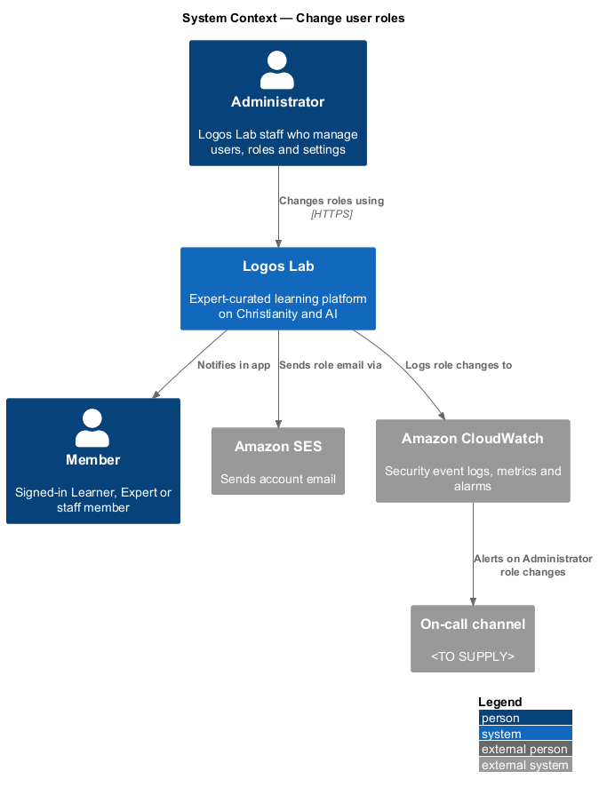
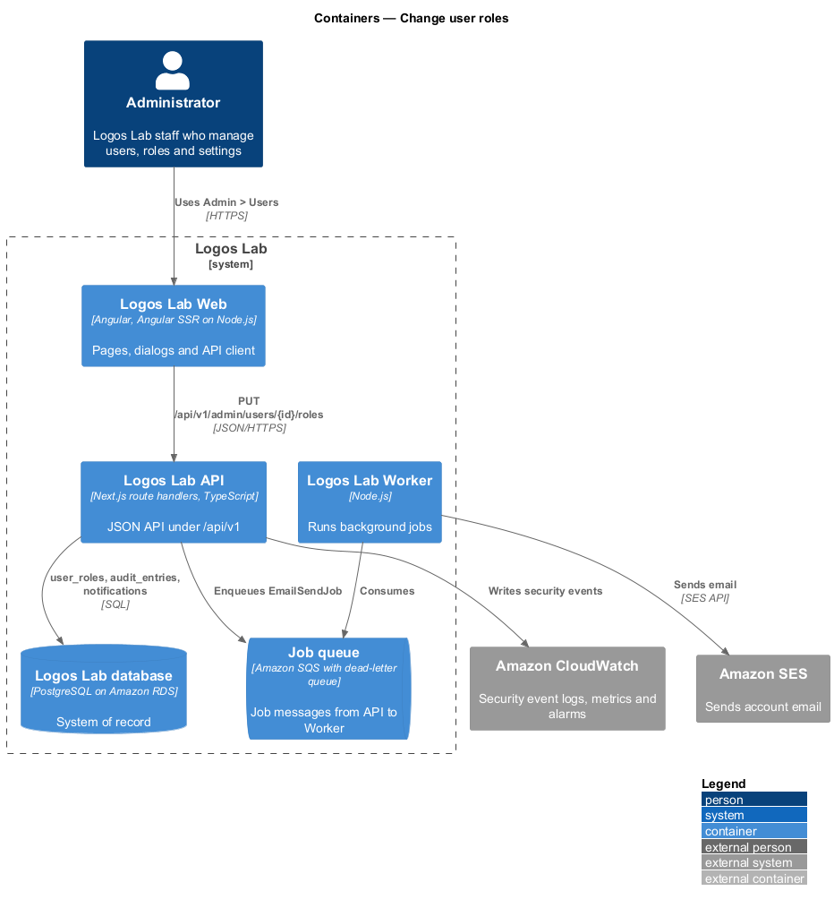
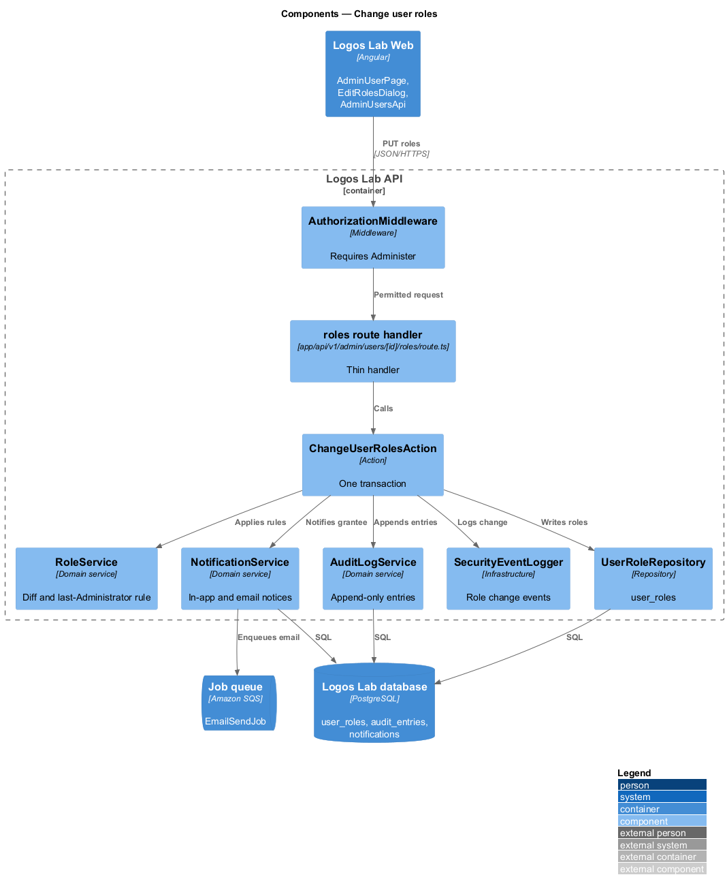
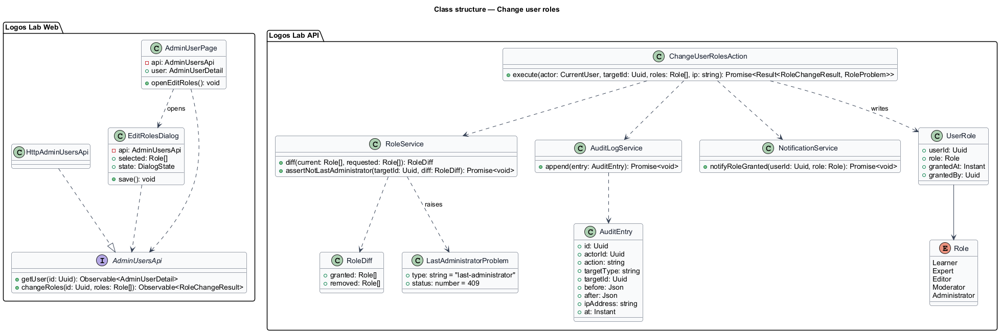
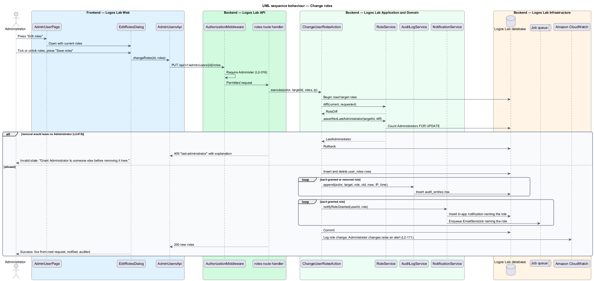
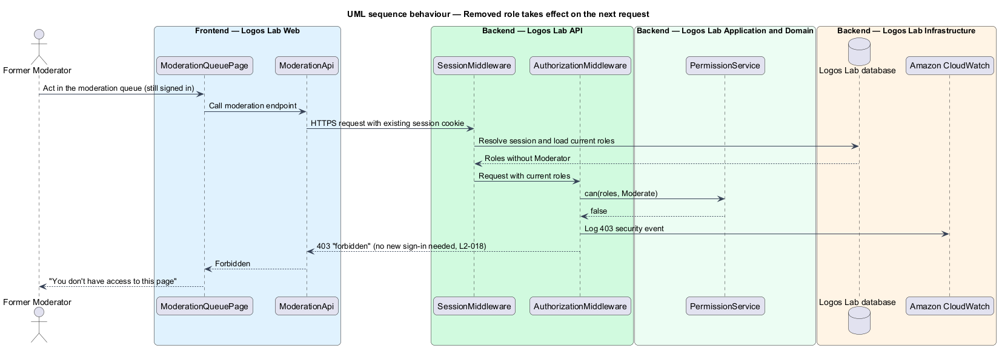

# Change user roles

## Overview

Administrators grant and remove roles: for example, they make a learner a Moderator or retire an Editor. A role change alters what a person may do on the platform, so it takes effect at once, it leaves an audit trail, and it tells the person concerned.

**role change** — grant or removal of one role on one user account by an Administrator

**audit entry** — append-only record of an administrative change: actor, action, target, before and after values, IP address and timestamp (`L2-099`)

**last Administrator** — the only account that still holds the Administrator role

The feature belongs to the authorization subsystem. It changes the roles that `authorization/enforce-role-permissions` (`L2-016`) reads on every request. Granting a mandatory-MFA role sends the user through two-step enrolment before their next page (`accounts/set-up-two-step-verification`, `L2-014`).

## Description

**Screens (Logos Lab Web)**

- **`AdminUserPage`** — routed page at `/admin/users/{id}`, guarded by the `Administer` capability. It shows roles, state, MFA status and history, with "Edit roles" in the page header. The mocks in `docs/mocks/pages/admin-user/` cover `default`, `last-admin`, `loading` and `error`, among others.
- **`EditRolesDialog`** — CDK dialog built on `ll-dialog` with an `ll-checkbox` group. Learner is fixed; Expert, Editor, Moderator and Administrator can be ticked, each with its capability summary. The mocks in `docs/mocks/dialogs/edit-roles/` cover `default`, `busy`, `invalid` (the last Administrator), `failed` and `success`. The success state says the role works from the next request, the user is notified, and the audit log records it.
- **`AdminAuditPage`** — routed page at `/admin/audit`, filterable by actor, action ("Role changes"), target and date range (`docs/mocks/pages/admin-audit/`). Its full behaviour belongs to `L2-099`.
- The role notice appears in the user's notification panel through `ll-notification-item` (`docs/mocks/notifications/notification/`).

**API contract (shared API library)**

- **`AdminUsersApi`** (token `ADMIN_USERS_API`, implementation `HttpAdminUsersApi`) — `getUser(id)`, `changeRoles(id, roles: Role[])`.

**Endpoint (Logos Lab API)**

- **`PUT /api/v1/admin/users/{id}/roles`** — requires the `Administer` capability. Body `{ roles }`. Answers `200` with the new roles, `409` with problem type `last-administrator` and an explanation, or `422` for an unknown role.

**Application and domain (Logos Lab API)**

- **`ChangeUserRolesAction`** — owns the transaction. It loads the target, computes the grants and removals, applies the last-Administrator rule, writes `user_roles`, appends one audit entry per changed role, and creates notifications for granted roles.
- **`RoleService`** — `diff(current, requested)` and `assertNotLastAdministrator(target, removals)`. The check counts holders of Administrator with a row lock, so two concurrent removals cannot both pass.
- **`AuditLogService`** — appends an `AuditEntry` per role change to table `audit_entries`: actor, target user, role, old value, new value, IP address and timestamp. The table is append-only.
- **`NotificationService`** — creates the in-app notification naming the role and enqueues `EmailSendJob` for the email notification.
- **`SecurityEventLogger`** — logs every role change (`L2-111`). Any change to an Administrator role alerts the on-call channel within 5 minutes.
- **Immediate effect** — `SessionMiddleware` loads roles from `user_roles` on every request and nothing caches them across requests. A removed capability is therefore refused on the user's next request without a new sign-in.
- **`UserRole`** — table `user_roles`: `userId`, `role`, `grantedAt`, `grantedBy`.

**Rules from the acceptance criteria**

- An Administrator removing a role from a signed-in user makes the removed capabilities refused on that user's next request, without a new sign-in.
- Each grant or removal records an audit entry with actor, target user, role, old value, new value and timestamp.
- Removing the Administrator role from the last remaining Administrator is refused with an explanation.
- A user granted a role receives an in-app and an email notification naming the role.

## Requirements

The feature realizes the following level-2 (L2) requirement.

| L2 ID | Refines (L1) | Requirement |
|-------|--------------|-------------|
| `L2-018` | `L1-003` | **Role changes.** Changes to a user's roles shall take effect immediately and shall be auditable. |

## Diagrams

### System context

An Administrator changes a member's roles in Logos Lab. Logos Lab emails the member and alerts the on-call channel on Administrator changes.

### Containers

The Logos Lab API writes roles, audit entries and notifications in one database transaction and enqueues the email for the Worker.

### Components

`ChangeUserRolesAction` uses `RoleService` for the rules, `AuditLogService` for the trail and `NotificationService` for the notices.

### Class structure

The dialog depends on `AdminUsersApi`. The action writes `UserRole` rows, `AuditEntry` rows and `Notification` rows.

### Behaviour — change roles

The last-Administrator rule runs before any write. A successful change is audited and notified in the same transaction (`L2-018`).

### Behaviour — removed role takes effect on the next request

The user's next request loads the current roles, so the removed capability is refused at once.

