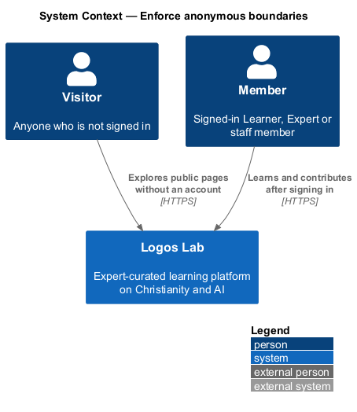
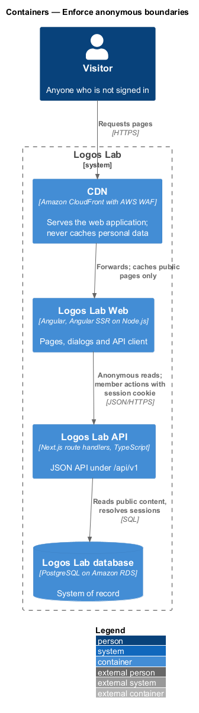
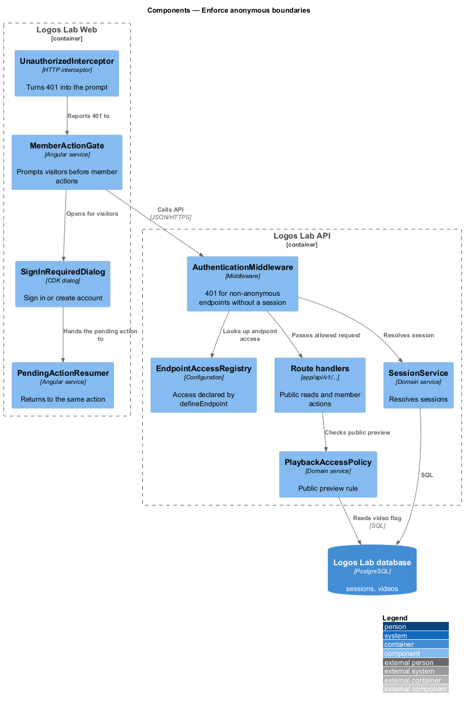
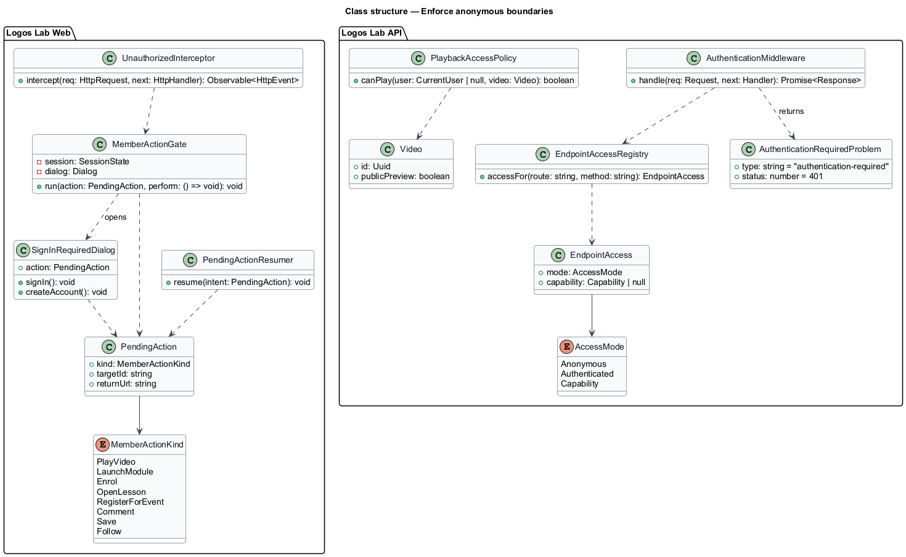
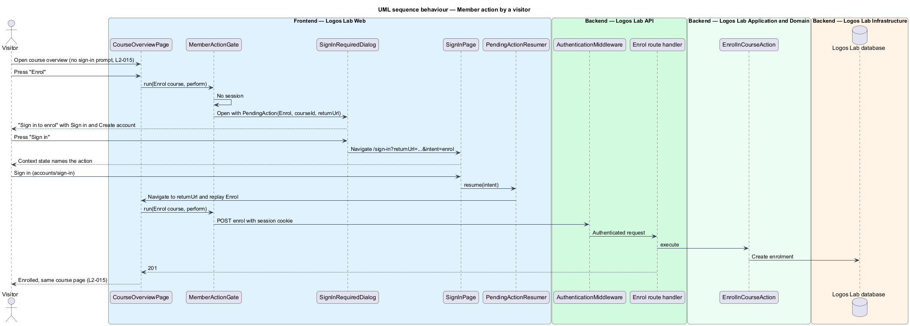
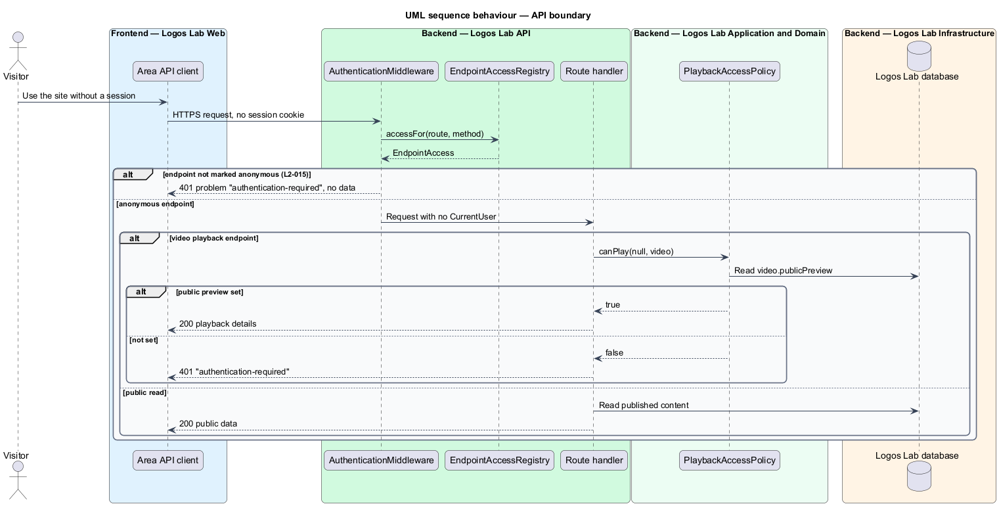

# Enforce anonymous boundaries

## Overview

Logos Lab is open to explore and closed to learn. A visitor may read the shop window: the home page, the catalogue, search, topics, expert profiles, articles, collections, events, and the overview pages of courses, modules and videos. Learning activity and contributions need an account. This feature draws that line on both tiers and makes crossing it smooth: a visitor who tries a member action is asked to sign in or register, then returned to the same action.

**anonymous endpoint** — API endpoint explicitly marked as callable without a session

**member action** — action that needs an account: playing a video, launching a module, enrolling, opening a lesson, registering for an event, commenting, saving an item or following anything

**pending action** — member action recorded before sign-in so that it can resume afterwards

**public preview** — editor-set flag on a video that lets visitors play it without signing in

The feature is the first of the authorization subsystem. It decides whether a caller needs a session at all. Role permissions (`authorization/enforce-role-permissions`, `L2-016`) and ownership (`authorization/scope-owned-data`, `L2-017`) decide what a signed-in caller may do.

## Description

**Mechanism (Logos Lab API)**

- **`defineEndpoint`** — wrapper every route handler in `app/api/v1` uses to declare its access: `anonymous`, `authenticated` (the default) or a capability (`L2-016`). An endpoint without a declaration is authenticated.
- **`EndpointAccessRegistry`** — the access declarations, read by the middleware for each matched route.
- **`AuthenticationMiddleware`** — the authentication stage of the pipeline (after rate limiting, before authorization). It resolves the session through `SessionService` (`accounts/manage-sessions`). For a request with no valid session to an endpoint that is not anonymous, it answers `401` with an RFC 9457 problem of type `authentication-required` and no data.
- **`PlaybackAccessPolicy`** — rule for the video playback endpoint, which is reachable anonymously. A visitor receives playback only when the video has `publicPreview` set; otherwise the action answers `401` and the web prompts for sign-in. The playback endpoint itself belongs to the videos subsystem (`L2-040`).

**Mechanism (Logos Lab Web)**

- Public pages are server-rendered and load without a sign-in prompt. They call only anonymous endpoints when no session exists.
- **`MemberActionGate`** — web service that each member action calls first. For a visitor it records a `PendingAction` and opens `SignInRequiredDialog`.
- **`SignInRequiredDialog`** — CDK dialog built on `ll-dialog` with "Sign in" and "Create account". The mock in `docs/mocks/dialogs/sign-in-required/default.html` names the action (for example "Sign in to enrol") and promises the return.
- **`PendingAction`** — `kind`, `targetId` and `returnUrl`. It travels as the `returnUrl` and `intent` query parameters to `/sign-in` or `/register`, so it survives a full page load. `SignInPage` shows the `context` state for it (`docs/mocks/pages/sign-in/context.html`).
- **`PendingActionResumer`** — after sign-in, it navigates to the same-origin `returnUrl` (`ReturnUrlPolicy`, `L2-008`) and replays the intent on that page.
- **`UnauthorizedInterceptor`** — HTTP interceptor that turns a `401` during a member action into the same prompt, and a `401` with `session-expired` into the sign-in page.
- The mocks `docs/mocks/pages/home/` and `docs/mocks/pages/video-page/` show the visitor views of public pages.
- **`memberGuard`** — route guard for pages that exist only for a member (Dashboard, My learning, Saved, My events, My certificates, Following, Settings, Studio, Moderation, Admin). It waits for the session to load; a visitor is sent to `/sign-in?returnUrl={the requested path}` and returns there after signing in. A member passes, and capability guards (`authorization/enforce-role-permissions`) run after it.

**Public surface (anonymous)**

| Area | Anonymous pages and reads |
|---|---|
| Discovery | Home page, catalogue, search, topic pages |
| People | Expert profiles |
| Content | Article pages, collection pages, event pages |
| Overviews | Course, module and video overview pages |
| Media | Playback of videos marked "Public preview" |

**Rules from the acceptance criteria**

- A visitor opens each page in the public surface without a sign-in prompt.
- A visitor who plays a video, launches a module, enrols, opens a lesson, registers for an event, comments, saves an item or follows anything is prompted to sign in or register, and returns to the same action afterwards.
- A video marked "Public preview" plays without sign-in.
- An unauthenticated request to an endpoint that is not explicitly anonymous answers `401` with no data.

## Requirements

The feature realizes the following level-2 (L2) requirement.

| L2 ID | Refines (L1) | Requirement |
|-------|--------------|-------------|
| `L2-015` | `L1-003` | **Anonymous access boundaries.** Visitors shall be able to explore the platform without an account, but learning activity shall require one. |

## Diagrams

### System context

A visitor explores Logos Lab without an account and becomes a member to learn.

### Containers

The CDN serves public pages from Logos Lab Web. The Logos Lab API answers anonymous endpoints and refuses the rest with `401`.

### Components

`AuthenticationMiddleware` reads the access declaration of each endpoint from `EndpointAccessRegistry`. In the web tier, `MemberActionGate` and `PendingActionResumer` handle the prompt and the return.

### Class structure

Route handlers declare an `EndpointAccess`. On the web side, a `PendingAction` connects the gate, the dialog and the resumer.

### Behaviour — member action by a visitor

The visitor is prompted, signs in, and the same action resumes (`L2-015`).

### Behaviour — API boundary

The middleware lets anonymous endpoints through and refuses others with `401`. The playback rule admits public-preview videos.

