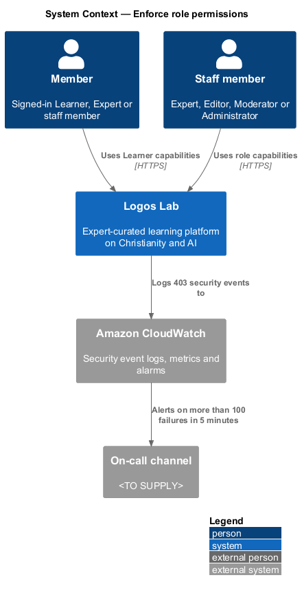
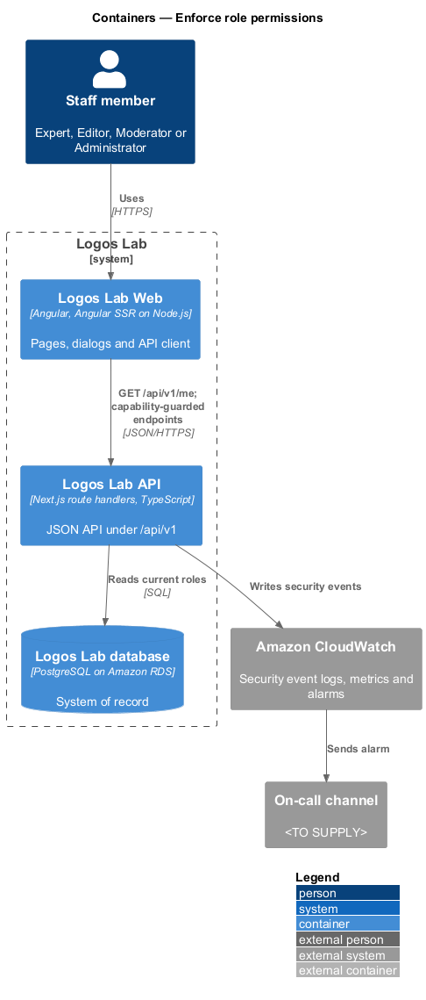
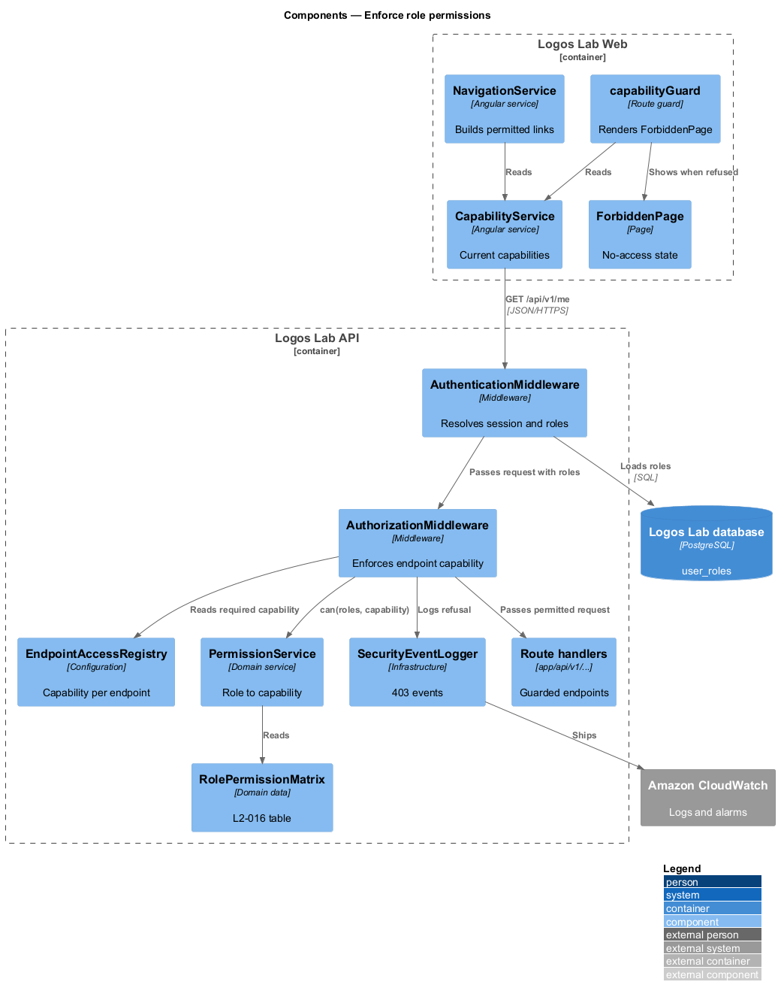
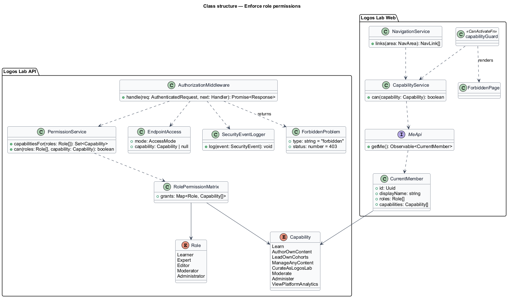
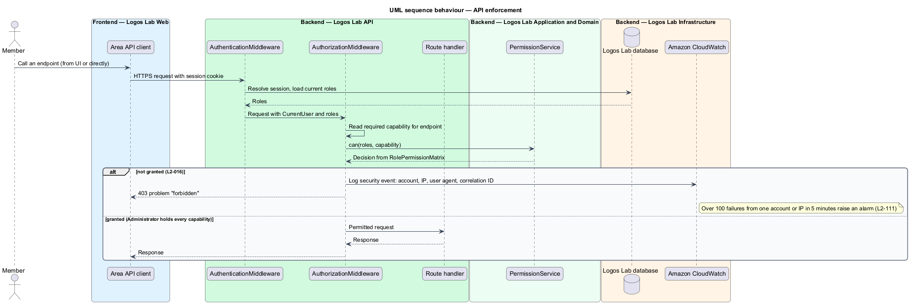
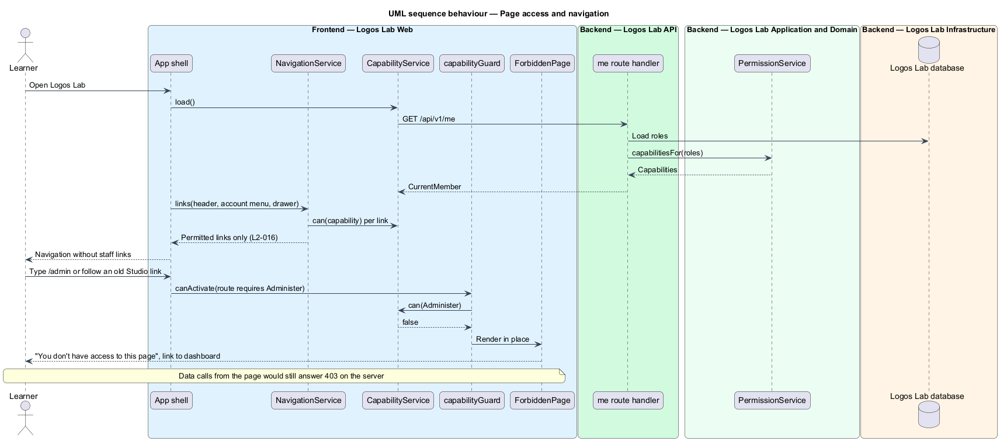

# Enforce role permissions

## Overview

Logos Lab has six roles: Visitor, Learner, Expert, Editor, Moderator and Administrator. Each signed-in role decides which capabilities the user holds. This feature enforces those capabilities on every API endpoint, on the server, and keeps the web interface consistent with them.

**role** — named set of capabilities granted to a user account; every account holds Learner

**capability** — permission to perform one family of operations, such as reviewing content or managing users

**permission matrix** — table that maps each role to the capabilities it grants

Permissions are cumulative: every role also holds the Learner capabilities, and a user with several roles holds the union of them. The interface hides what a user cannot use, but hiding is never the enforcement; the API refuses the call regardless. The feature sits in the authorization subsystem between authentication (`authorization/enforce-anonymous-boundaries`, `L2-015`) and ownership checks (`authorization/scope-owned-data`, `L2-017`).

## Description

**Permission matrix**

The `RolePermissionMatrix` encodes the table of `L2-016` as data. `Capability` has one value per row.

| Capability | Learner | Expert | Editor | Moderator | Admin |
|---|---|---|---|---|---|
| `Learn` — learn, comment, message, register for events | yes | yes | yes | yes | yes |
| `AuthorOwnContent` — author own content, edit own expert profile | - | yes | yes | - | - |
| `LeadOwnCohorts` — lead own cohorts | - | yes | yes | - | - |
| `ManageAnyContent` — review, publish, schedule, archive any content | - | - | yes | - | yes |
| `CurateAsLogosLab` — curate featured content and collections as Logos Lab | - | - | yes | - | yes |
| `Moderate` — handle reports, hide or remove content, suspend users | - | - | - | yes | yes |
| `Administer` — manage users, roles, invitations, taxonomy, settings | - | - | - | - | yes |
| `ViewPlatformAnalytics` — view platform-wide analytics | - | - | yes | - | yes |

The table copies `L2-016`. Acceptance criterion 3 permits an Administrator every endpoint in the table, although the table marks Admin "-" for `AuthorOwnContent` and `LeadOwnCohorts`. `PermissionService` therefore grants the Administrator role every capability. Confirmation of this reading is `<TO SUPPLY>`.

**Mechanism (Logos Lab API)**

- **`defineEndpoint`** — each route handler declares the `Capability` it requires, if any.
- **`AuthorizationMiddleware`** — the last stage of the middleware pipeline. It reads the required capability from `EndpointAccessRegistry` and the user's current roles from the resolved session. It asks `PermissionService` whether the roles grant it. A refusal answers `403` with an RFC 9457 problem of type `forbidden`.
- **`PermissionService`** — `capabilitiesFor(roles)` and `can(roles, capability)` over `RolePermissionMatrix`.
- **`SecurityEventLogger`** — logs every `403` as a security event with timestamp, account identifier, IP address, user agent and correlation ID (`L2-111`). More than 100 authorization failures from one account or IP address in 5 minutes alert the on-call channel within 5 minutes through an Amazon CloudWatch alarm (`L2-111`).
- Roles are read from the database on each request, so a removed role stops working at once (`L2-018`).

**Mechanism (Logos Lab Web)**

- **`MeApi`** (token `ME_API`, implementation `HttpMeApi`) — `getMe()` returns `CurrentMember` with `roles` and `capabilities` from `GET /api/v1/me`.
- **`CapabilityService`** — holds the current member's capabilities for the session.
- **`capabilityGuard`** — route guard. A route declares its capability in route data; a user without it sees `ForbiddenPage`.
- **`ForbiddenPage`** — the "You don't have access to this page" state, at `/403` and in place on a guarded route, built on `ll-error-page`. The mocks are `docs/mocks/pages/forbidden/default.html` and `docs/mocks/pages/admin/forbidden.html`.
- At `/403`, with no area to name, the page says "Your account doesn't have the role this page needs. If you think you should have access, write to help@logoslab.ca." A guarded area (Studio, admin, moderation) words the text for that area, as its own mock shows.
- **`NavigationService`** — builds the links of the header, `AccountMenu` and the navigation drawer from `CapabilityService`. The navigation never shows a link the user cannot use. The mocks `docs/mocks/dialogs/account-menu/` (`default`, `staff`), `docs/mocks/dialogs/nav-drawer/` (`signed-in`, `staff`) and `docs/mocks/pages/admin/` (`default`, `editor`) show the role-specific link sets.
- An `*llIfCan` structural directive hides controls the user cannot use.

**Rules from the acceptance criteria**

- A user without a capability who calls its endpoint gets `403`, and the attempt is logged as a security event.
- A user without a capability who navigates to its page sees the "You don't have access to this page" state; the navigation never links to it.
- An Administrator calling any endpoint in the table is permitted.
- A control hidden in the UI is still refused by the API when called directly.

## Requirements

The feature realizes the following level-2 (L2) requirement.

| L2 ID | Refines (L1) | Requirement |
|-------|--------------|-------------|
| `L2-016` | `L1-003` | **Role permissions.** Every API endpoint shall enforce role-based permissions on the server. Permissions are cumulative: every role also holds the Learner permissions. |

## Diagrams

### System context

Members and staff use Logos Lab with the capabilities of their roles. Refusals go to Amazon CloudWatch, which alerts the on-call channel on bursts.

### Containers

Logos Lab Web hides what the member cannot use. The Logos Lab API enforces the capability and logs refusals.

### Components

`AuthorizationMiddleware` consults `EndpointAccessRegistry` and `PermissionService`. The web guard and navigation read `CapabilityService`.

### Class structure

`RolePermissionMatrix` maps each `Role` to its `Capability` values. Both tiers use the same capability names.

### Behaviour — API enforcement

Each request is checked against the endpoint's capability; a refusal answers `403` and is logged (`L2-016`).

### Behaviour — page access and navigation

The web shows only permitted links and renders the no-access state for a guarded page.

