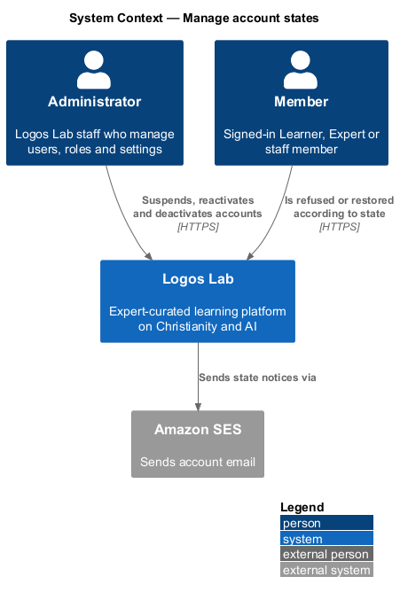
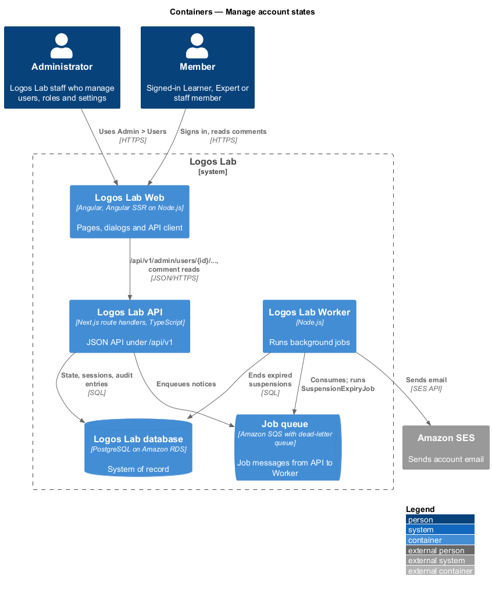
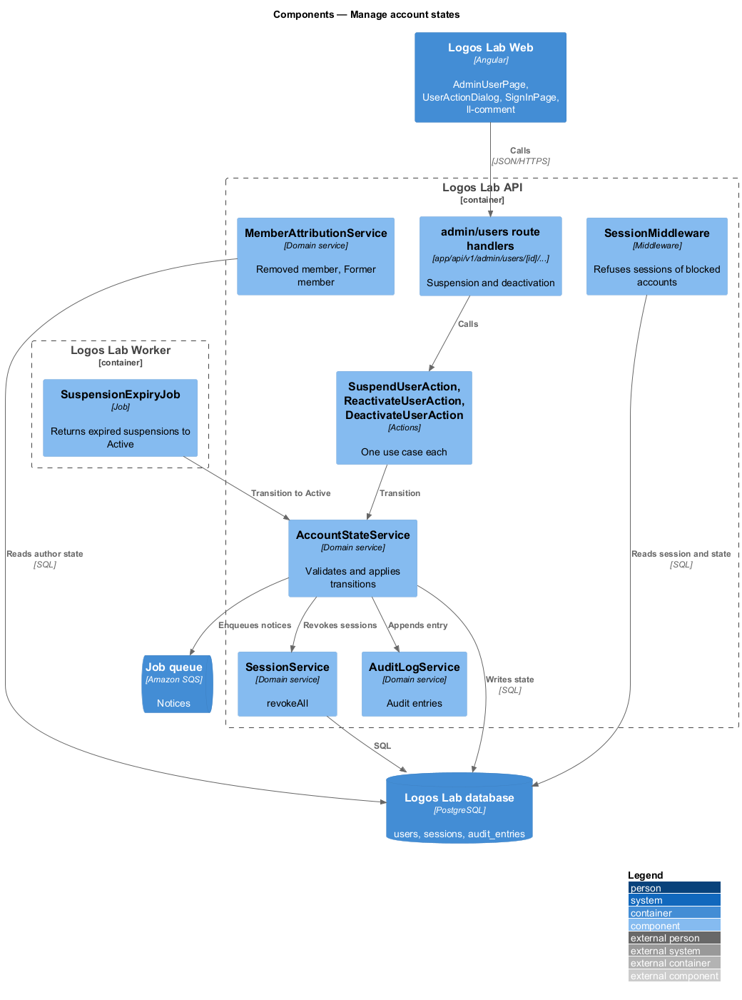
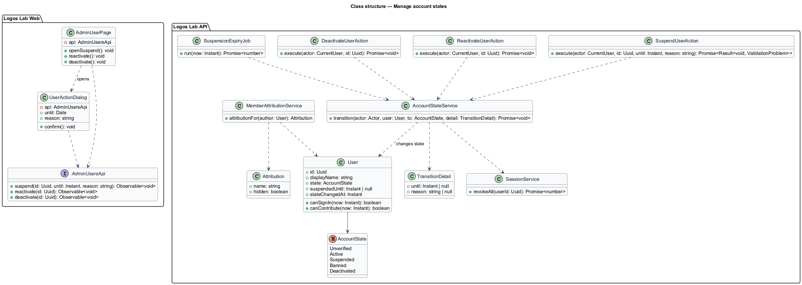
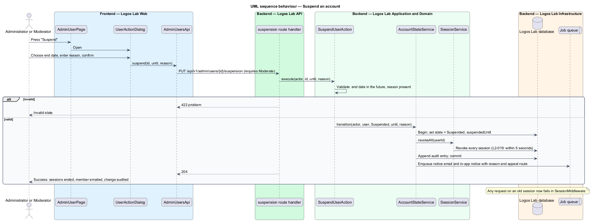
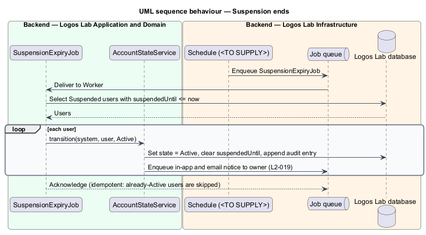
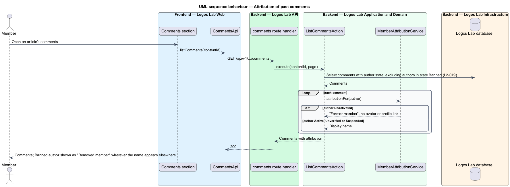

# Manage account states

## Overview

Every Logos Lab account is in exactly one account state, and that state decides what the account may do. This feature defines the states, the transitions between them, and the effects that each transition has on sessions, sign-in and how the account's past contributions appear to others.

**account state** — lifecycle status of an account: Unverified, Active, Suspended (until a date), Banned or Deactivated

**suspension** — temporary block on an account that ends automatically on a set date

**ban** — permanent block on an account imposed by moderation

**deactivation** — closing of an account, self-initiated (`L2-117`) or by an Administrator (`L2-095`), followed by a purge after 30 days unless restored

**attribution** — name shown beside a comment or post to say who wrote it

The feature is the state model of the authorization subsystem. Other features trigger transitions: email verification (`L2-007`), moderation actions (`L2-087`), user management (`L2-095`) and account deletion (`L2-117`). This design owns what every transition does.

## Description

**State model**

| State | Sign-in | Contributions | Attribution of past comments |
|---|---|---|---|
| `Unverified` | Allowed (`L2-007`) | Refused until verified | Display name |
| `Active` | Allowed | Allowed | Display name |
| `Suspended` (until a date) | Refused with end date and notice link | Refused | Display name |
| `Banned` | Refused; copy `<TO SUPPLY>` | Refused | Comments hidden; name "Removed member" |
| `Deactivated` | Refused with restore deadline | Refused | "Former member" |

Transitions: `Unverified` to `Active` on verification. `Active` to `Suspended` or `Banned` by a Moderator or Administrator. `Suspended` to `Active` on the end date, or early by "Reactivate". `Active` to `Deactivated` by the owner or an Administrator; `Deactivated` to `Active` on restore within 30 days (`L2-117`). Whether a ban can be lifted is `<TO SUPPLY>`.

**Screens (Logos Lab Web)**

- **`AdminUserPage`** — at `/admin/users/{id}`. Its `ll-danger-zone` offers Suspend and Deactivate; a suspended account shows an `ll-alert` with the end date and "Reactivate". The mocks in `docs/mocks/pages/admin-user/` cover `default`, `unverified`, `suspended` and `deactivated`.
- **`UserActionDialog`** — CDK dialog for "Suspend user", with an end date and a reason the member will see. The mocks in `docs/mocks/dialogs/user-action/` cover `default`, `busy`, `invalid` (past date, missing reason), `failed` and `success`.
- **`AccountNoticePage`** — at `/account/notices/{id}`; shows the suspension and the appeal route (`docs/mocks/pages/account-notice/`, `L2-090`).
- **`SignInPage`** states `suspended` and `deactivated` (`docs/mocks/pages/sign-in/`) explain the refusal.
- **`ll-comment`** — renders the attribution returned by the API; the mock `docs/mocks/pages/comments/default.html` shows a "Former member" comment.

**API contract (shared API library)**

- **`AdminUsersApi`** (token `ADMIN_USERS_API`) — `suspend(id, until, reason)`, `reactivate(id)`, `deactivate(id)`.

**Endpoints (Logos Lab API)**

- **`PUT /api/v1/admin/users/{id}/suspension`** — body `{ until, reason }`; capability `Moderate`.
- **`DELETE /api/v1/admin/users/{id}/suspension`** — reactivate early; capability `Moderate`.
- **`POST /api/v1/admin/users/{id}/deactivation`** — capability `Administer`.
- Ban is applied through the moderation endpoints of `L2-087` and calls the same `AccountStateService`.

**Application and domain (Logos Lab API)**

- **`AccountStateService`** — the only code that changes `User.state`. It validates the transition, writes the state and `suspendedUntil`, appends an audit entry (`L2-099`), and calls `SessionService.revokeAll` for Suspended, Banned and Deactivated.
- **`SuspendUserAction`**, **`ReactivateUserAction`**, **`DeactivateUserAction`** — one use case each; each owns its transaction.
- **Session invalidation** — `revokeAll` marks every session revoked in the same transaction as the state change. `SessionMiddleware` also refuses any session whose user is not `Active` or `Unverified`. All sessions therefore stop working within 5 seconds of a suspension or ban.
- **`SuspensionExpiryJob`** — scheduled Worker job. It returns each Suspended account whose `suspendedUntil` has passed to `Active` and notifies the owner in app and by email. The schedule interval is `<TO SUPPLY>`. Sign-in also treats a passed end date as Active, so a member is never refused after the date.
- **`MemberAttributionService`** — maps an author to the name shown with their content: "Removed member" for Banned, "Former member" for Deactivated, otherwise the display name. Comment queries exclude a Banned author's comments.
- **`User`** — `state`, `suspendedUntil`, `stateChangedAt` on table `users`.

**Rules from the acceptance criteria**

- A Suspended account returns to Active automatically when the end date passes, and its owner is notified.
- When an account becomes Suspended or Banned, all of its sessions are invalidated within 5 seconds.
- A Banned account's comments remain hidden and its display name shows as "Removed member".
- A Deactivated account's past comments are attributed to "Former member".

Mock note: `docs/mocks/dialogs/user-action/default.html` says a suspension ends "at the start of this day, Eastern time", while `docs/mocks/pages/admin-user/suspended.html` shows an end time of 8:51 am ET. The exact end instant is `<TO SUPPLY>`.

## Requirements

The feature realizes the following level-2 (L2) requirement.

| L2 ID | Refines (L1) | Requirement |
|-------|--------------|-------------|
| `L2-019` | `L1-003` | **Account states.** Accounts shall have one of these states: Unverified, Active, Suspended (until a date), Banned or Deactivated. Each state determines what the account can do. |

## Diagrams

### System context

Administrators and moderators change account states. The member concerned is told by email and in app.

### Containers

The Logos Lab API changes the state and revokes sessions in one transaction. The Worker ends suspensions and sends the notices.

### Components

`AccountStateService` owns every transition. `SuspensionExpiryJob` and `MemberAttributionService` apply the time-based and display rules.

### Class structure

`User` holds an `AccountState`. The actions and the job change it only through `AccountStateService`.

### Behaviour — suspend an account

The suspension revokes every session in the same transaction, so the member's devices are signed out within 5 seconds (`L2-019`).

### Behaviour — suspension ends

The scheduled job returns expired suspensions to Active and notifies the owners.

### Behaviour — attribution of past comments

Comment reads hide a Banned author's comments and attribute a Deactivated author's comments to "Former member".

