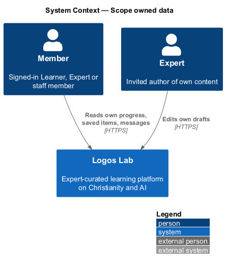
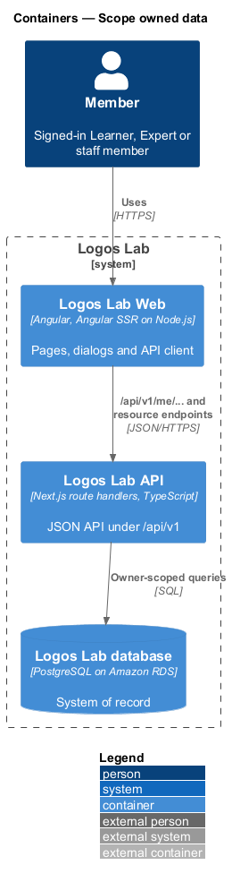
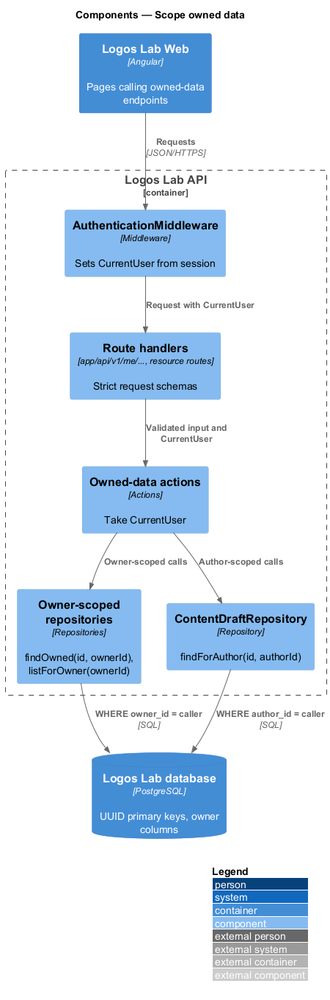
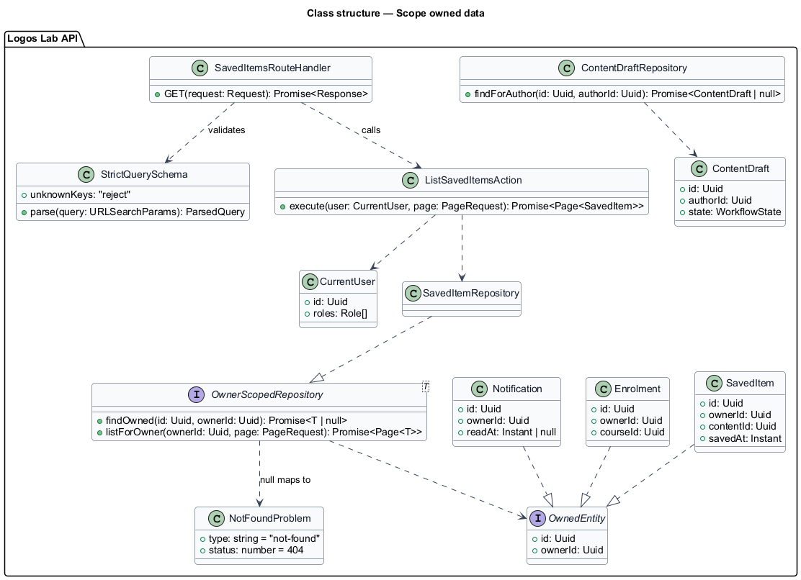
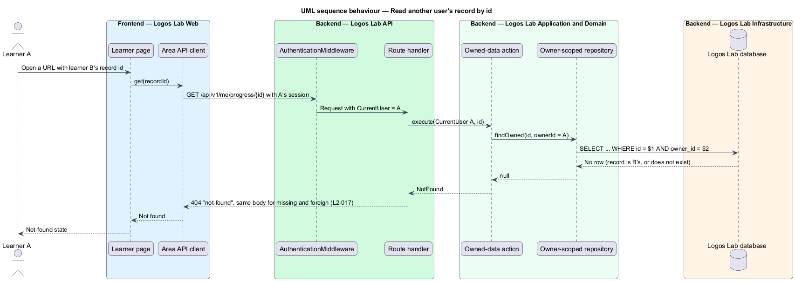
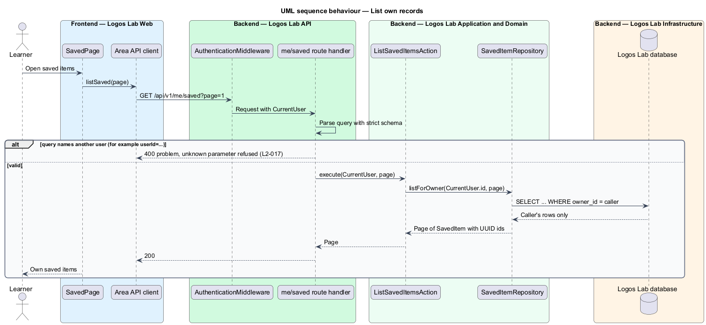

# Scope owned data

## Overview

Much of what Logos Lab stores belongs to one person: progress, saved items, notifications, enrolments, certificates in progress, messages, account data and expert drafts. This feature guarantees that such data is reachable only by its owner, whatever identifier a caller sends.

**user-owned data** — record whose owner is one user account and which no other member may read or change

**IDOR (insecure direct object reference)** — flaw in which a caller reaches another user's record by changing an identifier in a request

**owner scope** — query condition that limits a read or write to records whose owner is the current user

**non-sequential identifier** — identifier that cannot be guessed from another, such as a random UUID or a slug

The feature is a cross-cutting rule of the authorization subsystem. Role checks (`authorization/enforce-role-permissions`, `L2-016`) decide whether a caller may use an endpoint at all. Ownership decides which records that endpoint may touch. Every other subsystem's repositories follow this design.

## Description

**Mechanism (Logos Lab API)**

- **`CurrentUser`** — value attached to the request context by `AuthenticationMiddleware`. It is the only source of the owner id; no request field, path segment or query parameter can set it.
- **`/api/v1/me/...` endpoints** — list and detail endpoints for the caller's own data, such as `GET /api/v1/me/saved`, `GET /api/v1/me/enrolments`, `GET /api/v1/me/notifications` and `GET /api/v1/me/progress/{courseId}`. The spec's example path `/api/me/saved` maps to `/api/v1/me/saved` under the baseline's `/api/v1` prefix.
- **Request schemas** — every route handler validates its query and body with a strict schema that rejects unknown keys. A `userId`, `ownerId` or similar parameter is refused with `400`, so no parameter can widen the scope.
- **Owner-scoped repositories** — every repository method for user-owned data takes `ownerId: Uuid` and adds it to the `WHERE` clause, for example `SavedItemRepository.listForOwner(ownerId, page)` and `findOwned(id, ownerId)`. Repositories expose no unscoped lookup by id for these tables.
- **`OwnedResource` lookup rule** — a record that does not exist and a record owned by someone else produce the same `null`. The action answers `404` with problem type `not-found` and the same body and headers in both cases, so the response reveals nothing about existence.
- **Author drafts** — `ContentDraftRepository.findForAuthor(id, authorId)` scopes expert drafts. Expert A editing or submitting expert B's draft gets `404`. Editor access to any content goes through separate capability-guarded endpoints (`ManageAnyContent`).
- **Identifiers** — every table that exposes an identifier in a URL or API response has a primary key generated as a random UUID (`gen_random_uuid()`), or a slug for public content. No auto-increment integer is exposed. Internal surrogate keys, if any, never leave the API.
- **Administrator access** — staff reach other users' data only through capability-guarded admin endpoints (`L2-095`); member-scoped endpoints never accept another member's id, and impersonation is not supported.
- The mock set has no screen for this feature; its visible result is the `404` state of each page (`docs/mocks/pages/not-found/`).

**Rules from the acceptance criteria**

- Learner A requesting learner B's progress, saved items, notifications, enrolments, certificates in progress, messages or account data by id gets `404`, which reveals nothing about existence.
- Expert A requesting to edit or submit expert B's draft gets `404`.
- A list endpoint returns only the caller's records, and no query parameter widens the scope.
- Every identifier exposed in a URL or API response is a UUID or a slug, never an auto-increment integer.

## Requirements

The feature realizes the following level-2 (L2) requirement.

| L2 ID | Refines (L1) | Requirement |
|-------|--------------|-------------|
| `L2-017` | `L1-003` | **Ownership scoping.** User-owned data shall be scoped to its owner. Resources shall never be exposed to other users through guessable identifiers (IDOR). |

## Diagrams

### System context

Learners and experts reach only their own data in Logos Lab.

### Containers

The Logos Lab API derives the owner from the session and passes it into every database query for owned data.

### Components

Route handlers validate strict schemas, actions take `CurrentUser`, and owner-scoped repositories add the owner condition.

### Class structure

Each owned entity carries an `ownerId` and a UUID `id`. Repositories for owned data offer only owner-scoped methods.

### Behaviour — read another user's record by id

A record owned by someone else and a missing record both answer `404` (`L2-017`).

### Behaviour — list own records

List endpoints take the owner from the session and refuse any parameter that names another user.

