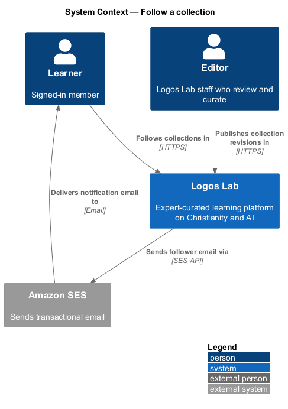
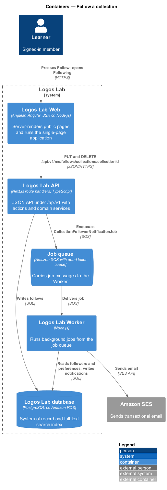
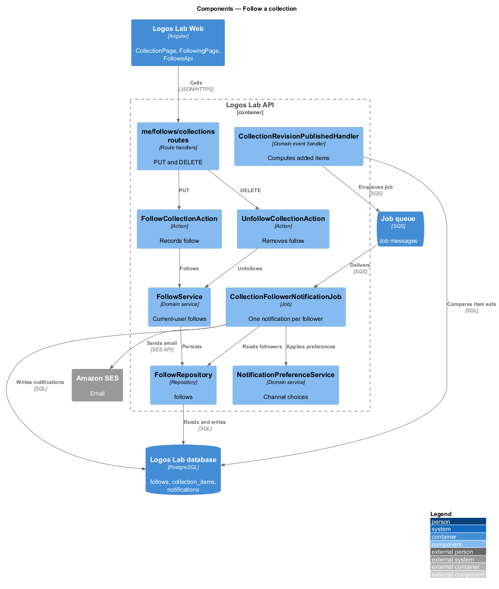
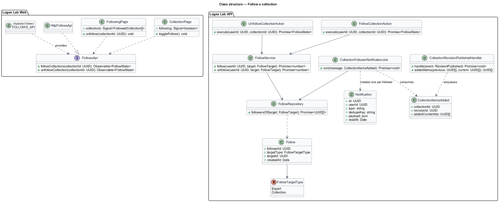
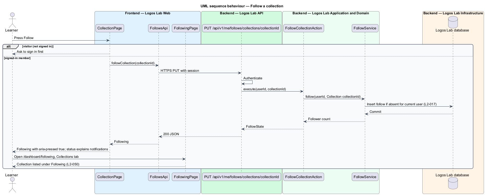
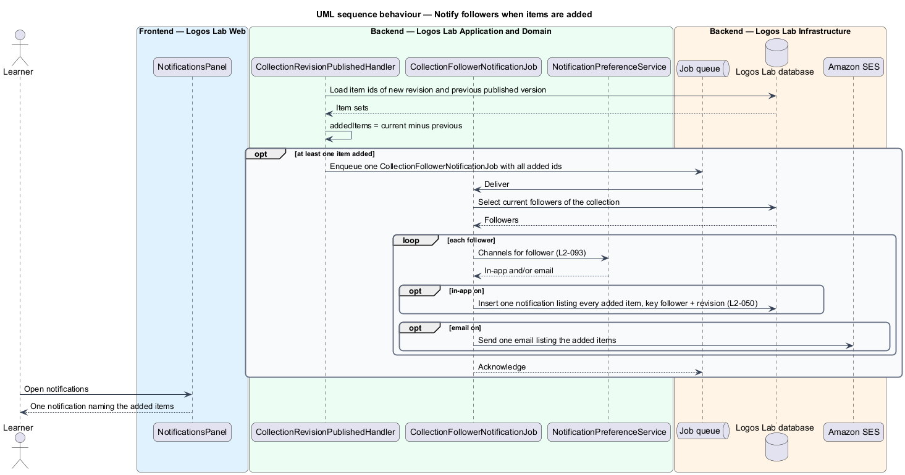

# Follow a collection

## Overview

A member *follows* a collection to hear when items are added to it. A *collection follow* is a
member's standing request to be notified when a published revision of a collection adds items. This
feature belongs to the collections subsystem and connects the collection page to the dashboard and to
notifications.

The Follow button sits on the collection page. A followed collection appears under Following in the
member's dashboard (`L2-074`). When a revision that adds items is published, each follower receives
one notification that lists the added items, however many there are. Terms used below:

- **added items** — items present in the newly published revision of a collection and absent from the
  previous published version
- **follower notification** — single notification to one follower that names every added item

## Description

The slice runs from `CollectionPage` and `FollowingPage` in Logos Lab Web to the Logos Lab API, the
Logos Lab database, the Job queue, the Worker and Amazon SES.

**Logos Lab Web**

- **`CollectionPage`** — holds the Follow toggle (`ll-button` with `aria-pressed`) and a status message
  that says one notification arrives whenever items are added. A visitor is asked to sign in first.
  Mock: `docs/mocks/pages/collection-page/following.html`.
- **`FollowingPage`** — dashboard page at `/dashboard/following` with a Collections tab, owned by
  `L2-074`. Mock: `docs/mocks/pages/following/collections.html`.
- **`UnfollowDialog`** — CDK confirmation dialog shared with expert follows
  (`docs/mocks/dialogs/unfollow/`).
- **Notifications** — `ll-notification-item` renders the follower notification; the stacked mock
  (`docs/mocks/notifications/notification/stacked.html`) groups items across followed collections.
- **`FollowsApi`** — contract shared with the expert follow feature, with
  `followCollection(collectionId)` and `unfollowCollection(collectionId)`. `FOLLOWS_API` is its token
  and `HttpFollowsApi` its HTTP implementation.

**Logos Lab API**

- **`PUT /api/v1/me/follows/collections/{collectionId}`** and
  **`DELETE /api/v1/me/follows/collections/{collectionId}`** — authenticated and idempotent. They call
  `FollowCollectionAction` and `UnfollowCollectionAction`.
- **`FollowService`** and **`FollowRepository`** — write `follows` rows with target type `Collection`
  for the current user only (`L2-017`).
- **`CollectionRevisionPublishedHandler`** — runs when a collection revision is published (`L2-080`).
  It computes the added items by comparing the new item set with the previous published set. When the
  set is not empty, it enqueues one `CollectionFollowerNotificationJob`.
- **`CollectionFollowerNotificationJob`** — Worker job that, for each current follower, writes one
  in-app notification listing every added item and sends email through Amazon SES, according to the
  member's notification preferences (`L2-093`). The preference category for collection updates is
  `<TO SUPPLY>`. The job keys each notification by follower and revision, so a retry never duplicates
  it.

**Key rules**

- A signed-in member who presses "Follow" on a collection sees it under Following in their dashboard.
- When a revision that adds items is published, each follower receives one notification that lists the
  added items, regardless of how many items were added.

## Requirements

| L2 ID | Refines (L1) | Requirement |
|-------|--------------|-------------|
| `L2-050` | `L1-009` | **Follow a collection.** Members shall be able to follow a collection to be notified when items are added. |

## Diagrams

### System context

Learners follow collections in Logos Lab. When an editor publishes a revision that adds items, Logos
Lab notifies followers in-app and through Amazon SES.

### Containers

The API records follows and enqueues the notification job on publication. The Worker writes
notifications and sends email.

### Components

The follow routes share `FollowService` with expert follows. `CollectionRevisionPublishedHandler`
computes the added items before the job runs.

### Class structure

`CollectionItemsAdded` carries the added item ids for one revision, and the job turns it into one
`Notification` per follower.

### Behaviour — follow a collection

The member presses Follow; the follow is stored for the current user and the collection appears under
Following in the dashboard.

### Behaviour — notify followers when items are added

Publishing a revision that adds items enqueues one job, which writes one notification per follower
listing every added item.

