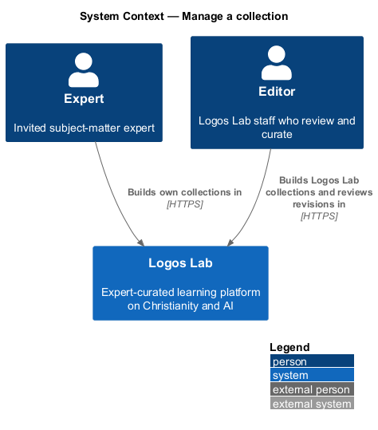
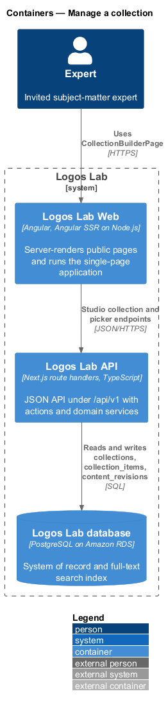
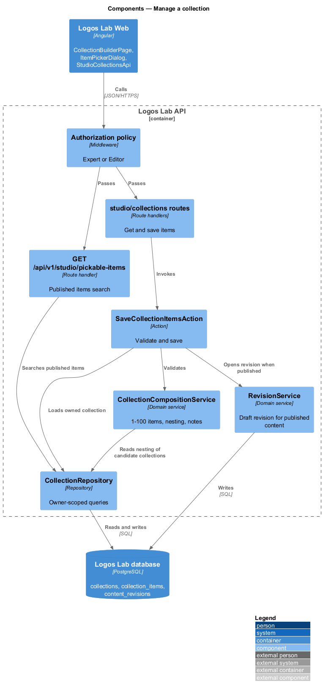
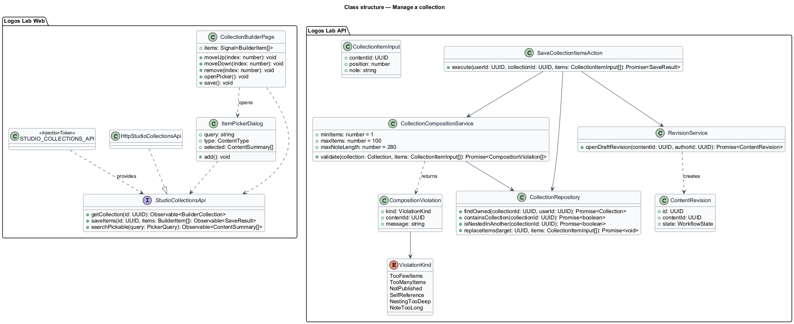
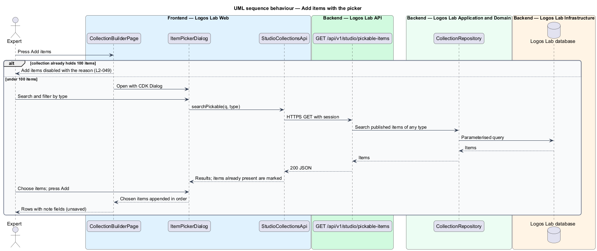
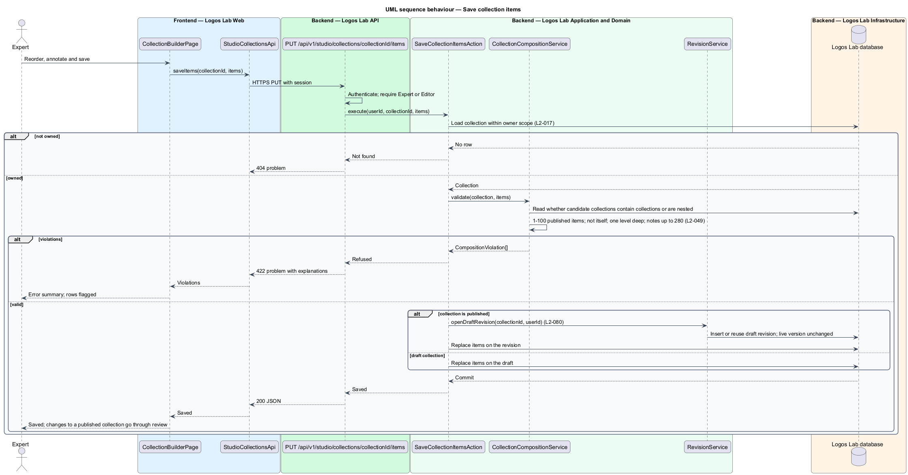

# Manage a collection

## Overview

Collections are built by authors in Studio. Experts curate their own collections, and editors curate
Logos Lab collections. Both kinds go through the *editorial workflow*, the sequence of states (draft,
review, scheduled, published, archived) that every piece of content follows before and after
publication (`L2-076`). This feature belongs to the collections subsystem and covers building and
changing a collection's items.

Terms used below:

- **collection builder** — Studio page where an author adds, orders, annotates and removes items
- **item note** — author's short explanation of why an item is in the collection, up to 280
  characters
- **nested collection** — collection that appears as an item inside another collection
- **nesting depth** — number of collection levels below the outer collection; at most one is allowed
- **revision** — draft copy of published content whose changes go live only after review (`L2-080`)

## Description

The slice runs from `CollectionBuilderPage` in Logos Lab Web to the Logos Lab API and the Logos Lab
database.

**Logos Lab Web**

- **`CollectionBuilderPage`** — routed Studio page at `/studio/collections/{collectionId}/edit`
  (baseline choice). It lists items in reading order, each with a drag handle, Move up and Move down,
  Remove and a note field with a character count. It shows a "Before you submit" checklist.
- **`ItemPickerDialog`** — CDK dialog that searches published items of any type, filters by type,
  marks items already in the collection and adds the chosen ones.
- **Design-system components** — `ll-sortable`, `ll-textarea`, `ll-form-field`, `ll-alert` (error
  summary), `ll-workflow-bar`, `ll-list`, `ll-description-list`, `ll-empty-state`, `ll-skeleton`,
  `ll-dialog`, `ll-checkbox` and `ll-select`.
- **`StudioCollectionsApi`** — contract with `getCollection(id)`, `saveItems(id, items)` and
  `searchPickable(query)`. `STUDIO_COLLECTIONS_API` is its token and `HttpStudioCollectionsApi` its HTTP
  implementation.
- **Screen states** — `docs/mocks/pages/collection-builder/` covers `default`, `empty`, `invalid`
  (nesting and note-length errors), `loading`, `error` and `long` (100 items, Add items disabled).
  `docs/mocks/dialogs/item-picker/` covers `default`, `selected`, `busy`, `empty`, `no-results` and
  `invalid`.

**Logos Lab API**

- **`GET /api/v1/studio/collections/{collectionId}`** — Expert or Editor, ownership-scoped. Experts see
  their own collections; editors see Logos Lab collections.
- **`PUT /api/v1/studio/collections/{collectionId}/items`** — same scope. Replaces the ordered item list
  with notes. Calls `SaveCollectionItemsAction`.
- **`GET /api/v1/studio/pickable-items`** — Expert or Editor. Searches published items for the picker,
  with `q` and `type` parameters.
- **`SaveCollectionItemsAction`** — loads the collection under the ownership scope, validates the
  composition, and writes the items. When the collection is published, it writes to a draft revision
  instead of the live collection (`L2-080`).
- **`CollectionCompositionService`** — enforces the composition rules and returns each violation with an
  explanation.
- **`RevisionService`** — opens or reuses the draft revision of a published collection; the live
  version stays unchanged until the revision is published.
- **`CollectionRepository`** — reads and writes `collections`, `collection_items` and
  `content_revisions`. Every query carries the owner scope (`L2-017`).

**Key rules**

- An author can add 1-100 published items of any type, including other collections nested one level
  deep, reorder them and add a note of up to 280 characters per item.
- Adding a collection to itself, or nesting collections more than one level deep, is refused with an
  explanation when saved. A collection that already contains a collection cannot be added; a
  collection that is itself an item of another collection cannot receive a collection.
- When the author of a published collection adds or reorders items, the change goes through review
  like any revision (`L2-080`).
- Submission for review uses the editorial workflow (`L2-076`, `L2-077`).

## Requirements

| L2 ID | Refines (L1) | Requirement |
|-------|--------------|-------------|
| `L2-049` | `L1-009` | **Collection management.** Experts curate their own collections and editors curate Logos Lab collections. Both go through the editorial workflow (L2-076). |

## Diagrams

### System context

Experts and editors build collections in Logos Lab. Editors review the result through the editorial
workflow.

### Containers

Logos Lab Web calls the Studio collection endpoints in the Logos Lab API, which stores items and
revisions in the Logos Lab database.

### Components

`SaveCollectionItemsAction` validates through `CollectionCompositionService` and routes changes to a
published collection through `RevisionService`.

### Class structure

`CollectionCompositionService` returns `CompositionViolation` values typed by `ViolationKind`, which
the builder lists in its error summary.

### Behaviour — add items with the picker

The author searches published items in `ItemPickerDialog` and adds the chosen ones to the builder's
list.

### Behaviour — save the items

The action refuses violations with explanations. A valid list on a draft collection is saved
directly; on a published collection it is saved to a draft revision.

