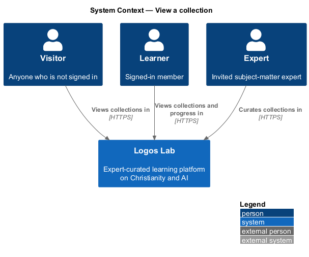
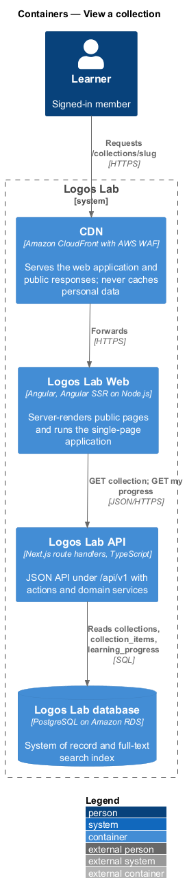
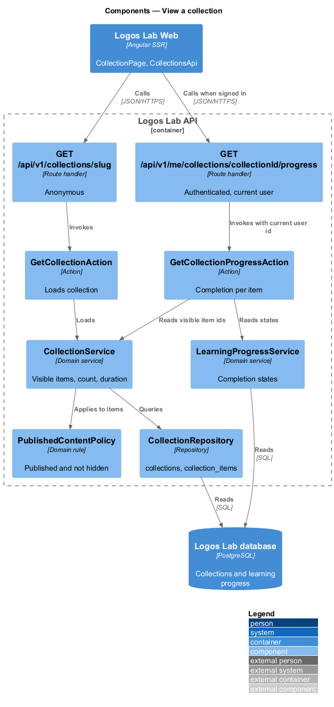
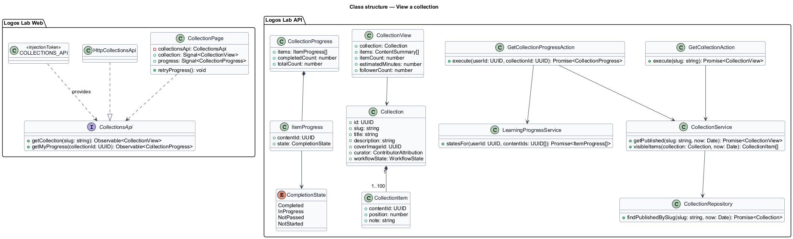
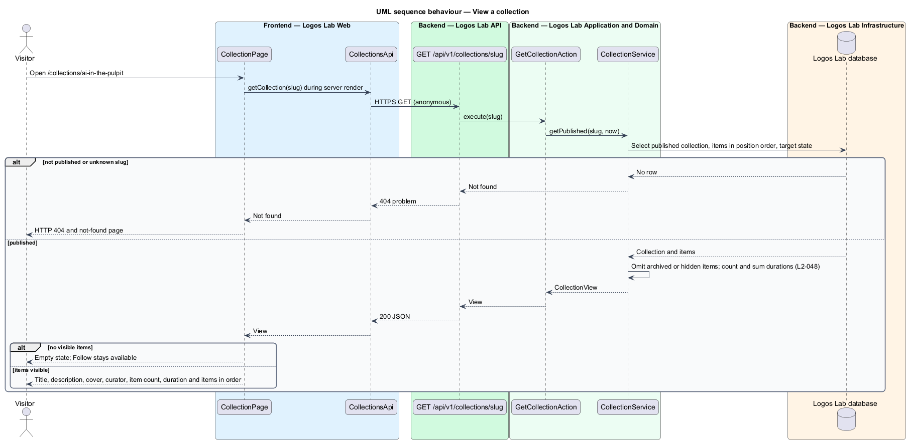
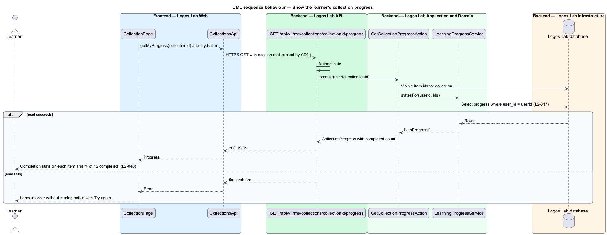

# View a collection

## Overview

A *collection* is a themed, ordered group of published Logos Lab content of any type, curated by an
expert or by Logos Lab. The *collections* subsystem covers viewing, building and following
collections; this feature covers the public collection page at `/collections/{slug}`.

The page presents the collection and its items in the curator's order. For a signed-in learner it
also shows how far they have got through the items. Terms used below:

- **curator** — expert or Logos Lab, credited as the author of a collection
- **collection item** — reference from a collection to one published item, with a position and an
  optional note
- **visible item** — collection item whose target is still published and not archived or hidden
- **completion state** — learner's standing on one item: Completed, In progress, Not passed or Not
  started
- **estimated duration** — sum of the visible items' durations, shown as the collection's length

## Description

The slice runs from the server-rendered `CollectionPage` in Logos Lab Web to the Logos Lab API and the
Logos Lab database.

**Logos Lab Web**

- **`CollectionPage`** — routed standalone component for `/collections/{slug}`, server-rendered for
  the public parts. For a signed-in learner it requests progress after hydration and shows each item's
  completion state and a summary such as "4 of 12 completed".
- **Design-system components** — `ll-breadcrumb`, `ll-page-header`, `ll-content-card` (item rows with
  position, type, title and contributor), `ll-badge` (completion state), `ll-progress-bar`,
  `ll-description-list` (curator, items, length, updated, followers), `ll-button` (Follow, `L2-050`),
  `ll-empty-state`, `ll-alert` and `ll-skeleton`.
- **`CollectionsApi`** — contract with `getCollection(slug)` and `getMyProgress(collectionId)`.
  `COLLECTIONS_API` is its token and `HttpCollectionsApi` its HTTP implementation.
- **Screen states** — `docs/mocks/pages/collection-page/` covers `default`, `progress`, `following`,
  `partial` (progress failed; items shown without marks and a Try again notice), `empty` (every item
  archived or hidden), `loading`, `error` and `long`.

**Logos Lab API**

- **`GET /api/v1/collections/{slug}`** — anonymous route handler. Returns the published collection with
  its visible items in order, or `404`. The response holds no personal data, so the CDN may cache it.
- **`GET /api/v1/me/collections/{collectionId}/progress`** — authenticated route handler. Returns the
  completion state of each item for the current user only (`L2-017`). The CDN does not cache it.
- **`GetCollectionAction`** — loads the collection through `CollectionService`.
- **`CollectionService`** — keeps items in position order, omits items that are archived or hidden,
  counts the remaining items and sums their durations. How events and nested collections contribute to
  the total duration is `<TO SUPPLY>`.
- **`GetCollectionProgressAction`** — calls `LearningProgressService` for the visible item ids and
  builds the "n of m completed" summary.
- **`CollectionRepository`** — reads `collections` and `collection_items` (`collection_id`,
  `content_id`, `position`, `note`). **`LearningProgressRepository`** reads `learning_progress`.

**Key rules**

- A published collection shows title, description, cover image, curator (an expert or Logos Lab),
  item count, total estimated duration and its items in order.
- An archived or hidden item is omitted, and the count excludes it.
- A signed-in learner sees each item's completion state and a summary such as "4 of 12 completed".

## Requirements

| L2 ID | Refines (L1) | Requirement |
|-------|--------------|-------------|
| `L2-048` | `L1-009` | **Collection page.** Each published collection has a page at `/collections/{slug}`. |

## Diagrams

### System context

Visitors and learners view collections in Logos Lab. Experts and editors curate them.

### Containers

Logos Lab Web server-renders the collection from the Logos Lab API and then requests the learner's
progress. The CDN caches only the public collection response.

### Components

`CollectionService` filters items to visible ones and totals them. `GetCollectionProgressAction`
reads progress scoped to the current user.

### Class structure

`Collection` composes ordered `CollectionItem` values. `CollectionProgress` pairs each item with a
`CompletionState`.

### Behaviour — view a collection

The server render loads the collection with visible items only, so the item count and duration exclude
archived or hidden items.

### Behaviour — show the learner's progress

After hydration, the page requests progress for the current user. A failure leaves the items in
place without marks and shows a Try again notice.

