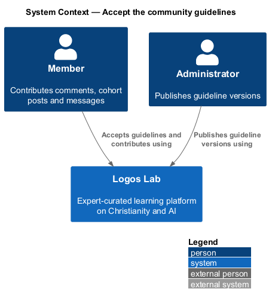
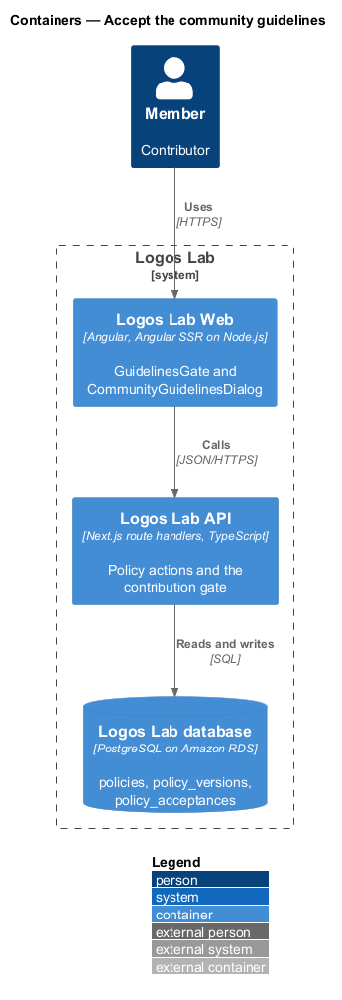
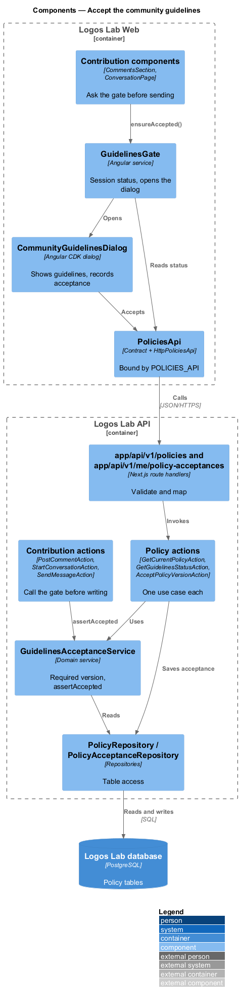
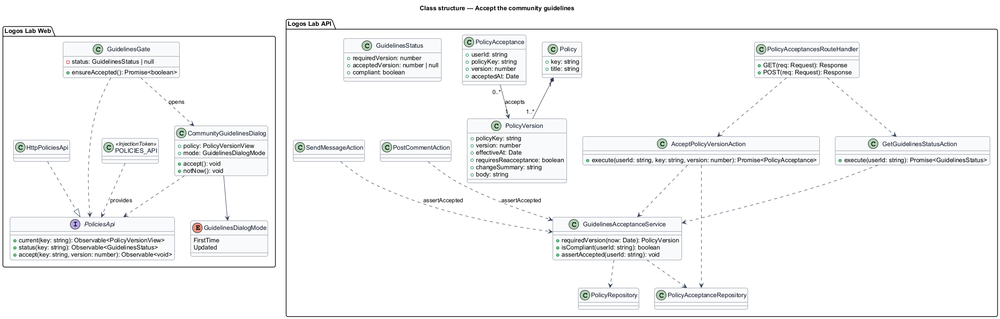
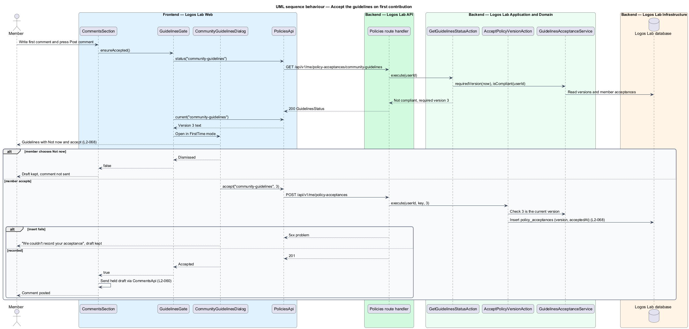
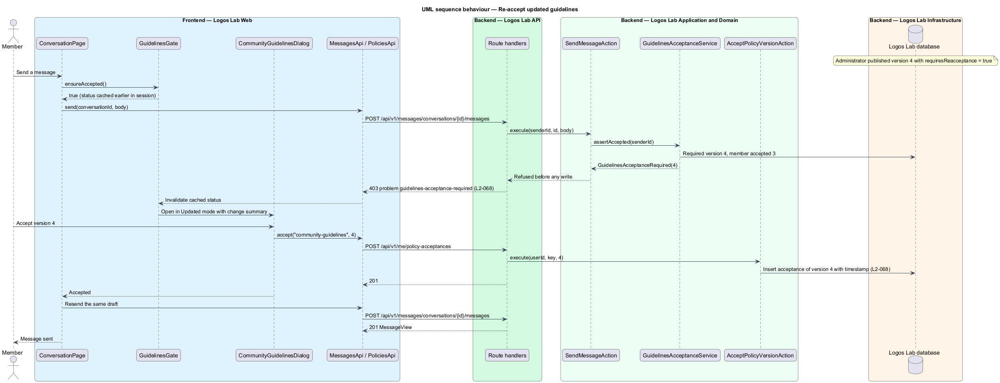

# Accept the community guidelines

## Overview

Logos Lab asks each member to agree to its community guidelines before they first contribute. The
**community guidelines** are a versioned policy that states how members treat one another in
comments, cohort posts and messages. Acceptance is a gate in front of every contribution, not a step in
registration, so members who only read never meet it.

- **contribution** — comment, cohort discussion post or direct message written by a member
- **guidelines version** — numbered, dated edition of the community guidelines
- **re-acceptance** — renewed acceptance required when an administrator publishes a version marked "Require re-acceptance"
- **acceptance record** — stored pair of guidelines version and timestamp against an account

This feature covers the gate, the acceptance dialog and the acceptance record (`L2-068`). Editing and
versioning the guidelines belongs to policy administration. The contribution features
(`comment-on-content`, `take-part-in-cohort`, `send-direct-messages`) call the gate.

## Description

### Screens

- **`CommunityGuidelinesDialog`** — opened by a contribution attempt when acceptance is missing. The
  first-time title is "Our community guidelines". The re-acceptance title is "We've updated the
  community guidelines", with a "What changed in version {n}" summary. The guidelines text scrolls
  inside the dialog. The dialog offers "Not now" and an accept action, and the held contribution is
  posted as soon as the member accepts.
- **Failure handling** — the `failed` state reads "We couldn't record your acceptance". The
  contribution stays unsent and the draft is kept.
- **`PolicyPage`** — public page of a policy version, linked from the composer text "community
  guidelines".
- **Mock states** — `docs/mocks/dialogs/community-guidelines/` (`default`, `scroll`, `updated`,
  `busy`, `failed`), `docs/mocks/pages/comments/`, `docs/mocks/pages/policy/`,
  `docs/mocks/pages/admin-policies/` and `docs/mocks/pages/policy-editor/`.

### API contract

`PoliciesApi` in `projects/api`, bound through `POLICIES_API` to `HttpPoliciesApi`.

| Method | Endpoint | Action |
|---|---|---|
| `GET` | `/api/v1/policies/community-guidelines/current` | `GetCurrentPolicyAction` (anonymous) |
| `GET` | `/api/v1/me/policy-acceptances/community-guidelines` | `GetGuidelinesStatusAction` |
| `POST` | `/api/v1/me/policy-acceptances` | `AcceptPolicyVersionAction` |

### Application and domain

- **`GuidelinesAcceptanceService`** — finds the **required version**: the newest effective version
  marked "Require re-acceptance", or the first version when none is marked. A member is compliant when
  they hold an acceptance of that version or a later one.
- **Server gate** — `PostCommentAction` and `StartConversationAction` call
  `GuidelinesAcceptanceService.assertAccepted(userId)` before any write. `SendMessageAction` makes the
  same call. A missing acceptance returns a 403 problem of type `guidelines-acceptance-required` with
  the required version. Cohort discussion posts take the same path through `PostCommentAction`.
- **Client gate** — `GuidelinesGate`, an Angular service, reads the status once per session. A
  contribution component calls `GuidelinesGate.ensureAccepted()` before it sends. When acceptance is
  missing, the gate opens `CommunityGuidelinesDialog` and resolves after acceptance. The draft is then
  sent unchanged. The server gate also covers a stale client.
- **`AcceptPolicyVersionAction`** — stores a `PolicyAcceptance` with `userId`, `policyKey`, `version`
  and `acceptedAt` (`L2-068`). It accepts only the current version. A repeated acceptance of the same
  version returns the existing record.
- **Entities** — `Policy` (`key`, `title`), `PolicyVersion` (`policyKey`, `version`, `effectiveAt`,
  `requiresReacceptance`, `changeSummary`, `body`) and `PolicyAcceptance`.
- **Repositories and tables** — `PolicyRepository` (`policies`, `policy_versions`) and
  `PolicyAcceptanceRepository` (`policy_acceptances`).

The admin mock (`docs/mocks/pages/policy-editor/`) labels the re-acceptance flag "Material change",
and `L2-068` calls it "Require re-acceptance". The final label is `<TO SUPPLY>`.

## Requirements

| L2 ID | Refines (L1) | Requirement |
|-------|--------------|-------------|
| `L2-068` | `L1-011` | **Community guidelines.** Members shall accept the community guidelines before their first contribution. |

## Diagrams

### System context

Members accept the guidelines in Logos Lab, and administrators publish new versions of them.

### Containers

Logos Lab Web opens the dialog. The Logos Lab API records acceptance and enforces the gate on each
contribution.

### Components

`GuidelinesGate` and `CommunityGuidelinesDialog` call `PoliciesApi`. Contribution actions call
`GuidelinesAcceptanceService`.

### Class structure

A `Policy` has versions, and each `PolicyAcceptance` ties an account to one version and a timestamp.

### Behaviour — first contribution

The client gate opens the dialog before the first post. After acceptance is recorded, the held draft is
sent.

### Behaviour — re-acceptance after an update

A version marked for re-acceptance makes the server gate refuse the next contribution. The dialog then
shows the change summary.

