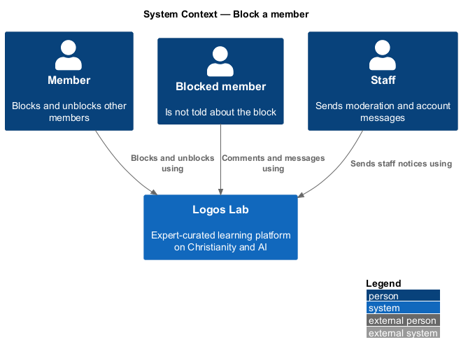
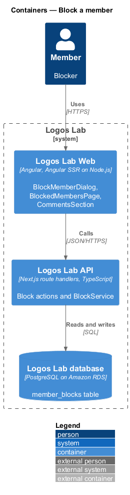
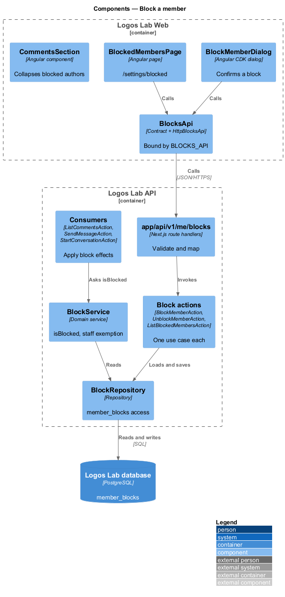
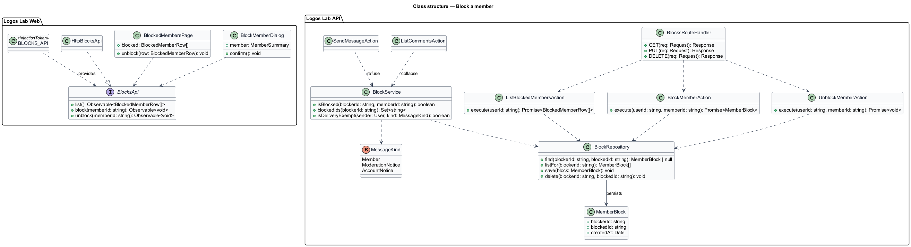
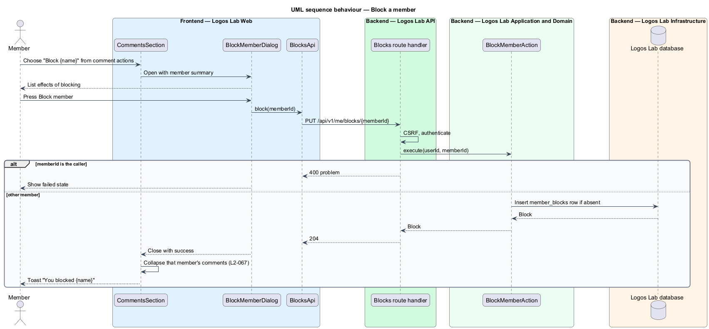
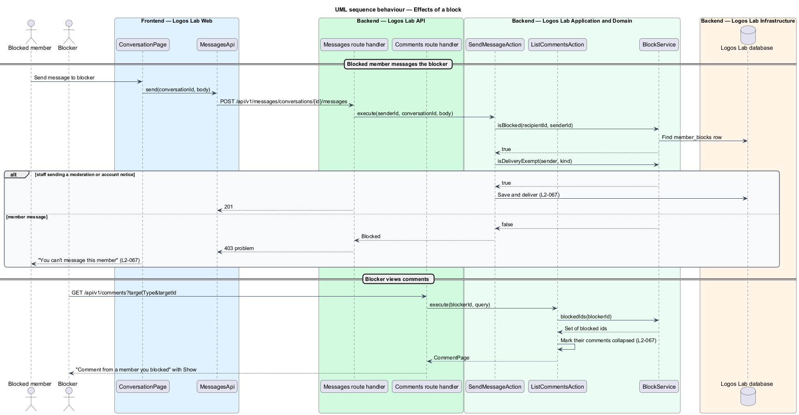
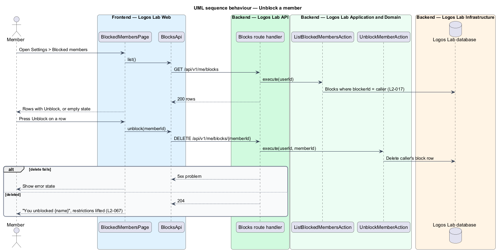

# Block a member

## Overview

A member may want to stop contact from another member without a moderator's help. Blocking is
that tool. A **block** is a one-way record, kept by one member against another, that stops the other
member's messages and folds away their comments for the blocker. The blocked member is not told.

- **blocker** — member who creates a block
- **blocked member** — member a block is held against
- **collapsed comment** — comment replaced, for the blocker only, by "Comment from a member you blocked" and a "Show" control
- **staff notice** — moderation or account message sent by a staff member

This feature covers creating a block, its effect on messages, comments and profiles, and unblocking
(`L2-067`). It sits beside `comment-on-content` and `send-direct-messages`, whose actions consult the
block record.

## Description

### Screens

- **`BlockMemberDialog`** — "Block {name}?", opened from a comment's more-actions `ll-menu` ("Block
  Jonah Fraser") or from `MemberProfilePage`. It lists the effects: no messages, collapsed comments,
  no notice to the member, and unblocking from Settings.
- **`BlockedMembersPage`** — `/settings/blocked`, titled "Blocked members". Each row shows `ll-avatar`,
  the name, "Blocked {date}" and an "Unblock" `ll-button`. A footnote states that staff moderation and
  account messages still arrive.
- **`CommentsSection`** — renders comments from blocked authors as collapsed for the blocker, with a
  "Show" control that reveals the text on request.
- **`ll-toast`** — confirms "You blocked {name}"; `ll-alert` confirms "You unblocked {name}".
- **Mock states** — `docs/mocks/dialogs/block-member/` (`default`, `busy`, `failed`, `success`),
  `docs/mocks/pages/settings-blocked/` (`default`, `loading`, `empty`, `error`, `success`),
  `docs/mocks/pages/comments/blocked.html` and `docs/mocks/notifications/toast/`.

### API contract

`BlocksApi` in `projects/api`, bound through `BLOCKS_API` to `HttpBlocksApi`.

| Method | Endpoint | Action |
|---|---|---|
| `GET` | `/api/v1/me/blocks` | `ListBlockedMembersAction` |
| `PUT` | `/api/v1/me/blocks/{memberId}` | `BlockMemberAction` (idempotent) |
| `DELETE` | `/api/v1/me/blocks/{memberId}` | `UnblockMemberAction` |

### Application and domain

- **`BlockMemberAction`** — refuses a block against oneself and saves a `MemberBlock`. A repeated block
  returns the existing record.
- **`UnblockMemberAction`** — deletes the caller's block against the member. Restrictions end at once
  (`L2-067`).
- **`BlockService`** — answers `isBlocked(blockerId, memberId)` for other actions. It also answers
  `isDeliveryExempt(sender, messageKind)`, true for staff notices (`L2-067`).
- **Effect on messages** — `StartConversationAction` and `SendMessageAction` refuse a member's message
  to someone who blocked them. The UI shows only "You can't message this member".
- **Effect on comments** — `ListCommentsAction` reads the viewer's block list and marks matching
  comments `collapsed: true`. The comment text still travels in the response, so "Show" needs no
  second request.
- **Effect on profiles** — `GetMemberProfileAction` returns the same profile to a blocked member as to
  anyone else. No field reveals the block (`L2-067`).
- **Entity** — `MemberBlock` (`blockerId`, `blockedId`, `createdAt`), unique on the pair.
- **Repository and table** — `BlockRepository` over `member_blocks`. Every query takes the caller's id
  as `blockerId`, so a member reads only their own blocks (`L2-017`).

## Requirements

| L2 ID | Refines (L1) | Requirement |
|-------|--------------|-------------|
| `L2-067` | `L1-011` | **Blocking members.** Members shall be able to block other members. |

## Diagrams

### System context

Members block and unblock others in Logos Lab, and staff notices still reach a member who blocked the
sender.

### Containers

Logos Lab Web calls the Logos Lab API, which stores blocks in the Logos Lab database.

### Components

`BlockService` sits beside the block actions and serves the comment, messaging and profile actions.

### Class structure

`MemberBlock` links a blocker to a blocked member. The block, comment and messaging actions depend on
`BlockService`.

### Behaviour — block a member

The dialog confirms the effects, and the action stores the block idempotently.

### Behaviour — effects of a block

Comments from the blocked member collapse for the blocker. Their messages are refused, while staff
notices still arrive.

### Behaviour — unblock a member

Unblocking from Settings removes the record, and the restrictions end at once.

