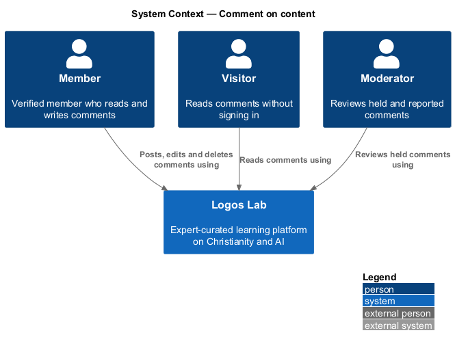
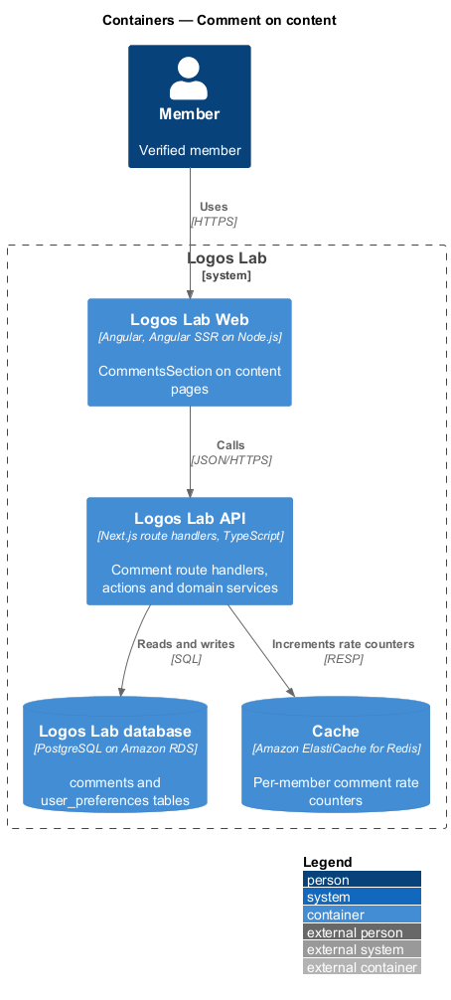
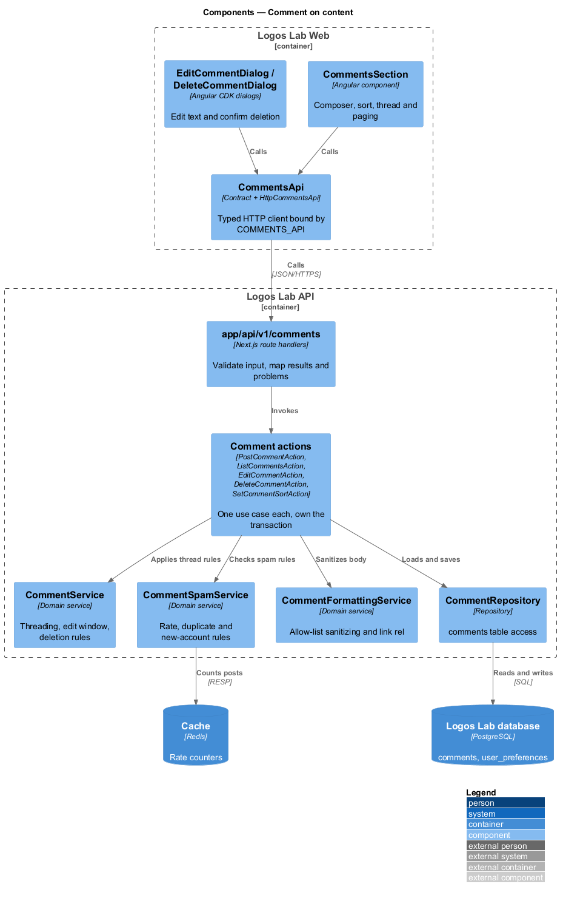
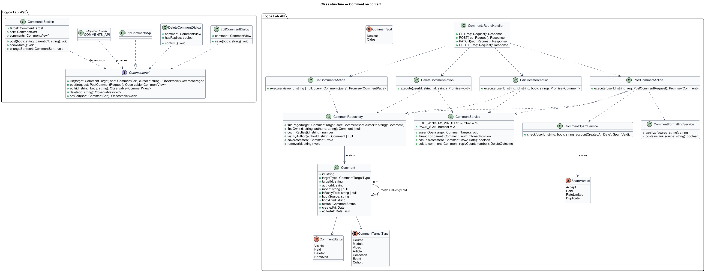
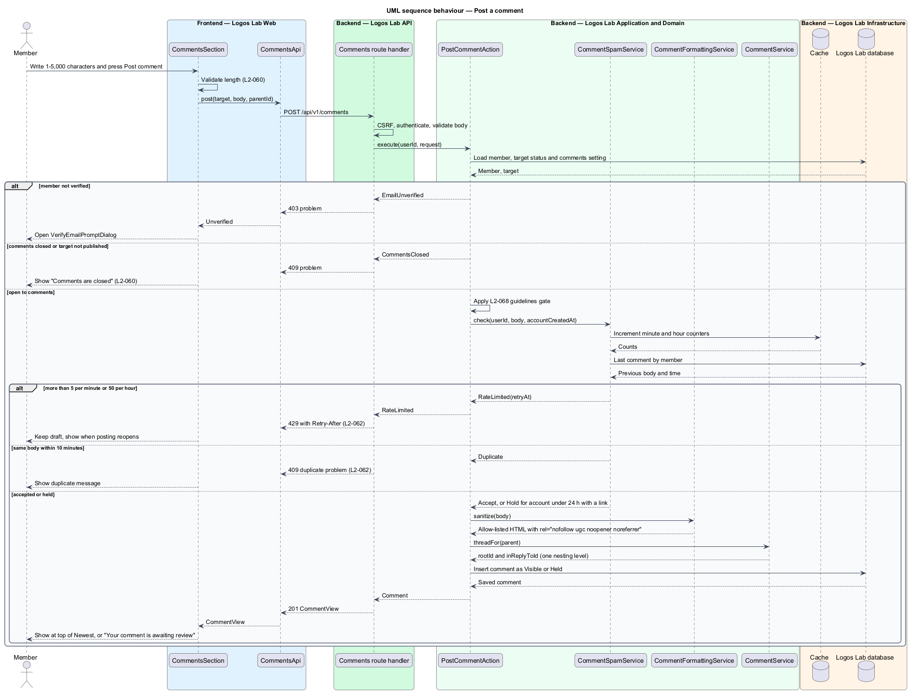
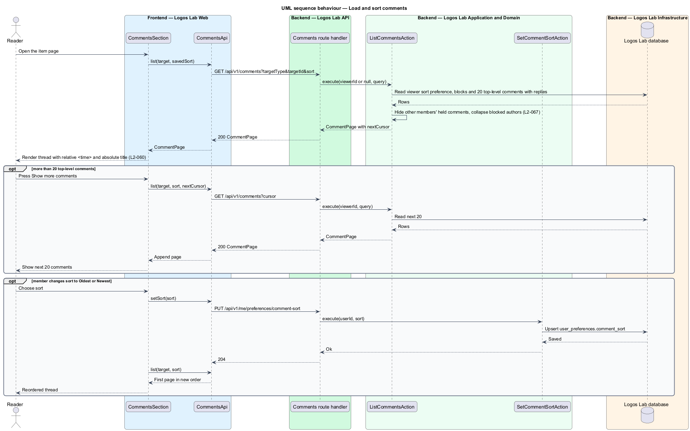
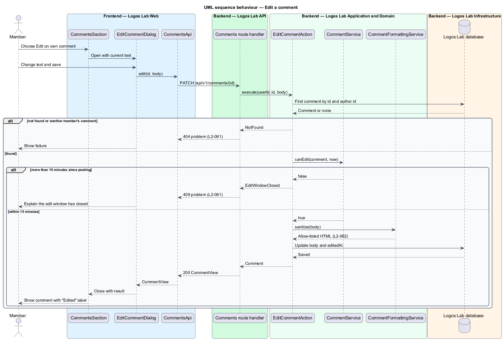
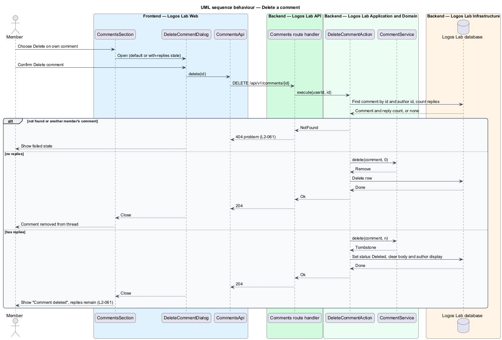

# Comment on content

## Overview

Logos Lab publishes courses, modules, videos, articles, collections and events. Each published item
carries a comment thread, so members can discuss the item where they read or watch it. Comments are
the most open part of the community subsystem: they appear to every reader of the item, while cohort
discussion and direct messages stay private.

- **comment** — member-written text attached to one published item and shown under it
- **top-level comment** — comment that answers the item itself rather than another comment
- **reply** — comment that answers another comment and is shown one level below its top-level comment
- **verified member** — signed-in account whose email address has been confirmed
- **held comment** — comment withheld from other readers until a moderator approves it

This feature covers posting, threading, sorting and paging comments (`L2-060`), editing and deleting a
member's own comments (`L2-061`), and the formatting and spam rules every comment passes (`L2-062`).
Blocking (`L2-067`), the community guidelines gate (`L2-068`) and reporting (`L2-085`) touch the same
thread and have their own designs.

## Description

### Screens

- **`CommentsSection`** — feature component in `projects/logos-lab`, embedded at `#comments` in
  `ArticlePage`, `CourseOverviewPage`, `ModulePage`, `VideoPage`, `CollectionPage` and `EventPage`. It
  holds the sort control, the composer, the thread and the "Show more comments" control.
- **Shared components** — `ll-comment` renders one comment with its `comment__head`, `comment__meta`,
  `comment__body` and `comment__actions` parts. `ll-textarea` inside `ll-form-field` is the composer,
  with a "0 of 5,000 characters" counter. `ll-select` holds the "Newest" and "Oldest" sort.
  `ll-menu` holds Edit, Delete, Report comment and Block. `ll-badge` marks "Author" and "Awaiting
  review". `ll-alert` carries the closed, rate-limited and unverified notices. `ll-avatar`,
  `ll-button` and `ll-skeleton` complete the section.
- **`DeleteCommentDialog`** — confirmation opened from Delete. It says whether the comment has replies.
- **`EditCommentDialog`** — dialog opened from Edit, holding the comment text in `ll-textarea`. Pages
  hold no inline edit forms, so editing opens this dialog. Its mock is `<TO SUPPLY>`; the `edited` mock
  state shows only the result.
- **Mock states** — `docs/mocks/pages/comments/` covers `default`, `loading`, `empty`, `error`, `long`,
  `submitting`, `invalid`, `held`, `rate-limited`, `closed`, `edited`, `deleted`, `blocked`,
  `visitor` and `unverified`. `docs/mocks/dialogs/delete-comment/` covers `default`, `with-replies`,
  `busy`, `failed` and `success`. `docs/mocks/notifications/toast/` holds the confirmation toasts.
  `docs/mocks/pages/moderation-queue/held.html` shows held comments to moderators.

Each timestamp renders as a relative time inside `<time datetime="…" title="…">`, so the absolute date
and time stay exposed (`L2-060`). A reply to a reply renders at the reply level with "In reply to
{name}". A visitor sees the thread read-only with a sign-in prompt. An unverified member sees "Verify
your email to join the conversation" and the `VerifyEmailPromptDialog` from account management.

### API contract

`CommentsApi` in `projects/api`, bound through the `COMMENTS_API` token to `HttpCommentsApi`.

| Method | Endpoint | Action | Notes |
|---|---|---|---|
| `GET` | `/api/v1/comments?targetType=&targetId=&sort=&cursor=` | `ListCommentsAction` | Anonymous read. Pages of 20 top-level comments with their replies. |
| `POST` | `/api/v1/comments` | `PostCommentAction` | Body: `targetType`, `targetId`, optional `parentId`, `body`. |
| `PATCH` | `/api/v1/comments/{id}` | `EditCommentAction` | Own comment only, within 15 minutes. |
| `DELETE` | `/api/v1/comments/{id}` | `DeleteCommentAction` | Own comment only. |
| `PUT` | `/api/v1/me/preferences/comment-sort` | `SetCommentSortAction` | Persists `Newest` or `Oldest` for the member. |

Route handlers under `app/api/v1/comments/` validate the request and map results to JSON or RFC 9457
problem responses. Each write passes the middleware pipeline: CSRF check, rate limiting,
authentication and authorization policy.

### Application and domain

- **`PostCommentAction`** — checks that the caller is a verified member and that the target is
  published with comments open. It calls the guidelines gate (`L2-068`), then `CommentSpamService`,
  then `CommentFormattingService`. It saves the comment as `Visible` or `Held` in one transaction.
- **`ListCommentsAction`** — reads one page of top-level comments, their replies and the caller's sort
  preference. It hides other members' held comments and marks comments from blocked authors as
  collapsed for the caller (`L2-067`).
- **`EditCommentAction`** and **`DeleteCommentAction`** — load the comment by id and author id
  together. A comment that belongs to another member is not found, and the API answers 404 (`L2-061`).
- **`CommentService`** — owns the thread rules. A reply stores the top-level comment as `rootId` and the
  answered comment as `inReplyToId`. Editing is allowed while `now - createdAt` is at most 15 minutes
  and sets `editedAt`. Deleting a comment without replies removes it. Deleting a comment with replies
  sets status `Deleted`, so the thread shows "Comment deleted" and keeps the replies.
- **`CommentFormattingService`** — parses the body and keeps only paragraphs, bold, italic, inline code
  and links. All other markup is escaped and shown as literal text. Each link gets
  `rel="nofollow ugc noopener noreferrer"`.
- **`CommentSpamService`** — applies the `L2-062` rules. Counters in the Cache allow 5 comments per
  minute and 50 per hour per member; the next post receives 429 with `Retry-After`. A body identical
  to the member's previous comment within 10 minutes is refused as a duplicate with a 409 problem
  response (baseline choice). A member account younger than 24 hours that posts a link has the
  comment held.
- **`Comment`** — entity with `id`, `targetType`, `targetId`, `authorId`, `rootId`, `inReplyToId`,
  `bodySource`, `bodyHtml`, `status`, `createdAt`, `editedAt`. `CommentStatus` holds `Visible`,
  `Held`, `Deleted` and `Removed`. `CommentTargetType` holds `Course`, `Module`, `Video`, `Article`,
  `Collection`, `Event` and `Cohort`.
- **`CommentRepository`** — reads and writes the `comments` table, indexed on target and creation time.
  **`UserPreferenceRepository`** stores the sort choice in `user_preferences`.

### Key rules

- A comment holds 1 to 5,000 characters (`L2-060`).
- A new comment appears at the top of the "Newest" sort at once, attributed to its author.
- The page loads 20 top-level comments, and "Show more comments" loads the next 20.
- The sort choice persists for the member across items.
- When an author or editor turns comments off, existing comments stay visible and read-only under the
  notice "Comments are closed". The API refuses new comments on that item.
- Edit is offered for 15 minutes after posting, and the API refuses later edits (`L2-061`).
- A held comment shows "Your comment is awaiting review" to its author only and enters the moderation
  queue's "Held for review" view.
- On 429 the composer keeps the draft and states when posting reopens, for example "You can post again
  at 10:25 am ET".

## Requirements

| L2 ID | Refines (L1) | Requirement |
|-------|--------------|-------------|
| `L2-060` | `L1-011` | **Comments on content.** Verified members shall be able to comment on courses, modules, videos, articles, collections and events. |
| `L2-061` | `L1-011` | **Comment editing and deletion.** Members shall be able to edit and delete their own comments. |
| `L2-062` | `L1-011` | **Comment content rules and rate limits.** Comments support limited formatting and are protected from spam. |

## Diagrams

### System context

Members and visitors read comments in Logos Lab, and moderators review held comments. No external
system takes part in posting a comment.

### Containers

Logos Lab Web calls the Logos Lab API, which stores comments in the Logos Lab database and keeps rate
counters in the Cache.

### Components

`CommentsSection` calls `CommentsApi`. The route handlers dispatch to one action each, and the actions
share `CommentService`, `CommentSpamService` and `CommentFormattingService`.

### Class structure

`Comment` refers to its target, its top-level comment and the comment it answers. The actions depend on
the domain services and on `CommentRepository`.

### Behaviour — post a comment

The action checks verification and comment status, then applies the `L2-062` rate, duplicate and
new-account rules before it sanitizes and saves the comment.

### Behaviour — load and sort comments

The section loads 20 top-level comments in the member's saved sort. A sort change persists the choice
and reloads the first page.

### Behaviour — edit a comment

The edit dialog sends the new text. The action scopes the lookup to the author and refuses edits after
15 minutes.

### Behaviour — delete a comment

After confirmation, the action removes a comment without replies or replaces one with replies by
"Comment deleted".

