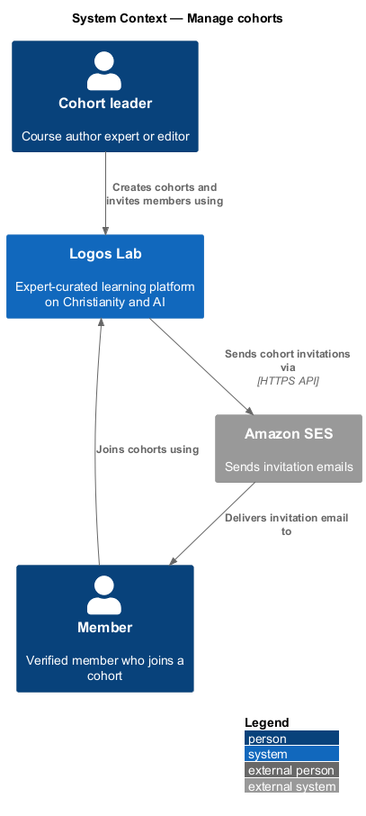
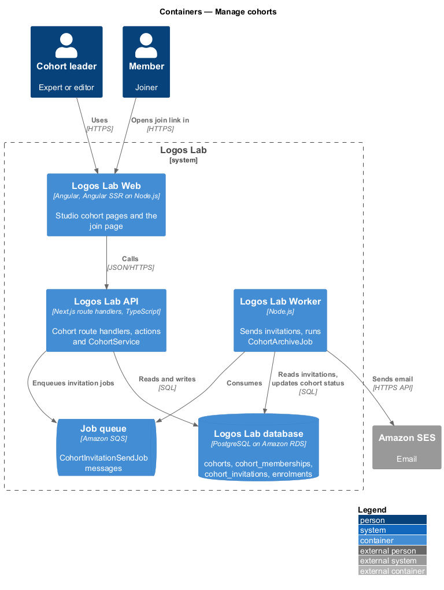
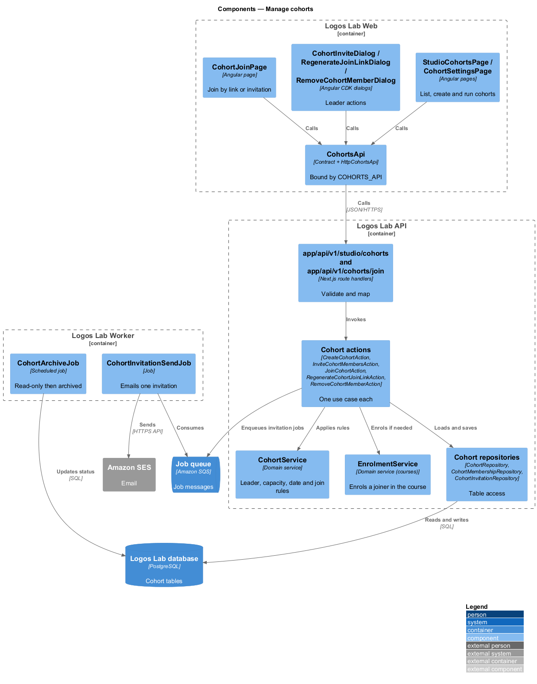
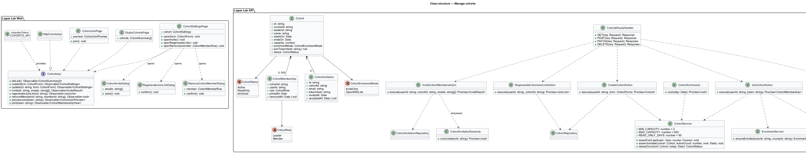
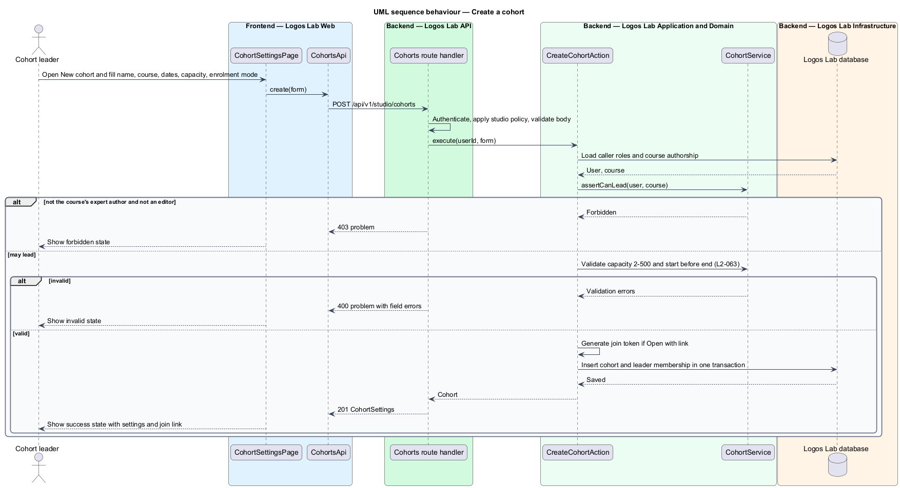
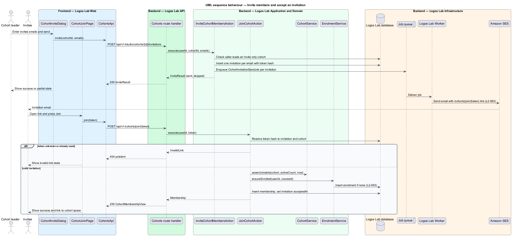
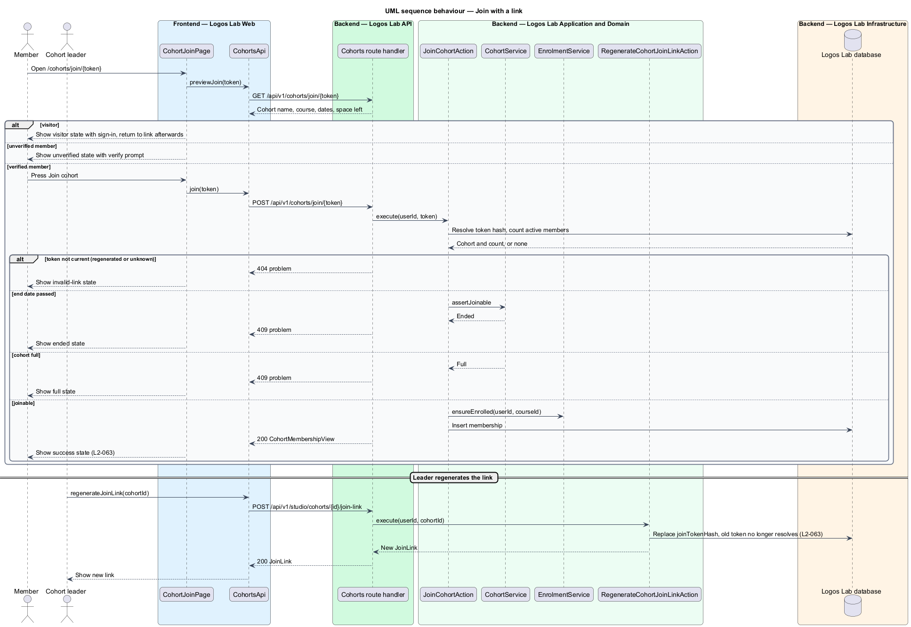
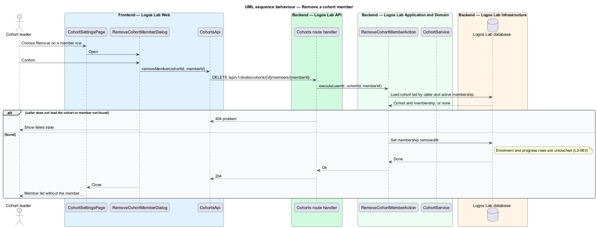
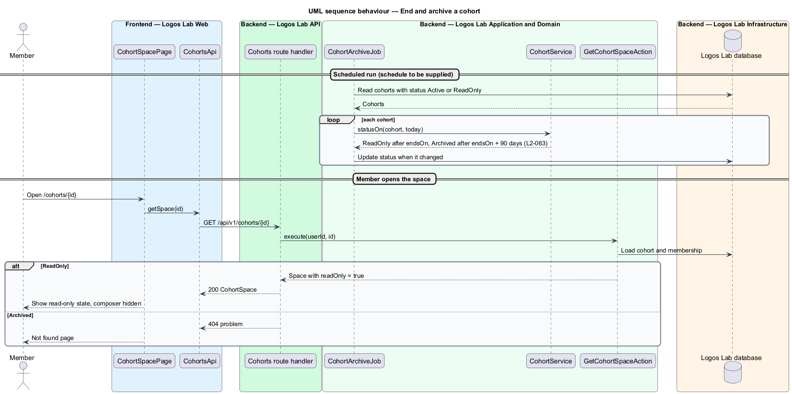

# Manage cohorts

## Overview

A course on Logos Lab may be taken alone or with others. A **cohort** is a private group of learners
who take one course together between a start date and an end date. Cohorts give a course a shared pace
and a private place to talk, led by a person the platform trusts with the course.

- **cohort leader** — expert who authored the cohort's course, or any editor, who creates and runs the cohort
- **enrolment mode** — rule that decides how people join a cohort: "Invite only" or "Open with link"
- **join link** — secret URL that lets a verified member join an "Open with link" cohort
- **cohort invitation** — emailed, single-person link that enrols the invitee and adds them to an "Invite only" cohort

This feature covers the leader's side of a cohort: creating it, inviting or admitting members,
regenerating the join link, removing members and the cohort's end-of-life (`L2-063`). The member's
experience inside the cohort is the `take-part-in-cohort` feature.

## Description

### Screens

- **`StudioCohortsPage`** — `/studio/cohorts`, titled "Your cohorts". It lists the cohorts the caller
  leads, with a "New cohort" action.
- **`CohortSettingsPage`** — `/studio/cohorts/{id}`. The `new` state is the blank creation form; other
  states show settings and the member list. It uses `ll-form-field`, `ll-text-field`, `ll-select`,
  `ll-radio-group`, `ll-table` and `ll-button`.
- **`CohortInviteDialog`** — "Invite to cohort". It accepts email addresses and reports partial
  success.
- **`RegenerateJoinLinkDialog`** — "Regenerate join link". It confirms that the old link stops
  working.
- **`RemoveCohortMemberDialog`** — "Remove member". It confirms the removal and states that course
  progress is kept.
- **`CohortJoinPage`** — `/cohorts/join/{token}`. It serves both join links and invitation links.
- **Mock states** — `docs/mocks/manifest.json` lists the screens `studio-cohorts`, `cohort-settings`,
  `cohort-invite`, `regenerate-link`, `remove-cohort-member` and `cohort-join` with their states.
  `cohort-join` lists `default`, `submitting`, `success`, `full`, `ended`, `invalid-link`,
  `unverified`, `visitor`, `loading` and `error`. The mock folders under `docs/mocks/` are
  `<TO SUPPLY>`; none exists yet. `docs/mocks/pages/course-overview/cohort.html` shows a cohort from
  the course page.

### API contract

`CohortsApi` in `projects/api`, bound through the `COHORTS_API` token to `HttpCohortsApi`. The same
contract serves `take-part-in-cohort`.

| Method | Endpoint | Action |
|---|---|---|
| `GET` | `/api/v1/studio/cohorts` | `ListLedCohortsAction` |
| `POST` | `/api/v1/studio/cohorts` | `CreateCohortAction` |
| `GET`, `PATCH` | `/api/v1/studio/cohorts/{id}` | `GetCohortSettingsAction`, `UpdateCohortAction` |
| `POST` | `/api/v1/studio/cohorts/{id}/invitations` | `InviteCohortMembersAction` |
| `POST` | `/api/v1/studio/cohorts/{id}/join-link` | `RegenerateCohortJoinLinkAction` |
| `DELETE` | `/api/v1/studio/cohorts/{id}/members/{memberId}` | `RemoveCohortMemberAction` |
| `GET` | `/api/v1/cohorts/join/{token}` | `PreviewCohortJoinAction` (anonymous) |
| `POST` | `/api/v1/cohorts/join/{token}` | `JoinCohortAction` |

### Application and domain

- **`CohortService`** — holds the cohort rules. Only the course's authoring expert or an editor may
  create or lead a cohort. Capacity is 2 to 500. A join succeeds only before the end date and while
  the active member count is below capacity.
- **`CreateCohortAction`** — validates name, course, start and end date, capacity and enrolment mode,
  then saves the cohort with the caller as leader. An "Open with link" cohort receives a join token.
- **`InviteCohortMembersAction`** — creates one `CohortInvitation` per email address and enqueues a
  `CohortInvitationSendJob` per invitation. The Worker sends each email through Amazon SES.
- **`JoinCohortAction`** — resolves the token to a join link or an invitation. It requires a signed-in,
  verified member. It enrols the member in the course through `EnrolmentService` when no enrolment
  exists, then adds an active `CohortMembership`.
- **`RegenerateCohortJoinLinkAction`** — replaces the stored token hash, so the old link resolves to
  nothing and the join page shows its `invalid-link` state.
- **`RemoveCohortMemberAction`** — ends the membership by setting `removedAt`. The member loses access
  to the cohort space. The `Enrolment` and its progress rows stay unchanged.
- **`CohortArchiveJob`** — scheduled Worker job. A cohort whose end date has passed becomes
  `ReadOnly`; 90 days after the end date it becomes `Archived`.
- **Entities** — `Cohort` (`id`, `courseId`, `leaderId`, `name`, `startsOn`, `endsOn`, `capacity`,
  `enrolmentMode`, `joinTokenHash`, `status`), `CohortMembership` (`cohortId`, `userId`, `role`,
  `joinedAt`, `removedAt`) and `CohortInvitation` (`id`, `cohortId`, `email`, `tokenHash`,
  `invitedAt`, `acceptedAt`). Enumerations: `CohortEnrolmentMode` (`InviteOnly`, `OpenWithLink`),
  `CohortStatus` (`Active`, `ReadOnly`, `Archived`), `CohortRole` (`Leader`, `Member`).
- **Repositories and tables** — `CohortRepository` (`cohorts`), `CohortMembershipRepository`
  (`cohort_memberships`), `CohortInvitationRepository` (`cohort_invitations`) and
  `EnrolmentRepository` (`enrolments`, owned by the courses subsystem).

Tokens are stored as hashes, never in clear. Invitation expiry is `<TO SUPPLY>`; the specification does
not state one. The archive job's schedule is `<TO SUPPLY>`.

## Requirements

| L2 ID | Refines (L1) | Requirement |
|-------|--------------|-------------|
| `L2-063` | `L1-011` | **Cohort creation and membership.** Experts and editors shall be able to run cohorts: private groups of learners who take a course together over a defined period. |

## Diagrams

### System context

Leaders run cohorts in Logos Lab, invitees and members join them, and Amazon SES delivers invitation
emails.

### Containers

The Logos Lab API stores cohorts and enqueues invitation jobs; the Logos Lab Worker sends the emails
and runs the archive job.

### Components

Studio pages and the join page call `CohortsApi`. The cohort actions share `CohortService` and call
`EnrolmentService` when a joiner has no enrolment.

### Class structure

`Cohort` owns its memberships and invitations. The enumerations fix the enrolment mode, the lifecycle
status and the member role.

### Behaviour — create a cohort

The action confirms that the caller may lead the course, validates the 2-500 capacity and saves the
cohort with the caller as leader.

### Behaviour — invite and accept

The leader's invitations become queued email jobs. Accepting a link enrols the invitee when needed and
adds the membership.

### Behaviour — join with a link

A verified member joins through the link before the end date while space remains. Regenerating the link
invalidates the old one.

### Behaviour — remove a member

Removal ends the membership and leaves the course enrolment and progress in place.

### Behaviour — end and archive

The archive job makes ended cohorts read-only and archives them 90 days after the end date.

