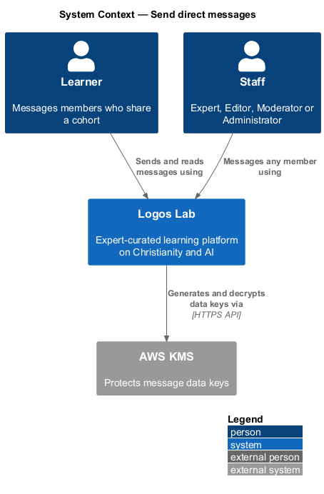
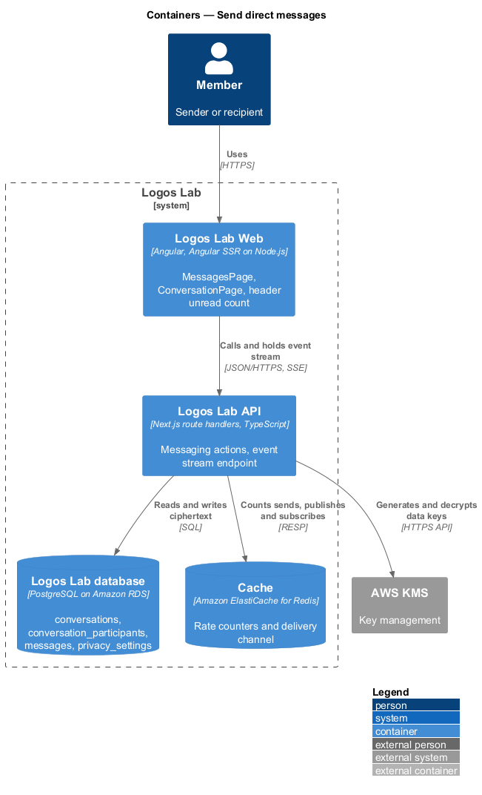
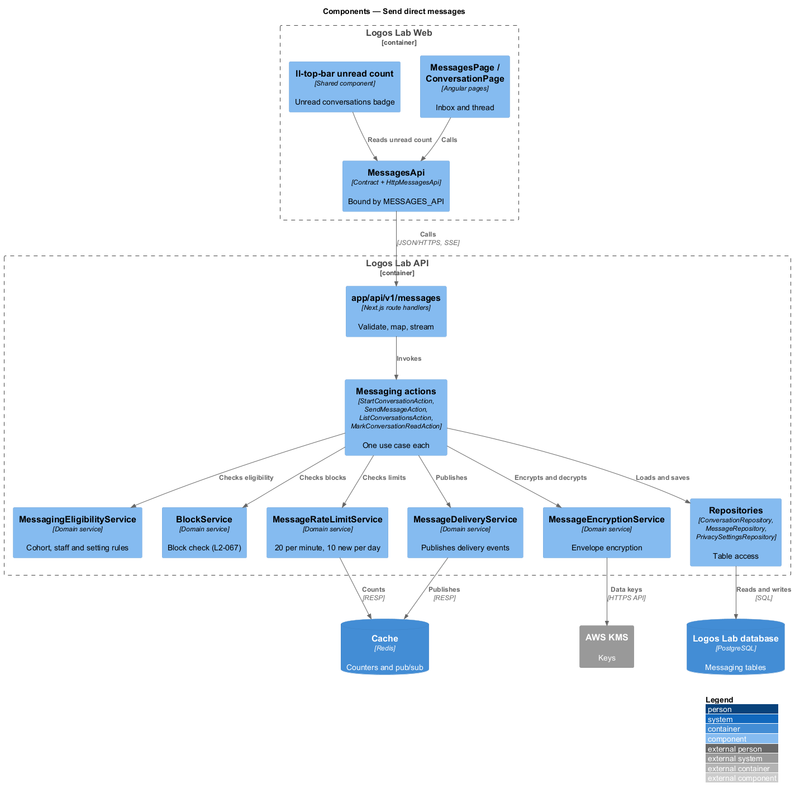
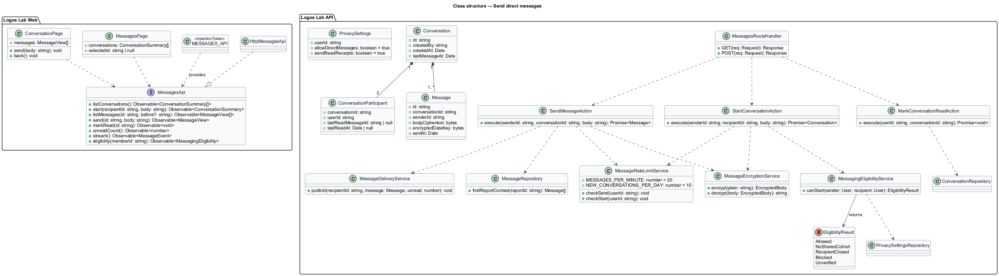
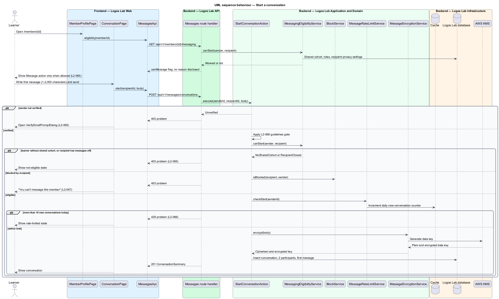
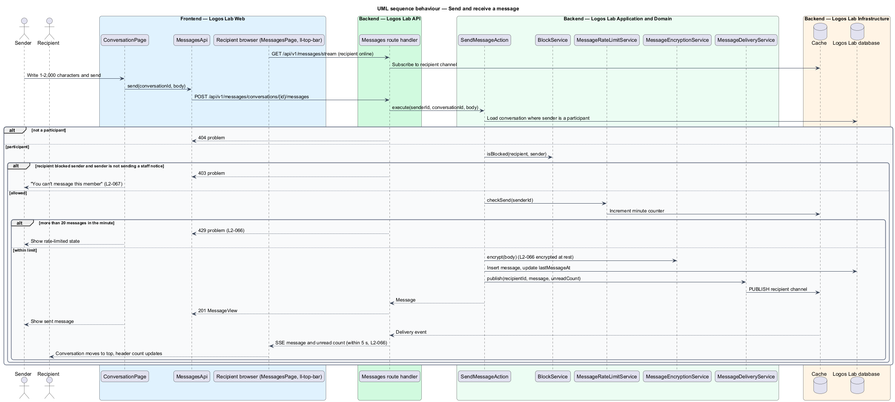
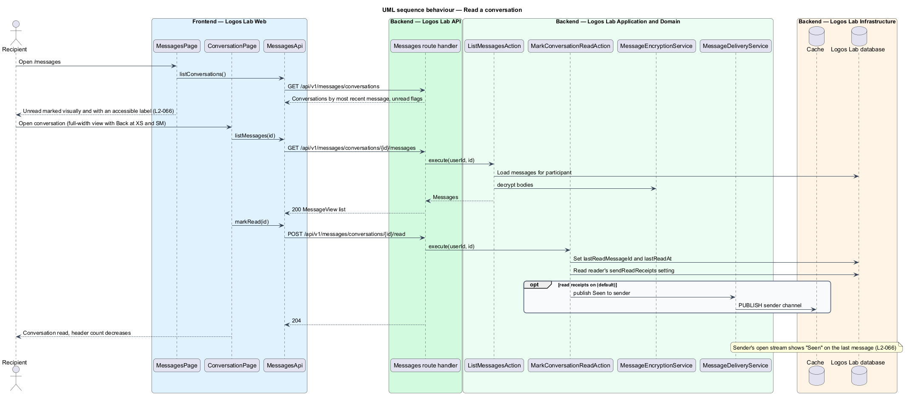

# Send direct messages

## Overview

Direct messages let two members talk privately, outside comments and cohort discussion. Logos Lab keeps
messaging narrow on purpose: learners may message only people they already study with, and staff may
message anyone. The narrow rule limits spam and unwanted contact.

- **direct message** — private text sent by one member to one other member
- **conversation** — ordered set of direct messages between exactly two members
- **inbox** — page at `/messages` that lists a member's conversations by most recent message
- **messaging eligibility** — rule set that decides whether one member may start a conversation with another
- **staff** — member who holds the Expert, Editor, Moderator or Administrator role
- **read receipt** — "Seen" marker shown to a sender once the recipient has read the latest message

This feature covers eligibility (`L2-065`) and the inbox, delivery, read state, rate limits and
encryption of messages (`L2-066`). Blocking (`L2-067`), the guidelines gate (`L2-068`) and message
reports (`L2-085`) apply to the same send path and have their own designs.

## Description

### Screens

- **`MessagesPage`** — `/messages`. It renders `ll-inbox` with conversations ordered by most recent
  message. Unread conversations carry a visual marker and an accessible "Unread" label.
- **`ConversationPage`** — `/messages/{id}`. It renders `ll-message-thread` with a composer of 1 to
  2,000 characters. At XS and SM the inbox and the conversation are separate full-width views with a
  Back control; at MD and above they sit side by side (`L2-066`).
- **`MemberProfilePage`** — `/members/{id}`, owned by the profiles area. It shows the "Message" action
  only when the eligibility endpoint allows it.
- **`PrivacySettingsPage`** — `/settings/privacy`. Its "Messaging" section holds the `ll-switch`
  controls "Allow direct messages" and "Send read receipts".
- **`VerifyEmailPromptDialog`** — opened when an unverified member tries to send (`L2-065`).
- **Header unread count** — `ll-top-bar` shows the unread-conversation count and updates when a
  message arrives.
- **Mock states** — `docs/mocks/pages/settings-privacy/` (`default`, `loading`, `error`,
  `submitting`, `success`), `docs/mocks/dialogs/verify-email-prompt/` (`default`, `busy`,
  `cooldown`, `failed`, `success`), `docs/mocks/notifications/notification/unread.html` ("Jonah Fraser
  sent you a message") and `docs/mocks/pages/report-detail/message-context.html`.
  `docs/mocks/manifest.json` lists `messages`, `conversation` and `member-profile`, including the
  conversation states `seen`, `rate-limited`, `blocked`, `not-eligible` and `offline`. Their mock
  folders are `<TO SUPPLY>`.

### API contract

`MessagesApi` in `projects/api`, bound through `MESSAGES_API` to `HttpMessagesApi`.

| Method | Endpoint | Action |
|---|---|---|
| `GET` | `/api/v1/messages/conversations` | `ListConversationsAction` |
| `POST` | `/api/v1/messages/conversations` | `StartConversationAction` |
| `GET` | `/api/v1/messages/conversations/{id}/messages?before=` | `ListMessagesAction` |
| `POST` | `/api/v1/messages/conversations/{id}/messages` | `SendMessageAction` |
| `POST` | `/api/v1/messages/conversations/{id}/read` | `MarkConversationReadAction` |
| `GET` | `/api/v1/messages/unread-count` | `GetUnreadCountAction` |
| `GET` | `/api/v1/messages/stream` | Server-sent event stream for new messages (baseline choice) |
| `GET` | `/api/v1/members/{id}/messaging` | `GetMessagingEligibilityAction` |

### Application and domain

- **`MessagingEligibilityService`** — decides whether a sender may start a conversation. Staff may
  always start one. A learner may start one only with a member who shares at least one cohort.
  Otherwise the API answers 403. A recipient with "Allow direct messages" off refuses new
  conversations from non-staff, and the profile hides "Message". Existing conversations stay readable.
- **`StartConversationAction`** — requires a verified sender, then applies the guidelines gate
  (`L2-068`), eligibility, the block check (`L2-067`) and the daily new-conversation limit. It creates
  the `Conversation`, its two `ConversationParticipant` rows and the first `Message`.
- **`SendMessageAction`** — checks that the sender is a participant, applies the block check and the
  per-minute limit, encrypts the body and saves the message. It then publishes a delivery event.
- **`MessageRateLimitService`** — Cache counters allow 20 messages per minute and 10 new conversations
  per day per member. The next attempt receives 429 (`L2-066`).
- **`MessageEncryptionService`** — envelope encryption: each body is encrypted with a data key that
  AWS KMS protects, and only ciphertext reaches the database (`L2-066`).
- **`MessageDeliveryService`** — publishes a delivery event on a Redis channel in the Cache. The API
  instance that holds the recipient's event stream pushes the message and the new unread count. The
  target is delivery within 5 seconds while the recipient is online (`L2-066`).
- **`MarkConversationReadAction`** — sets the reader's `lastReadMessageId` and `lastReadAt`. The sender
  sees "Seen" on the last message only when the reader's "Send read receipts" setting is on, which is
  the default.
- **Moderator access** — `MessageRepository.findReportContext(reportId)` returns a reported message and
  the 10 messages before it, and nothing else. The moderation subsystem calls it for `L2-085` reports.
- **Entities** — `Conversation` (`id`, `createdBy`, `createdAt`, `lastMessageAt`),
  `ConversationParticipant` (`conversationId`, `userId`, `lastReadMessageId`, `lastReadAt`),
  `Message` (`id`, `conversationId`, `senderId`, `bodyCiphertext`, `encryptedDataKey`, `sentAt`) and
  `PrivacySettings` (`userId`, `allowDirectMessages`, `sendReadReceipts`).
- **Repositories and tables** — `ConversationRepository` (`conversations`,
  `conversation_participants`), `MessageRepository` (`messages`), `PrivacySettingsRepository`
  (`privacy_settings`) and `CohortMembershipRepository` (`cohort_memberships`).

The event-stream transport, its reconnect policy and any polling fallback interval are `<TO SUPPLY>`
and should be confirmed by an ADR.

## Requirements

| L2 ID | Refines (L1) | Requirement |
|-------|--------------|-------------|
| `L2-065` | `L1-011` | **Direct message eligibility.** To limit spam and unwanted contact, direct messaging is restricted. |
| `L2-066` | `L1-011` | **Direct messaging.** Eligible members exchange one-to-one messages in an inbox at `/messages`. |

## Diagrams

### System context

Members message each other through Logos Lab. AWS KMS protects the keys that encrypt message bodies at
rest.

### Containers

The Logos Lab API stores ciphertext in the Logos Lab database and uses the Cache for rate counters and
delivery events.

### Components

Messaging pages call `MessagesApi`. The send actions share eligibility, rate-limit, encryption and
delivery services.

### Class structure

A `Conversation` has two participants and many messages. Each `Message` holds only ciphertext and its
encrypted data key.

### Behaviour — start a conversation

The action checks verification, eligibility, the recipient's setting, blocks and the daily limit before
it creates the conversation.

### Behaviour — send and receive a message

The sender's message is rate-limited, encrypted and saved. The recipient's open stream then receives it
and the new unread count.

### Behaviour — read a conversation

Opening a conversation marks it read. "Seen" reaches the sender only when the reader allows read
receipts.

