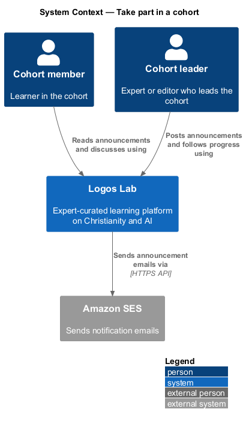
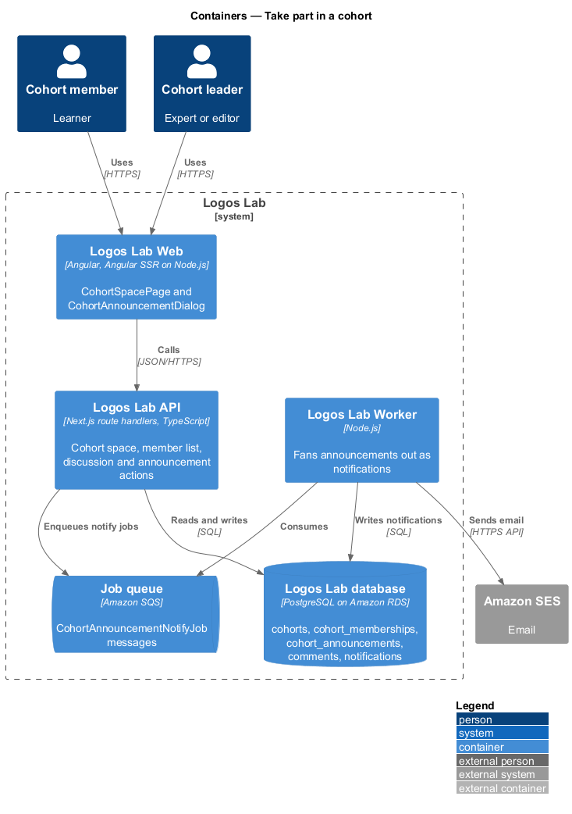
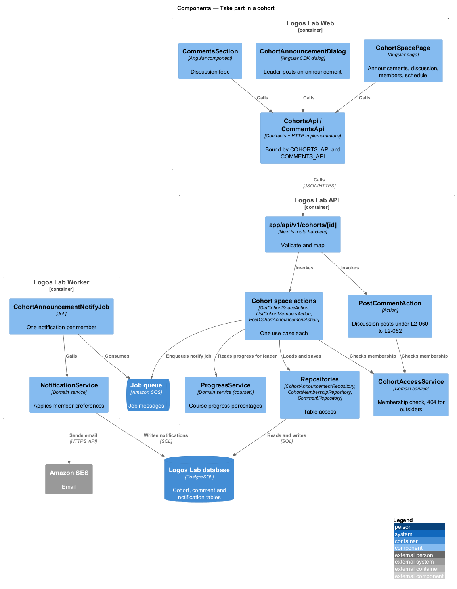
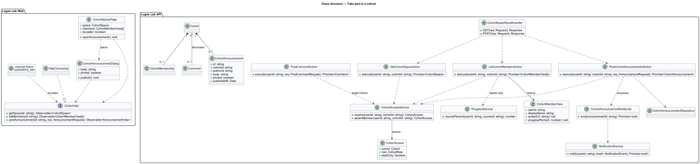
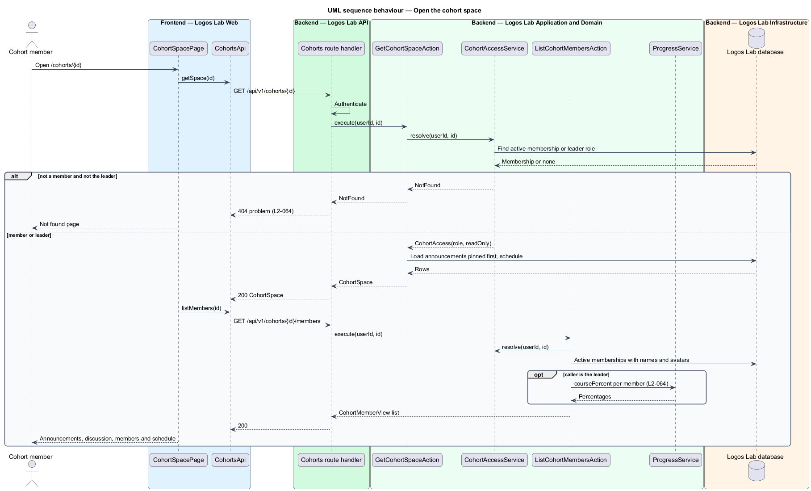
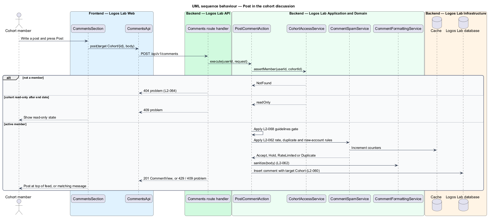
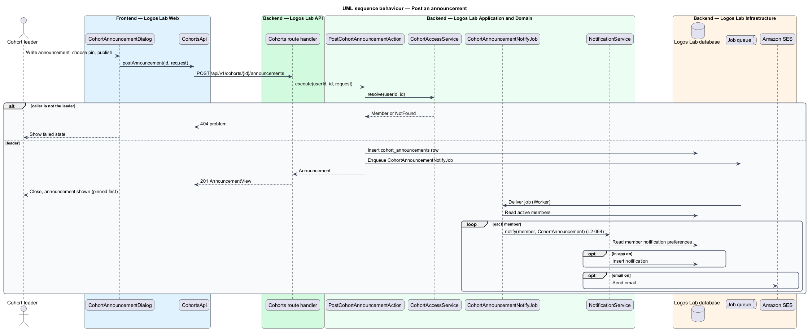

# Take part in a cohort

## Overview

A cohort is a private group of learners who take one course together over a defined period
(`manage-cohorts`). Each cohort has a **cohort space**: a private page where the cohort talks, reads
the leader's announcements, sees who else is taking part and follows the course schedule. Only the
cohort's members and its leader can see the space.

- **cohort space** — private page at `/cohorts/{id}` that gathers a cohort's announcements, discussion, members and schedule
- **announcement** — leader-written post shown above the discussion and sent to every member as a notification
- **discussion feed** — thread of member posts inside a cohort space, governed by the comment rules
- **course schedule** — cohort's dated plan for the course sections between its start and end dates

This feature covers the member's experience inside the space (`L2-064`). Creating and running the
cohort is `manage-cohorts`; the comment rules that the discussion reuses are `comment-on-content`.

## Description

### Screens

- **`CohortSpacePage`** — `/cohorts/{id}`. It shows announcements with pinned ones first, the
  discussion feed, the member list and the course schedule. The leader sees a "Post announcement"
  action and each member's course progress percentage.
- **`CohortAnnouncementDialog`** — "Post announcement", opened by the leader. It holds the text field
  and a pin option.
- **Shared components** — the discussion reuses `CommentsSection` and `ll-comment` with target type
  `Cohort`. Planned parts are `ll-person-list` and `ll-avatar` for members, `ll-progress-bar` for the
  leader's view, `ll-timeline` for the schedule and `ll-badge` for "Pinned" and "Leader". The final
  choice follows the `cohort-space` mock once it exists.
- **Mock states** — `docs/mocks/manifest.json` lists `cohort-space` with `default`, `leader`,
  `loading`, `empty`, `error`, `read-only` and `long`, and `cohort-announcement` with `default`,
  `busy`, `invalid`, `failed` and `success`. Their mock folders are `<TO SUPPLY>`.
  `docs/mocks/pages/course-overview/cohort.html` links the course to its cohort.
  `docs/mocks/notifications/notification/unread.html` shows the notification "Dr. Abena Mensah posted
  in Imago Dei, Autumn 2026".

### API contract

`CohortsApi` in `projects/api`, bound through `COHORTS_API` to `HttpCohortsApi`.

| Method | Endpoint | Action |
|---|---|---|
| `GET` | `/api/v1/cohorts/{id}` | `GetCohortSpaceAction` |
| `GET` | `/api/v1/cohorts/{id}/members` | `ListCohortMembersAction` |
| `GET`, `POST` | `/api/v1/comments?targetType=Cohort&targetId={id}` and `/api/v1/comments` | `ListCommentsAction`, `PostCommentAction` |
| `POST` | `/api/v1/cohorts/{id}/announcements` | `PostCohortAnnouncementAction` |

### Application and domain

- **`CohortAccessService`** — resolves the caller's active `CohortMembership` or leader role for a
  cohort. A caller with neither receives 404 from every cohort endpoint, so the API does not confirm
  that the cohort exists (`L2-064`).
- **`GetCohortSpaceAction`** — returns the cohort header, announcements ordered pinned first then newest,
  the schedule and a `readOnly` flag. The flag is true after the end date (`L2-063`).
- **`ListCohortMembersAction`** — returns names and avatars to members. For the leader it adds each
  member's course progress percentage from `ProgressService` (`L2-064`).
- **Discussion posts** — stored as `Comment` rows with target type `Cohort`. `PostCommentAction` calls
  `CohortAccessService` for that target and then applies the `L2-060` to `L2-062` rules unchanged.
- **`PostCohortAnnouncementAction`** — allows the leader only. It saves a `CohortAnnouncement` and
  enqueues one `CohortAnnouncementNotifyJob`.
- **`CohortAnnouncementNotifyJob`** — Worker job. For each active member it calls
  `NotificationService`, which applies the member's notification preferences. It creates an in-app
  notification, and an email through Amazon SES where the member has email turned on.
- **Entities** — `CohortAnnouncement` (`id`, `cohortId`, `authorId`, `body`, `pinned`,
  `publishedAt`), plus `Cohort`, `CohortMembership` and `Comment` from the related features.
- **Repositories and tables** — `CohortAnnouncementRepository` (`cohort_announcements`),
  `CohortMembershipRepository` (`cohort_memberships`), `CommentRepository` (`comments`) and
  `ProgressRepository` (course progress, owned by the courses subsystem).

The length limit of an announcement is `<TO SUPPLY>`; the specification does not state one.

## Requirements

| L2 ID | Refines (L1) | Requirement |
|-------|--------------|-------------|
| `L2-064` | `L1-011` | **Cohort space and discussion.** Each cohort has a private space with a discussion feed, a member list and announcements from the leader. |

## Diagrams

### System context

Members and the leader use the cohort space in Logos Lab. Amazon SES delivers announcement emails to
members whose preferences allow email.

### Containers

The Logos Lab API serves the space and enqueues announcement jobs. The Logos Lab Worker fans each
announcement out as notifications.

### Components

`CohortSpacePage` calls `CohortsApi` and `CommentsApi`. Every cohort action passes through
`CohortAccessService` first.

### Class structure

`Cohort` aggregates announcements and memberships, and discussion posts are `Comment` rows that target
the cohort.

### Behaviour — open the cohort space

Non-members receive 404. Members receive the space, and the member list adds progress percentages only
for the leader.

### Behaviour — post in the discussion

A discussion post passes the cohort access check and the read-only check, then follows the comment
pipeline from `comment-on-content`.

### Behaviour — post an announcement

The leader's announcement is saved, and a Worker job notifies every member according to their
preferences.

