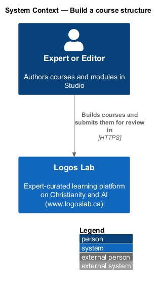
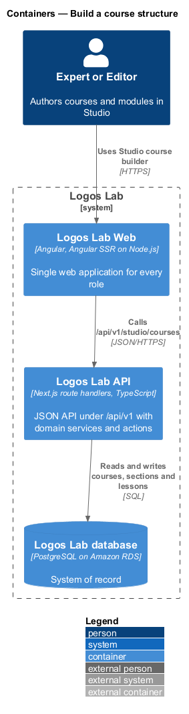
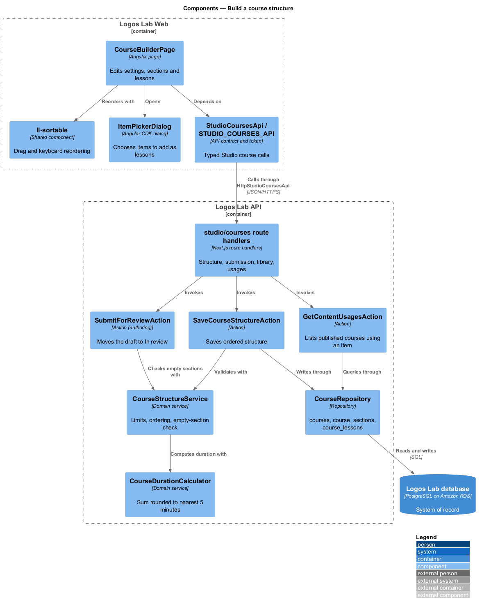
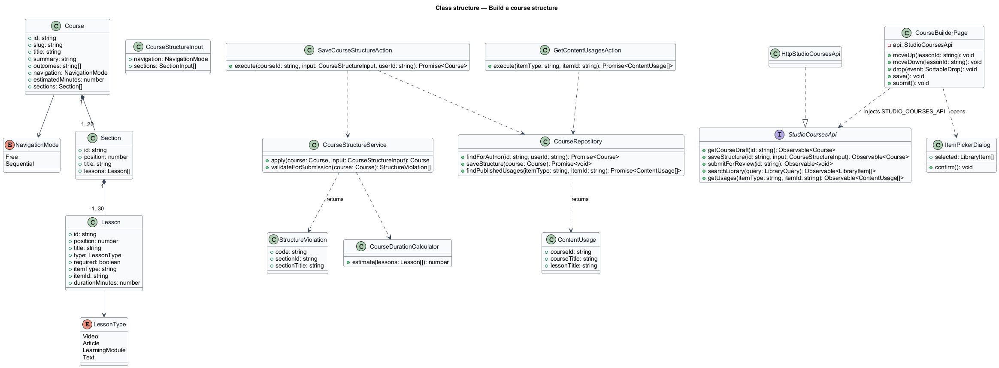
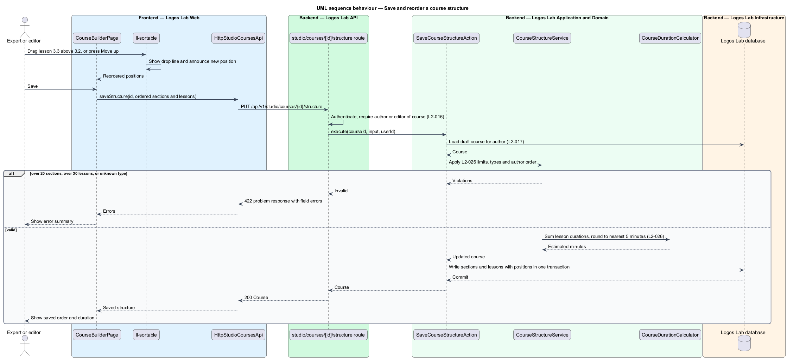
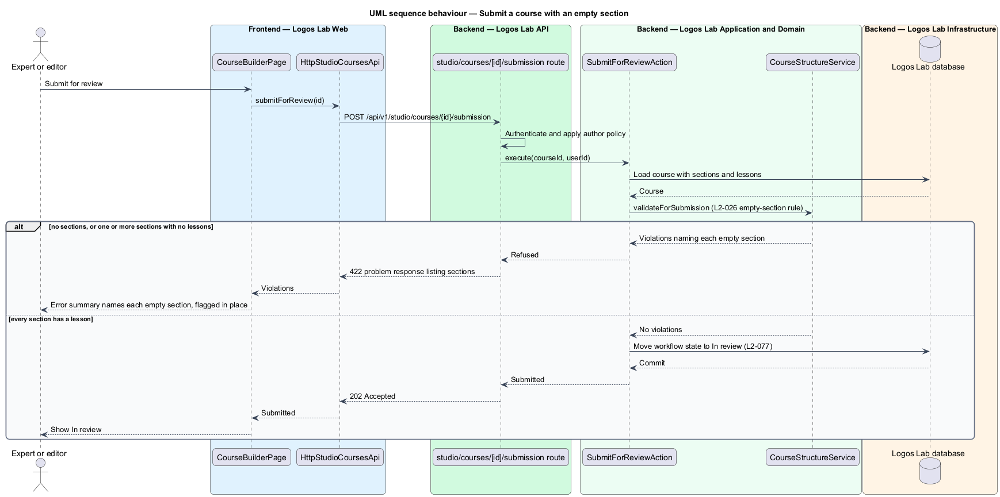
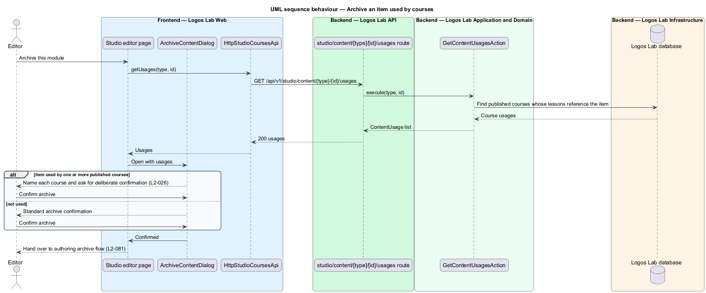

# Build a course structure

## Overview

A **course** — ordered set of sections and lessons that a learner studies toward a certificate — is
written in Studio, the authoring workspace for experts and editors. This feature covers the **course
builder** — Studio screen where an author sets course details, the navigation mode and the ordered
sections and lessons.

A **section** — named, ordered group of lessons inside a course — holds 1-30 lessons, and a course
holds 1-20 sections. A **lesson** — one unit of study inside a section — has one of four types:
Video, Article, Learning module (SCORM) or Text. A lesson is either required or optional. Video,
Article and Learning module lessons are references to existing published items, not copies, so a
published update to the item shows in the course.

The builder sits on the authoring side of the courses subsystem. The editorial workflow itself
(submit for review, approve, publish, archive) belongs to the authoring subsystem (`L2-076`,
`L2-077`, `L2-081`); this feature adds the course-specific structure rules that the workflow
enforces.

## Description

**Frontend (Logos Lab Web)**

- **`CourseBuilderPage`** — routed Studio page for one course (route `/studio/courses/:id`, baseline
  choice). Edits title, summary (50 to 300 characters), learning outcomes (3 to 8), navigation mode
  (Free or Sequential) and the sections and lessons. Lesson editing opens a dialog; no inline forms.
- **`ItemPickerDialog`** — dialog that searches published videos, articles and modules to add as
  lessons, with a type filter, a result count and items already in the course marked. Mock states in
  `docs/mocks/dialogs/item-picker/`.
- **`ArchiveContentDialog`** — owned by the authoring subsystem; its `in-use` state names each
  published course that uses an item and asks for a deliberate confirmation
  (`docs/mocks/dialogs/archive-content/in-use.html`).
- **Components used** — `ll-sortable` (drag handle plus "Move up" and "Move down" buttons, with the
  new position announced to assistive technology), `ll-form-field`, `ll-text-field`, `ll-textarea`,
  `ll-radio-group` (navigation), `ll-switch` (required or optional), `ll-button`,
  `ll-inline-message`, `ll-alert` (error summary), `ll-description-list`, `ll-skeleton`,
  `ll-error-page`.
- **Screen states** — `docs/mocks/pages/course-builder/` covers `default`, `empty`, `reordering`,
  `invalid` (submission refused, empty section flagged in place), `loading`, `error` and `long`.
- **`StudioCoursesApi`** / **`STUDIO_COURSES_API`** / **`HttpStudioCoursesApi`** — contract, token
  and HTTP implementation. Methods: `getCourseDraft(id)`, `saveStructure(id, structure)`,
  `submitForReview(id)`, `searchLibrary(query)`, `getUsages(itemType, itemId)`.

**API (Logos Lab API)**

- **`GET /api/v1/studio/courses/{id}`** — loads the editable draft.
- **`PUT /api/v1/studio/courses/{id}/structure`** — saves sections and lessons in the order sent.
  Handled by **`SaveCourseStructureAction`**.
- **`POST /api/v1/studio/courses/{id}/submission`** — submits for review. The authoring subsystem's
  `SubmitForReviewAction` calls **`CourseStructureService.validateForSubmission`**, which refuses
  with `422` and lists each empty section by name, or reports a course with no sections.
- **`GET /api/v1/studio/library?type=&q=`** — searches published items for the item picker.
- **`GET /api/v1/studio/content/{type}/{id}/usages`** — lists the published courses that reference an
  item. Handled by **`GetContentUsagesAction`**; the authoring archive flow reads it before archiving.
- **`CourseStructureService`** — enforces 1-20 sections, 1-30 lessons per section, the four lesson
  types and dense positions. It calls **`CourseDurationCalculator`**, which sums lesson durations
  and rounds to the nearest 5 minutes.
- **`CourseRepository`** — writes `courses`, `course_sections` (`position`) and `course_lessons`
  (`position`, `type`, `required`, `item_type`, `item_id`, `duration_minutes`). Only the course's
  authors and editors may write (`L2-016`, `L2-017`).

**Key rules**

- Sections and lessons keep the order the author set; reordering by drag or by keyboard ("Move up",
  "Move down") persists on save.
- Submission is refused for a course with no sections, or for any section with no lessons, with a
  message naming each empty section.
- A lesson stores the referenced item's id. The lesson player reads the item's current published
  revision, so a published update shows in the course without a course edit.
- Archiving a referenced item warns the editor which published courses use it and requires
  confirmation.
- Estimated duration equals the sum of lesson durations rounded to the nearest 5 minutes. The rule
  for an exact 2.5-minute tie is `<TO SUPPLY>`.
- The duration of a Text lesson is entered by the author; whether it may be derived from word count
  is `<TO SUPPLY>`.

## Requirements

| L2 ID | Refines (L1) | Requirement |
|-------|--------------|-------------|
| `L2-026` | `L1-005` | **Course structure.** A course is made of 1-20 ordered sections, each with 1-30 ordered lessons. Each lesson is one of these types: Video, Article, Learning module (SCORM) or Text. A lesson is either required or optional. |

## Diagrams

### System context

Experts and editors build courses in Logos Lab Studio; no external system takes part.

### Containers

The Studio pages in Logos Lab Web call the Logos Lab API, which stores the structure in the Logos
Lab database.

### Components

`CourseBuilderPage` and its dialogs call `StudioCoursesApi`; three actions share
`CourseStructureService` for the structure rules.

### Class structure

`Course` composes `Section` and `Lesson` rows; each lesson references an item by type and id and
carries its own position, type and required flag.

### Behaviour — save and reorder the structure

A reorder changes positions in the page; saving sends the whole ordered structure, which the service
validates and stores in one transaction with a recalculated duration.

### Behaviour — submit with an empty section

Submission runs the structure check first and refuses a course with an empty section, naming each
one.

### Behaviour — archive a referenced item

Before an item is archived, the editor sees every published course that uses it and confirms.

