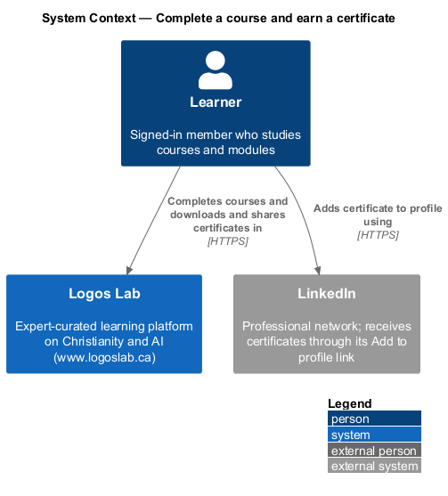
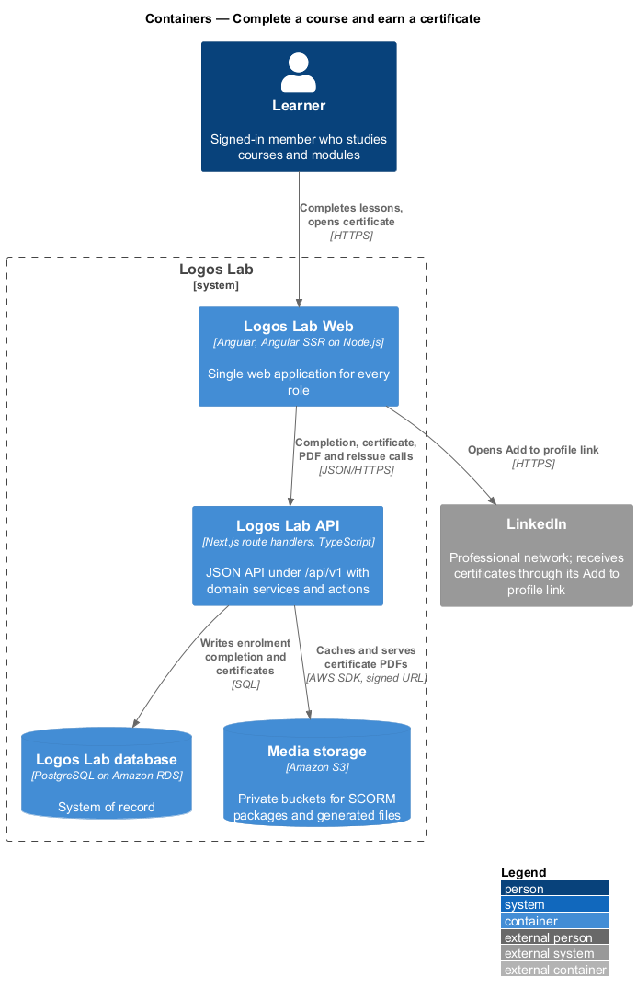
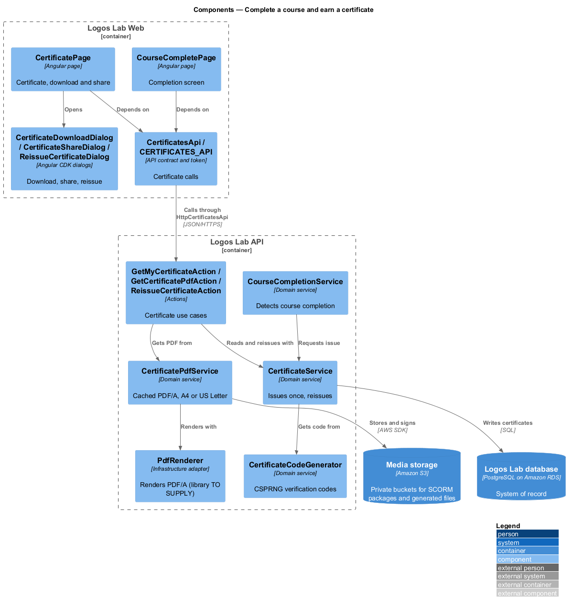
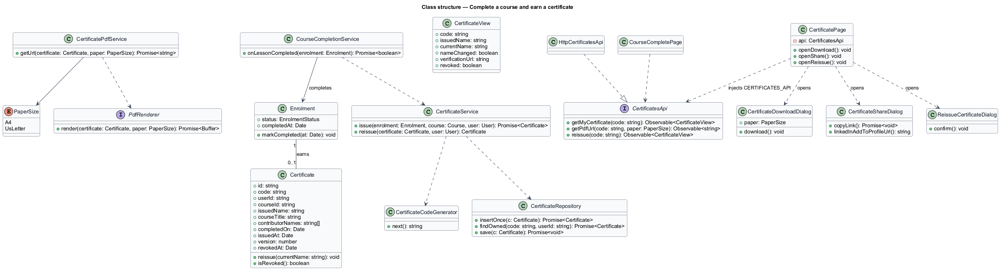
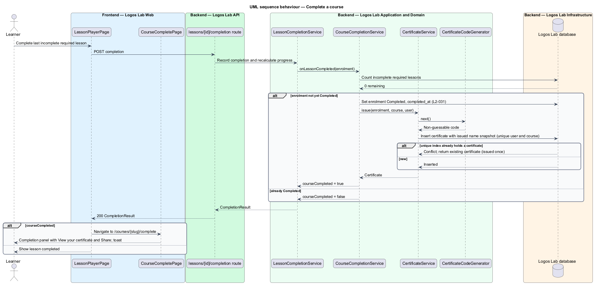
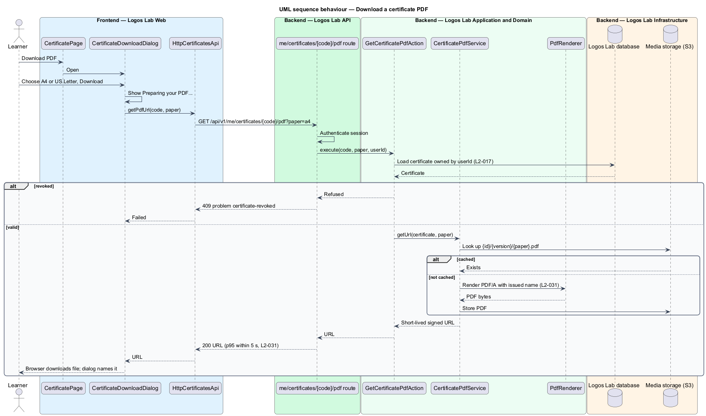
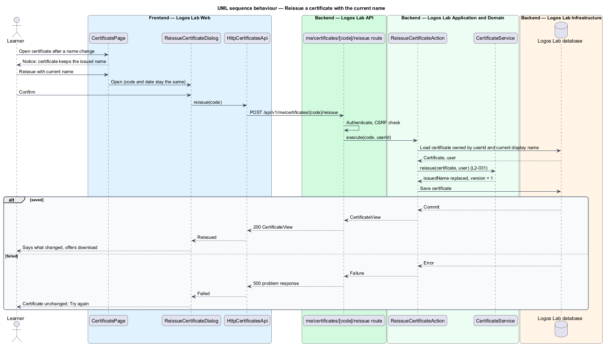

# Complete a course and earn a certificate

## Overview

A learner **completes a course** — reaches the state in which every required lesson of the course is
complete — when the last incomplete required lesson is recorded. Completion is the moment the
platform marks the enrolment complete, shows a completion screen and issues a **certificate** —
record of course completion, issued once per learner and course, that anyone can verify by its code.

Each certificate carries a **verification code** — unique, non-guessable identifier printed on the
certificate and used in its public verification URL. The certificate shows the learner's display
name, the course title, the contributor or contributors, the completion date and the verification
URL. The **issued name** — learner's display name captured at the moment of issue — stays on the
certificate even if the learner later changes the display name, unless the learner chooses "Reissue
with current name".

From the certificate page a learner downloads a PDF in A4 or US Letter, and shares the public
verification URL or adds the certificate to a LinkedIn profile. Public verification is covered by
`verify-certificate`; the certificate list on the dashboard is `L2-073`.

## Description

**Frontend (Logos Lab Web)**

- **`CourseCompletePage`** — routed page for `/courses/:slug/complete` (baseline choice). The lesson
  player navigates here when a completion response reports `courseCompleted`. States in
  `docs/mocks/pages/course-complete/`: `default` ("View your certificate" and "Share", plus where to go
  next), `loading` and `error` (says the course is still complete).
- **`CertificatePage`** — routed page for `/dashboard/certificates/:code` (baseline choice, following
  the mock breadcrumb Dashboard > Certificates). States in `docs/mocks/pages/certificate/`:
  `default`, `name-changed` (notice with "Reissue with current name"), `revoked` (download and share
  removed), `loading` and `error`.
- **`CertificateDownloadDialog`** — choose A4 or US Letter and download
  (`docs/mocks/dialogs/certificate-download/`: `default`, `busy`, `success`, `failed`).
- **`CertificateShareDialog`** — copy the public verification URL with the Clipboard API, or open
  LinkedIn's "Add to profile" link (`docs/mocks/dialogs/certificate-share/`: `default`, `success`,
  `failed` when the browser blocks copying).
- **`ReissueCertificateDialog`** — confirms a reissue with the current name; the code and date stay
  the same (`docs/mocks/dialogs/reissue-certificate/`).
- **Components used** — `ll-certificate`, `ll-panel`, `ll-description-list`, `ll-button`,
  `ll-radio-group`, `ll-dialog`, `ll-notice-panel`, `ll-toast` (`docs/mocks/notifications/toast/`),
  `ll-content-card`, `ll-skeleton`, `ll-error-page`.
- **`CertificatesApi`** / **`CERTIFICATES_API`** / **`HttpCertificatesApi`** — methods
  `getMyCertificate(code)`, `getPdfUrl(code, paper)` and `reissue(code)`.

**API (Logos Lab API)**

- **`CourseCompletionService`** — called after each lesson completion. When every required lesson is
  complete and the enrolment is not yet `Completed`, it sets `Completed` and `completed_at` and asks
  `CertificateService` to issue.
- **`CertificateService.issue`** — inserts one `certificates` row per (`user_id`, `course_id`),
  guarded by a unique index, so a repeat completion never issues a second certificate. It snapshots
  `issued_name`, `course_title`, `contributor_names` and `completed_on`.
- **`CertificateCodeGenerator`** — draws the code from a cryptographically secure random source in
  the form shown by the mocks (`LL-7K4Q-29XM`). The minimum entropy is `<TO SUPPLY>`; the code is
  never derived from ids or dates.
- **`GET /api/v1/me/certificates/{code}`** — the learner's own certificate, scoped to the current user
  (`L2-017`). Handled by **`GetMyCertificateAction`**.
- **`GET /api/v1/me/certificates/{code}/pdf?paper=a4|letter`** — handled by
  **`GetCertificatePdfAction`**. **`CertificatePdfService`** returns a cached PDF from Media storage
  keyed by certificate id, version and paper size, or renders one with **`PdfRenderer`** as PDF/A and
  stores it. The response is a short-lived signed S3 URL. The PDF/A conformance level and the
  rendering library are `<TO SUPPLY>`.
- **`POST /api/v1/me/certificates/{code}/reissue`** — handled by **`ReissueCertificateAction`**. It
  replaces `issued_name` with the current display name, increments `version`, and keeps the code and
  completion date.
- **Entity `Certificate`** in table `certificates` — `id`, `code` (unique), `user_id`, `course_id`,
  `issued_name`, `course_title`, `contributor_names`, `completed_on`, `issued_at`, `version`,
  `revoked_at`, `revocation_reason`.
- **LinkedIn** — the share dialog builds LinkedIn's "Add to profile" URL with the certificate name,
  issue date, code and verification URL. The Logos Lab LinkedIn organization id is `<TO SUPPLY>`.

**Key rules**

- Completing the last incomplete required lesson marks the course complete, shows the completion
  screen, and issues the certificate once.
- The PDF downloads within 5 seconds at p95, in A4 or US Letter.
- After a display-name change, a re-download shows the issued name unless the learner chooses
  "Reissue with current name".
- A revoked certificate offers neither download nor share.

## Requirements

| L2 ID | Refines (L1) | Requirement |
|-------|--------------|-------------|
| `L2-031` | `L1-005` | **Course completion and certificate.** Completing every required lesson completes the course and issues a certificate. |

## Diagrams

### System context

Learners complete courses and manage certificates in Logos Lab, and add certificates to LinkedIn
through its public "Add to profile" link.

### Containers

The API issues the certificate inside the completion transaction and stores generated PDFs in Media
storage.

### Components

`CourseCompletionService` hands issuing to `CertificateService`; `CertificatePdfService` serves cached
or newly rendered PDFs.

### Class structure

`Certificate` holds the issue snapshot and a version that changes only on reissue; `PaperSize` selects
A4 or US Letter.

### Behaviour — complete a course

The last required completion marks the enrolment complete and issues one certificate; the lesson
player then opens the completion page.

### Behaviour — download the PDF

The PDF service returns a cached file when one exists for the certificate version and paper size,
otherwise it renders and stores one.

### Behaviour — reissue with the current name

Reissuing replaces the issued name and bumps the version, which makes the next download render a
fresh PDF.

