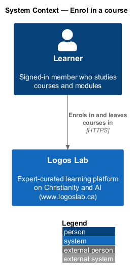
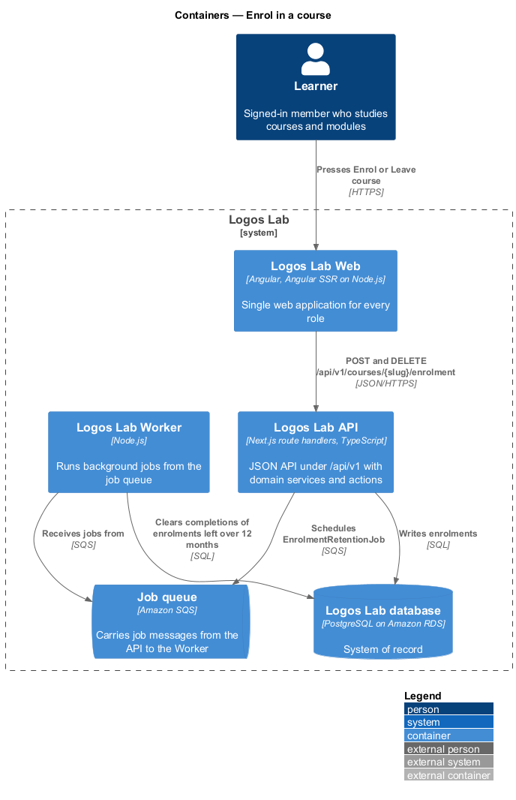
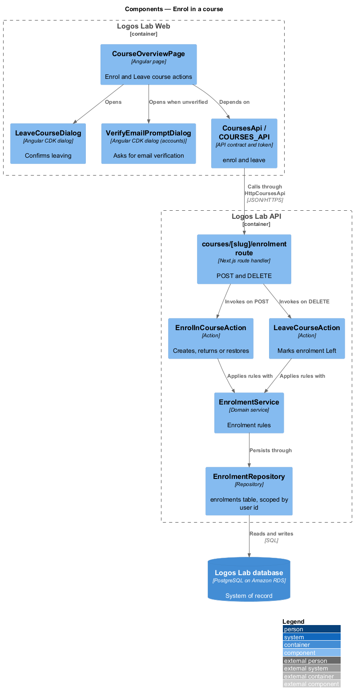
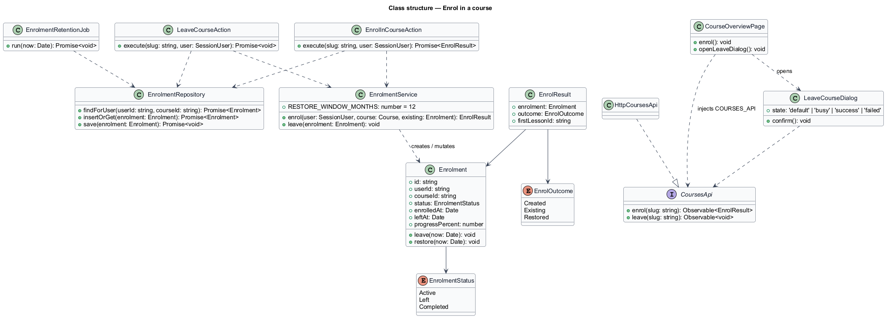
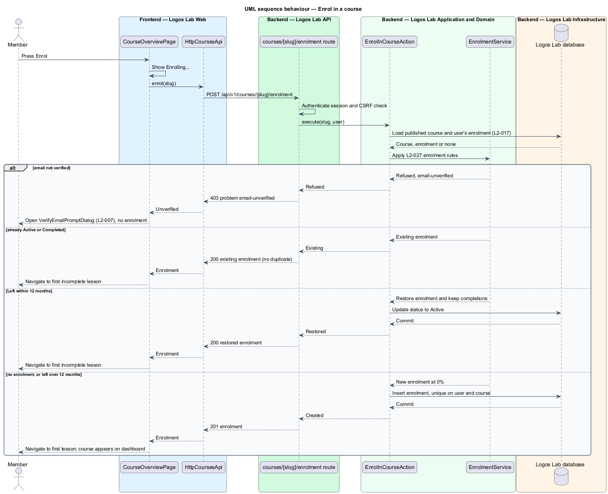
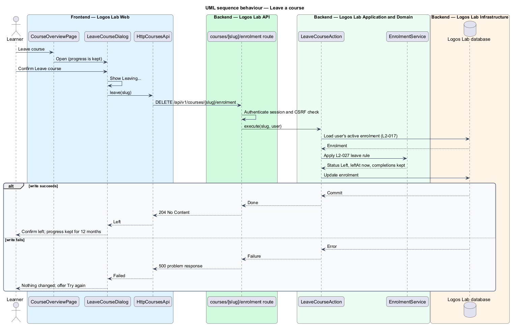

# Enrol in a course

## Overview

An **enrolment** — record that a member has joined a course as a learner — is what turns a
course overview into a course in progress. Enrolment opens the course's lessons to the member, adds
the course to the learner dashboard and starts progress tracking.

Only a **verified member** — signed-in member whose email address is confirmed (`L2-007`) — may
enrol. A learner may also leave a course. Leaving removes the course from the in-progress list but
keeps the learner's progress, so re-enrolling within 12 months restores it.

The feature sits between the course overview (`view-course-overview`) and the lesson player
(`play-lesson`) in the courses subsystem.

## Description

**Frontend (Logos Lab Web)**

- **`CourseOverviewPage`** — hosts the "Enrol" and "Leave course" actions. While the request runs the
  button reads "Enrolling…" (`docs/mocks/pages/course-overview/submitting.html`). On success the page
  navigates to the first lesson.
- **`LeaveCourseDialog`** — confirmation dialog opened with the Angular CDK `Dialog` service. States
  in `docs/mocks/dialogs/leave-course/`: `default` (says progress is kept), `busy` ("Leaving…"),
  `success` (progress kept for 12 months) and `failed` (nothing changed, try again).
- **`VerifyEmailPromptDialog`** — owned by the accounts subsystem (`L2-007`); opened when an
  unverified member presses "Enrol" (`docs/mocks/dialogs/verify-email-prompt/`).
- **Components used** — `ll-button` (busy state), `ll-dialog`, `ll-inline-message`, `ll-toast`.
- **`CoursesApi`** — adds `enrol(slug)` and `leave(slug)`.

**API (Logos Lab API)**

- **`POST /api/v1/courses/{slug}/enrolment`** — creates or returns the enrolment. Returns `201` with a
  new enrolment, or `200` with the existing one. Returns `403` with problem type `email-unverified`
  for an unverified member. Handled by **`EnrolInCourseAction`**.
- **`DELETE /api/v1/courses/{slug}/enrolment`** — leaves the course. Handled by
  **`LeaveCourseAction`**; returns `204`.
- **`EnrolmentService`** — owns the enrolment rules: verified members only, published courses only,
  one enrolment per member and course, and restoration of a left enrolment.
- **`Enrolment`** entity in table `enrolments` — `id`, `user_id`, `course_id`, `status` (`Active`,
  `Left`, `Completed`), `enrolled_at`, `left_at`, `progress_percent`. A unique index on
  (`user_id`, `course_id`) prevents duplicates under concurrent requests.
- **`EnrolmentRetentionJob`** — Worker job that clears the lesson completions of enrolments left more
  than 12 months ago, so a later enrolment starts fresh. The run schedule is `<TO SUPPLY>`.

**Key rules**

- A verified member pressing "Enrol" on a published course gets an enrolment, lands on the first
  lesson, and sees the course on the dashboard.
- A repeated enrolment request creates no duplicate; the API returns the existing enrolment.
- An unverified member is prompted to verify the email address and no enrolment is created.
- Leaving needs confirmation in a dialog. The course leaves the in-progress list; lesson completions
  are kept.
- Re-enrolling within 12 months of leaving reactivates the same enrolment and its progress. After 12
  months, a new enrolment starts at 0%.
- Whether a learner may leave a completed course, and what that does to the certificate, is
  `<TO SUPPLY>`; certificates stay valid in every case (`L2-030`).

## Requirements

| L2 ID | Refines (L1) | Requirement |
|-------|--------------|-------------|
| `L2-027` | `L1-005` | **Enrolment.** Verified members shall be able to enrol in and leave courses. |

## Diagrams

### System context

Learners enrol in and leave courses in Logos Lab; no external system takes part.

### Containers

The API writes enrolments to the database; the Worker runs the 12-month retention job from the job
queue.

### Components

`EnrolInCourseAction` and `LeaveCourseAction` share `EnrolmentService`, which applies the
verification and restoration rules.

### Class structure

`Enrolment` holds its status and timestamps; `EnrolmentService` decides between a new, existing or
restored enrolment.

### Behaviour — enrol

The action is idempotent: an existing enrolment is returned, a left one inside 12 months is
restored, and an unverified member is sent to the verification prompt.

### Behaviour — leave a course

Leaving is confirmed in `LeaveCourseDialog` and marks the enrolment `Left` without deleting
completions.

