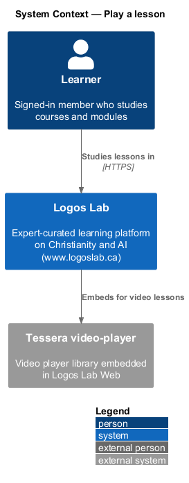
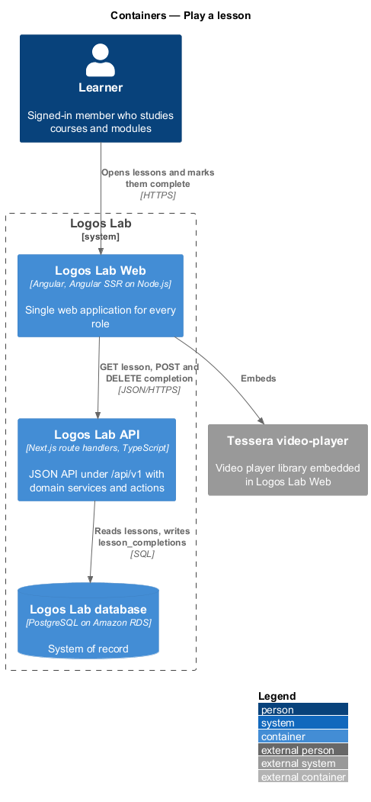
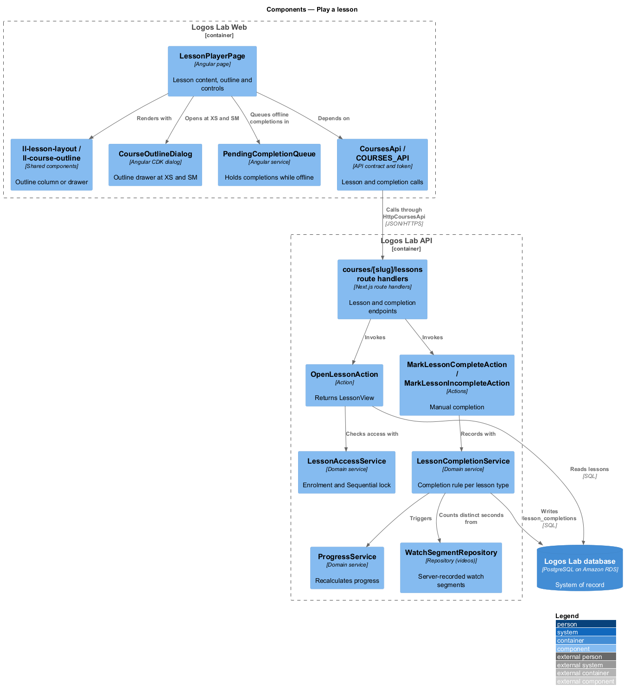
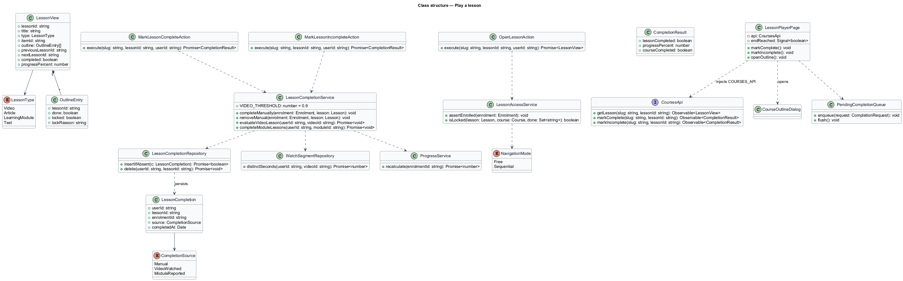
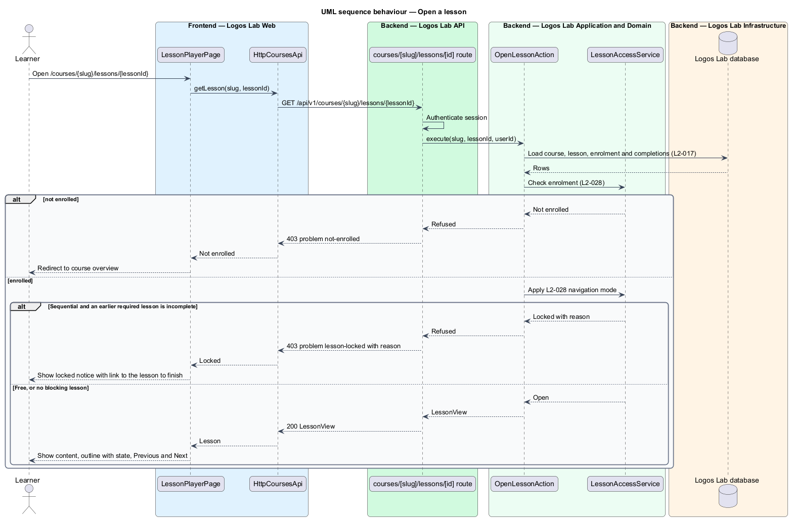
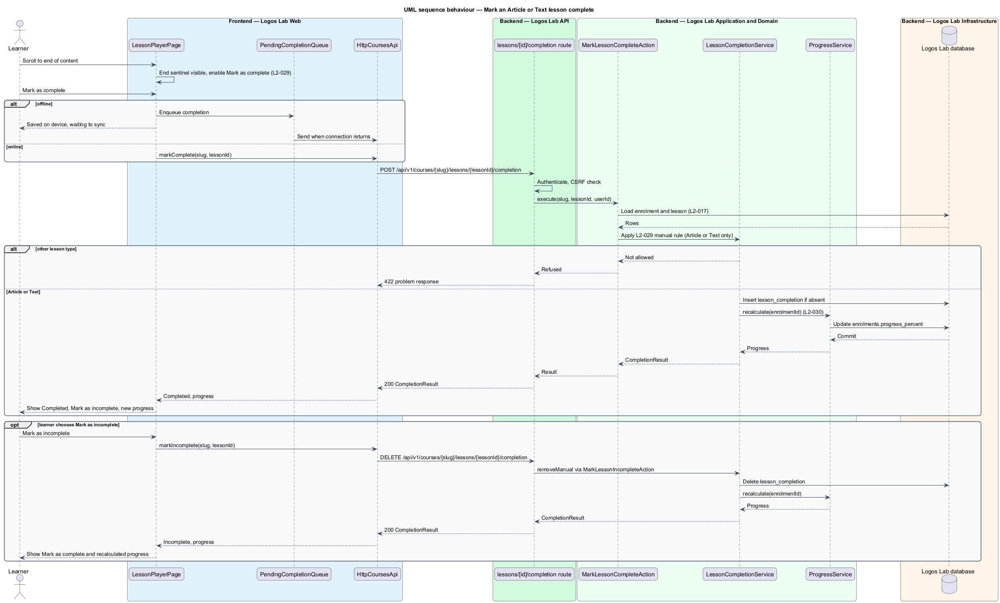
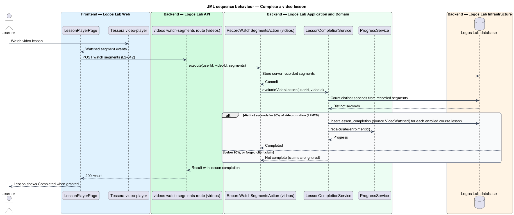

# Play a lesson

## Overview

The **lesson player** — page where an enrolled learner studies one lesson with the course outline
beside it — is where most course time is spent. It shows the lesson content, the outline with the
completion state of each lesson, and "Previous" and "Next" controls.

Each course has a **navigation mode** — course setting that decides whether lessons open in any
order. In **Free** mode (the default) every lesson opens. In **Sequential** mode a lesson that comes
after an incomplete required lesson is **locked** — shown, but refused with a reason until the
earlier lesson is complete.

Each lesson type has a **completion rule** — server-side condition that marks a lesson complete for a
learner. Video lessons complete at 90% of distinct seconds watched, Article and Text lessons complete
when the learner presses "Mark as complete", and Learning module lessons complete when the module
reports `completed` or `passed`. The server records every completion; the client never decides one
on its own.

The feature sits between enrolment (`enrol-in-course`) and progress (`track-course-progress`) in the
courses subsystem. Module lessons embed the player from `learning-modules/launch-learning-module`.

## Description

**Frontend (Logos Lab Web)**

- **`LessonPlayerPage`** — routed page for `/courses/:slug/lessons/:lessonId` (baseline choice). It
  renders the lesson by type: video through `ll-player` around the Tessera video-player, Article and
  Text through `ll-prose`, and Learning module through the Tessera scorm-player host from
  `launch-learning-module`.
- **`CourseOutlineDialog`** — drawer opened by the "Outline" button at XS and SM, built on `ll-drawer`
  and the Angular CDK `Dialog` service. States in `docs/mocks/dialogs/course-outline/`: `default`,
  `locked` (explains when a locked lesson opens) and `scroll`.
- **Components used** — `ll-lesson-layout` (outline column plus content; at XS and SM the outline
  collapses and content takes the full width), `ll-course-outline`, `ll-progress-bar`, `ll-player`,
  `ll-prose`, `ll-button`, `ll-badge`, `ll-notice-panel` (locked and archived notices),
  `ll-skeleton`, `ll-error-page`, and the offline notice from `docs/mocks/notifications/offline-notice/`.
- **Screen states** — `docs/mocks/pages/lesson-player/` covers `default` (Text lesson),
  `scroll-to-complete` ("Mark as complete" disabled with "Read to the end to mark this complete"),
  `completed` ("Mark as incomplete"), `article`, `video`, `module`, `locked`, `archived`, `offline`,
  `loading` and `error`.
- **End-of-content sentinel** — an `IntersectionObserver` on an element after the last paragraph
  enables "Mark as complete" once the end has been scrolled into view.
- **`PendingCompletionQueue`** — client service that holds a completion request made while offline
  and sends it when the connection returns (`docs/mocks/pages/lesson-player/offline.html`). Whether
  the queue survives a page reload is `<TO SUPPLY>`.
- **`CoursesApi`** — adds `getLesson(slug, lessonId)`, `markComplete(slug, lessonId)` and
  `markIncomplete(slug, lessonId)`.

**API (Logos Lab API)**

- **`GET /api/v1/courses/{slug}/lessons/{lessonId}`** — returns `LessonView` (content reference,
  outline with completion and lock state, previous and next ids, progress). Refuses with `403`
  problem type `lesson-locked` and the reason for a locked Sequential lesson, and with `403` problem
  type `not-enrolled` for a learner without an active enrolment; the page then redirects to the course
  overview. Handled by **`OpenLessonAction`**.
- **`POST /api/v1/courses/{slug}/lessons/{lessonId}/completion`** and **`DELETE`** on the same path —
  "Mark as complete" and "Mark as incomplete" for Article and Text lessons only; other types return
  `422`. Handled by **`MarkLessonCompleteAction`** and **`MarkLessonIncompleteAction`**.
- **`LessonAccessService`** — applies the navigation mode. In Sequential mode a lesson is locked when
  any earlier required lesson is incomplete.
- **`LessonCompletionService`** — applies the completion rule per type and writes
  `lesson_completions` (`user_id`, `lesson_id`, `enrolment_id`, `source`, `completed_at`). It exposes
  `evaluateVideoLesson`, called by the videos subsystem after watch segments are recorded (`L2-042`),
  and `completeModuleLessons`, called by `ModuleAttemptService` (`L2-037`).
- **`WatchSegmentRepository`** — owned by the videos subsystem; returns server-recorded watch segments
  so distinct seconds can be counted.
- After each change, **`ProgressService.recalculate`** updates progress, and
  **`CourseCompletionService`** checks course completion (`track-course-progress`,
  `complete-course-and-earn-certificate`).

**Key rules**

- Video: complete when distinct seconds watched reach at least 90% of the video's duration, counted
  from server-recorded segments, never from playhead position or a client claim.
- Article and Text: complete on "Mark as complete", which is enabled only after the end has been
  scrolled into view. "Mark as incomplete" removes the completion and progress is recalculated.
- Learning module: complete when the module reports `completed` or `passed`; `failed` does not
  complete it.
- Sequential: a locked lesson is shown with its reason, and a direct URL request is refused with `403`.
- Free: any lesson opens regardless of completion state.
- XS and SM: the outline sits behind an "Outline" button that opens it as a drawer.

## Requirements

| L2 ID | Refines (L1) | Requirement |
|-------|--------------|-------------|
| `L2-028` | `L1-005` | **Lesson player and navigation.** Enrolled learners study lessons in a lesson player with course navigation. |
| `L2-029` | `L1-005` | **Lesson completion rules.** Each lesson type has a defined completion rule that the server records. |

## Diagrams

### System context

Learners study lessons in Logos Lab, which embeds the Tessera video-player for video lessons.

### Containers

Logos Lab Web renders the lesson and sends completions to the Logos Lab API, which records them in
the Logos Lab database.

### Components

`LessonPlayerPage` reads lessons and sends completions through `CoursesApi`; the API actions share
`LessonAccessService` and `LessonCompletionService`.

### Class structure

`LessonView` carries the outline and navigation; `LessonCompletionService` holds one rule per
`LessonType` and writes `LessonCompletion` rows.

### Behaviour — open a lesson

The API checks enrolment, then the Sequential lock, before returning the lesson; refusals send the
learner to the overview or to a locked notice.

### Behaviour — mark an Article or Text lesson complete

"Mark as complete" unlocks at the end of the content; the server records the completion and returns
the recalculated progress. "Mark as incomplete" reverses it.

### Behaviour — complete a video lesson

Completion is evaluated on the server from recorded watch segments each time new segments arrive.

