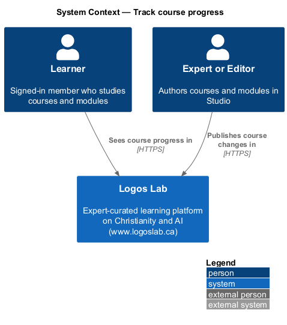
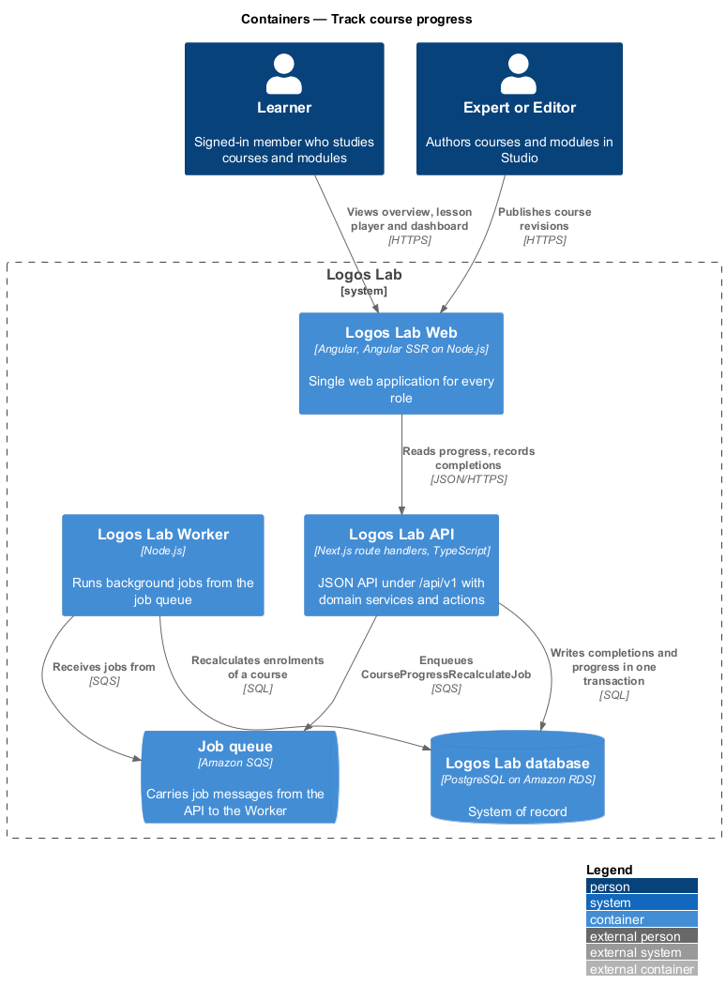
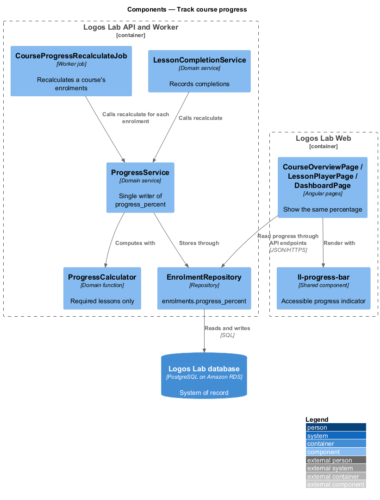
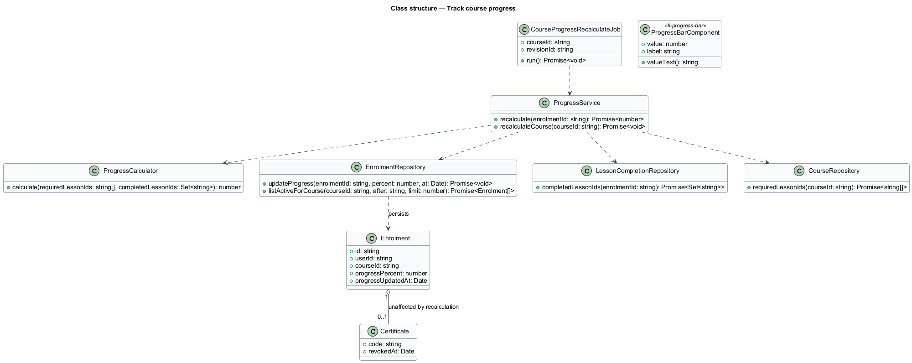
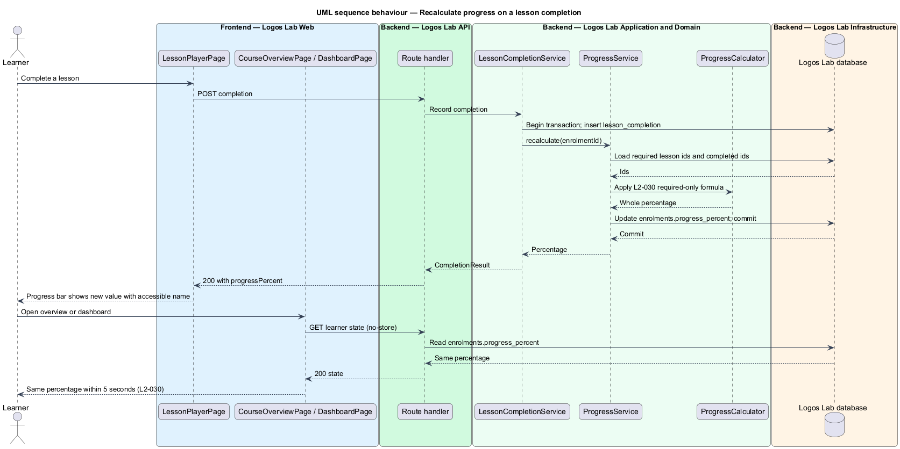
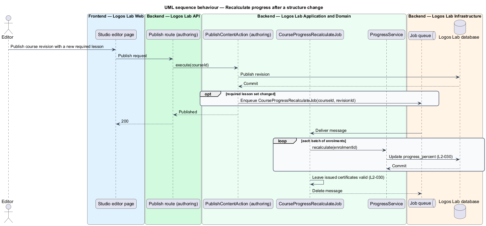

# Track course progress

## Overview

**Course progress** — share of a course's required lessons that a learner has completed, shown as a
whole percentage — tells the learner how far through a course they are. Optional lessons never count
toward it: a course with 10 required and 2 optional lessons shows 40% when 4 required and 2 optional
lessons are complete.

Progress appears in three places: the course overview, the lesson player and the learner dashboard.
All three show the same number within 5 seconds of a change. Progress is recalculated when the
learner completes or un-completes a lesson, and when an author changes the required lessons of a
published course. A certificate already issued stays valid when progress later drops below 100%.

The feature is a shared calculation within the courses subsystem. `play-lesson` and
`record-scorm-runtime-data` produce completions; `view-course-overview`, `play-lesson` and the
dashboard (`L2-069`) read the result.

## Description

**Frontend (Logos Lab Web)**

- **`ll-progress-bar`** — shared component with `role="progressbar"`, `aria-valuenow`,
  `aria-valuemin`, `aria-valuemax` and `aria-valuetext` in the form "Course progress: 40%". The
  percentage is also printed as text beside the bar, so colour is never the only signal.
- **`CourseOverviewPage`**, **`LessonPlayerPage`** and **`DashboardPage`** (dashboard subsystem) —
  each reads the stored percentage from the API. The lesson player also applies the percentage
  returned by each completion response at once.
- **Screen states** — `docs/mocks/pages/course-overview/enrolled.html` (42%, 10 of 24),
  `docs/mocks/pages/lesson-player/completed.html` (46%), `docs/mocks/pages/dashboard/default.html` and
  `docs/mocks/pages/certificate/default.html`.

**API (Logos Lab API)**

- **`ProgressService.recalculate(enrolmentId)`** — counts completed required lessons over all
  required lessons of the current published course revision and stores the whole percentage in
  `enrolments.progress_percent` with `progress_updated_at`. It runs in the same transaction as the
  completion change.
- **`ProgressCalculator`** — pure function behind the service. Rounding is to the nearest whole
  percent, matching the mocks (10 of 24 shows 42%). The value for a course with no required lessons
  is `<TO SUPPLY>`.
- **`CourseProgressRecalculateJob`** — Worker job enqueued when a new revision of a published course
  is published with a changed set of required lessons. It recalculates every enrolment of the course
  in batches; the batch size is `<TO SUPPLY>`. It never touches certificates.
- **Read paths** — `GET /api/v1/courses/{slug}/me`, `GET /api/v1/courses/{slug}/lessons/{lessonId}`
  and the dashboard endpoint all read `enrolments.progress_percent`. These responses carry
  `Cache-Control: no-store` and no tier caches them (`L2-113`), so all three agree as soon as the
  transaction commits, inside the 5-second limit.

**Key rules**

- Progress equals completed required lessons divided by all required lessons, as a percentage.
- The overview, lesson player and dashboard show the same percentage within 5 seconds of a change.
- The progress indicator has an accessible name and does not rely on colour alone.
- When an author adds a required lesson to a published course, progress is recalculated; a
  certificate already issued stays valid.

## Requirements

| L2 ID | Refines (L1) | Requirement |
|-------|--------------|-------------|
| `L2-030` | `L1-005` | **Course progress.** The learner's progress in a course shall be calculated from required lessons and shown consistently everywhere. |

## Diagrams

### System context

Learners see their progress in Logos Lab, and authors change courses that progress depends on; no
external system takes part.

### Containers

The API recalculates progress inside the completion transaction; the Worker recalculates a whole
course after a structure change.

### Components

`ProgressService` is the single writer of `progress_percent`; three pages read it through their API
contracts.

### Class structure

`ProgressCalculator` counts required lessons only; `Enrolment` stores the result with its update
time.

### Behaviour — recalculate on a lesson completion

A completion and its progress update commit together, so every later read returns the new
percentage.

### Behaviour — recalculate after a structure change

Publishing a revision with different required lessons enqueues a job that recalculates every
enrolment and leaves certificates unchanged.

