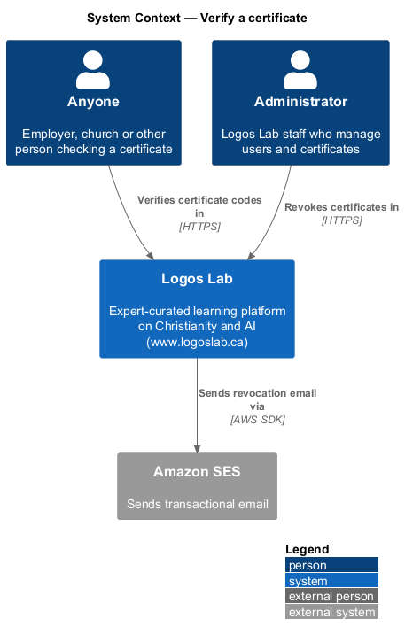
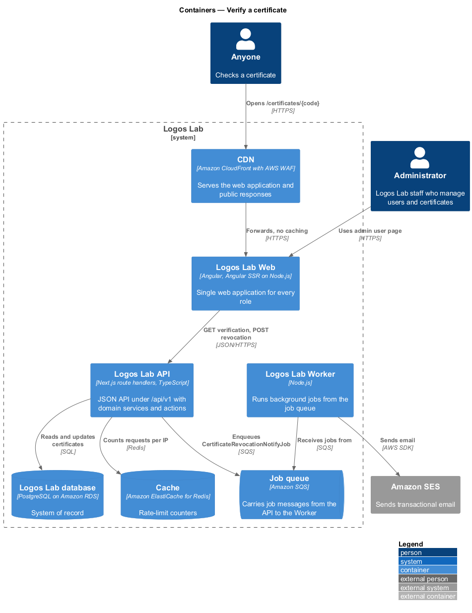
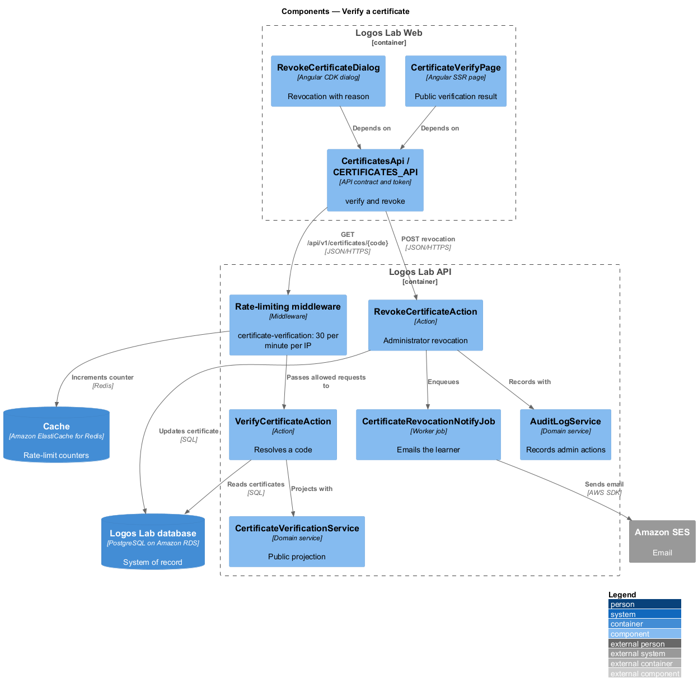
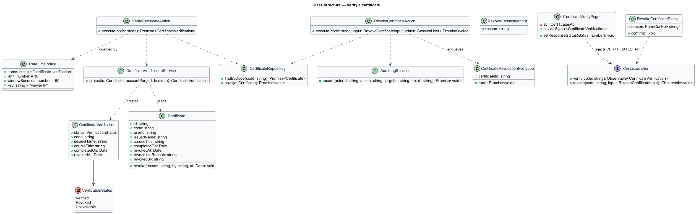
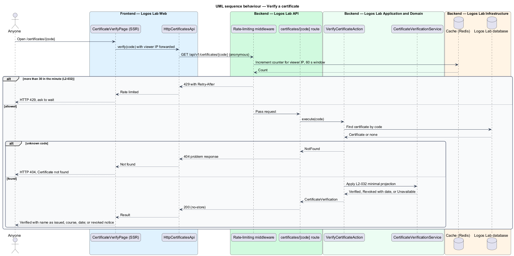
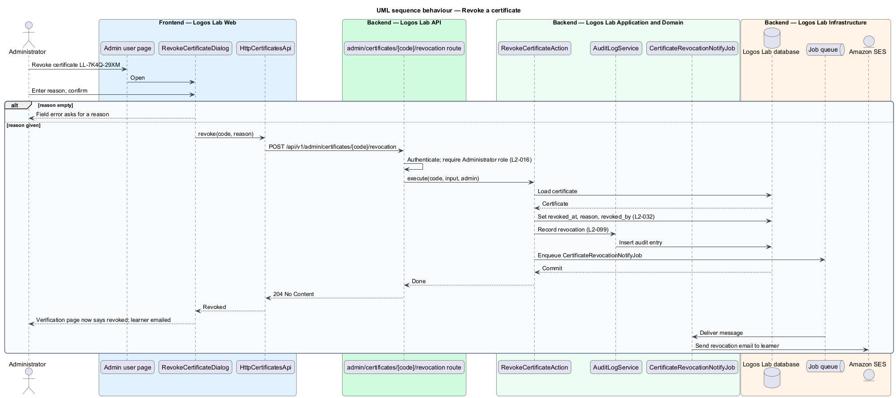

# Verify a certificate

## Overview

**Certificate verification** — public check that a certificate code belongs to a real, unrevoked
certificate issued by Logos Lab — lets an employer, a church or anyone else confirm a learner's
course completion without signing in. The verification page lives at `/certificates/{code}`, the URL
printed on every certificate and shared by learners.

The page discloses the minimum: "Verified", the learner's name as issued, the course title and the
completion date, and nothing else about the learner. An unknown code shows "Certificate not found".
A **revoked certificate** — certificate an Administrator has withdrawn, for example for academic
misconduct — shows "This certificate has been revoked" with the revocation date.

To stop **code enumeration** — guessing codes in bulk to discover certificates — the endpoint refuses
more than 30 requests a minute from one IP address. The feature closes the courses subsystem; the
certificate itself is issued by `complete-course-and-earn-certificate`.

## Description

**Frontend (Logos Lab Web)**

- **`CertificateVerifyPage`** — anonymous routed page for `/certificates/:code`, server-rendered by
  Angular SSR. The SSR response carries the API's status (`404` for an unknown code, `429` when rate
  limited) so crawlers and tools see the real outcome.
- **`RevokeCertificateDialog`** — Administrator dialog opened from the admin user page
  (`docs/mocks/pages/admin-user/`). It requires a reason. States in
  `docs/mocks/dialogs/revoke-certificate/`: `default`, `invalid` (no reason), `busy` and `success`.
- **Components used** — `ll-alert` (verified, revoked, not found), `ll-certificate` (stamped when
  revoked), `ll-page-header`, `ll-text-field` (check another code), `ll-button`, `ll-dialog`,
  `ll-textarea`, `ll-error-page`.
- **Screen states** — `docs/mocks/pages/certificate-verify/` covers `default`, `not-found`, `revoked`,
  `rate-limited`, `unavailable` (the learner deleted the account and it was purged, `L2-117`) and
  `error`.
- **`CertificatesApi`** — adds `verify(code)` and `revoke(code, reason)`.

**API (Logos Lab API)**

- **`GET /api/v1/certificates/{code}`** — anonymous endpoint. Returns `CertificateVerification`
  (`status` of `Verified`, `Revoked` or `Unavailable`; `issuedName`; `courseTitle`; `completedOn`;
  `revokedAt`) or `404`. Sent with `Cache-Control: no-store`, so the CDN never caches it and every
  request reaches the rate limiter. Handled by **`VerifyCertificateAction`**.
- **Rate-limiting middleware** — policy `certificate-verification`: 30 requests per minute per client
  IP, counted in the Redis cache; request 31 within the minute gets `429` with `Retry-After`. The key
  is the viewer IP from the CloudFront viewer-address header, which the SSR server forwards. The
  window algorithm (fixed or sliding) is `<TO SUPPLY>`.
- **`CertificateVerificationService`** — maps a certificate to the public projection and withholds
  every other learner field.
- **`POST /api/v1/admin/certificates/{code}/revocation`** — Administrator only (`L2-016`). Handled by
  **`RevokeCertificateAction`**, which sets `revoked_at`, `revocation_reason` and `revoked_by`, writes
  an audit entry through **`AuditLogService`** (`L2-099`), and enqueues
  **`CertificateRevocationNotifyJob`**, which emails the learner through Amazon SES.
- **Entity `Certificate`** — table `certificates`, as in `complete-course-and-earn-certificate`.

**Key rules**

- A valid code shows "Verified", the name as issued, the course title and the completion date, and
  nothing else about the learner.
- An unknown code shows "Certificate not found" and returns HTTP `404`.
- A revoked code shows "This certificate has been revoked" with the revocation date.
- More than 30 verification requests from one IP address in a minute are refused with `429`.
- Whether the verification page is excluded from search indexing is `<TO SUPPLY>`.

## Requirements

| L2 ID | Refines (L1) | Requirement |
|-------|--------------|-------------|
| `L2-032` | `L1-005` | **Certificate verification.** Anyone shall be able to verify a certificate at `/certificates/{code}` without signing in. |

## Diagrams

### System context

Anyone verifies certificates in Logos Lab without an account; Administrators revoke certificates,
and Amazon SES tells the learner.

### Containers

The CDN passes every verification through to the server-rendered page and the API, which counts
requests per IP in the cache.

### Components

The rate-limiting middleware runs before `VerifyCertificateAction`; revocation goes through its own
action, the audit log and a notification job.

### Class structure

`CertificateVerification` is the public projection of `Certificate` and holds only the four permitted
facts plus revocation.

### Behaviour — verify a code

The limiter refuses the 31st request in a minute; otherwise the code resolves to verified, revoked,
unavailable or not found.

### Behaviour — revoke a certificate

An Administrator revokes with a required reason; the change is audited and the learner is emailed.

