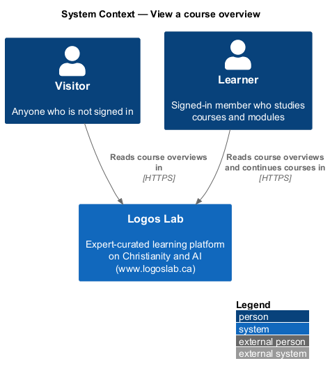
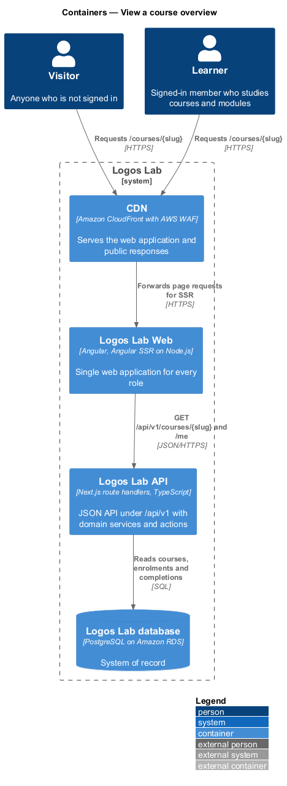
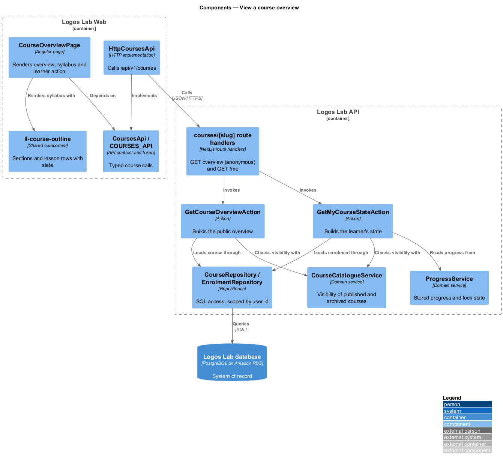
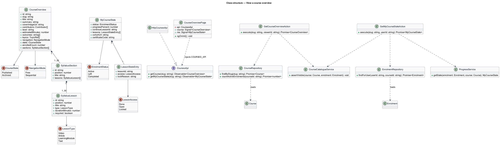
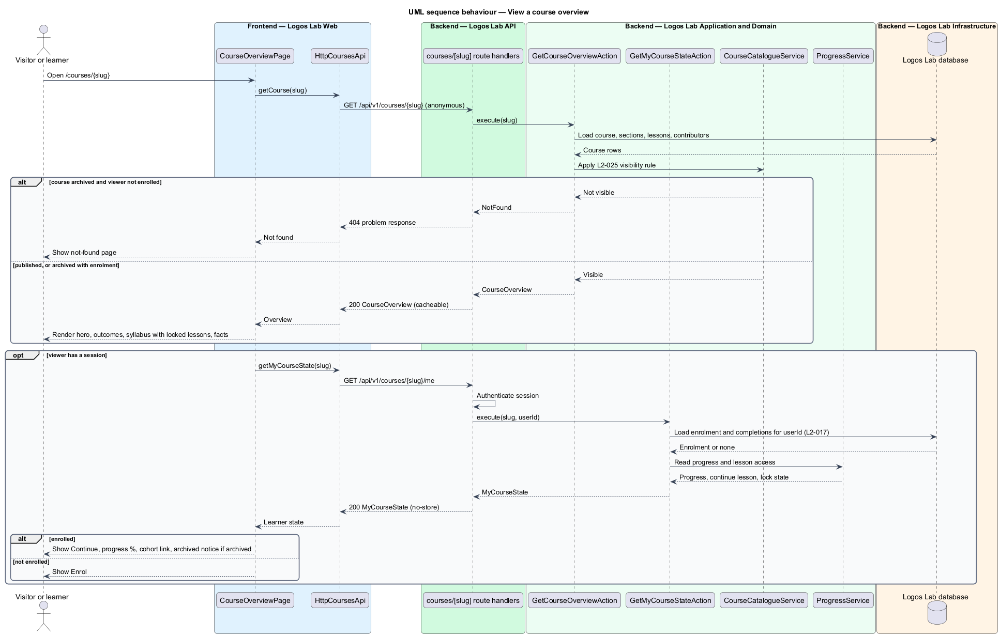

# View a course overview

## Overview

Logos Lab publishes structured courses written by invited experts or by Logos Lab itself. The
**course overview page** — public page at `/courses/{slug}` that describes one published course and
offers the learner's next action — is the entry point to every course. It is the page that search
results, catalogue cards, expert profiles and shared links open.

The page serves three kinds of viewer. A **visitor** — person who is not signed in — and a
**non-enrolled member** — signed-in member without an active enrolment in the course — see the full
description and syllabus, with every lesson title visible but no lesson openable. An **enrolled
learner** — member with an active enrolment in the course — sees a "Continue" action and a progress
percentage. When the learner belongs to an active **cohort** — group of learners who take a course
together in a shared space (`L2-064`) — the page links to the cohort space.

The overview sits at the front of the courses subsystem. Enrolment, the lesson player, progress and
certificates are separate features that this page links to.

## Description

The slice runs from a server-rendered page in Logos Lab Web to the course tables in the Logos Lab
database.

**Frontend (Logos Lab Web)**

- **`CourseOverviewPage`** — routed standalone page for `/courses/:slug`. Angular SSR renders it for
  visitors and crawlers (`L2-142`); after hydration it requests the viewer's own state. The page
  depends on the `CoursesApi` contract, never on the HTTP implementation.
- **Components used** — `ll-breadcrumb`, `ll-hero` (compact variant with title, summary, contributor
  eyebrow, cover and actions), `ll-progress-bar`, `ll-button`, `ll-course-outline` (sections as
  disclosures; lessons as done, current or locked rows with type and duration), `ll-description-list`
  (lessons, length, level, order, enrolled learners), `ll-chip` (topics), `ll-person-list`
  ("Taught by"), `ll-notice-panel` (archived notice), `ll-content-card` (related content, `L2-047`),
  `ll-skeleton` and `ll-error-page`.
- **Screen states** — `docs/mocks/pages/course-overview/` covers `default` (signed-in, not enrolled,
  with "Enrol"), `visitor` ("Sign in to enrol"), `submitting`, `enrolled` ("Continue" and progress),
  `completed` ("View your certificate"), `cohort`, `archived`, `loading`, `error` and `long`.
- **`CoursesApi`** / **`COURSES_API`** / **`HttpCoursesApi`** — API contract, injection token and HTTP
  implementation in `projects/api`. Methods: `getCourse(slug)` and `getMyCourseState(slug)`.

**API (Logos Lab API)**

- **`GET /api/v1/courses/{slug}`** — anonymous endpoint. Returns `CourseOverview`: title, summary,
  cover image, contributors (one or more experts, or Logos Lab), level, estimated total duration,
  3-8 learning outcomes, topics, navigation mode, the syllabus of sections and lessons with each
  lesson's type and duration, and the enrolled-learner count. The response holds no personal data,
  so the CDN may cache it (`L2-113`).
- **`GET /api/v1/courses/{slug}/me`** — authenticated endpoint. Returns `MyCourseState`: enrolment
  status, progress percentage, per-lesson completion and lock state, the first incomplete lesson for
  "Continue", the cohort link when one applies, and the certificate code when one is issued. Sent
  with `Cache-Control: no-store`.
- **`GetCourseOverviewAction`** and **`GetMyCourseStateAction`** — the two use cases behind the
  endpoints.
- **`CourseCatalogueService`** — decides visibility. A published course is visible to all. An
  archived course is visible only to learners enrolled in it; every other viewer receives `404`.
- **`ProgressService`** — supplies the stored progress percentage and lesson lock state (see
  `track-course-progress` and `play-lesson`).
- **`CourseRepository`**, **`EnrolmentRepository`**, **`LessonCompletionRepository`** — read the
  `courses`, `course_sections`, `course_lessons`, `course_contributors`, `enrolments` and
  `lesson_completions` tables. Queries for user-owned rows take the current user's id (`L2-017`).

**Key rules**

- Visitors and non-enrolled members see lesson titles, types and durations; lesson links are not
  rendered and the lesson endpoint refuses them (`play-lesson`).
- For an enrolled learner the primary action is "Continue", which opens the first incomplete lesson,
  and the progress indicator shows the percentage with the accessible name required by `L2-030`.
- An archived course shows enrolled learners a notice that it is no longer maintained and can still
  be finished. Non-enrolled users receive `404`.
- The enrolled-learner count counts active enrolments. Whether the count is cached, and for how long,
  is `<TO SUPPLY>`.

## Requirements

| L2 ID | Refines (L1) | Requirement |
|-------|--------------|-------------|
| `L2-025` | `L1-005` | **Course overview page.** Each course has a public overview page at `/courses/{slug}`. |

## Diagrams

### System context

Visitors and learners read course overviews in Logos Lab; no external system takes part in this
slice.

### Containers

The CDN serves the server-rendered page and the cacheable public course response; the personal
learner state goes straight to the API and is never cached.

### Components

`CourseOverviewPage` calls the two `CoursesApi` methods; inside the API, two actions share the
catalogue visibility rule and read progress from `ProgressService`.

### Class structure

`CourseOverview` composes sections and lessons; `MyCourseState` carries only the viewer's own
enrolment, progress and links.

### Behaviour — view a course overview

The page loads the public overview first, then the learner state when a session exists; an archived
course returns `404` to anyone not enrolled.

